# Capstone Project Report

## Report 3 – Software Requirement Specification

**Project:** HistoryTalk – A SaaS Historical Education Platform Powered by Conversational AI and RAG
**Vietnamese title:** HistoryTalk – Nền tảng SaaS giáo dục lịch sử ứng dụng AI hội thoại và RAG
**Subject:** SWP490 / SEP490 – Capstone Project
**Document version:** 2.0

– Ho Chi Minh City, October 2026 –

---

## Table of Contents

- [Record of Changes](#record-of-changes)
- [I. Project Report](#i-project-report)
  - [1. Status Report](#1-status-report)
  - [2. Team Involvements](#2-team-involvements)
  - [3. Issues/Suggestions](#3-issuessuggestions)
- [II. Software Requirement Specification](#ii-software-requirement-specification)
  - [1. Overall Description](#1-overall-description)
    - [1.1 Product Overview](#11-product-overview)
    - [1.2 Business Rules](#12-business-rules)
  - [2. User Requirements](#2-user-requirements)
    - [2.1 System Actors](#21-system-actors)
    - [2.2 Use Cases](#22-use-cases)
      - [2.2.1 Diagram(s)](#221-diagrams)
      - [2.2.2 Descriptions](#222-descriptions)
  - [3. Functional Requirements](#3-functional-requirements)
    - [3.1 System Functional Overview](#31-system-functional-overview)
      - [3.1.1 Screens Flow](#311-screens-flow)
      - [3.1.2 Screen Descriptions](#312-screen-descriptions)
      - [3.1.3 Screen Authorization](#313-screen-authorization)
      - [3.1.4 Non-Screen Functions](#314-non-screen-functions)
      - [3.1.5 Entity Relationship Diagram](#315-entity-relationship-diagram)
    - [3.2 Authentication & Account](#32-authentication--account)
    - [3.3 Historical Learning Content](#33-historical-learning-content)
    - [3.4 AI Character Chat](#34-ai-character-chat)
    - [3.5 Quiz](#35-quiz)
    - [3.6 Gamification](#36-gamification)
    - [3.7 Student Classroom & Assignments](#37-student-classroom--assignments)
    - [3.8 Subscription & Payment](#38-subscription--payment)
    - [3.9 Teacher Functions](#39-teacher-functions)
    - [3.10 School Admin Functions](#310-school-admin-functions)
    - [3.11 Content Admin Functions](#311-content-admin-functions)
    - [3.12 System Admin Functions](#312-system-admin-functions)
  - [4. Non-Functional Requirements](#4-non-functional-requirements)
    - [4.1 External Interfaces](#41-external-interfaces)
    - [4.2 Quality Attributes](#42-quality-attributes)
  - [5. Requirement Appendix](#5-requirement-appendix)
    - [5.1 Business Rules](#51-business-rules)
    - [5.2 Common Requirements](#52-common-requirements)
    - [5.3 Application Messages List](#53-application-messages-list)
    - [5.4 Other Requirements](#54-other-requirements)

---

# Record of Changes

| Date | A\* M, D | In charge | Change Description |
| :---- | :---: | :---- | :---- |
| 06/03/2026 | A | Nguyễn Minh Trí | Initial system architecture, SRS template setup and core use case definition. |
| 18/05/2026 | M | Võ Đồng Đức Khải | Refactored monolith into decoupled architecture (Spring Boot core + FastAPI AI service). |
| 25/05/2026 | A | Đỗ Quốc Bảo | Added PayOS VietQR payment flow and subscription tier definitions. |
| 05/06/2026 | M | Đỗ Quốc Bảo | Added payment expiry and fulfillment reconciliation jobs and webhook verification. |
| 23/07/2026 | A | Võ Đồng Đức Khải | Added document upload, PDF text extraction / OCR and vectorization requirements. |
| 23/09/2026 | M | Võ Đồng Đức Khải | Updated session security: JWT access token + refresh token. |
| 14/10/2026 | A | Trần Quốc Dinh | Added B2B school module (student import, class rosters, teacher assignment). |
| 16/10/2026 | A | Nguyễn Minh Trí | Added local content and assignment workflow. |
| 20/10/2026 | M | Đỗ Quốc Bảo | Version 2.0: merged the two Review 1 drafts into the FPT SRS template (title page, TOC and body sections); aligned all rules, statuses, limits, jobs and entities with the implemented code base; added school lifecycle, token ticket, gamification and question-bank functions; unified use case (UC-01 – UC-49), screen (S-01 – S-59), business rule and message numbering. |

\*A – Added, M – Modified, D – Deleted

---

# I. Project Report

## 1. Status Report

**Current phase:** Iteration 1 / Review 1 deliverable.

**Milestone progress:**

* Architecture finalized: Java Spring Boot 3.2 (Java 21) core backend, Python FastAPI AI service, web frontend.
* PostgreSQL schema on Supabase with pgvector for embeddings, versioned by Flyway migrations.
* Implemented and under integration testing: email/password and Google sign-in, password reset, B2C token economy and PayOS VietQR subscription, AI character chat with SSE streaming and RAG, quiz and question bank (multiple-choice, fill-in-blank, matching), interactive historical map, school tenant lifecycle, classroom management, student CSV import, teacher assignments, local content, token request tickets, gamification (daily check-in and quests), analytics dashboards.
* Mobile application (React Native / Expo) is prototyped but **out of scope** for this release.

**Planned review date:** Week 3 / Review 1.

## 2. Team Involvements

| Student ID | Full Name | Role | Core Responsibilities & Contributions |
| :---- | :---- | :---- | :---- |
| **SE192645** | **Nguyễn Minh Trí** | Leader & AI Engineer & Backend Dev | Project management, sprint planning, RAG pipeline design, AI streaming chat, prompt engineering for historical personas, token logic. |
| **SE196495** | **Trần Quốc Dinh** | Backend Developer & DevOps | School, classroom and user management APIs, assignments, analytics, CI/CD pipeline, containerization (Docker/Caddy). |
| **SE196405** | **Võ Đồng Đức Khải** | Backend Developer & Tester | Multi-tenant schema design, RBAC & Google OAuth2 integration, academic content CRUD APIs, document OCR pipeline (PDFBox / Tess4J), unit & integration testing. |
| **SE196309** | **Nguyễn Công Thành** | Frontend Developer & Tester | Learner web app (AI chat, map, quiz player), teacher & school admin portals, content & system admin dashboards, UI/UX testing. |
| **SE193803** | **Đỗ Quốc Bảo** | Backend Developer & Tester | Quiz & question bank APIs, PayOS checkout, webhook and reconciliation, map APIs, test case design and execution. |

## 3. Issues/Suggestions

* **Issue 1 – AI hallucination:** generic LLMs invent historical facts. *Solution:* two-stage retrieval (pgvector similarity search, then cross-encoder re-ranking) so answers are grounded in curated documents (BR-17).
* **Issue 2 – Username collision across schools:** imported student codes may repeat between schools. *Solution:* usernames are generated with the school code prefix (BR-10).
* **Issue 3 – AI response latency:** waiting for a full answer causes drop-off. *Solution:* answers are streamed with Server-Sent Events (PER-01).
* **Issue 4 – Open items before Review 2:** automatic daily token reset for Customers, assignment deadline job (MISSED status) and quiz time-limit enforcement are specified but not yet implemented (see 5.4, OTH-05).

---

# II. Software Requirement Specification

## 1. Overall Description

### 1.1 Product Overview

HistoryTalk is a Software-as-a-Service platform for Vietnamese history education. It replaces passive memorization with interactive learning: learners talk with AI-simulated historical figures whose answers are grounded in curated documents, explore events on a time-based map, and check their knowledge with quizzes.

The platform serves two business models:

1. **B2C (individual learners):** a Customer registers for free (Free tier) and may buy the Plus or Pro package via PayOS VietQR to receive more AI tokens.
2. **B2B (secondary and high schools):** each school is an isolated tenant with an annual enterprise package (01/09 – 31/05) that provides a shared token pool. The School Admin imports students, manages classes and teachers and sets daily token limits. Teachers create local historical content and assign homework (read a context, chat with a character, or take a quiz) to their classes and track results.

**Context Diagram**

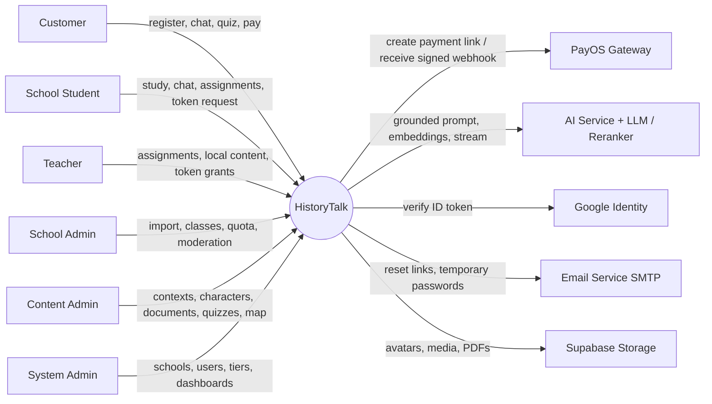

| External Entity | Interaction with HistoryTalk |
| :---- | :---- |
| PayOS Gateway | Creates payment links with VietQR, sends signed payment webhooks, answers order queries. |
| AI Service (FastAPI) + LLM provider (Ollama or OpenAI-compatible API) + re-ranker | Receives grounded prompts, streams answers with token usage; chunks and embeds documents. |
| Google Identity | Verifies Google ID tokens for sign-in. |
| Email Service (SMTP) | Delivers password-reset links and temporary passwords for Google-created accounts. |
| Supabase Storage | Stores avatars, character/context media, map images and uploaded PDFs; files are served by time-limited signed URLs. |

**Scope**

* **In scope (Release 1.0):** web application for all six roles; AI character chat; historical map; quizzes and question bank; gamification; school tenant lifecycle; classroom, student and teacher management; assignments; local content; token tickets; B2C payment via PayOS VietQR; content curation with PDF extraction and OCR.
* **Out of scope:** native mobile app; payments other than PayOS VietQR; online B2B invoicing (school contracts are billed offline and recorded by the System Admin); teacher-to-student messaging; UI languages other than Vietnamese.

**Assumptions & Dependencies**

* PayOS, Google Identity, the LLM provider and Supabase are third-party services; their outage only degrades the related functions (REL-04).
* AI latency targets assume the LLM provider meets its own published latency.
* Each school provides unique student codes in its roster file.

**Definitions & Acronyms**

| Term | Definition |
| :---- | :---- |
| Tenant | A school registered on the platform; its data is isolated from other schools. |
| Learner | A Customer or a School Student. |
| Historical Context | A historical period or event (e.g., "Chiến dịch Điện Biên Phủ 1954") used to group characters, documents, quizzes and map data. |
| Global content | Content curated by Content Admins (no school), visible to everyone when published. |
| Local content | Content created by a Teacher for his/her school (scope CLASS_ONLY or SCHOOL_WIDE). |
| Token | Unit of AI usage; one chat turn costs the total model tokens reported by the AI service (BR-05). |
| School pool | The school's remaining token quota (`unallocatedTokenQuota`), shared by all its students and teachers. |
| Token ticket | A request for extra daily tokens (TokenBoostRequest). |
| RAG | Retrieval-Augmented Generation. |
| SSE | Server-Sent Events, used to stream AI answers. |
| OCR | Optical Character Recognition (Tess4J, Vietnamese language data). |

### 1.2 Business Rules

The numbered rules are defined in section 5.1. Main groups:

* **Tenant, accounts & sessions:** BR-01 – BR-04, BR-10 – BR-12.
* **Token economy:** BR-05 – BR-09.
* **School lifecycle:** BR-13 – BR-15.
* **Content & AI grounding:** BR-16 – BR-19.
* **Quiz, assignments & gamification:** BR-20 – BR-25.
* **Payment & subscription:** BR-26 – BR-30.

---

## 2. User Requirements

### 2.1 System Actors

| # | Actor | Description |
| :---- | :---- | :---- |
| 1 | Customer | Individual (B2C) learner. Registers by email or Google, holds a token balance, chats with characters, explores the map, takes quizzes, buys packages. |
| 2 | School Student | Learner belonging to a school tenant. Logs in with school-issued credentials, does assignments, chats within the daily limit, requests extra tokens. Cannot purchase packages. |
| 3 | Teacher | Instructor of a school, homeroom teacher of one or more classes. Creates local content and assignments for own classes, monitors results, approves student token requests from his/her daily allowance. |
| 4 | School Admin | Administrator of one school. Imports students, manages classes, teachers and students, sets token policy, moderates local content, reviews token tickets, rolls over the academic year. |
| 5 | Content Admin | Platform history specialist. Curates global contexts, characters, documents, quizzes, question bank, map data, daily quests and trash. |
| 6 | System Admin | Platform super-administrator. Provisions schools and School Admins, manages school subscriptions, user accounts and tiers, monitors dashboards. Has all Content Admin rights. |
| 7 | PayOS Gateway | External payment system that processes VietQR transfers and sends payment webhooks. |
| 8 | AI Service | External FastAPI service + LLM + re-ranker that generates grounded answers and document embeddings. |
| 9 | Google Identity | External identity provider used for Google sign-in. |
| 10 | Email Service | External SMTP service that sends system emails. |

"Learner" is used in diagrams as a generalization of Customer and School Student.

### 2.2 Use Cases

#### 2.2.1 Diagram(s)

**Diagram 1 – Account & Learning (Learner)**

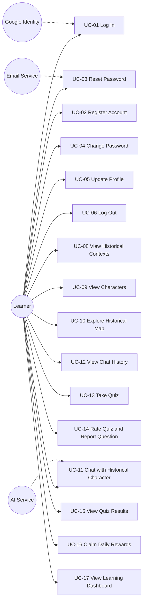

**Diagram 2 – Student, Customer Payment**

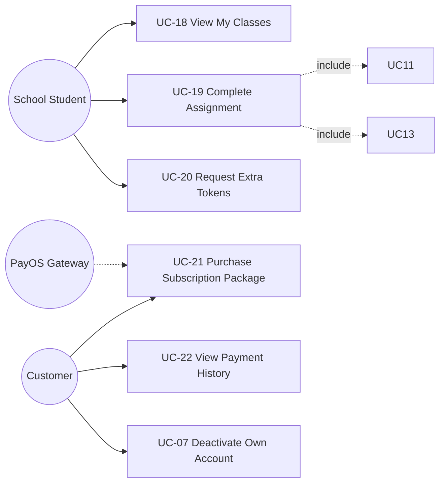

**Diagram 3 – School (B2B)**

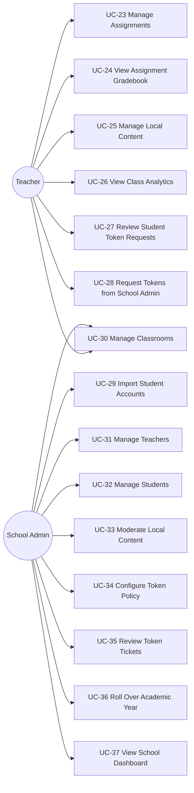

**Diagram 4 – Administration**

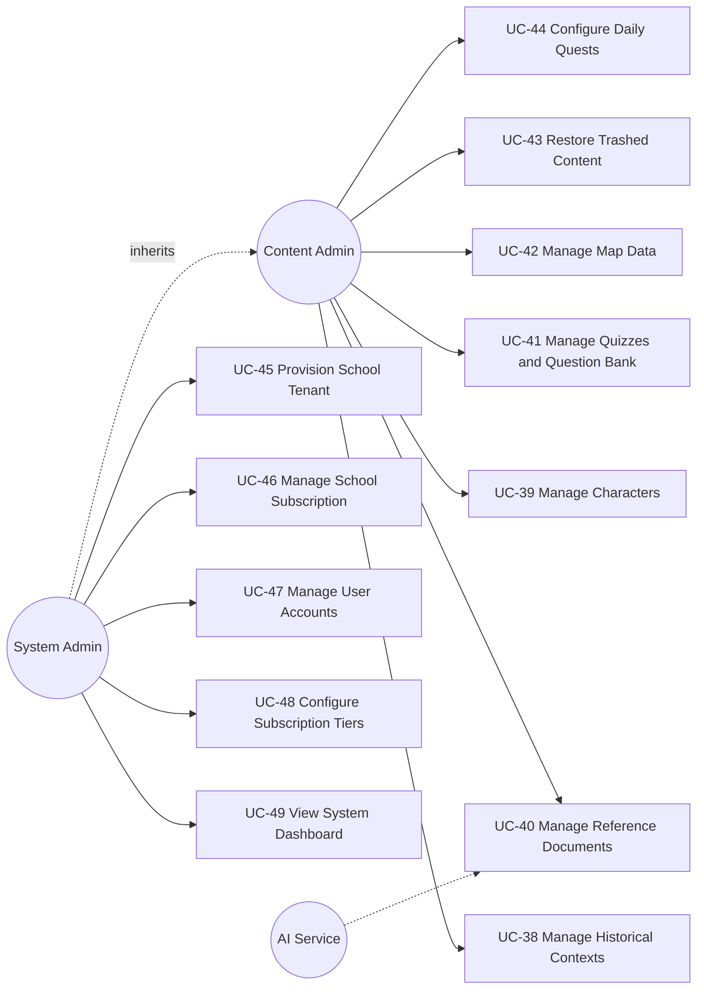

#### 2.2.2 Descriptions

| ID | Use Case | Actors | Use Case Description |
| :---: | :---- | :---- | :---- |
| UC-01 | Log In | All users, Google Identity | User signs in with email + password or with a Google account and is routed to the home screen of his/her role. |
| UC-02 | Register Account | Customer | Visitor creates a Customer account on the Free tier. |
| UC-03 | Reset Password | All users, Email Service | User who forgot the password receives a one-time reset link by email and sets a new password. |
| UC-04 | Change Password | All users | User changes the password; required at first login of issued accounts. |
| UC-05 | Update Profile | All users | User updates full name, date of birth, gender, phone, address and avatar. |
| UC-06 | Log Out | All users | User ends the session; the tokens of the session are revoked. |
| UC-07 | Deactivate Own Account | Customer | User deactivates his/her own account. |
| UC-08 | View Historical Contexts | All users | Browse and search published historical contexts and read their details, media and documents. |
| UC-09 | View Characters | All users | Browse historical characters and read their biography. |
| UC-10 | Explore Historical Map | All users | View map pins and map focuses of a context on an interactive map. |
| UC-11 | Chat with Historical Character | Learner, Teacher, AI Service | Ask questions and receive streamed first-person answers grounded in curated documents; tokens are deducted. |
| UC-12 | View Chat History | Learner, Teacher | Review own chat sessions, continue or delete one. |
| UC-13 | Take Quiz | Learner, Teacher | Start a quiz session, answer questions, submit and get the server-graded result. |
| UC-14 | Rate Quiz and Report Question | Learner | Rate a quiz (1–5) and report a wrong or unclear question. |
| UC-15 | View Quiz Results | Learner | List own quiz sessions and review answers with explanations. |
| UC-16 | Claim Daily Rewards | Learner | Check in daily (streak) and claim token rewards of completed daily quests. |
| UC-17 | View Learning Dashboard | Customer, School Student | See token balance, study days, progress and recent activity. |
| UC-18 | View My Classes | School Student | See the classes he/she is enrolled in. |
| UC-19 | Complete Assignment | School Student | Start an assignment, perform its task (read, chat or quiz) and submit it. |
| UC-20 | Request Extra Tokens | School Student | Send a daily token request to the homeroom teacher. |
| UC-21 | Purchase Subscription Package | Customer, PayOS | Choose Plus or Pro, pay by VietQR; the package and its tokens are granted after the verified webhook. |
| UC-22 | View Payment History | Customer | View own payment orders and their status. |
| UC-23 | Manage Assignments | Teacher | Create, update the deadline of, and cancel assignments for own classes. |
| UC-24 | View Assignment Gradebook | Teacher | View each student's status, score and submission time for an assignment. |
| UC-25 | Manage Local Content | Teacher | Create, edit, publish, trash and restore local contexts, characters, documents and quizzes. |
| UC-26 | View Class Analytics | Teacher | View completion, scores and token usage of one of his/her classes. |
| UC-27 | Review Student Token Requests | Teacher | Approve, reject or escalate students' token requests; grant tokens directly. |
| UC-28 | Request Tokens from School Admin | Teacher | Create a token ticket for him/herself or a student, sent to the School Admin. |
| UC-29 | Import Student Accounts | School Admin | Upload a CSV file to create student accounts in bulk. |
| UC-30 | Manage Classrooms | School Admin, Teacher | Create/update/delete classes, assign the homeroom teacher, add, transfer and remove students. |
| UC-31 | Manage Teachers | School Admin | Create, update, activate/deactivate teachers and reset their passwords. |
| UC-32 | Manage Students | School Admin | View, update, activate/deactivate students, reset passwords, allocate additional tokens. |
| UC-33 | Moderate Local Content | School Admin | Review teachers' local contexts/characters and change their status with a note. |
| UC-34 | Configure Token Policy | School Admin | Set default daily limits for students and teachers and per-class or per-grade limits. |
| UC-35 | Review Token Tickets | School Admin | Approve (from the school pool) or reject token tickets. |
| UC-36 | Roll Over Academic Year | School Admin | Archive the classes of the finished year and deactivate graduated grade-12 students. |
| UC-37 | View School Dashboard | School Admin | Monitor members, classes, pool usage and learning statistics. |
| UC-38 | Manage Historical Contexts | Content Admin | Create, edit, publish/unpublish and trash global contexts with media. |
| UC-39 | Manage Characters | Content Admin | Create, edit, publish and trash characters and link them to contexts. |
| UC-40 | Manage Reference Documents | Content Admin, AI Service | Create text/markdown documents or upload PDFs; extract text (OCR for scans) and index it for AI grounding. |
| UC-41 | Manage Quizzes and Question Bank | Content Admin | Create quizzes and questions, attach/detach bank questions, import CSV, resolve question reports. |
| UC-42 | Manage Map Data | Content Admin | Create, edit and delete map pins and ordered map focuses of a context. |
| UC-43 | Restore Trashed Content | Content Admin | List trashed contexts, characters and quizzes; restore or permanently delete them. |
| UC-44 | Configure Daily Quests | Content Admin | Edit daily quest title, target and reward. |
| UC-45 | Provision School Tenant | System Admin | Create a school with an enterprise package and create its School Admin account(s). |
| UC-46 | Manage School Subscription | System Admin | Register renewal, activate the new academic year, top up the school pool. |
| UC-47 | Manage User Accounts | System Admin | Search users, edit, change role, deactivate/restore, create Content/System Admin accounts. |
| UC-48 | Configure Subscription Tiers | System Admin | Maintain B2C tiers (title, price, months, token amount, active flag). |
| UC-49 | View System Dashboard | System Admin | Monitor users, revenue, payments, tokens, chat activity, content, quizzes and system health. |

---

## 3. Functional Requirements

### 3.1 System Functional Overview

#### 3.1.1 Screens Flow

Rectangles are full screens; rounded shapes `([ ])` are pop-ups; `[Tabs: …]` marks a screen with several information tabs.

**A. Public, Customer and Student screens**

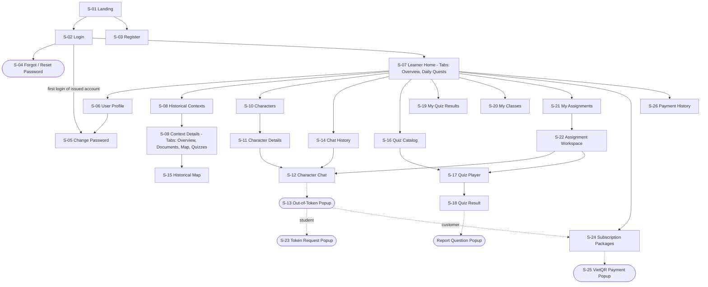

**B. Teacher and School Admin screens**

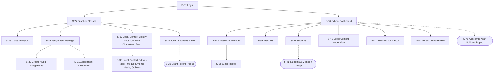

**C. Content Admin and System Admin screens**

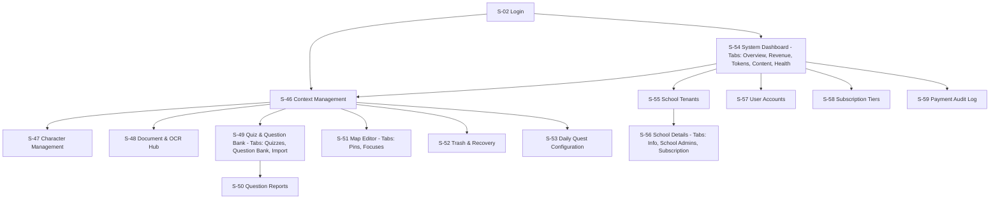

#### 3.1.2 Screen Descriptions

| # | Feature | Screen | Description |
| :---- | :---- | :---- | :---- |
| S-01 | Public | Landing | Product introduction, tier summary, links to Login/Register. |
| S-02 | Authentication | Login | Email + password form, Google sign-in button, forgot-password link. |
| S-03 | Authentication | Register | Customer registration: username, email, password, confirm password. |
| S-04 | Authentication | Forgot / Reset Password (popup) | Step 1: enter email. Step 2 (link from email): new + confirm password. |
| S-05 | Authentication | Change Password | Current / new / confirm password; shown automatically when `mustChangePassword` is true. |
| S-06 | Account | User Profile | View/edit profile and avatar; shows role, school and current tier. |
| S-07 | Learning | Learner Home | Token balance, study days, daily check-in, daily quests, recent chats, active assignments (students). |
| S-08 | Learning | Historical Contexts | Searchable list of published contexts, filter by era and category. |
| S-09 | Learning | Context Details | Description, years, location, image, video, documents, characters, quizzes, map. |
| S-10 | Learning | Characters | List of characters with image, title and life years. |
| S-11 | Learning | Character Details | Biography, personality, related contexts, "Start chat" button. |
| S-12 | AI Chat | Character Chat | Streaming chat, suggested questions, quotes, remaining tokens. |
| S-13 | AI Chat | Out-of-Token Popup | Shown when no tokens remain; offers upgrade (Customer) or token request (Student). |
| S-14 | AI Chat | Chat History | Own sessions with character and last message; open or delete. |
| S-15 | Visualization | Historical Map | Map with pins, battle map/GeoJSON layers and ordered focuses of the selected context. |
| S-16 | Assessment | Quiz Catalog | Published quizzes filtered by level and context. |
| S-17 | Assessment | Quiz Player | Question navigation, answer input per question type, submit. |
| S-18 | Assessment | Quiz Result | Score, correct/wrong questions, explanations, rating and report. |
| S-19 | Assessment | My Quiz Results | List of own quiz sessions with score and date. |
| S-20 | Student | My Classes | Enrolled classes with homeroom teacher and academic year. |
| S-21 | Student | My Assignments | Assignments of own classes with type, deadline and status. |
| S-22 | Student | Assignment Workspace | Task of the assignment (context, chat or quiz), progress, submit button. |
| S-23 | Student | Token Request Popup | Requested tokens and reason, sent to the homeroom teacher. |
| S-24 | Payment | Subscription Packages | Active tiers with price, duration and token amount; "Pay now". |
| S-25 | Payment | VietQR Payment Popup | QR code, amount, transfer content, 15-minute countdown, live status. |
| S-26 | Payment | Payment History | Customer's own orders with status. |
| S-27 | Teacher | Teacher Classes | Classes where the teacher is homeroom teacher. |
| S-28 | Teacher | Class Analytics | Class dashboard: completion, average scores, token usage per student. |
| S-29 | Teacher | Assignment Manager | Assignments of a class with submission counts. |
| S-30 | Teacher | Create / Edit Assignment | Class, type, target, minimum requirement, deadline. |
| S-31 | Teacher | Assignment Gradebook | Per-student status, score, message count / reading time, submission time. |
| S-32 | Teacher | Local Content Library | Teacher's local contexts and characters with status; trash tab. |
| S-33 | Teacher | Local Content Editor | Edit info, scope, documents (incl. PDF), media and quizzes of local content. |
| S-34 | Teacher | Token Requests Inbox | Pending student requests of own classes; approve / reject / escalate. |
| S-35 | Teacher | Grant Tokens Popup | Grant tokens directly to a student of own class. |
| S-36 | School | School Dashboard | Members, classes, pool remaining, subscription dates, usage statistics. |
| S-37 | School | Classroom Manager | Class list by academic year; create, edit, delete; assign homeroom teacher; class daily quota. |
| S-38 | School | Class Roster | Students of a class; add (batch), transfer, remove; CSV import into class. |
| S-39 | School | Teachers | Teacher directory; create, edit, activate/deactivate, reset password, delete. |
| S-40 | School | Students | Student directory; edit, activate/deactivate, reset password, allocate tokens. |
| S-41 | School | Student CSV Import Popup | Template download, file upload, default token, result with generated credentials. |
| S-42 | School | Local Content Moderation | Teachers' local contexts/characters with documents; change status with note. |
| S-43 | School | Token Policy & Pool | Pool total/remaining, default student/teacher daily limits, per-class/per-grade limits. |
| S-44 | School | Token Ticket Review | Tickets escalated to or created for the School Admin; approve / reject. |
| S-45 | School | Academic Year Rollover Popup | Select completed year, option to deactivate graduated grade-12 students. |
| S-46 | Content Admin | Context Management | CRUD, publish, soft-delete of global contexts; media upload. |
| S-47 | Content Admin | Character Management | CRUD, publish, soft-delete of characters; link to contexts; media. |
| S-48 | Content Admin | Document & OCR Hub | Create documents, upload PDF, streaming extraction/OCR progress, save content. |
| S-49 | Content Admin | Quiz & Question Bank | Quizzes, questions (3 types), bank attach/detach, CSV import. |
| S-50 | Content Admin | Question Reports | Learner reports on questions; resolve. |
| S-51 | Content Admin | Map Editor | Pins (coordinates, icon, info) and ordered focuses of a context; map image upload. |
| S-52 | Content Admin | Trash & Recovery | Trashed contexts, characters and quizzes; restore or permanently delete. |
| S-53 | Content Admin | Daily Quest Configuration | Quest title, target and reward tokens. |
| S-54 | System Admin | System Dashboard | Overview, users, revenue, payments, tiers, tokens, chat activity, content, quiz, system health. |
| S-55 | System Admin | School Tenants | School list with package, status and subscription dates; create school. |
| S-56 | System Admin | School Details | School info, School Admin accounts, renewal, activation, top-up. |
| S-57 | System Admin | User Accounts | All users; edit, change role, deactivate/restore (single, batch, all); create admin accounts. |
| S-58 | System Admin | Subscription Tiers | Tier configuration (title, amount, months, token amount, active). |
| S-59 | System Admin | Payment Audit Log | All payment orders with status and fulfillment status. |

#### 3.1.3 Screen Authorization

Legend: **X** = allowed. Roles: SYS = System Admin, CA = Content Admin, SA = School Admin, TEA = Teacher, STU = School Student, CUS = Customer. Requests outside these rights return HTTP 403 (MSG11).

| Screen / Screen Activity | SYS | CA | SA | TEA | STU | CUS |
| :---- | :---: | :---: | :---: | :---: | :---: | :---: |
| S-01 – S-04 Public & authentication | X | X | X | X | X | X |
| S-05 – S-06 Change Password, Profile | X | X | X | X | X | X |
| S-07 Learner Home |  |  |  |  | X | X |
| S-08 – S-11, S-15 Contexts, Characters, Map (view) | X | X | X | X | X | X |
| S-12 – S-14 Character Chat, History | X | X | X\* | X | X | X |
| S-16 – S-19 Quiz, Result, Rating, Report | X | X | X | X | X | X |
| S-20 – S-23 Classes, Assignments, Token Request |  |  |  |  | X |  |
| S-24 – S-26 Subscription, Payment, History |  |  |  |  |  | X |
| S-27 – S-35 Teacher screens |  |  |  | X |  |  |
| S-36 – S-45 School Admin screens |  |  | X |  |  |  |
| S-37, S-38 Classroom / Roster (view, add/transfer/remove students) |  |  | X | X |  |  |
| S-46 – S-53 Content Admin screens | X | X |  |  |  |  |
| S-54 – S-59 System Admin screens | X |  |  |  |  |  |
| Query All Data (all tenants, all users, all payments) | X |  |  |  |  |  |
| Query Own Data (own profile, chats, quiz sessions, orders, requests) | X | X | X | X | X | X |
| Query Managed Data – own school |  |  | X |  |  |  |
| Query Managed Data – own classes only |  |  |  | X |  |  |
| Add / Update / Trash Global Content | X | X |  |  |  |  |
| Add / Update / Trash Local Content (own items) |  |  |  | X |  |  |
| Update Local Content Status (own school) |  |  | X | X\*\* |  |  |
| Add / Update / Cancel Assignments (own classes) |  |  |  | X |  |  |
| Add / Update Students, Teachers, Classes (own school) |  |  | X |  |  |  |
| Update Token Policy, Approve Tickets from School Pool |  |  | X |  |  |  |
| Approve Student Requests from Teacher Allowance |  |  |  | X |  |  |
| Add / Update Schools, School Admins, Tiers, Admin Accounts | X |  |  |  |  |  |
| Update Quiz Sessions / Submitted Assignments (not allowed for any role, BR-23) |  |  |  |  |  |  |
| Delete Data permanently (only trashed content, from S-52 / S-32 Trash) | X | X |  | X |  |  |

\* School Admin may chat (subscription is checked) but no tokens are recorded for this role.
\*\* A teacher may change the status of own items only.

#### 3.1.4 Non-Screen Functions

| # | Feature | System Function | Description |
| :---- | :---- | :---- | :---- |
| 1 | AI Chat | AI Answer Streaming & Token Deduction | Builds the grounded prompt, streams the answer via SSE, saves the messages and deducts tokens (3.4.3). |
| 2 | Token | Daily Allowance Preparation (lazy reset) | On the first chat of a new day, resets a school user's daily used/bonus counters and computes the available tokens (3.4.4). |
| 3 | Payment | Payment Webhook Handler | Receives PayOS webhooks, verifies the signature and completes the order (3.8.3). |
| 4 | Payment | Payment Order Expiry Job | Every 60 s: PENDING orders past `expiredAt` become EXPIRED (3.8.4). |
| 5 | Payment | Subscription Expiry Job | Every 5 min: paid user tiers past `endTime` become inactive (3.8.4). |
| 6 | Payment | Payment Fulfillment Reconciliation Job | Every 60 s: retries fulfillment of PAID orders whose fulfillment is PENDING or FAILED (3.8.4). |
| 7 | Content | Document Extraction & OCR | Extracts text from PDFs with PDFBox; scanned pages are processed by Tess4J OCR (Vietnamese, 300 dpi) with streamed progress (3.11.3). |
| 8 | Content | Document Indexing (AI Service) | Splits document text into semantic chunks, embeds them and stores them in `vector_chunk` (3.11.3). |
| 9 | School | School Subscription Guard | On each request of a school user, rejects access when the school is EXPIRED/SUSPENDED/INACTIVE or outside the subscription dates (BR-13). |

#### 3.1.5 Entity Relationship Diagram

Attribute-level design (data types, keys, indexes) is defined in Report 4 – Software Design Description.

**Part 1 – Users, schools, classes, tokens**

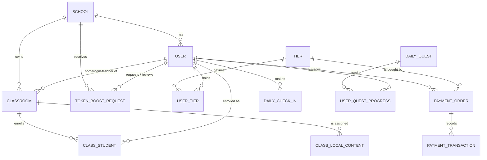

**Part 2 – Content, chat, map, quiz**

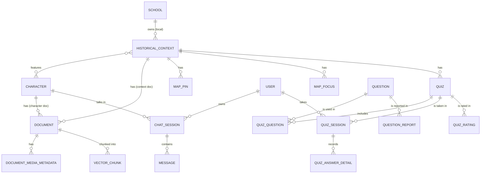

**Part 3 – Assignments**

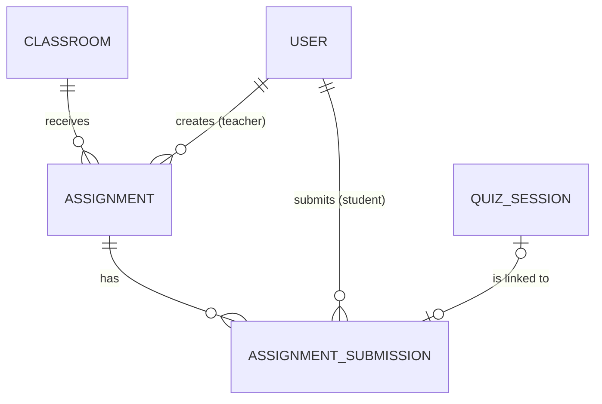

**Entities Description**

| # | Entity | Description |
| :---- | :---- | :---- |
| 1 | User | Account of any of the six roles: username, email, BCrypt password, profile, role, school, student code, `mustChangePassword`, account status (ACTIVE/DEACTIVATED), token balance, daily used/bonus tokens, last reset time, password-reset token hash and expiry, soft-delete time. |
| 2 | School | Tenant: name, unique school code, contacts, enterprise package, total and remaining token pool, subscription start/end, renewal flag and next package, default daily student/teacher quota, local-history policy accepted, status (ACTIVE/INACTIVE/SUSPENDED/EXPIRED). |
| 3 | Classroom | Class of a school: name, code, grade level, academic year, homeroom teacher, daily token quota, status (ACTIVE/ARCHIVED). |
| 4 | Class Student | Enrollment of a student in a class with join time and status. |
| 5 | Token Boost Request | Token ticket: school, class, student, requester and role, requested/approved tokens, reason, status (PENDING/PENDING_ADMIN/APPROVED/REJECTED), teacher and admin review data. |
| 6 | Class Local Content | Assignment of a local context/character to a class. |
| 7 | Tier | B2C package: title (free/plus/pro), amount (VND), number of months, token amount, active flag. |
| 8 | User Tier | A user's subscription: tier, payment order, start/end time, active flag. |
| 9 | Payment Order | Purchase: order code, amount, description (transfer content), tier, status (PENDING/PAID/CANCELLED/EXPIRED/FAILED), fulfillment status (PENDING/PROCESSING/FULFILLED/FAILED), expiry time. |
| 10 | Payment Transaction | PayOS transaction data received for an order (status PENDING/SUCCESS/FAILED). |
| 11 | Daily Check-In | One check-in of a user per day with streak count. |
| 12 | Daily Quest | Quest definition: type (CHAT/QUIZ/READ_CONTEXT), title, target, reward tokens. |
| 13 | User Quest Progress | A user's daily progress and claimed flag for a quest. |
| 14 | Historical Context | Period/event: name, description, era, category, year range, BC flag, location, image, video, battle map, coordinates, published flag, school (null = global), scope (CLASS_ONLY/SCHOOL_WIDE), content status, review note, approver, soft-delete time. |
| 15 | Character | Historical figure: name, title, background, personality, image, 3D model URL, birth/death dates (with BC flags), published flag, contexts, school and content status for local characters. |
| 16 | Document | Reference source of a context or character: title, type (TEXT/MARKDOWN/PDF), content, file path, status. |
| 17 | Document Media Metadata | Media attached to a document/entity (e.g., video). |
| 18 | Vector Chunk | A passage of a document with its embedding (stored by the AI service in pgvector). |
| 19 | Map Pin | Point on the map of a context: label, description, pin type, owner type, coordinates, year, path GeoJSON. |
| 20 | Map Focus | Ordered camera focus of a context's map story: name, description, center, zoom level, order, default/active flags. |
| 21 | Chat Session | Conversation between a user and a character (optionally linked to a local scenario). |
| 22 | Message | One user question or AI answer: content, message type, token count, suggested questions, quotes. |
| 23 | Quiz | Set of questions of a context: title, level (EASY/MEDIUM/HARD), published flag, creator, soft-delete time. |
| 24 | Question | Bank question: content, explanation, type (MULTIPLE_CHOICE/FILL_IN_BLANK/MATCHING), JSON question data (options and correct answers). |
| 25 | Quiz Question | Ordered link between a quiz and a bank question. |
| 26 | Quiz Session | One attempt: quiz, user, time limit, start/end time, score (number of correct answers). |
| 27 | Quiz Answer Detail | Answer given to one question in a session with correctness and score earned. |
| 28 | Question Report | Learner report on a question; resolved by Content Admin. |
| 29 | Quiz Rating | Rating of a quiz by a user. |
| 30 | Assignment | Homework for one class: teacher, title, description, type (CONTEXT_READING/AI_CHAT_ROLEPLAY/QUIZ_TEST), target id, minimum requirement, deadline, status (ACTIVE/CANCELLED/ARCHIVED). |
| 31 | Assignment Submission | A student's work on an assignment: status (BR-24), score, message count, reading duration, start/submit time, linked quiz session or chat session. |

---

### 3.2 Authentication & Account

#### 3.2.1 Log In

* **Function trigger:** User opens S-02 from S-01 or any protected URL; clicks "Đăng nhập" or "Tiếp tục với Google".
* **Function description:** All roles sign in with email and password; any user may also sign in with Google. The system returns a JWT access token and refresh token and the client routes by role: Customer/Student → S-07, Teacher → S-27, School Admin → S-36, Content Admin → S-46, System Admin → S-54. (UC-01)
* **Screen layout:**

```
+-------------------------------------------------------------+
|                 HistoryTalk – Chắp cánh tri thức lịch sử     |
|                     [ ĐĂNG NHẬP HỆ THỐNG ]                   |
|  Email:      [__________________________________________]    |
|  Mật khẩu:   [__________________________________] (👁)       |
|                                         Quên mật khẩu?      |
|  [                    ĐĂNG NHẬP                        ]     |
|  ------------------------- HOẶC ----------------------       |
|  [ (G) Tiếp tục với tài khoản Google                   ]     |
|  Chưa có tài khoản? [Đăng ký ngay]                           |
+-------------------------------------------------------------+
```

* **Function details:**
  * *Data:* email (valid format), password.
  * *Validation:* both fields required (MSG02); email format (MSG17).
  * *Business rules:* BR-02, BR-03, BR-11, BR-13.
  * *Normal flow:* 1) User enters credentials. 2) System finds the user by email (case-insensitive), checks the BCrypt hash and that the account is not deactivated or deleted. 3) System issues an access token and a refresh token (BR-03). 4) If `mustChangePassword` is true the client opens S-05 with MSG22; otherwise the role home screen.
  * *Google flow:* 1) User selects a Google account. 2) System verifies the Google ID token. 3a) Email exists → sign in with that account's role. 3b) Email is new → create a CUSTOMER account on the Free tier with a random temporary password sent by email, then sign in.
  * *Refresh:* the client exchanges the refresh token for a new access token; a revoked or expired refresh token → MSG09.
  * *Abnormal:* wrong email or password → MSG09 (does not reveal which one); deactivated account → MSG15; school subscription expired, suspended or not started (school roles) → MSG24; Google verification failure → MSG14.

#### 3.2.2 Register Account

* **Function trigger:** Visitor clicks "Đăng ký ngay" on S-01/S-02 and opens S-03.
* **Function description:** Creates a Customer account on the Free tier. (UC-02)
* **Screen layout:**

```
+-------------------------------------------------------------+
|                    ĐĂNG KÝ TÀI KHOẢN                         |
|  Tên đăng nhập:       [__________________________]           |
|  Email:               [__________________________]           |
|  Mật khẩu:            [__________________________] (👁)      |
|  Xác nhận mật khẩu:   [__________________________] (👁)      |
|  [                     ĐĂNG KÝ                     ]         |
|  Đã có tài khoản? [Đăng nhập]                                |
+-------------------------------------------------------------+
```

* **Function details:**
  * *Validation:* all fields required (MSG02); username 3–50 characters (MSG08); valid email (MSG17); password at least 8 characters (MSG18, BR-02); confirmation matches (MSG19).
  * *Normal flow:* system creates the user with role CUSTOMER, a Free user-tier record and a token balance equal to the Free tier's token amount (BR-05), then shows MSG04 and opens S-02.
  * *Abnormal:* email already used → MSG20; username already used → MSG41.

#### 3.2.3 Reset Password

* **Function trigger:** User clicks "Quên mật khẩu?" on S-02 (S-04 step 1) or opens the link in the email (S-04 step 2).
* **Function description:** Sends a one-time reset link to the account's email; the user sets a new password from that link. (UC-03)
* **Screen layout:**

```
+-------------------------------------------+    +-------------------------------------------+
| QUÊN MẬT KHẨU                             |    | ĐẶT LẠI MẬT KHẨU                          |
| Email: [_______________________________]  |    | Mật khẩu mới:     [____________________]  |
| [ Gửi liên kết ]                          |    | Xác nhận mật khẩu:[____________________]  |
+-------------------------------------------+    | [ Đặt lại mật khẩu ]                      |
                                                 +-------------------------------------------+
```

* **Function details:**
  * *Rules:* BR-04. Students whose account uses a generated shadow email cannot receive the email; their password is reset by the School Admin (3.10.4).
  * *Normal flow:* 1) System always shows MSG05 (whether or not the email exists). 2) If the email exists, a random token is generated, its SHA-256 hash and expiry (15 minutes) are stored and the link is emailed. 3) User submits the new password; the token is cleared and MSG03 is shown on S-02.
  * *Abnormal:* link invalid, used or expired → MSG21; new password missing → MSG02; confirmation differs → MSG19; new password shorter than 6 characters → MSG18.

#### 3.2.4 Change Password

* **Function trigger:** User opens S-05 from S-06, or is redirected there at first login.
* **Function description:** Changes the password of the signed-in user. (UC-04)
* **Screen layout:**

```
+-------------------------------------------------------------------------+
| ĐỔI MẬT KHẨU                                                            |
| Mật khẩu hiện tại:    [____________________] (👁)                        |
| Mật khẩu mới:         [____________________] (👁)                        |
| Xác nhận mật khẩu mới:[____________________] (👁)                        |
| [ Hủy ]                                      [ Lưu mật khẩu ]           |
+-------------------------------------------------------------------------+
```

* **Function details:** current password must be correct (MSG09); new password 6–100 characters (MSG18); confirmation must match (MSG19). On success `mustChangePassword` is cleared and MSG03 is shown.

#### 3.2.5 Update Profile, Log Out and Deactivate Own Account

* **Function trigger:** User opens S-06 from the avatar menu; selects "Đăng xuất" or "Vô hiệu hóa tài khoản".
* **Function description:** Updates profile and avatar; ends the session; deactivates the own account. (UC-05, UC-06, UC-07)
* **Screen layout:**

```
+-------------------------------------------------------------------------+
| HỒ SƠ CÁ NHÂN                                   [Avatar ▾] Đăng xuất    |
| (Ảnh đại diện)  [ Đổi ảnh ]   (ảnh ≤ 5 MB)                               |
| Tên đăng nhập: thpta_hs_hs1023 (chỉ đọc)    Vai trò: Học sinh           |
| Trường: THPT A (chỉ đọc)                   Gói: free / plus / pro       |
| Họ tên:   [ Nguyễn Văn An        ]  Ngày sinh: [15/01/2008]             |
| Giới tính:[ Nam v ]  SĐT: [0901234567]  Địa chỉ: [______________]       |
| [ Đổi mật khẩu ]  [ Vô hiệu hóa tài khoản ]          [ Lưu thay đổi ]   |
+-------------------------------------------------------------------------+
```

* **Function details:** username, role and school are read-only. Phone must be a valid Vietnamese mobile number (MSG08). Avatar must be an image of at most 5 MB (MSG28); it is stored in Supabase Storage and shown via a signed URL. Success → MSG03. Log out adds the session token to the revocation list (BR-03) and returns to S-01. Deactivating the own account requires confirmation (MSG37), sets the account to DEACTIVATED and signs the user out.

### 3.3 Historical Learning Content

#### 3.3.1 View Historical Contexts

* **Function trigger:** User opens S-08 from the main menu, then an item to open S-09.
* **Function description:** Lists published global contexts and, for school users, published local contexts visible to them (BR-16). (UC-08)
* **Screen layout:**

```
+-------------------------------------------------------------------------+
| BỐI CẢNH LỊCH SỬ    [ Tìm kiếm...     ] [ Thời kỳ: Tất cả v ] [ Loại v ] |
+-------------------------------------------------------------------------+
| +-------------+  +-------------+  +-------------+  +-------------+      |
| | (ảnh bìa)   |  | (ảnh bìa)   |  | (ảnh bìa)   |  | (ảnh bìa)   |      |
| | Bạch Đằng   |  | Như Nguyệt  |  | Đống Đa     |  | Điện Biên   |      |
| | 938         |  | 1077        |  | 1789        |  | Phủ 1954    |      |
| +-------------+  +-------------+  +-------------+  +-------------+      |
|                    < 1  2  3 ... 8 >                                    |
+-------------------------------------------------------------------------+
```

* **Function details:** search by name; filter by era (e.g., ANCIENT, MEDIEVAL, MODERN…) and category (WAR, POLITICS, CULTURE, SCIENCE, RELIGION); paging per COM-02; no result → MSG01. S-09 shows description, year/year range (BC supported), location, image, video, documents (PDF via signed URL), related characters, quizzes and a link to S-15. Reading a context counts toward the READ_CONTEXT daily quest (BR-25).

#### 3.3.2 View Characters

* **Function trigger:** User opens S-10, then a character to open S-11.
* **Function description:** Lists published characters with image, title and life years. (UC-09)
* **Screen layout:**

```
+-------------------------------------------------------------------------+
| NHÂN VẬT LỊCH SỬ      [ Tìm theo tên...      ] [ Bối cảnh: Tất cả v ]   |
| (ảnh) Ngô Quyền – 898–944 – Chiến thắng Bạch Đằng           [ Xem ]     |
| (ảnh) Lý Thường Kiệt – 1019–1105 – Phòng tuyến Như Nguyệt   [ Xem ]     |
| (ảnh) Võ Nguyên Giáp – 1911–2013 – Điện Biên Phủ             [ Xem ]    |
| CHI TIẾT (S-11): Tiểu sử | Tính cách | Bối cảnh liên quan | [Trò chuyện]|
+-------------------------------------------------------------------------+
```

* **Function details:** filter by context; S-11 shows background, personality, birth/death dates, related contexts and (if available) a 3D model; "Trò chuyện" opens S-12 with a new session.

#### 3.3.3 Explore Historical Map

* **Function trigger:** User opens S-15 from S-09 or the main menu and selects a context.
* **Function description:** Shows the map pins, battle map / GeoJSON layers and the ordered map focuses (story steps) of a context. (UC-10)
* **Screen layout:**

```
+-------------------------------------------------------------------------+
|  BẢN ĐỒ LỊCH SỬ – CHIẾN DỊCH ĐIỆN BIÊN PHỦ (1954)  [ Bối cảnh v ]       |
|  +-------------------------------------+  [ THÔNG TIN ĐIỂM ]            |
|  |  (Bản đồ)     * Him Lam             |  Cứ điểm Him Lam               |
|  |        * Độc Lập                    |  Mô tả: ...                    |
|  |                    * Mường Thanh    |  [ Xem bối cảnh ] [ Trò chuyện ]|
|  +-------------------------------------+                                |
|  Diễn biến: [<] Bước 2/6: Tấn công Him Lam 13/3/1954 [>]               |
+-------------------------------------------------------------------------+
```

* **Function details:** pins and focuses are read publicly; focuses are shown in their configured order (camera moves to center/zoom of each step); clicking a pin opens its information panel with links to S-09 and S-12; a context without pins → MSG01 in the panel.

### 3.4 AI Character Chat

#### 3.4.1 Chat with Historical Character

* **Function trigger:** User clicks "Trò chuyện" on S-11, S-15 or S-22, or resumes a session from S-14; then sends a question.
* **Function description:** The character answers in the first person, grounded in retrieved document passages; the answer is streamed. (UC-11)
* **Screen layout:**

```
+-------------------------------------------------------------------------+
| [<- Quay lại]   ĐẠI TƯỚNG VÕ NGUYÊN GIÁP              Còn lại: 1.420 token |
|                 Chiến dịch Điện Biên Phủ (1954)                         |
| (AI) Chào cháu. Ta là Võ Nguyên Giáp... Cháu muốn hỏi ta điều gì?       |
|                          (Bạn) Vì sao Đại tướng đổi phương châm tác chiến?|
| (AI) [đang trả lời...] Quyết định chuyển từ "đánh nhanh thắng nhanh"    |
|      sang "đánh chắc tiến chắc" là ...                                   |
|      Trích dẫn: "..."                                                    |
| Gợi ý: [ Kéo pháo vào Điện Biên? ] [ Vai trò của dân công? ]            |
| [ Nhập câu hỏi (tối đa 4000 ký tự)...                       ] [GỬI]     |
+-------------------------------------------------------------------------+
```

* **Function details:**
  * *Validation:* message required (MSG02), at most 4,000 characters (MSG08).
  * *Business rules:* BR-05 – BR-08, BR-13, BR-17, BR-18.
  * *Normal flow:* 1) System checks tokens: Customer balance > 0; School Student/Teacher via 3.4.4; School Admin subscription only. 2) User message is saved and sent to the AI service (3.4.3). 3) Answer is displayed progressively, followed by suggested questions and quotes. 4) Remaining tokens are updated from the final SSE event.
  * *Abnormal:* Customer balance 0 → S-13 with MSG10; student/teacher daily limit or school pool exhausted → S-13 with MSG23; school subscription invalid → MSG24; AI service error or timeout → MSG14, no tokens are deducted.
  * *Out-of-scope or unsafe question:* the character politely declines in persona (BR-18).

#### 3.4.2 View Chat History

* **Function trigger:** User opens S-14.
* **Function description:** Lists the user's own sessions; opens or deletes one. (UC-12)
* **Screen layout:**

```
+-----------------------------------------------------------------------------+
| LỊCH SỬ TRÒ CHUYỆN                       [ Nhân vật: Tất cả      v ]        |
| Võ Nguyên Giáp  | 18/10/2026 20:15 | "Vì sao đổi phương châm..." [Mở][Xóa]  |
| Ngô Quyền       | 15/10/2026 19:02 | "Cọc gỗ được cắm thế nào..." [Mở][Xóa] |
|                     < 1  2  3 >                                             |
+-----------------------------------------------------------------------------+
```

* **Function details:** opening a session loads its messages in S-12 and allows continuing; "Xóa" asks for confirmation (MSG37) and soft-deletes the session (MSG06); no sessions → MSG01.

#### 3.4.3 AI Answer Streaming & Token Deduction (non-screen)

* **Function trigger:** Each message sent from S-12 (`POST /api/v1/chat/messages/stream`, or `/messages` without streaming).
* **Function description:** Produces a grounded answer and charges tokens.
* **Screen layout:** N/A – non-screen function.
* **Function details:**
  1. The Java core sends the character/context persona, the last 4 messages of the session and the question to the AI service.
  2. The AI service embeds the question, retrieves the 10 most similar chunks of the related documents (`match_history_chunks`), re-ranks them with a cross-encoder (falls back to the top 2 chunks if the re-ranker fails) and builds the prompt.
  3. The LLM answer is streamed back and relayed to the browser as SSE events; the last event contains prompt/completion token counts.
  4. On completion the user and AI messages are saved with token counts, suggested questions and quotes; cost = prompt + completion tokens (BR-05). Customer: balance is reduced (not below 0). School Student/Teacher: daily used tokens increase and the school pool decreases (BR-07).
  5. If the stream fails, no cost is charged and MSG14 is returned.

#### 3.4.4 Daily Allowance Preparation (non-screen)

* **Function trigger:** Before each chat turn of a School Student or Teacher.
* **Function description:** Lazily resets daily counters and computes today's available tokens.
* **Screen layout:** N/A – non-screen function.
* **Function details:** 1) Reject if the account is deactivated or the school subscription is invalid (BR-13). 2) If the last reset was before today: daily used = 0, daily bonus = 0. 3) Daily limit = teacher default (teachers) or the first active class quota, else the school default student quota (students) (BR-06). 4) Available = min(limit + bonus − used, school pool). 5) Available ≤ 0 → MSG23.

### 3.5 Quiz

#### 3.5.1 Take Quiz

* **Function trigger:** User clicks "Làm bài" on S-16, S-09 or S-22 and opens S-17.
* **Function description:** Quiz with multiple-choice, fill-in-blank and matching questions graded by the server. (UC-13)
* **Screen layout:**

```
+-------------------------------------------------------------------------+
|  BÀI KIỂM TRA: KHÁNG CHIẾN CHỐNG THỰC DÂN PHÁP        Thời gian: [12:45] |
|  Câu 4 / 15 (Trắc nghiệm)                                                |
|  Vị tướng nào trực tiếp chỉ huy chiến dịch Điện Biên Phủ năm 1954?       |
|  [ ] A. Nguyễn Chí Thanh      [x] B. Võ Nguyên Giáp                      |
|  [ ] C. Đồng Sỹ Nguyên        [ ] D. Chu Văn Tấn                         |
|  [ Câu trước ]                                          [ Câu tiếp ]     |
|  Danh sách câu: [1✓] [2✓] [3✓] [4] [5] ... [15]           [ NỘP BÀI ]    |
+-------------------------------------------------------------------------+
```

* **Function details:**
  * *Business rules:* BR-20, BR-21, BR-23.
  * *Normal flow:* 1) "Bắt đầu" creates a quiz session with start time and an optional time limit (shown as a countdown); questions are sent without answer keys. 2) User answers and clicks "Nộp bài"; a confirmation shows the number of unanswered questions. 3) Server grades each answer (BR-20), saves answer details, sets end time and score, and opens S-18 with MSG13. Completing a quiz counts toward the QUIZ daily quest.
  * *Abnormal:* session already submitted → MSG35; quiz not found or unpublished → MSG42.

#### 3.5.2 View Quiz Result, Rate Quiz and Report Question

* **Function trigger:** S-18 after submission, or a session opened from S-19.
* **Function description:** Shows the result; lets the learner rate the quiz and report a question. (UC-14, UC-15)
* **Screen layout:**

```
+-------------------------------------------------------------------------+
| KẾT QUẢ: 12/15 câu đúng (80%)                     Đánh giá: ☆☆☆☆☆        |
| Câu 4 ✓  Giải thích: Đại tướng Võ Nguyên Giáp là Tổng tư lệnh...        |
| Câu 7 ✗  Đáp án đúng: ...                      [ Báo lỗi câu hỏi ]       |
| [ Làm lại ]                                     [ Về danh sách ]         |
+-------------------------------------------------------------------------+
```

* **Function details:** score shown as correct/total and percentage; correct answers and explanations are shown after submission only (BR-21). A learner has one rating per quiz and can view or update it. A question report is sent with a reason and appears in S-50. S-19 lists own sessions newest first with paging; no sessions → MSG01.

### 3.6 Gamification

#### 3.6.1 Claim Daily Rewards and View Learning Dashboard

* **Function trigger:** Learner opens S-07.
* **Function description:** Daily check-in with streak, daily quests with token rewards, learning statistics. (UC-16, UC-17)
* **Screen layout:**

```
+-------------------------------------------------------------------------+
| XIN CHÀO, AN!          Token: 1.420     Chuỗi ngày học: 🔥 5   [Điểm danh]|
| NHIỆM VỤ HÔM NAY                                                         |
|  [✓] Trò chuyện với một nhân vật lịch sử   1/1   +500   [ Nhận thưởng ]  |
|  [ ] Hoàn thành 1 bài trắc nghiệm lịch sử  0/1   +500                    |
|  [ ] Khám phá 1 bối cảnh lịch sử           0/1   +300                    |
| Ngày học trong tháng: [lịch]     Trò chuyện gần đây: ...                 |
+-------------------------------------------------------------------------+
```

* **Function details:** check-in once per day; the streak increases when the previous day was checked in, otherwise restarts at 1; a second check-in on the same day returns the current streak with no reward. Quests (CHAT, QUIZ, READ_CONTEXT) are configured in S-53 (BR-25). "Nhận thưởng" is enabled only for completed, unclaimed quests; claiming adds the reward to the token balance and returns the new balance. Abnormal: quest not completed → MSG44; already claimed today → MSG45.

### 3.7 Student Classroom & Assignments

#### 3.7.1 View My Classes and My Assignments

* **Function trigger:** Student opens S-20 or S-21.
* **Function description:** Shows the classes the student is enrolled in and their assignments. (UC-18)
* **Screen layout:**

```
+-------------------------------------------------------------------------+
| BÀI TẬP CỦA TÔI                        [ Lớp: 12A1 v ] [ Trạng thái v ]  |
| Tìm hiểu Điện Biên Phủ | Đọc bối cảnh | Hạn 30/10 23:59 | Chưa làm       |
| Trò chuyện Võ Nguyên Giáp | Chat AI   | Hạn 01/11 23:59 | Đang làm       |
| Kiểm tra Điện Biên Phủ | Trắc nghiệm  | Hạn 05/11 23:59 | Đã nộp – 8.67  |
+-------------------------------------------------------------------------+
```

* **Function details:** only ACTIVE assignments of the student's classes are listed with type, deadline, status (BR-24) and score; paging per COM-02; empty → MSG01.

#### 3.7.2 Complete Assignment

* **Function trigger:** Student opens an assignment in S-22 and clicks "Bắt đầu", then "Nộp bài".
* **Function description:** Performs the single task of the assignment and submits it. (UC-19)
* **Screen layout:**

```
+-------------------------------------------------------------------------+
|  TRÒ CHUYỆN VỚI ĐẠI TƯỚNG VÕ NGUYÊN GIÁP     Lớp 12A1 – GV: Trần Thị B   |
|  Hạn nộp: 23:59 01/11/2026                   Trạng thái: ĐANG LÀM        |
|  Yêu cầu: tối thiểu 5 tin nhắn   Đã gửi: 3/5          [ Tiếp tục chat ]  |
|                                                       [ NỘP BÀI TẬP ]    |
+-------------------------------------------------------------------------+
```

* **Function details:**
  * *Business rules:* BR-22, BR-23, BR-24.
  * *Normal flow:* 1) "Bắt đầu" changes NOT_STARTED → IN_PROGRESS and records the start time. 2) The student reads the context, chats with the target character or takes the target quiz. 3) "Nộp bài" computes the score (BR-22) from the linked chat session, quiz session or reading time and sets SUBMITTED, or LATE_SUBMITTED if after the deadline; MSG03.
  * *Abnormal:* assignment cancelled/unavailable → MSG42; already submitted → MSG35; chat session with a different character, or no chat session → MSG46; quiz session not owned, of another quiz or not finished → MSG46; out of tokens during the chat task → MSG23 (the deadline is not extended).

#### 3.7.3 Request Extra Tokens

* **Function trigger:** Student clicks "Xin thêm token" on S-13 or S-07 (opens S-23).
* **Function description:** Sends a daily token request to the homeroom teacher. (UC-20)
* **Screen layout:**

```
+-------------------------------------------------+
| XIN THÊM TOKEN                                   |
| Số token: [ 500 ]                                |
| Lý do:    [ Cần hoàn thành bài chat với ... ]    |
| [ Hủy ]                          [ Gửi yêu cầu ] |
+-------------------------------------------------+
```

* **Function details:** the student must belong to an active class (MSG47); only one PENDING request per student per day (MSG48); the request is created with status PENDING and appears in the teacher's S-34. The student can view the status of own requests.

### 3.8 Subscription & Payment

#### 3.8.1 Purchase Subscription Package

* **Function trigger:** Customer clicks "Thanh toán ngay" on a tier in S-24.
* **Function description:** Creates a PayOS payment order, shows VietQR and grants the tier after the verified webhook. (UC-21)
* **Screen layout:**

```
+-------------------------------------------------------------------------+
|                  THANH TOÁN GÓI PRO – 1 THÁNG                            |
|  Số tiền: 99.000 VNĐ        Quyền lợi: +999 token                        |
|  +---------------------------+   1. Mở ứng dụng ngân hàng                |
|  |        [ MÃ VIETQR ]      |   2. Quét mã QR bên cạnh                  |
|  |                           |   3. Kiểm tra số tiền và nội dung:        |
|  +---------------------------+      HISTALK998241                        |
|  Đơn hàng hết hạn sau: 14:32      Trạng thái: Đang chờ thanh toán ⟳      |
|  [ Hủy giao dịch ]                                                       |
+-------------------------------------------------------------------------+
```

* **Function details:**
  * *Business rules:* BR-26 – BR-30.
  * *Normal flow:* 1) System checks that the customer has no active paid subscription (BR-29), creates a PENDING order with a unique order code, transfer content "HISTALK" + last 6 digits and an expiry of 15 minutes, and requests a PayOS payment link. 2) S-25 shows the QR code and countdown and polls the order status. 3) When the webhook marks the order PAID (3.8.3), fulfillment grants the tier and tokens; the popup shows MSG26.
  * *Abnormal:* active paid subscription → MSG40; PayOS unavailable → MSG14, no order; user cancels → CANCELLED; countdown ends → EXPIRED (MSG27). The PayOS return URL only reports the client-side result; the order is completed only by the verified webhook.

#### 3.8.2 View Payment History

* **Function trigger:** Customer opens S-26.
* **Function description:** Lists the customer's own orders. (UC-22)
* **Screen layout:**

```
+--------------------------------------------------------------------------------+
| LỊCH SỬ THANH TOÁN                                                             |
| Mã đơn        | Gói        | Số tiền    | Trạng thái     | Thời gian           |
| 1729401234567 | pro 1 tháng| 99.000 VNĐ | Đã thanh toán  | 20/10/2026 14:02    |
| 1729301234500 | plus 1 tháng| 49.000 VNĐ| Hết hạn        | 12/10/2026 09:30    |
|                     < 1  2 >                                                   |
+--------------------------------------------------------------------------------+
```

* **Function details:** read-only; shows order code, tier, amount, status (BR-26), created and expiry time; no orders → MSG01.

#### 3.8.3 Payment Webhook Handler (non-screen)

* **Function trigger:** PayOS calls `POST /api/v1/payments/payos/webhook`.
* **Function description:** Confirms payments reliably.
* **Screen layout:** N/A – non-screen function.
* **Function details:** 1) Verify the signature with the PayOS SDK and checksum key (BR-27); invalid → rejected, no change. 2) Find the order by order code and validate the data (amount, order) against it. 3) Only a PENDING order changes status: success code → PAID, otherwise CANCELLED/FAILED. 4) For a PAID order, fulfillment creates an active user tier (start = now, end = now + tier months), adds the tier's token amount to the balance and marks fulfillment FULFILLED; on error fulfillment is FAILED and retried by 3.8.4. Repeated notifications have no further effect.

#### 3.8.4 Payment Expiry, Subscription Expiry and Fulfillment Reconciliation Jobs (non-screen)

* **Function trigger:** Scheduled with fixed delay: order expiry every 60 s; subscription expiry every 5 min; fulfillment reconciliation every 60 s.
* **Function description:** Keeps orders and subscriptions consistent.
* **Screen layout:** N/A – non-screen function.
* **Function details:** order expiry: PENDING orders with `expiredAt` < now → EXPIRED. Subscription expiry: active paid user tiers with `endTime` < now → inactive; the user falls back to the Free tier record (Free never expires); tokens already granted remain. Reconciliation: PAID orders whose fulfillment is PENDING/FAILED are fulfilled again (idempotent, no double grant).

### 3.9 Teacher Functions

#### 3.9.1 Manage Assignments

* **Function trigger:** Teacher clicks "Tạo bài tập" on S-29 (opens S-30), edits or cancels an assignment in S-29.
* **Function description:** Creates homework of one type for one own class, updates its deadline or cancels it. (UC-23)
* **Screen layout:**

```
+-------------------------------------------------------------------------+
|                       TẠO BÀI TẬP LỊCH SỬ MỚI                            |
|  Tiêu đề: [ Tìm hiểu Chiến dịch Điện Biên Phủ 1954                    ]  |
|  Mô tả:   [ ......................................................... ]  |
|  Lớp:     [ 12A1 v ]   (chỉ các lớp mình chủ nhiệm)                      |
|  Loại:    ( ) Đọc bối cảnh  (•) Trò chuyện AI  ( ) Bài trắc nghiệm       |
|  Nội dung:[ Đại tướng Võ Nguyên Giáp                                v ]  |
|  Yêu cầu tối thiểu: [ 5 ] tin nhắn  (đọc: giây; quiz: số lần)            |
|  Hạn nộp: [ 23:59 ] [ 30/10/2026 ]                                       |
|  [ Hủy ]                                            [ Giao bài tập ]     |
+-------------------------------------------------------------------------+
```

* **Function details:**
  * *Validation:* title 3–255 characters (MSG02, MSG08); class, type and target required; deadline in the future (MSG43); minimum requirement > 0, default 180 seconds (reading), 5 messages (chat), 1 (quiz).
  * *Business rules:* BR-01, BR-12, BR-19, BR-22 – BR-24.
  * *Normal flow:* 1) System checks the teacher is the homeroom teacher of the class (MSG11) and the target is published and, for local content, belongs to the school (MSG42). 2) The assignment is saved ACTIVE and a NOT_STARTED submission is created for every student enrolled in the class; MSG04.
  * *Update:* title, description, minimum requirement and deadline can be changed; a new deadline must be in the future; LATE_SUBMITTED submissions that are on time under the new deadline become SUBMITTED.
  * *Cancel:* confirmation (MSG37); status CANCELLED; students no longer see it.

#### 3.9.2 View Assignment Gradebook

* **Function trigger:** Teacher opens an assignment in S-29 to view S-31.
* **Function description:** Shows each student's status, score and progress. (UC-24)
* **Screen layout:**

```
+-----------------------------------------------------------------------------+
| BẢNG ĐIỂM: TRÒ CHUYỆN VÕ NGUYÊN GIÁP       Lớp 12A1   Hạn 01/11 23:59       |
| Đã nộp 28 | Nộp muộn 3 | Đang làm 5 | Chưa làm 6 | ĐTB 8.12                 |
| Học sinh        | Trạng thái | Tin nhắn | Điểm | Nộp lúc                    |
| Nguyễn Văn An   | Đã nộp     | 6/5      | 10.0 | 29/10 21:05                |
| Lê Thị Bình     | Đang làm   | 2/5      | —    | —                          |
+-----------------------------------------------------------------------------+
```

* **Function details:** counts per status and average score of SUBMITTED/LATE_SUBMITTED submissions; only own classes (MSG11); read-only (BR-23).

#### 3.9.3 Manage Local Content

* **Function trigger:** Teacher opens S-32 and works in S-33.
* **Function description:** Creates school-specific contexts, characters, their documents/media and quizzes; publishes, trashes and restores them. (UC-25)
* **Screen layout:**

```
+-------------------------------------------------------------------------+
| NỘI DUNG ĐỊA PHƯƠNG (S-32)      [Bối cảnh][Nhân vật][Thùng rác] [+ Tạo] |
| Anh hùng Nguyễn Trung Trực (Nhân vật) | Toàn trường | Đã phát hành [Sửa] |
| Lịch sử Rạch Giá (Bối cảnh)           | Theo lớp    | Bản nháp     [Sửa] |
+-------------------------------------------------------------------------+
| TRÌNH SOẠN THẢO (S-33): [Thông tin][Tài liệu][Media][Bài kiểm tra]      |
| Tên [_____________]  Phạm vi [ Theo lớp / Toàn trường v ]               |
| Mô tả [___________________________]   Tài liệu: [ + Văn bản ][ 📁 PDF ] |
| [ Lưu nháp ]                                          [ Phát hành ]     |
+-------------------------------------------------------------------------+
```

* **Function details:**
  * *Business rules:* BR-01, BR-16.
  * *Normal flow:* create as DRAFT (MSG04) or published directly; "Phát hành" (submit) sets the item ACTIVE/published; documents can be text or PDF (3.11.3) and are indexed for chat; quizzes of a local context can be created, edited, published and given questions.
  * *Visibility:* CLASS_ONLY items are visible only to the owner teacher (and to students through assignments/class content); SCHOOL_WIDE items are visible read-only to all teachers of the school.
  * *Editing:* only the creator can edit or delete; delete moves the item to the teacher's trash (MSG06); restore → MSG07; permanent delete requires confirmation (MSG37).
  * *Abnormal:* required fields missing → MSG02; invalid file → MSG28; item of another teacher/school → MSG11.

#### 3.9.4 View Class Analytics

* **Function trigger:** Teacher opens S-28 from a class in S-27.
* **Function description:** Per class: assignment completion, average scores and AI usage per student. (UC-26)
* **Screen layout:**

```
+----------------------------------------------------------------------------+
| THỐNG KÊ LỚP 12A1                                                          |
| Sĩ số: 42   Tỉ lệ hoàn thành: 86%   Điểm TB: 7.42   Token đã dùng hôm nay  |
| Học sinh       | Bài đã nộp | Điểm TB | Token dùng hôm nay | Hạn mức       |
| Nguyễn Văn An  | 5/5        | 8.30    | 320                | 1.000         |
+----------------------------------------------------------------------------+
```

* **Function details:** only classes where the teacher is the homeroom teacher (BR-12, MSG11); token figures are those of the current day (BR-06).

#### 3.9.5 Review Student Token Requests and Request Tokens from School Admin

* **Function trigger:** Teacher opens S-34; clicks "Cấp token" (S-35) or "Tạo ticket gửi Quản trị trường".
* **Function description:** Handles students' requests from the teacher's daily allowance and escalates to the School Admin. (UC-27, UC-28)
* **Screen layout:**

```
+-----------------------------------------------------------------------------+
| YÊU CẦU TOKEN CỦA HỌC SINH                         [ Trạng thái: Chờ duyệt v]|
| Nguyễn Văn An | 12A1 | 500 | "Cần hoàn thành bài chat" | [Duyệt][Từ chối][Chuyển lên QTT] |
| [ + Cấp token trực tiếp ]            [ + Tạo ticket gửi Quản trị trường ]   |
+-----------------------------------------------------------------------------+
```

* **Function details:** only requests of students in the teacher's classes (MSG11), only status PENDING (MSG49). Approve: approved tokens (default = requested, > 0) are transferred from the teacher's remaining daily allowance to the student's daily bonus (BR-08); not enough allowance → MSG50. Reject → REJECTED with note. Escalate → PENDING_ADMIN (goes to S-44). Direct grant (S-35): same transfer, recorded as an APPROVED request. Ticket to School Admin: for the teacher or for one of the school's students, status PENDING_ADMIN.

### 3.10 School Admin Functions

#### 3.10.1 Import Student Accounts

* **Function trigger:** School Admin clicks "Import danh sách (CSV)" on S-40 (opens S-41), or imports into one class from S-38.
* **Function description:** Creates student accounts from the CSV template. (UC-29)
* **Screen layout:**

```
+-------------------------------------------------------------------------+
|                 IMPORT TÀI KHOẢN HỌC SINH (CSV)                          |
|  1. Tải file mẫu:  [ student_import_template.csv ]                       |
|  2. Chọn tệp:      [ 📁 Kéo thả hoặc nhấn để chọn ]  hs_khoi10.csv        |
|  3. Token ban đầu mỗi học sinh: [ 10000 ]                                |
|  [ Hủy ]                                         [ Bắt đầu import ]      |
|  Kết quả: 448 thành công, 2 lỗi   [ Tải danh sách tài khoản & lỗi ]      |
+-------------------------------------------------------------------------+
```

* **Function details:**
  * *Template columns:* `student_code, full_name, email, dob, gender, phone_number, password, additional_token` (UTF-8 with BOM).
  * *Business rules:* BR-10, BR-15.
  * *Normal flow:* 1) Upload → each row is validated. 2) Username = `{school_code}_hs_{student_code}` (lower case); if the code is empty it is generated from the school code, year and sequence. 3) Email empty → shadow email `{username}@saas.historytalk.vn`. 4) Password = the row's password (≥ 6 characters) or `{student_code}@2026`; `mustChangePassword` = true. 5) The result (MSG12) lists each created account with username and initial password, existing students and failed rows with reasons.
  * *Abnormal:* not a CSV / empty / unreadable → MSG28; missing required column → MSG29; invalid row (missing name, invalid email/date, duplicate) → row skipped and listed.

#### 3.10.2 Manage Classrooms

* **Function trigger:** School Admin opens S-37 and S-38; Teacher opens S-38 for own classes.
* **Function description:** Creates, edits and deletes classes; assigns the homeroom teacher; adds, transfers and removes students. (UC-30)
* **Screen layout:**

```
+----------------------------------------------------------------------------+
| QUẢN LÝ LỚP HỌC (S-37)     [ Năm học: 2026 v ] [ Khối v ]   [ + Thêm lớp ] |
| Lớp  | Khối | Sĩ số | GV chủ nhiệm | Hạn mức/ngày | Trạng thái |           |
| 12A1 | 12   | 42    | Trần Thị B   | 1.500        | ACTIVE     | [Sửa][Xóa]|
| DANH SÁCH LỚP (S-38): [ + Thêm học sinh ] [ Chuyển lớp ] [ Xóa khỏi lớp ]   |
|                       [ Import CSV vào lớp ]                                |
+----------------------------------------------------------------------------+
```

* **Function details:** fields: class name, class code, grade level, academic year, description, homeroom teacher (a teacher of the same school), daily token quota (optional). "Thêm học sinh" lists available students of the school and adds them in batch; "Chuyển lớp" moves selected students to another class of the school; "Xóa khỏi lớp" removes the enrollment. Delete requires confirmation (MSG37). Cross-school data → MSG11; duplicate → MSG41.

#### 3.10.3 Manage Teachers

* **Function trigger:** School Admin opens S-39.
* **Function description:** Directory of teachers; create, edit, change status, reset password, delete. (UC-31)
* **Screen layout:**

```
+------------------------------------------------------------------------------+
| GIÁO VIÊN     [ Tìm tên/email... ] [ Trạng thái v ]          [ + Thêm GV ]   |
| Tài khoản        | Họ tên       | Bộ môn   | Trạng thái |                     |
| thpta_gv_tranb   | Trần Thị B   | Lịch sử  | ACTIVE     | [Sửa][Khóa][Đặt lại MK] |
+------------------------------------------------------------------------------+
```

* **Function details:** username generated as `{school_code}_gv_…` (BR-10); new accounts get `mustChangePassword` = true; reset password shows a new temporary password once; deactivated teachers cannot sign in (MSG15).

#### 3.10.4 Manage Students

* **Function trigger:** School Admin opens S-40.
* **Function description:** Directory of students; edit, change status, reset password, allocate tokens, delete. (UC-32)
* **Screen layout:**

```
+------------------------------------------------------------------------------+
| HỌC SINH     [ Tìm tên/mã... ] [ Lớp v ] [ Trạng thái v ]  [ Import CSV ]    |
| Mã     | Họ tên         | Lớp  | Trạng thái |                                |
| HS1023 | Nguyễn Văn An  | 12A1 | ACTIVE     | [Sửa][Khóa][Đặt lại MK][Cấp token] |
|                     < 1  2  3 ... 23 >                                       |
+------------------------------------------------------------------------------+
```

* **Function details:** search and filter; reset password returns a new temporary password and sets `mustChangePassword`; deactivate sets DEACTIVATED with a reason (e.g., graduated, transferred) and blocks sign-in and chat (MSG15); token allocation adjusts students' allowance within the school pool (BR-07).

#### 3.10.5 Moderate Local Content

* **Function trigger:** School Admin opens S-42.
* **Function description:** Reviews teachers' local contexts and characters and changes their status. (UC-33)
* **Screen layout:**

```
+-------------------------------------------------------------------------+
| NỘI DUNG ĐỊA PHƯƠNG CỦA TRƯỜNG                  [ Trạng thái v ] [Loại v]|
| Anh hùng Nguyễn Trung Trực | Nhân vật | GV Lê Văn C | ACTIVE   [Xem]     |
| XEM: thông tin + tài liệu                                                |
| Trạng thái: [ ACTIVE / DRAFT / INACTIVE v ]  Ghi chú: [__________] [Lưu] |
+-------------------------------------------------------------------------+
```

* **Function details:** only content of the own school (MSG11). ACTIVE → published (approver = School Admin); DRAFT → unpublished, approver cleared; INACTIVE → hidden, approver kept for audit; the note is stored as the review note visible to the teacher. MSG03 on success.

#### 3.10.6 Configure Token Policy

* **Function trigger:** School Admin opens S-43.
* **Function description:** Shows the school pool and sets daily limits. (UC-34)
* **Screen layout:**

```
+---------------------------------------------------------------------------+
| HẠN MỨC TOKEN CỦA TRƯỜNG          Gói: ENTERPRISE_MEDIUM  HĐ: 01/09–31/05  |
| Tổng quỹ: 20.000.000   Còn lại: 1.600.000 (8%)                             |
| Mặc định / học sinh / ngày: [ 1000 ]   Mặc định / giáo viên / ngày: [10000]|
| Theo lớp: [ 12A1 v ] [ 1500 ]      Theo khối: [ 12 v ] [ 1500 ]   [ Lưu ] |
+---------------------------------------------------------------------------+
```

* **Function details:** values must be positive integers (MSG08); per-class or per-grade limits override the school default (BR-06); new limits apply from the next chat turn. Success → MSG03.

#### 3.10.7 Review Token Tickets

* **Function trigger:** School Admin opens S-44.
* **Function description:** Approves or rejects tickets with status PENDING or PENDING_ADMIN. (UC-35)
* **Screen layout:**

```
+-----------------------------------------------------------------------------+
| TICKET XIN TOKEN                                     Quỹ còn lại: 1.600.000  |
| GV Trần Thị B (cho HS Nguyễn Văn An) | 2.000 | "Ôn thi" | [Duyệt][Từ chối]   |
+-----------------------------------------------------------------------------+
```

* **Function details:** approve: approved tokens (> 0) must not exceed the school pool (MSG50); they are added to the target user's daily bonus for today (BR-08); status APPROVED with admin note. Reject → REJECTED. Already processed → MSG49.

#### 3.10.8 Roll Over Academic Year

* **Function trigger:** School Admin clicks "Kết thúc năm học" on S-36 (opens S-45).
* **Function description:** Closes the finished academic year. (UC-36)
* **Screen layout:**

```
+-------------------------------------------------+
| KẾT THÚC NĂM HỌC                                 |
| Năm học đã hoàn thành: [ 2025 v ]                |
| [x] Vô hiệu hóa học sinh khối 12 đã tốt nghiệp   |
| [ Hủy ]                           [ Xác nhận ]   |
+-------------------------------------------------+
```

* **Function details:** classes of the selected year become ARCHIVED; students' daily counters are reset (tokens stay in the school pool); if selected, grade-12 students of those classes become DEACTIVATED (graduated). The result shows the number of archived classes and deactivated students. Confirmation required (MSG37).

#### 3.10.9 View School Dashboard

* **Function trigger:** School Admin signs in (S-36 is the home screen).
* **Function description:** Monitors the school. (UC-37)
* **Screen layout:**

```
+-------------------------------------------------------------------------+
| TỔNG QUAN TRƯỜNG THPT A                  Gói: ENTERPRISE_MEDIUM (ACTIVE) |
| Giáo viên: 24 | Học sinh: 912 | Lớp: 24 | Quỹ token còn: 8%             |
| Hợp đồng: 01/09/2026 – 31/05/2027        [ Kết thúc năm học ]            |
| [ Token dùng theo lớp ]   [ Tỉ lệ hoàn thành bài tập theo lớp ]          |
+-------------------------------------------------------------------------+
```

* **Function details:** read-only aggregates of the own school only (BR-01); a warning is shown when the remaining pool is below 10%.

### 3.11 Content Admin Functions

#### 3.11.1 Manage Historical Contexts

* **Function trigger:** Content Admin opens S-46.
* **Function description:** CRUD of global contexts and their media. (UC-38)
* **Screen layout:**

```
+------------------------------------------------------------------------------+
| QUẢN LÝ BỐI CẢNH LỊCH SỬ  [ Tìm... ] [ Trạng thái v ]  [ + Thêm bối cảnh ]   |
| Chiến dịch Điện Biên Phủ | 1954 | Đã phát hành | [Sửa][Ẩn][Thùng rác]        |
| Khởi nghĩa Hai Bà Trưng  | 40   | Bản nháp     | [Sửa][Phát hành][Thùng rác] |
| FORM: Tên | Thời kỳ | Loại | Năm / Năm bắt đầu–kết thúc | TCN | Địa điểm |   |
|       Mô tả | Ảnh | Video | Bản đồ trận đánh | Vĩ độ/Kinh độ                 |
|                                   [ Lưu nháp ] [ Phát hành ]                 |
+------------------------------------------------------------------------------+
```

* **Function details:** fields: name, description, era, category, year or year range, BC flag, location, image, video URL, battle map, latitude/longitude. Lifecycle per BR-16: draft ↔ published, soft-delete to Trash (MSG37, MSG06). Media are uploaded directly to storage (MSG28 on invalid file).

#### 3.11.2 Manage Characters

* **Function trigger:** Content Admin opens S-47.
* **Function description:** CRUD of characters and their links to contexts. (UC-39)
* **Screen layout:**

```
+---------------------------------------------------------------------------+
| QUẢN LÝ NHÂN VẬT          [ Tìm... ] [ Bối cảnh v ]   [ + Thêm nhân vật ] |
| Tên [________]  Chức danh [________]                                      |
| Sinh [ngày/tháng/năm][TCN]  Mất [ngày/tháng/năm][TCN]                     |
| Bối cảnh [ Điện Biên Phủ x ][ + ]   Ảnh [ 📁 ]  Mô hình 3D [ URL ]         |
| Tiểu sử [______________________________________________________]          |
| Tính cách / cách xưng hô [______________________________________]          |
|                                         [ Lưu nháp ] [ Phát hành ]        |
+---------------------------------------------------------------------------+
```

* **Function details:** fields: name, title, background, personality (used as persona instructions, incl. forms of address – BR-18), image, model URL, birth/death day-month-year with BC flags. Link/unlink contexts. Same lifecycle as 3.11.1.

#### 3.11.3 Manage Reference Documents

* **Function trigger:** Content Admin (or Teacher for local content) creates a document or uploads a PDF on S-48.
* **Function description:** Adds sources for AI grounding and makes their text available. (UC-40)
* **Screen layout:**

```
+-----------------------------------------------------------------------------+
| THƯ VIỆN TÀI LIỆU & OCR                              [ + Tải tài liệu ]     |
| Gắn với: [ Bối cảnh / Nhân vật v ]  [ Võ Nguyên Giáp v ]                     |
| Tên tài liệu                  | Loại     | Trạng thái                       |
| Điện Biên Phủ – Điểm hẹn LS   | PDF      | ACTIVE                           |
| Đại Việt sử ký (bản scan)     | PDF      | Đang trích xuất trang 45/96 ...  |
| [ Xem văn bản trích xuất ] [ Lưu nội dung ] [ Sửa ] [ Xóa ]                 |
+-----------------------------------------------------------------------------+
```

* **Function details:**
  * *Validation:* title and linked context or character required (MSG02); file is PDF, at most 50 MB (MSG28).
  * *Processing:* the PDF is stored in Supabase Storage; text pages are extracted with PDFBox; scanned pages are recognized with Tess4J (Vietnamese, 300 dpi); progress is streamed (SSE) page by page; the admin reviews and saves the extracted content.
  * *Indexing:* the saved content is sent to the AI service, which removes old chunks of the document, splits the text into semantic chunks, embeds them and stores them in `vector_chunk`.
  * *Result:* the PDF can be opened through a time-limited URL; deleting a document removes it from grounding.

#### 3.11.4 Manage Quizzes and Question Bank

* **Function trigger:** Content Admin opens S-49 and S-50.
* **Function description:** Maintains quizzes and bank questions. (UC-41)
* **Screen layout:**

```
+-------------------------------------------------------------------------+
| BÀI KIỂM TRA & NGÂN HÀNG CÂU HỎI [Bài kiểm tra][Ngân hàng][Import CSV]  |
| Bài: Kháng chiến chống Pháp | Bối cảnh: Điện Biên Phủ | Mức độ: MEDIUM  |
| Câu hỏi                                  | Loại          |               |
| Ai chỉ huy chiến dịch Điện Biên Phủ?     | Trắc nghiệm   | [Sửa][Gỡ]     |
| Nối nhân vật với sự kiện                 | Ghép cặp      | [Sửa][Gỡ]     |
| [ + Thêm câu hỏi ] [ Gắn câu từ ngân hàng ]        [ Phát hành ]         |
+-------------------------------------------------------------------------+
```

* **Function details:** quiz fields: title, context, level (EASY/MEDIUM/HARD), published. Question types: MULTIPLE_CHOICE (options with one or more correct options), FILL_IN_BLANK (accepted answers, trim/case options), MATCHING (pairs); each with explanation. Bank questions can be attached to or detached from quizzes and soft-deleted. CSV import groups rows by quiz and reports created/skipped (MSG12, MSG29). Question reports (S-50) are listed and resolved. System Admin can view all quiz sessions.

#### 3.11.5 Manage Map Data

* **Function trigger:** Content Admin opens S-51 for a context.
* **Function description:** CRUD of map pins and ordered focuses. (UC-42)
* **Screen layout:**

```
+-------------------------------------------------------------------------+
| BẢN ĐỒ: CHIẾN DỊCH ĐIỆN BIÊN PHỦ          [ Điểm ghim ][ Diễn biến ]    |
| +--------------------------------+  Tên [ Cứ điểm Him Lam   ]           |
| |  (bản đồ – nhấn để chọn vị trí)|  Vĩ độ [21.39] Kinh độ [103.02]      |
| |            * vị trí đã chọn    |  Biểu tượng [ ⚔ v ]  Ảnh [ 📁 ]       |
| +--------------------------------+  Mô tả [______________]  [ Lưu ]     |
| Diễn biến: 1. Tổng quan  2. Him Lam  3. Độc Lập ...  [ Sắp xếp lại ]    |
+-------------------------------------------------------------------------+
```

* **Function details:** a pin has label, description, pin type, owner type, coordinates, year and optional path GeoJSON (e.g., troop movement); a focus has name, description, center (latitude/longitude), zoom level (default 8), order, default and active flags; focuses can be reordered by drag-and-drop; map images are uploaded to storage. Delete requires confirmation (MSG37).

#### 3.11.6 Restore Trashed Content

* **Function trigger:** Content Admin opens S-52.
* **Function description:** Lists trashed global contexts, characters and quizzes; restores or permanently deletes them. (UC-43)
* **Screen layout:**

```
+-----------------------------------------------------------------------------+
| THÙNG RÁC & KHÔI PHỤC              [ Bối cảnh ][ Nhân vật ][ Bài kiểm tra ] |
| [x] Khởi nghĩa Bà Triệu     | Bối cảnh | Xóa lúc 05/10/2026                 |
| [x] Đề ôn tập số 3          | Quiz     | Xóa lúc 25/09/2026                 |
| [ Khôi phục đã chọn ]                          [ Xóa vĩnh viễn đã chọn ]    |
+-----------------------------------------------------------------------------+
```

* **Function details:** batch selection; restore clears the deletion time (MSG07); permanent delete requires confirmation (MSG37) and cannot be undone; empty list → MSG01. Trashed items are not purged automatically (COM-05).

#### 3.11.7 Configure Daily Quests

* **Function trigger:** Content Admin opens S-53.
* **Function description:** Edits the daily quests. (UC-44)
* **Screen layout:**

```
+-------------------------------------------------------------------+
| NHIỆM VỤ HẰNG NGÀY                                                 |
| Loại        | Tiêu đề                               | Mục tiêu | Thưởng |
| CHAT        | Trò chuyện với một nhân vật lịch sử   | 1        | 500 [Sửa] |
| QUIZ        | Hoàn thành 1 bài trắc nghiệm lịch sử  | 1        | 500 [Sửa] |
| READ_CONTEXT| Khám phá 1 bối cảnh lịch sử           | 1        | 300 [Sửa] |
+-------------------------------------------------------------------+
```

* **Function details:** title required (MSG02); target and reward are positive integers (MSG08); changes apply to the next day's progress. MSG03 on success.

### 3.12 System Admin Functions

#### 3.12.1 Provision School Tenant

* **Function trigger:** System Admin clicks "Thêm trường" on S-55; manages School Admins in S-56.
* **Function description:** Registers a school with an enterprise package and creates its School Admin account(s). (UC-45)
* **Screen layout:**

```
+---------------------------------------------------------------------------------+
| TRƯỜNG HỌC (S-55)              [ Tìm... ] [ Trạng thái v ]    [ + Thêm trường ] |
| Mã trường [THPTA ] (để trống để tự sinh)  Tên trường [ THPT A           ]       |
| Địa chỉ  [______________________]  Email liên hệ [__________] SĐT [_______]     |
| Gói: ( ) SMALL 5.000.000  (•) MEDIUM 20.000.000  ( ) LARGE 50.000.000 token     |
| [x] Đồng ý điều khoản nội dung lịch sử địa phương                               |
| [ Hủy ]                                              [ Tạo trường ]             |
+---------------------------------------------------------------------------------+
```

* **Function details:** school code 2–30 letters/digits/hyphens/underscores, unique (MSG41), generated from the name if empty; the local-history policy must be accepted (MSG02). On save: pool = package tokens, subscription = 01/09 – 31/05 of the current academic year (BR-14), default daily student quota from the package (1,000). School Admin account: username `{school_code}_admin` (suffix added if taken), random 10-character password shown once, `mustChangePassword` = true; email must be unused (MSG20). School Admins can be edited, activated/deactivated, have their password reset or be deleted.

#### 3.12.2 Manage School Subscription

* **Function trigger:** System Admin uses "Gia hạn", "Kích hoạt năm học mới" or "Nạp thêm token" on S-56.
* **Function description:** Renews, activates and tops up a school's package. (UC-46)
* **Screen layout:**

```
+---------------------------------------------------------------------------+
| GÓI CỦA TRƯỜNG THPT A        Gói hiện tại: MEDIUM   01/09/2026–31/05/2027  |
| Quỹ còn lại: 1.600.000 / 20.000.000                                        |
| Gia hạn năm sau (chỉ trong tháng 5): [ LARGE v ]          [ Đăng ký ]      |
| Kích hoạt năm học mới (từ 01/09)                           [ Kích hoạt ]    |
| Nạp thêm token: [ 1000000 ]                                [ Nạp ]          |
+---------------------------------------------------------------------------+
```

* **Function details:** renewal is accepted only in May (MSG51) and stores the next package; activation is accepted only from September (MSG52) and only after renewal: new pool = next package tokens + 20% of the remaining pool (BR-14), new dates 01/09 – 31/05, status ACTIVE. Top-up adds tokens to the total and remaining pool. MSG03 on success.

#### 3.12.3 Manage User Accounts

* **Function trigger:** System Admin opens S-57.
* **Function description:** Searches and manages all accounts; creates Content/System Admin accounts. (UC-47)
* **Screen layout:**

```
+---------------------------------------------------------------------------+
| TÀI KHOẢN NGƯỜI DÙNG  [ Tìm email/tên... ] [ Vai trò v ] [ Trạng thái v ] |
| [ + Tạo tài khoản quản trị ]   [ Khôi phục đã chọn ] [ Khôi phục tất cả ]  |
| Email               | Vai trò       | Trường | Trạng thái |               |
| an@gmail.com        | CUSTOMER      | —      | ACTIVE     | [Sửa][Vô hiệu hóa] |
| content01@htalk.vn  | CONTENT_ADMIN | —      | ACTIVE     | [Sửa][Đổi vai trò] |
+---------------------------------------------------------------------------+
```

* **Function details:** edit username/full name/phone/address; change role; deactivate (soft-deletes the user and his/her chats, quiz sessions and authored content, MSG37) and restore (single, batch or all). Admin accounts can only be created with role CONTENT_ADMIN or SYSTEM_ADMIN (MSG08); only a System Admin can deactivate another user's account.

#### 3.12.4 Configure Subscription Tiers

* **Function trigger:** System Admin opens S-58.
* **Function description:** Maintains the B2C tiers shown on S-24. (UC-48)
* **Screen layout:**

```
+-------------------------------------------------------------------------+
| CẤU HÌNH GÓI DỊCH VỤ                                    [ + Thêm gói ]  |
| Gói  | Giá (VNĐ) | Số tháng | Token  | Kích hoạt |                       |
| free | 0         | 1        | 20     | ✓         | [Sửa]                 |
| plus | 49.000    | 1        | 100    | ✓         | [Sửa][Ẩn][Xóa]        |
| pro  | 99.000    | 1        | 999    | ✓         | [Sửa][Ẩn][Xóa]        |
+-------------------------------------------------------------------------+
```

* **Function details:** title, amount (VND ≥ 0), number of months, token amount, active flag. Changes affect new purchases only; existing user tiers keep their dates. The `free` tier is used at registration and must stay active (BR-05).

#### 3.12.5 View System Dashboard and Payment Audit Log

* **Function trigger:** System Admin signs in (S-54 is the home screen) or opens S-59.
* **Function description:** Shows platform usage, revenue, content and health; lists all payment orders. (UC-49)
* **Screen layout:**

```
+-------------------------------------------------------------------------+
| TỔNG QUAN HỆ THỐNG  [Tổng quan][Doanh thu][Token][Nội dung][Sức khỏe]   |
| Người dùng: 4.820 | Trường: 18 | Phiên chat hôm nay: 1.240              |
| Doanh thu tháng: 18.540.000 VNĐ   Đơn PAID / PENDING / EXPIRED          |
| [ Biểu đồ doanh thu theo ngày ]    [ Biểu đồ token theo ngày ]          |
| Sức khỏe: Database ● | AI Service ● | Storage ●                         |
+-------------------------------------------------------------------------+
```

* **Function details:** overview, users by role, revenue from PAID orders, payments by status, tier distribution, token consumption, chat activity, content counts, quiz statistics and system health; S-59 lists every order with user, tier, amount, status and fulfillment status, with paging and status filter; read-only. A failed health check is shown in red.

---

## 4. Non-Functional Requirements

### 4.1 External Interfaces

#### 4.1.1 User Interfaces

* UI-01: Web application supports the latest two versions of Chrome, Edge, Firefox and Safari.
* UI-02: Layout supports desktop (≥ 1366×768) and tablet (≥ 768 px); learner screens S-07 – S-23 are also usable on phones (≥ 360 px).
* UI-03: All UI text is Vietnamese; dates dd/MM/yyyy HH:mm (UTC+7); money with Vietnamese separators (e.g., 99.000 VNĐ).
* UI-04: Light and dark themes; text contrast meets WCAG 2.1 AA.

#### 4.1.2 Software Interfaces

| Interface | Purpose | Requirement |
| :---- | :---- | :---- |
| PayOS API & webhook (payos-java SDK) | Create payment links, receive payment results | Webhook signature verified with the checksum key (BR-27); order query by order code. |
| AI Service (FastAPI, port 8001) | Answer generation, document indexing | HTTP/streaming; returns prompt and completion token counts. |
| LLM provider (Ollama or OpenAI-compatible API) and re-ranker | Generation, embeddings, re-ranking | Configurable by environment; embedding dimension fixed per configured model. |
| Google Identity | Google sign-in | ID token verified server-side. |
| Email (SMTP, Spring Mail) | Password reset, temporary passwords | Sent after the transaction commits. |
| Supabase Storage | Avatars, media, map images, PDFs | Private bucket; upload links valid 300 s, view links 3,600 s. |
| PostgreSQL + pgvector (Supabase) | Business data and embeddings | Schema `historical_schema`, versioned by Flyway. |
| Prometheus / Grafana | Monitoring | Metrics exposed at `/actuator/prometheus`. |

#### 4.1.3 Hardware Interfaces

No dedicated hardware interface; the system runs on standard servers/containers and is used from standard browsers.

#### 4.1.4 Communications Interfaces

* COMM-01: All external traffic uses HTTPS (TLS 1.2 or higher).
* COMM-02: AI answers and PDF extraction progress are streamed with Server-Sent Events (`text/event-stream`).
* COMM-03: Client–server APIs are RESTful JSON under `/api/v1`, authenticated with `Authorization: Bearer <JWT>`; the contract is published with OpenAPI (Swagger UI).

### 4.2 Quality Attributes

#### 4.2.1 Usability

* USA-01: A first-time Customer can register, open a character and send the first question within 3 minutes without help.
* USA-02: A first-time Teacher can create an assignment within 5 minutes after a 15-minute introduction (power user: within 2 minutes).
* USA-03: A School Admin can import 500 students from the template within 10 minutes including preparing the file.
* USA-04: Every input has a visible label; validation errors appear in red under the field (MSG02, MSG08…); destructive actions require confirmation (MSG37).
* USA-05: Every list screen offers search/filter and paging (COM-02); empty results show MSG01.

#### 4.2.2 Reliability

* REL-01 Availability: ≥ 99.5% during 06:00–23:00 (UTC+7), measured monthly, excluding announced maintenance (max 4 h/month, outside 06:00–23:00).
* REL-02 MTBF: ≥ 720 hours for the core backend.
* REL-03 MTTR: ≤ 30 minutes for a crashed core service (container restart policy and redeploy).
* REL-04 Degraded mode: if the AI service is unavailable, chat returns MSG14 while all other functions keep working; if PayOS is unavailable, purchases are disabled and existing subscriptions are unaffected; if the re-ranker fails, retrieval falls back to the top 2 chunks.
* REL-05 Data durability: daily database backups kept 30 days; RPO ≤ 24 h, RTO ≤ 4 h.
* REL-06 Accuracy: quiz grading is deterministic on the server (BR-20); assignment scores are rounded to 2 decimals (BR-22); a token deduction always equals the token usage reported by the AI service (BR-05).
* REL-07 AI grounding: in an acceptance test of 100 questions per sampled character, ≥ 90% of answers contain only facts supported by the retrieved passages.
* REL-08 OCR accuracy: ≥ 85% character accuracy on clear printed Vietnamese scans at 300 dpi.
* REL-09 Defect rate, by category:
  * **Critical** – data loss or corruption, cross-school data leak (BR-01), payment accepted without the tier/tokens granted, wrong quiz/assignment score, or a main use case (UC-01, UC-11, UC-13, UC-19, UC-21, UC-23, UC-29) blocked with no workaround. Target: 0 open critical defects at each milestone; ≤ 0.5 critical defects/KLOC found in test.
  * **Significant** – a function works incorrectly but a workaround exists. Target ≤ 1 defect/KLOC; fixed within 24 h.
  * **Minor** – cosmetic or text issues that do not affect function. Target ≤ 2 defects/KLOC; fixed in the next release.

#### 4.2.3 Performance

* PER-01 AI response (UC-11): first part of the answer displayed within 1.5 s for 95% of questions (TTFT); complete answer within 15 s for 95% of questions.
* PER-02 Response time: non-AI requests average ≤ 200 ms, 95% ≤ 300 ms, maximum 1 s under normal load.
* PER-03 Throughput: at least 50 non-AI requests per second sustained.
* PER-04 Capacity: 500 concurrent active users and 100 concurrent AI chat streams without breaching PER-01/PER-02.
* PER-05 Batch: a CSV import of 1,000 students (UC-29) completes within 60 s; a 100-page text PDF is extracted within 2 minutes and a 100-page scan within 20 minutes (UC-40).
* PER-06 Resource utilization: under the PER-04 load, CPU ≤ 70% and memory ≤ 75% on each application server; database connections ≤ 80% of the pool.

#### 4.2.4 Security

* SEC-01 Tenant isolation: every query on school data is filtered by the user's school; no API returns another school's data (BR-01).
* SEC-02 Authentication: passwords stored with BCrypt; JWT signed with HMAC-SHA256; reset tokens stored only as SHA-256 hashes (BR-04).
* SEC-03 Authorization: every API checks the role (`@PreAuthorize`) and the data scope of section 3.1.3 on the server side; unauthorized requests return HTTP 403 (MSG11).
* SEC-04 Quiz integrity: answer keys are never sent to the client before submission (BR-21).
* SEC-05 Payment: webhook signatures verified (BR-27); no card or bank data is stored by HistoryTalk.
* SEC-06 AI safety: characters resist instructions that try to change their persona or reveal system instructions (BR-18); user input is never executed or rendered as HTML.
* SEC-07 Personal data: only data needed for the service is collected; students' data is visible only to their school staff; handling follows Vietnam's personal data protection regulations.
* SEC-08 Files: storage is private; files are accessed only through time-limited signed URLs.

#### 4.2.5 Maintainability

* MAI-01 The core backend and the AI service are deployed independently.
* MAI-02 Every database schema change is applied through versioned Flyway migrations; version numbers must be unique.
* MAI-03 Tier prices and tokens, school quotas, password-reset expiry, storage URL expiry and JWT lifetimes are configurable without code changes.
* MAI-04 Unit test coverage ≥ 70% for business rules BR-05 – BR-09, BR-14, BR-20 – BR-24, BR-26 – BR-30.

---

## 5. Requirement Appendix

### 5.1 Business Rules

| ID | Rule Definition |
| ----- | ----- |
| **Tenant, accounts & sessions** |  |
| BR-01 | Tenant isolation: School Admins, Teachers and Students can only view and change data of their own school. Global content is visible to everyone; local content only inside its school (BR-16). |
| BR-02 | Passwords: registration requires at least 8 characters; changed or reset passwords require 6–100 characters; confirmation must match. |
| BR-03 | Sessions use a JWT access token (default lifetime 24 h, configurable) and a refresh token (configurable). Logging out revokes the presented token; a revoked refresh token cannot be used. |
| BR-04 | A password reset link is valid for 15 minutes (configurable) and can be used once; requesting a new link replaces the previous one. The response never reveals whether the email exists. |
| BR-10 | Usernames: students `{school_code}_hs_{student_code}`, teachers `{school_code}_gv_…`, School Admins `{school_code}_admin`, all lower case, with a numeric suffix if already taken. Issued accounts must change password at first login. |
| BR-11 | A DEACTIVATED or deleted account cannot sign in or use AI chat. |
| BR-12 | A Teacher can only manage classes, assignments, analytics and token requests of classes where he/she is the homeroom teacher. |
| **Token economy** |  |
| BR-05 | Token cost of one chat turn = prompt tokens + completion tokens reported by the AI service. Failed answers are not charged. A Customer starts with the Free tier's token amount and can chat while the balance is greater than 0; the balance never becomes negative. |
| BR-06 | Daily limit of a School Student = quota of his/her active class if set, otherwise the school default (default 1,000). Daily limit of a Teacher = school teacher default (default 10,000). Counters reset lazily on the first chat of a new day; unused tokens are not carried over. |
| BR-07 | All tokens used by students and teachers are deducted from the school pool. Available today = min(daily limit + daily bonus − used today, school pool). When the pool is 0, chat is blocked for the whole school (MSG23). |
| BR-08 | Extra tokens: a student may send one PENDING request per day to the homeroom teacher. The teacher can approve (transfer from the teacher's remaining daily allowance to the student's daily bonus), reject or escalate to the School Admin. The School Admin approves from the school pool. Bonus tokens are valid only for the current day. |
| BR-09 | Daily quest rewards and paid tiers add tokens to a Customer's balance; tokens are not refunded or removed when a subscription expires. |
| **School lifecycle** |  |
| BR-13 | School users can work only while the school is ACTIVE and today is within the subscription dates; otherwise access is refused (MSG24) and an expired school is marked EXPIRED. |
| BR-14 | The academic package runs from 01/09 to 31/05. Renewal for the next year is registered only in May; activation is allowed only from September and only after renewal. On activation the new pool = new package tokens + 20% of the remaining pool. Packages: SMALL 5,000,000, MEDIUM 20,000,000, LARGE 50,000,000 tokens. |
| BR-15 | At the end of an academic year the School Admin archives that year's classes and may deactivate graduated grade-12 students; their data is kept. |
| **Content & AI grounding** |  |
| BR-16 | Global content: draft (unpublished) ↔ published; delete = soft delete to Trash, restorable until permanently deleted. Only published content is visible to learners. Local content: created by a Teacher with scope CLASS_ONLY or SCHOOL_WIDE and status DRAFT, ACTIVE (published), PENDING_REVIEW or INACTIVE; the School Admin can change the status of any local content of the school with a review note. |
| BR-17 | A character answers from passages retrieved from its own and its context's documents (similarity search, then re-ranking). |
| BR-18 | A character speaks in the first person with its configured personality and historically appropriate forms of address, and declines in persona questions unrelated to history, harmful content and attempts to change its role. |
| BR-19 | An assignment can only target a published context, character or quiz; local content must belong to the teacher's school. |
| **Quiz, assignments & gamification** |  |
| BR-20 | Quiz grading: multiple-choice is correct only if the exact set of correct options is chosen; fill-in-blank is correct if it matches an accepted answer (with the question's trim/case settings); matching is correct only if all pairs are correct. Quiz score = number of correct answers; percentage = correct ÷ total × 100. |
| BR-21 | Correct answers and explanations are returned only after submission. |
| BR-22 | Assignment score (0–10, 2 decimals) = min(10, achieved ÷ minimum requirement × 10), where achieved = messages sent to the target character (chat), reading time in seconds (reading) or correct answers ÷ total questions × 10 (quiz). |
| BR-23 | A submitted quiz session or assignment submission cannot be submitted again or edited by anyone. |
| BR-24 | Submission status: NOT_STARTED → IN_PROGRESS (start) → SUBMITTED (on or before the deadline) or LATE_SUBMITTED (after the deadline). MISSED is reserved for work never submitted after the deadline. Changing the deadline re-evaluates LATE_SUBMITTED submissions. |
| BR-25 | Daily quests (CHAT, QUIZ, READ_CONTEXT) reset each day; each quest reward can be claimed once per day after the target is reached. Check-in streak increases only on consecutive days. |
| **Payment & subscription** |  |
| BR-26 | Order status: PENDING → PAID, CANCELLED, FAILED, or EXPIRED (not paid within 15 minutes). Only PENDING orders change status. Fulfillment status: PENDING → PROCESSING → FULFILLED or FAILED (retried). |
| BR-27 | A PayOS webhook is accepted only if its signature, computed with the shared checksum key, is valid and its data match the order. Processing the same webhook more than once has no further effect. |
| BR-28 | A paid tier is granted only from the verified webhook (never from the client return URL): an active user tier from now for the tier's number of months, plus the tier's token amount. |
| BR-29 | A Customer with an active paid subscription cannot buy another package until it ends (no stacking, upgrading or cancelling mid-period). The Free tier never expires. |
| BR-30 | Refunds are not handled in the system; they are processed manually by support. |

### 5.2 Common Requirements

* COM-01 Time: timestamps are stored by the server and displayed in UTC+7 as dd/MM/yyyy HH:mm.
* COM-02 Paging: lists use page/size parameters (default 10 or 20 items) with total count.
* COM-03 Search: case-insensitive.
* COM-04 Text fields are trimmed; required fields are marked with *; maximum lengths enforced with MSG08.
* COM-05 Deletion: content and accounts are soft-deleted (`deleted_at`); content can be restored from Trash or permanently deleted by an authorized user; there is no automatic purge.
* COM-06 Every API response uses the common envelope (success flag, message, data, pagination metadata) and validation errors list each invalid field.
* COM-07 Every successful create/update/trash/restore action shows MSG04, MSG03, MSG06 or MSG07.
* COM-08 Emails are sent only after the database transaction commits.

### 5.3 Application Messages List

| # | Message code | Message Type | Context | Content |
| :---- | :---- | :---- | :---- | :---- |
| 1 | MSG01 | In line | No search result / empty list | Không tìm thấy kết quả phù hợp. |
| 2 | MSG02 | In red, under the text box | Required field is empty | Trường này là bắt buộc. |
| 3 | MSG03 | Toast message | Update succeeded | Cập nhật thành công. |
| 4 | MSG04 | Toast message | Create succeeded | Thêm mới thành công. |
| 5 | MSG05 | In line | Reset link requested | Nếu email đã được đăng ký, liên kết đặt lại mật khẩu sẽ được gửi đến hộp thư của bạn. |
| 6 | MSG06 | Toast message | Item moved to Trash | Đã chuyển vào thùng rác. |
| 7 | MSG07 | Toast message | Item restored | Khôi phục thành công. |
| 8 | MSG08 | In red, under the text box | Value length/range invalid | Giá trị không hợp lệ: độ dài/giá trị phải từ {min} đến {max}. |
| 9 | MSG09 | In line | Wrong email or password / invalid refresh token | Email hoặc mật khẩu không hợp lệ. |
| 10 | MSG10 | Pop-up (S-13) | Customer token balance is 0 | Bạn đã hết token. Vui lòng nạp thêm để tiếp tục chat. |
| 11 | MSG11 | Toast message (error) | No permission / other school's data | Bạn không có quyền thực hiện thao tác này. |
| 12 | MSG12 | Pop-up | Import finished | Import hoàn tất: {n} thành công, {m} thất bại. |
| 13 | MSG13 | Toast message | Quiz submitted | Nộp bài thành công! Bạn trả lời đúng {correct}/{total} câu. |
| 14 | MSG14 | Toast message (error) | Server/AI/external service error or timeout | Hệ thống đang bận. Vui lòng thử lại sau giây lát. |
| 15 | MSG15 | In line | Account deactivated | Tài khoản đã bị vô hiệu hóa. Vui lòng liên hệ quản trị viên. |
| 16 | MSG17 | In red, under the text box | Invalid email format | Định dạng email không hợp lệ. |
| 17 | MSG18 | In red, under the text box | Password does not meet BR-02 | Mật khẩu phải có ít nhất {min} ký tự. |
| 18 | MSG19 | In red, under the text box | Confirmation differs | Mật khẩu và mật khẩu xác nhận không khớp. |
| 19 | MSG20 | In red, under the text box | Email already used | Email đã tồn tại. |
| 20 | MSG21 | In line | Reset link invalid or expired | Token đặt lại mật khẩu không hợp lệ hoặc đã hết hạn. |
| 21 | MSG22 | In line | First login of issued account | Vì lý do bảo mật, vui lòng đổi mật khẩu trước khi tiếp tục. |
| 22 | MSG23 | Pop-up (S-13) | Daily limit or school pool exhausted | Bạn đã hết hạn mức Token AI trong ngày (hoặc Quỹ Token chung của trường đã hết). Bạn có thể bấm "Xin thêm Token". |
| 23 | MSG24 | In line | School subscription expired / suspended / not started | Gói đăng ký của trường hiện đang bị khóa hoặc đã hết hạn. Vui lòng liên hệ nhà trường. |
| 24 | MSG26 | Pop-up | Payment confirmed | Thanh toán thành công! Gói {tier} có hiệu lực đến {end_date}. |
| 25 | MSG27 | Pop-up | Order expired | Giao dịch đã hết hạn. Vui lòng tạo giao dịch mới. |
| 26 | MSG28 | In red, under the upload box | Wrong file type/size | Tệp không hợp lệ. Chỉ chấp nhận {types}, tối đa {size}. |
| 27 | MSG29 | In red, under the upload box | File not matching template | Tệp thiếu cột bắt buộc: {column}. Vui lòng dùng file mẫu. |
| 28 | MSG35 | Toast message (error) | Quiz/assignment already submitted | Bạn đã nộp bài này rồi, không thể nộp lại. |
| 29 | MSG37 | Confirm dialog | Before delete/deactivate/cancel/permanent delete | Bạn có chắc chắn muốn {action} "{name}"? |
| 30 | MSG40 | Pop-up | Buying while a paid tier is active | Bạn đang có gói "{tier}" còn hiệu lực đến {end_date}. Không thể mua thêm, nâng cấp hoặc hủy giữa kỳ. |
| 31 | MSG41 | In red, under the text box | Duplicate code/name | {field} đã tồn tại. |
| 32 | MSG42 | Toast message (error) | Selected content not available / not approved | Nội dung "{name}" không còn khả dụng hoặc chưa được phê duyệt. |
| 33 | MSG43 | In red, under the text box | Deadline not in the future | Hạn nộp bài phải ở thời điểm tương lai. |
| 34 | MSG44 | Toast message (error) | Claim an unfinished quest | Nhiệm vụ chưa hoàn thành. |
| 35 | MSG45 | Toast message (error) | Quest already claimed | Nhiệm vụ này đã được nhận phần thưởng hôm nay. |
| 36 | MSG46 | Toast message (error) | Assignment evidence invalid | Bạn chưa hoàn thành yêu cầu của bài tập (phiên chat/bài quiz không hợp lệ hoặc chưa hoàn thành). |
| 37 | MSG47 | Toast message (error) | Student without active class requests tokens | Bạn hiện chưa thuộc lớp học đang hoạt động nào để gửi yêu cầu xin thêm token. |
| 38 | MSG48 | Toast message (error) | Second request on the same day | Bạn đã có một yêu cầu xin thêm token đang chờ duyệt trong ngày hôm nay. |
| 39 | MSG49 | Toast message (error) | Request already processed | Yêu cầu này đã được xử lý trước đó. |
| 40 | MSG50 | Toast message (error) | Not enough allowance / pool | Hạn mức hoặc Quỹ Token chung của trường không đủ (yêu cầu: {requested}, còn lại: {remaining}). |
| 41 | MSG51 | Toast message (error) | Renewal outside May | Việc gia hạn cho năm học kế tiếp phải được thực hiện trong tháng 5 (01/05 – 31/05). |
| 42 | MSG52 | Toast message (error) | Activation before September / without renewal | Gói gia hạn chỉ được kích hoạt từ ngày 01/09 và sau khi đã đăng ký gia hạn. |

### 5.4 Other Requirements

* OTH-01 Deployment: services run in Docker containers; the core exposes `/actuator/health` (public) and the AI service a health endpoint, each responding within 200 ms.
* OTH-02 Monitoring: Prometheus scrapes `/actuator/prometheus`; Grafana dashboards show latency, errors and JVM metrics; AI and PayOS failures are logged.
* OTH-03 Content licensing: every reference document records its source; schools must accept the local-history content policy before provisioning (3.12.1).
* OTH-04 Detailed technical design (architecture, database schema, API list, AI pipeline parameters) is specified in Report 4 – Software Design Description.
* OTH-05 Items specified for Release 1.0 that are not yet implemented and must be completed before Review 2:
  * automatic daily token reset for Free Customers at 00:00 (UTC+7);
  * assignment deadline job that sets MISSED for unsubmitted work after the deadline;
  * server-side enforcement of the quiz time limit;
  * persistent (database/Redis) token revocation list instead of in-memory storage;
  * role restriction (Content/System Admin) on the map pin create/update/delete endpoints, which currently only require authentication.
