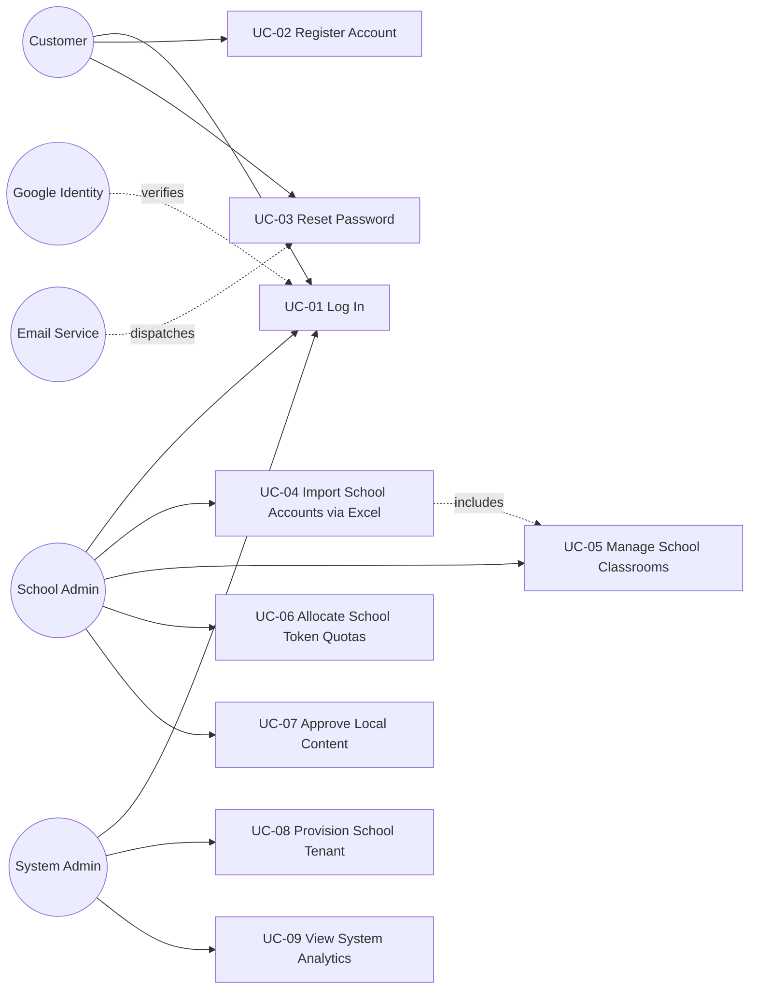
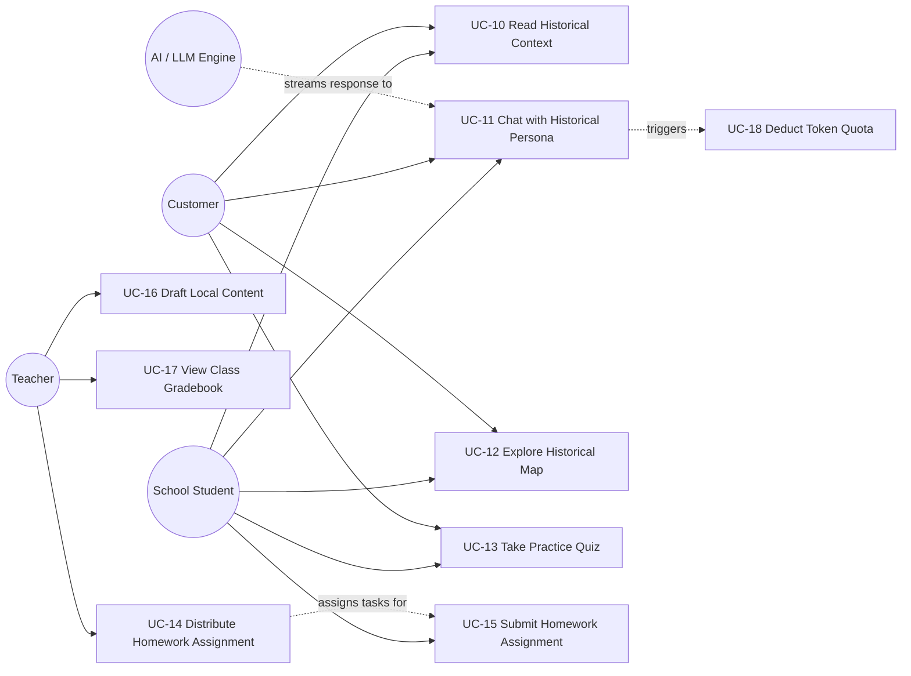
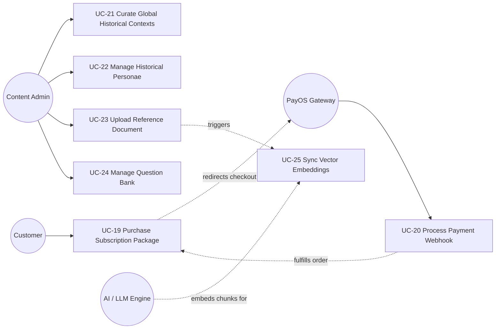
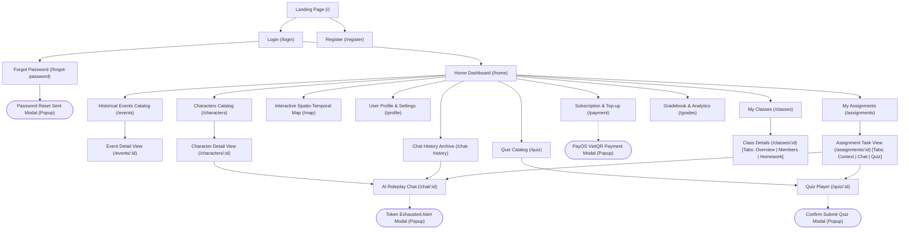
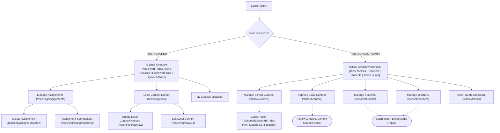
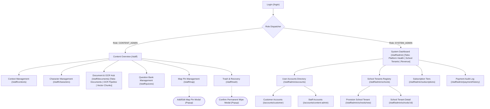
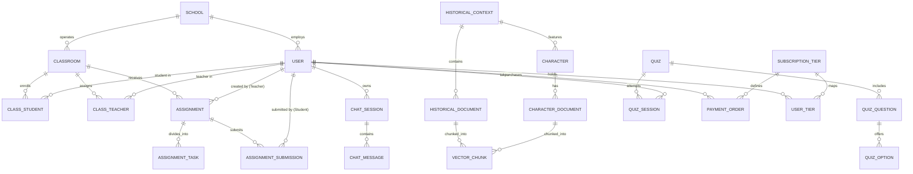

## TABLE OF CONTENTS
* [I. Project Report](#i-project-report)
  * [1. Status Report](#1-status-report)
  * [2. Team Involvements](#2-team-involvements)
  * [3. Issues/Suggestions](#3-issues-suggestions)
* [Record of Changes](#record-of-changes)
* [II. Software Requirement Specification](#ii-software-requirement-specification)
  * [1. Overall Description](#1-overall-description)
    * [1.1 Product Overview](#11-product-overview)
    * [1.2 Business Rules Summary](#12-business-rules-summary)
  * [2. User Requirements](#2-user-requirements)
    * [2.1 System Actors](#21-system-actors)
    * [2.2 Use Cases](#22-use-cases)
      * [2.2.1 Use Case Diagrams](#221-use-case-diagrams)
      * [2.2.2 Use Case Descriptions](#222-use-case-descriptions)
  * [3. Functional Requirements](#3-functional-requirements)
    * [3.1 System Functional Overview](#31-system-functional-overview)
      * [3.1.1 Screens Flow](#311-screens-flow)
      * [3.1.2 Screen Descriptions](#312-screen-descriptions)
      * [3.1.3 Screen Authorization (Role & Data Matrix)](#313-screen-authorization-role--data-matrix)
      * [3.1.4 Non-Screen Functions](#314-non-screen-functions)
      * [3.1.5 Entity Relationship Diagram (ERD) & Entities Description](#315-entity-relationship-diagram-erd--entities-description)
    * [3.2 Module 1: Authentication & Account Management](#32-module-1-authentication--account-management)
      * [3.2.1 Function: User Login & Google OAuth2](#321-function-user-login--google-oauth2)
      * [3.2.2 Function: School Admin Batch Excel Import](#322-function-school-admin-batch-excel-import)
      * [3.2.3 Non-Screen Function: Expired JWT Token Eviction Scheduler](#323-non-screen-function-expired-jwt-token-eviction-scheduler)
    * [3.3 Module 2: SaaS B2B Classroom Management](#33-module-2-saas-b2b-classroom-management)
      * [3.3.1 Function: Teacher Homework Assignment Distribution](#331-function-teacher-homework-assignment-distribution)
      * [3.3.2 Non-Screen Function: Assignment Expiration & Overdue Status Scheduler](#332-non-screen-function-assignment-expiration--overdue-status-scheduler)
    * [3.4 Module 3: Conversational AI & Historical Roleplay (RAG)](#34-module-3-conversational-ai--historical-roleplay-rag)
      * [3.4.1 Function: Streaming First-Person AI Chat with Persona](#341-function-streaming-first-person-ai-chat-with-persona)
      * [3.4.2 Non-Screen Function: Real-Time SSE AI Streaming Token Pipe](#342-non-screen-function-real-time-sse-ai-streaming-token-pipe)
    * [3.5 Module 4: Spatio-Temporal Historical Map](#35-module-4-spatio-temporal-historical-map)
      * [3.5.1 Function: Interactive Map & Timeline Exploration](#351-function-interactive-map--timeline-exploration)
    * [3.6 Module 5: Quiz & Automated Knowledge Assessment](#36-module-5-quiz--automated-knowledge-assessment)
      * [3.6.1 Function: Timed Quiz Player & Server-Side Evaluation](#361-function-timed-quiz-player--server-side-evaluation)
    * [3.7 Module 6: Token Economy & Payment Integration (PayOS)](#37-module-6-token-economy--payment-integration-payos)
      * [3.7.1 Function: Subscription Top-Up via PayOS VietQR](#371-function-subscription-top-up-via-payos-vietqr)
      * [3.7.2 Non-Screen Function: Midnight Daily Token Allowance Reset Scheduler](#372-non-screen-function-midnight-daily-token-allowance-reset-scheduler)
      * [3.7.3 Non-Screen Function: Asynchronous Payment Fulfillment & Reconciliation Scheduler](#373-non-screen-function-asynchronous-payment-fulfillment--reconciliation-scheduler)
    * [3.8 Module 7: Local Content & School Approval Workflow](#38-module-7-local-content--school-approval-workflow)
      * [3.8.1 Function: School Admin Review & Approval Queue](#381-function-school-admin-review--approval-queue)
    * [3.9 Module 8: Academic Knowledge Curation & Document OCR](#39-module-8-academic-knowledge-curation--document-ocr)
      * [3.9.1 Function: Document Upload, Tess4J OCR & Vector Ingestion](#391-function-document-upload-tess4j-ocr--vector-ingestion)
      * [3.9.2 Non-Screen Function: Tess4J Background OCR Text Extraction Worker](#392-non-screen-function-tess4j-background-ocr-text-extraction-worker)
      * [3.9.3 Non-Screen Function: Semantic Text Chunker & PgVector Ingestion Worker](#393-non-screen-function-semantic-text-chunker--pgvector-ingestion-worker)
    * [3.10 Module 9: Progress Tracking & Analytics Dashboards](#310-module-9-progress-tracking--analytics-dashboards)
      * [3.10.1 Function: Teacher Class Analytics & Gradebook](#3101-function-teacher-class-analytics--gradebook)
      * [3.10.2 Function: System Administrator Operational & Financial Analytics](#3102-function-system-administrator-operational--financial-analytics)
  * [4. Non-Functional Requirements](#4-non-functional-requirements)
    * [4.1 External Interfaces](#41-external-interfaces)
    * [4.2 Quality Attributes](#42-quality-attributes)
      * [4.2.1 Usability](#421-usability)
      * [4.2.2 Reliability & Availability](#422-reliability--availability)
      * [4.2.3 Performance](#423-performance)
      * [4.2.4 Security](#424-security)
      * [4.2.5 Maintainability](#425-maintainability)
  * [5. Requirement Appendix](#5-requirement-appendix)
    * [5.1 Business Rules](#51-business-rules)
    * [5.2 Common Requirements](#52-common-requirements)
    * [5.3 Application Messages List](#53-application-messages-list)
    * [5.4 Other Technical & Operational Requirements](#54-other-technical--operational-requirements)

---

# I. Project Report

## 1. Status Report
* **Milestone:** Review 1 (Week 3 Deliverable).
* **Work Progress:** On track (100% of planned Sprint 0 to Sprint 6 deliverables completed).
* **Completed Milestones:**
  1. System Architecture Design & 3-layer decoupled backend setup (Spring Boot Core + Python FastAPI RAG).
  2. Database modeling with PostgreSQL, Flyway migration scripts (37 versions), and Supabase PgVector.
  3. B2C Customer & B2B SaaS Multi-tenant School models established.
  4. PayOS VietQR payment gateway integration and token allocation scheduler.
  5. Interactive Spatio-Temporal Historical Map with chronological timeline slider.
  6. Conversational AI agent supporting first-person historical persona roleplay with streaming Server-Sent Events (SSE).

## 2. Team Involvements

| Student ID | Full Name | Role | Core Responsibilities & Contributions |
| :---: | :--- | :--- | :--- |
| **SE192645** | Nguyễn Minh Trí | Leader & AI Engineer & Backend Dev | Project management, Agile/Sprint planning, RAG pipeline design, AI streaming chat (SSE), prompt engineering for historical persona, daily token logic. |
| **SE196495** | Trần Quốc Dinh | Backend Developer & DevOps | B2B SaaS classroom & user management APIs, progress tracking & analytics engine, CI/CD automated pipeline, server containerization (Docker/Caddy). |
| **SE196405** | Võ Đồng Đức Khải | Backend Developer & Tester | Multi-tenant schema design, RBAC & Google OAuth2 integration, Academic Content CRUD APIs, Document OCR pipeline (Tess4J/PDFBox), Unit & Integration testing. |
| **SE196309** | Nguyễn Công Thành | Frontend Developer & Tester | User-facing Web application (AI Chat, Interactive Map, Quiz Player), B2B Teacher & School Admin portals, System & Content Admin dashboards, UI/UX testing. |
| **SE193803** | Đỗ Quốc Bảo | Backend Developer & Tester | Quiz & question bank engine APIs, PayOS online checkout & webhook reconciliation, interactive map geospatial APIs, test case design and execution. |

## 3. Issues/Suggestions
* **Issue 1:** High latency in initial LLM response when combining extensive RAG context with remote inference APIs.
  * *Solution:* Implemented Server-Sent Events (SSE) for real-time token streaming ($TTFT < 1.5$s) and deployed Kaggle Cross-Encoder reranking for compact context injection.
* **Issue 2:** Handling large scanned PDF documents during academic curation.
  * *Solution:* Asynchronous background queue executing Tess4J OCR with chunking strategy (500 tokens, 10% overlap).

---

# Record of Changes

| Date | A*, M, D | In charge | Change Description |
| :--- | :---: | :--- | :--- |
| **2026-03-06** | A | Nguyễn Minh Trí | Initial system architecture, SRS template setup and core use case definition. |
| **2026-05-18** | M | Võ Đồng Đức Khải | Refactored monolith to 3-layer decoupled architecture (Spring Boot Core + FastAPI AI). |
| **2026-05-25** | A | Đỗ Quốc Bảo | Added PayOS VietQR payment flow and Subscription Tier definitions. |
| **2026-06-05** | M | Đỗ Quốc Bảo | Added asynchronous payment fulfillment reconciliation scheduler and webhook verification. |
| **2026-07-23** | A | Võ Đồng Đức Khải | Integrated Tess4J OCR and Apache PDFBox for automated document vectorization. |
| **2026-09-23** | M | Võ Đồng Đức Khải | Updated dual-token security: JWT access token + refresh token rotation. |
| **2026-10-14** | A | Trần Quốc Dinh | Integrated B2B SaaS School Module (2-sheet Excel import, class rosters, teacher assignment). |
| **2026-10-16** | A | Nguyễn Minh Trí | Standardized 27-feature RBAC Role Matrix, Local Content Approval, and Assignment Workflow. |
| **2026-10-19** | M | Nguyễn Minh Trí | Finalized comprehensive SRS Report 3 for Capstone Project Review 1 submission. |
| **2026-10-20** | M | Nguyễn Minh Trí | Aligned with SRS template: standardized Verb+Object UC names, synchronized UC IDs, added modal/tab indicators in Screens Flow, expanded Screen Authorization with data operations, specified all 7 schedulers, added Google OAuth/Email interfaces, and clarified reliability/accuracy/performance metrics. |

*\*A: Added, M: Modified, D: Deleted*

---

# II. Software Requirement Specification

## 1. Overall Description

### 1.1 Product Overview
**HistoryTalk** is a Software-as-a-Service (SaaS) educational platform engineered to revolutionize Vietnamese history education. The system replaces passive rote learning and memorization of historical facts with immersive, interactive learning experiences.

The platform provides a dual-model service:
1. **B2C (Direct to Consumer):** Dedicated to individual learners, history buffs, and self-studying students with Free and Premium tiers, allowing them to chat with historical personae, interact with chronological battle maps, and practice quizzes.
2. **B2B SaaS (Schools & Educational Institutions):** Dedicated to secondary and high schools. It provides a multi-tenant administration ecosystem where School Admins manage teachers and classes, and Teachers curate localized historical contexts, distribute multi-component assignments (Context Reading $\rightarrow$ Character Roleplay $\rightarrow$ Automated Quiz Assessment), and monitor learning performance.

#### Context Diagram
The context diagram below illustrates the external entities, third-party services, and boundaries of the HistoryTalk platform:

```
                          ┌──────────────────────────┐
                          │   System Administrator   │
                          └────────────┬─────────────┘
                                       │ System config & SaaS School provisioning
                                       ▼
 ┌──────────────┐         ┌──────────────────────────┐         ┌──────────────┐
 │ School Admin │────────▶│                          │◀────────│   Teacher    │
 └──────────────┘ Manage  │                          │ Assign  └──────────────┘
                  classes │                          │ homework &
 ┌──────────────┐ & users │                          │ track   ┌──────────────┐
 │School Student│────────▶│                          │◀────────│   Customer   │
 └──────────────┘ Study & │       HISTORYTALK        │ Chat &  │(B2C Free/Pro)│
                  Quizzes │       SAAS SYSTEM        │ Top-up  └──────────────┘
 ┌──────────────┐         │                          │
 │Content Admin │────────▶│                          │
 └──────────────┘ Curate  │                          │
                  global  └────────────┬─────────────┘
                  content              │
         ┌─────────────────────────────┼─────────────────────────────┐
         │                             │                             │
         ▼                             ▼                             ▼
┌──────────────────┐          ┌──────────────────┐          ┌──────────────────┐
│ PayOS Payment GW │          │ Supabase Storage │          │ LLM Providers /  │
│ - VietQR Checkout│          │  & Cloudflare R2 │          │ Kaggle Reranker  │
│ - Webhook verify │          │ - Audio/Avatars  │          │ - Vector RAG API │
└──────────────────┘          │ - PDFs & Docs    │          │ - SSE LLM Stream │
         │                    └──────────────────┘          └──────────────────┘
         ▼                             ▼
┌──────────────────┐          ┌──────────────────┐
│ Google Identity  │          │ Email Service    │
│ - OAuth2 / OIDC  │          │ - SMTP/SendGrid  │
│ - SSO Token Auth │          │ - Password Reset │
└──────────────────┘          └──────────────────┘
```

### 1.2 Business Rules Summary
The core operations of HistoryTalk are governed by key business constraints:
* **Multi-tenancy Isolation:** School resources (classes, students, local content, assignments) are strictly segregated by `school_id`. No cross-tenant access is permitted.
* **Token Economy:** AI conversations consume tokens based on message complexity and prompt size. Free users receive a refreshed daily token quota upon their first login of the day; paid customers or school quota tiers expand this balance.
* **Academic Integrity in Assignments:** A homework assignment consists of up to 3 components (Reading Context, Chatting with Persona, Taking a Quiz). Quiz submissions are evaluated server-side against protected answer keys.

---

## 2. User Requirements

### 2.1 System Actors

| # | Actor | Type | Description |
| :-: | :--- | :--- | :--- |
| **1** | **Customer (B2C)** | Human | Individual user who signs up freely or upgrades to Premium (Plus/Pro). Interacts with historical personae, explores map events, and practices quizzes. |
| **2** | **School Student** | Human | Student belonging to an enrolled school tenant. Logs in via school-provisioned credentials, studies assigned homework, dialogues with AI, and submits tests. |
| **3** | **Teacher** | Human | Instructor managing classrooms. Manages class rosters, assigns homework, drafts local historical contexts and quizzes, and analyzes student grades. |
| **4** | **School Admin** | Human | School administrator. Performs 2-sheet batch Excel onboarding of teachers and students, sets school token allowances, and approves local teacher content. |
| **5** | **Content Admin** | Human | History content specialist. Curates global historical events, characters, reference documents, and standard quiz banks. |
| **6** | **System Admin** | Human | Super-administrator. Onboards new school contracts, oversees platform health, configures subscription tiers, and audits revenue. |
| **7** | **PayOS Gateway** | External System | Third-party payment gateway processing VietQR transactions and sending asynchronous payment confirmation webhooks. |
| **8** | **AI / LLM Engine** | External System | Python FastAPI microservice + remote LLM & Cross-Encoder hosting RAG vector searches and generating streaming roleplay responses. |
| **9** | **Google Identity** | External System | Identity provider handling Google OAuth 2.0 / OpenID Connect single sign-on authentication and profile exchange. |
| **10**| **Email Service** | External System | SMTP / transactional email service delivering password reset tokens, onboarding credentials, and system notifications. |

---

### 2.2 Use Cases

#### 2.2.1 Use Case Diagrams

##### 1. Authentication & School Administration Use Case Diagram


##### 2. Learning, AI Interaction & Assessment Use Case Diagram


##### 3. Payment, Content Management & Knowledge Ingestion Use Case Diagram


#### 2.2.2 Use Case Descriptions

The names of all use cases adhere strictly to the **Verb + Object** convention as required by the specification standard:

| ID | Use Case | Actors | Use Case Description |
| :---: | :--- | :--- | :--- |
| **UC-01** | **Log In** | All Users, Google Identity | Authenticate user identity via Email/Password or Google OAuth 2.0; issue signed JWT Access and Refresh token pair. |
| **UC-02** | **Register Account** | Customer | Register an individual learner account with username, email, full name, and encrypted password under the Free tier. |
| **UC-03** | **Reset Password** | All Users, Email Service | Request password recovery email, generate time-bounded one-time token, and allow secure submission of a new password. |
| **UC-04** | **Import School Accounts via Excel** | School Admin | Upload 2-sheet standardized Excel spreadsheet to batch-provision teacher and student accounts and establish class rosters. |
| **UC-05** | **Manage School Classrooms** | School Admin, Teacher | Create, update, archive classrooms; assign instructor teachers; and review enrolled student rosters. |
| **UC-06** | **Allocate School Token Quotas** | School Admin | Configure and distribute daily/monthly AI interaction token allowances across classes and student groups. |
| **UC-07** | **Approve Local Content** | School Admin, Teacher | Review teacher-authored local historical events, characters, and quizzes; publish approved items to school catalog or reject with feedback. |
| **UC-08** | **Provision School Tenant** | System Admin, School Admin | Register educational institution entity, establish school tenant code, set license duration, and issue School Admin account. |
| **UC-09** | **View System Analytics** | System Admin | Monitor system-wide health, active user counts, token consumption volume, PayOS transaction revenue, and API latency. |
| **UC-10** | **Read Historical Context** | School Student, Customer | Access curated national or local historical period articles, view associated battle landmarks, and review verified sources. |
| **UC-11** | **Chat with Historical Persona** | School Student, Customer, AI Engine | Engage in interactive, 1st-person conversational dialogue with AI-simulated historical figures backed by RAG context. |
| **UC-12** | **Explore Historical Map** | All Users | Inspect interactive chronological map of Vietnam; filter events, monuments, and battle sites using a temporal timeline slider. |
| **UC-13** | **Take Practice Quiz** | School Student, Customer | Complete randomized multiple-choice or fill-in knowledge tests; receive instant server-evaluated scoring and explanations. |
| **UC-14** | **Distribute Homework Assignment** | Teacher, School Student | Compose structured homework tasks (Context Reading, Persona Chat, Quiz Test) with deadlines, and dispatch to assigned classes. |
| **UC-15** | **Submit Homework Assignment** | School Student | Complete all requisite tasks assigned by teacher and submit before deadline; track real-time completion status and score. |
| **UC-16** | **Draft Local Content** | Teacher | Author localized historical events, regional heroic figures, and custom quiz questions for school administrative review. |
| **UC-17** | **View Class Gradebook** | Teacher | Inspect student homework completion rates, individual task scores, quiz attempts, and AI interaction metrics across classes. |
| **UC-18** | **Deduct Token Quota** | AI / LLM Engine, System | Check user/school token balance prior to each LLM query and atomically decrement quota based on prompt and response tokens. |
| **UC-19** | **Purchase Subscription Package** | Customer, PayOS Gateway | Select B2C subscription tier (Plus/Pro) or token top-up pack; initiate checkout and render dynamic VietQR code. |
| **UC-20** | **Process Payment Webhook** | PayOS Gateway, System | Validate HMAC-SHA256 signature of PayOS webhook payload; update order to `PAID` and credit user account tier and tokens. |
| **UC-21** | **Curate Global Historical Contexts** | Content Admin | Author, edit, and publish verified national historical periods, battle chronologies, and historical figures for platform-wide access. |
| **UC-22** | **Manage Historical Personae** | Content Admin | Configure historical character avatars, biographical metadata, period tags, and system persona prompts for AI roleplay. |
| **UC-23** | **Upload Reference Document** | Content Admin, Tess4J / PDFBox | Ingest historical reference books, research papers, or scanned PDF pages; trigger optical character recognition and text extraction. |
| **UC-24** | **Manage Question Bank** | Content Admin | Create, categorize, tag, and validate multiple-choice and single-choice questions linked to historical contexts. |
| **UC-25** | **Sync Vector Embeddings** | AI / LLM Engine, System | Split extracted document text into semantic chunks (500 tokens), generate dense vector embeddings, and store in PgVector. |

---

## 3. Functional Requirements

### 3.1 System Functional Overview

#### 3.1.1 Screens Flow

The navigation model distinguishes between normal flat screens, screens with multiple information tabs (annotated with `[Tabs]`), and pop-up / modal dialogues (represented using oval notation `([Modal])`).

##### A. Public & Student / Customer Screen Navigation Flow


##### B. Teacher & School Admin Screen Navigation Flow


##### C. Content Admin & System Admin Screen Navigation Flow


#### 3.1.2 Screen Descriptions

The screen inventory maps 1-to-1 with every screen and popup modal illustrated in the Screens Flow diagrams:

| # | Feature Area | Screen / Modal Name | Type | URL / Trigger | Description |
| :-: | :--- | :--- | :--- | :--- | :--- |
| **1** | Public | Landing Page | Screen | `/` | Showcase platform capabilities, interactive demo teasers, curriculum topics, and call-to-action buttons. |
| **2** | Authentication | Login Screen | Screen | `/login` | Form for email/password credentials or Google OAuth2 single-sign-on login. |
| **3** | Authentication | Registration Screen | Screen | `/register` | B2C customer registration form with input validations. |
| **4** | Authentication | Forgot Password | Screen | `/forgot-password` | Form to request password recovery email. |
| **5** | Authentication | Password Reset Modal | Popup Modal | Action on `/forgot-password` | Confirmation popup notifying that a time-limited reset link has been dispatched to email. |
| **6** | Portal | Home Dashboard | Screen | `/home` | User home feed displaying recommended historical eras, active assignments, and recent conversations. |
| **7** | Curriculum | Events Catalog | Screen | `/events` | Directory of national historical periods, chronologically sorted with search and era filters. |
| **8** | Curriculum | Event Detail View | Screen | `/events/:id` | Full article view of an event, battle summaries, related characters, and links to quiz/map. |
| **9** | AI Roleplay | Characters Catalog | Screen | `/characters` | Roster of historical personalities with era tags, avatars, and brief biographical summaries. |
| **10**| AI Roleplay | Character Detail View | Screen | `/characters/:id` | Detailed biographical profile of a historical figure with quote teaser and "Start Dialogue" action. |
| **11**| AI Roleplay | AI Roleplay Chat | Screen | `/chat/:id` | Real-time SSE streaming dialogue window simulating historical figure with token gauge and suggestion pills. |
| **12**| AI Roleplay | Token Exhausted Alert | Popup Modal | Triggered in `/chat/:id` | Modal warning user of depleted token balance, presenting upgrade link or notification of midnight reset. |
| **13**| AI Roleplay | Chat History Archive | Screen | `/chat-history` | List of previous conversation sessions with characters, with resumption capability. |
| **14**| Spatio-Temporal | Historical Map | Screen | `/map` | Interactive map of Vietnam with chronological time slider, battle pins, and historical monuments. |
| **15**| Assessment | Quiz Catalog | Screen | `/quiz` | Practice quiz catalog filtered by topic, historical era, and difficulty level. |
| **16**| Assessment | Quiz Player | Screen | `/quiz/:id` | Timed test player supporting single/multiple choice questions, countdown timer, and answer locking. |
| **17**| Assessment | Confirm Submit Modal | Popup Modal | Triggered in `/quiz/:id` | Dialog verifying that student wishes to submit test, highlighting any unanswered questions. |
| **18**| User Profile | User Profile & Settings| Screen | `/profile` | Account settings, display name, password update, and current subscription/token balance status. |
| **19**| Payment | Subscription & Top-up | Screen | `/payment` | Tier package selection (Free, Plus, Pro) and token top-up options. |
| **20**| Payment | PayOS VietQR Modal | Popup Modal | Triggered on `/payment` | Modal displaying dynamic VietQR image with payment amount and transfer code, polling for completion. |
| **21**| SaaS Student | My Classes | Screen | `/classes` | List of enrolled classrooms for students or assigned classrooms for teachers. |
| **22**| SaaS Student | Class Details | Multi-Tab Screen | `/classes/:id` | Multi-tab screen featuring: [Tab 1: Overview & Schedule, Tab 2: Class Members, Tab 3: Assigned Homework]. |
| **23**| SaaS Student | My Assignments | Screen | `/assignments` | Student homework list categorized by status (`NOT_STARTED`, `IN_PROGRESS`, `COMPLETED`, `OVERDUE`). |
| **24**| SaaS Student | Assignment Task View | Multi-Tab Screen | `/assignments/:id` | Multi-tab interface for homework: [Tab 1: Reading Context, Tab 2: AI Persona Dialogue, Tab 3: Assignment Quiz]. |
| **25**| SaaS Student | Gradebook & Analytics | Screen | `/grades` | Personal student report card with quiz scores, submission timestamps, and teacher remarks. |
| **26**| SaaS Teacher | Teacher Overview | Multi-Tab Screen | `/teaching` | Multi-tab workspace: [Tab 1: Active Classes, Tab 2: Homework Due & Submissions, Tab 3: Quick Action Tools]. |
| **27**| SaaS Teacher | Manage Assignments | Screen | `/teaching/assignments`| Table of distributed homework across classes, deadline monitoring, and completion statistics. |
| **28**| SaaS Teacher | Create Assignment | Screen | `/teaching/assignments/new`| Multi-step form to configure an assignment (target classes, reading material, chat requirement, quiz, due date).|
| **29**| SaaS Teacher | Assignment Submissions| Screen | `/teaching/assignments/:id`| Submission tracking table with student scores, completion status, and grade export. |
| **30**| SaaS Teacher | Local Content Library | Screen | `/teaching/local` | Library of teacher-drafted local history contexts and quizzes awaiting administrative approval. |
| **31**| SaaS Teacher | Create Local Content | Screen | `/teaching/local/new` | Form for authoring school-specific historical events, local heroic figures, and custom quiz tests. |
| **32**| SaaS Teacher | Edit Local Content | Screen | `/teaching/local/:id` | Form to edit drafted or rejected local historical items before re-submission. |
| **33**| SaaS School | School Overview | Multi-Tab Screen | `/school` | High-level school dashboard: [Tab 1: School Metrics, Tab 2: Faculty, Tab 3: Student Body, Tab 4: Token Quotas]. |
| **34**| SaaS School | Manage School Classes | Screen | `/school/classes` | Academic classroom management: class creation, grade level assignment, teacher instructor mapping. |
| **35**| SaaS School | School Class Detail | Multi-Tab Screen | `/school/classes/:id`| Class management view: [Tab 1: Class Information, Tab 2: Enrolled Students, Tab 3: Assigned Teachers]. |
| **36**| SaaS School | Approve Local Content | Screen | `/school/content` | Review queue for teacher-created local contexts and quizzes with Approve and Reject actions. |
| **37**| SaaS School | Reject Content Modal | Popup Modal | Triggered in `/school/content`| Dialog prompting School Admin to provide reason for rejecting teacher-authored content. |
| **38**| SaaS School | Manage Teachers | Screen | `/school/teachers` | Directory of school teachers with credentials management and status toggling. |
| **39**| SaaS School | Manage Students | Screen | `/school/students` | Directory of school students with classroom enrollment filters. |
| **40**| SaaS School | Batch Import Excel Modal| Popup Modal | Triggered in `/school/students`| Modal to upload 2-sheet Excel workbook (`Danh_Sach_Giao_Vien`, `Danh_Sach_Hoc_Sinh_Va_Lop`) with dry-run preview. |
| **41**| SaaS School | Token Quota Allocation| Screen | `/school/tokens` | Interface to configure daily/monthly token limits allocated to specific grades or classrooms. |
| **42**| Content Admin | Content Overview | Screen | `/staff` | Global curriculum overview, pending publication counts, and quick access to editors. |
| **43**| Content Admin | Context Management | Screen | `/staff/contexts` | CRUD interface for national historical contexts and timeline event definitions. |
| **44**| Content Admin | Character Management | Screen | `/staff/characters` | CRUD interface for historical personalities, bio parameters, and persona system prompts. |
| **45**| Content Admin | Document & OCR Hub | Multi-Tab Screen | `/staff/documents` | Multi-tab knowledge hub: [Tab 1: Document Repository, Tab 2: Tess4J OCR Pipeline, Tab 3: PgVector Chunks]. |
| **46**| Content Admin | Question Bank | Screen | `/staff/quizzes` | Question repository categorized by difficulty and era, with bulk question authoring. |
| **47**| Content Admin | Map Pin Management | Screen | `/staff/map` | Management table for geo-coordinates, historical battle pins, and year markers. |
| **48**| Content Admin | Add/Edit Map Pin Modal| Popup Modal | Triggered in `/staff/map` | Modal form to enter latitude, longitude, historical context reference, and pin marker icon. |
| **49**| Content Admin | Trash & Recovery | Screen | `/staff/trash` | Soft-deleted entity catalog supporting one-click restoration or permanent purge. |
| **50**| Content Admin | Confirm Wipe Modal | Popup Modal | Triggered in `/staff/trash` | High-risk confirmation dialog before permanently executing physical deletion from database. |
| **51**| System Admin | System Dashboard | Multi-Tab Screen | `/staff/admin` | Multi-tab operational dashboard: [Tab 1: Platform Health & JVM, Tab 2: School Tenants, Tab 3: Revenue & PayOS].|
| **52**| System Admin | User Accounts Directory| Screen | `/staff/admin/accounts`| Global user registry across all roles, supporting account deactivation and password overrides. |
| **53**| System Admin | School Tenants Registry| Screen | `/staff/admin/schools` | Enterprise school organization directory, license dates, and contracted student quotas. |
| **54**| System Admin | Provision School Tenant| Screen | `/staff/admin/schools/new`| Form to register new school tenant, generate initial School Admin account, and set license expiry. |
| **55**| System Admin | School Tenant Detail | Screen | `/staff/admin/schools/:id`| Comprehensive school tenant profile, active rosters count, and contractual token allocation. |
| **56**| System Admin | Subscription Tiers | Screen | `/staff/admin/subscriptions`| Configuration interface for B2C pricing plans, monthly prices, and token bundle limits. |
| **57**| System Admin | Payment Audit Log | Screen | `/staff/admin/payment/history`| Financial ledger displaying PayOS order IDs, transaction amounts, webhook signatures, and statuses. |

---

#### 3.1.3 Screen Authorization (Role & Data Matrix)

In strict compliance with the SRS specification standard, the authorization matrix specifies both screen access and granular data-level operations (`Query All Data`, `Query Own Data`, `Query Managed Data`, `Add New Data`, `Update All Data`, `Update Own Data`, `Update Managed Data`, `Delete Data`):

| Screen / Data Operation | System Admin | Content Admin | School Admin | Teacher | School Student | Customer |
| :--- | :---: | :---: | :---: | :---: | :---: | :---: |
| **Landing & Public Screens (`/`, `/login`, `/register`)** | | | | | | |
| Screen Access | X | X | X | X | X | X |
| Query All Data | X | X | X | X | X | X |
| Add New Data (Self-Register) | | | | | | X |
| **Curriculum & Events (`/events`, `/characters`, `/map`)** | | | | | | |
| Screen Access | X | X | X | X | X | X |
| Query All Data (Global Contexts) | X | X | X | X | X | X |
| Query Managed Data (Local Contexts) | | | X | X | X | |
| Add New Data | | X | | | | |
| Update All Data | | X | | | | |
| Delete Data | | X | | | | |
| **AI Roleplay Chat (`/chat/:id`, `/chat-history`)** | | | | | | |
| Screen Access | X | X | X | X | X | X |
| Query All Data | X | | | | | |
| Query Own Data (Chat History) | X | X | X | X | X | X |
| Add New Data (Send Prompt) | | | | | X | X |
| Delete Data (Clear Own History) | | | | | X | X |
| **Quiz Practice (`/quiz`, `/quiz/:id`)** | | | | | | |
| Screen Access | X | X | X | X | X | X |
| Query All Data | X | X | | | | X |
| Query Managed Data (School Quizzes) | | | X | X | X | |
| Query Own Data (Attempt History) | | | | | X | X |
| Add New Data (Submit Answers) | | | | | X | X |
| **Student Homework & Assignments (`/assignments`, `/grades`)**| | | | | | |
| Screen Access | | | | | X | |
| Query All Data | | | | | | |
| Query Own Data (My Assignments & Grades)| | | | | X | |
| Add New Data (Submit Assignment Task) | | | | | X | |
| Update Own Data (Save In-progress Task) | | | | | X | |
| **Teacher Classroom & Assignment Manager (`/teaching/**`)** | | | | | | |
| Screen Access | | | | X | | |
| Query Managed Data (Assigned Classes) | | | | X | | |
| Add New Data (Distribute Homework) | | | | X | | |
| Update Managed Data (Edit Homework) | | | | X | | |
| Delete Data (Cancel Draft Assignment) | | | | X | | |
| **Teacher Local Content Library (`/teaching/local/**`)** | | | | | | |
| Screen Access | | | | X | | |
| Query Managed Data (School Drafts) | | | | X | | |
| Query Own Data (Teacher's Own Drafts) | | | | X | | |
| Add New Data (Draft Local Context/Quiz)| | | | X | | |
| Update Own Data (Revise Draft) | | | | X | | |
| Delete Data (Remove Own Draft) | | | | X | | |
| **School Administration & Rosters (`/school/**`)** | | | | | | |
| Screen Access | X | | X | | | |
| Query Managed Data (School Members/Classes)| | | X | | | |
| Add New Data (Add Class, Batch Import) | | | X | | | |
| Update Managed Data (Modify Class/Roster)| | | X | | | |
| Delete Data (Deactivate Class/Member) | | | X | | | |
| **School Content Approval Queue (`/school/content`)** | | | | | | |
| Screen Access | | | X | | | |
| Query Managed Data (School Submissions)| | | X | | | |
| Update Managed Data (Approve / Reject) | | | X | | | |
| **Knowledge Curation & OCR Hub (`/staff/documents`, `/staff/quizzes`)**| | | | | | |
| Screen Access | X | X | | | | |
| Query All Data | X | X | | | | |
| Add New Data (Upload Doc, Trigger OCR) | | X | | | | |
| Update All Data (Edit Vector Metadata)| | X | | | | |
| Delete Data (Soft-delete to Trash) | | X | | | | |
| **B2C Payment & VietQR Top-up (`/payment`)** | | | | | | |
| Screen Access | X | | | | | X |
| Query Own Data (Own Transactions) | | | | | | X |
| Add New Data (Initiate Payment Order) | | | | | | X |
| **System Administration & School Provisioning (`/staff/admin/**`)**| | | | | | |
| Screen Access | X | | | | | |
| Query All Data (Platform-wide Metrics) | X | | | | | |
| Add New Data (Provision School Tenant)| X | | | | | |
| Update All Data (Modify School License)| X | | | | | |
| Delete Data (Archive School Tenant) | X | | | | | |

*\*Note: `X` denotes authorized operation. Cells left blank denote forbidden operations (enforced by Spring Security and returning HTTP 403 Forbidden).*

---

#### 3.1.4 Non-Screen Functions

The platform executes 7 dedicated automated background services, schedulers, and workers to ensure data integrity, timely status progression, and continuous operation:

| # | Feature Area | System Function Name | Execution Mode | Timing / Trigger | Description |
| :-: | :--- | :--- | :--- | :--- | :--- |
| **1** | Security Auditing | `JwtBlacklistCleanScheduler` | Spring Cron Job | Daily (`0 0 * * * ?`) | Evicts expired JWT access tokens from Redis blacklist to free memory. |
| **2** | Assignment Lifecycle | `AssignmentDueChecker` | Spring Cron Job | Hourly (`0 * * * * ?`) | Scans assignments past deadline; marks incomplete student submissions as `OVERDUE`. |
| **3** | AI Roleplay Pipeline | `FastApiRoleplaySseStream` | SSE Stream Service | Real-time on prompt | Bridges FastAPI LLM tokens via Server-Sent Events to client browser with token metering. |
| **4** | Token Economy | `DailyTokenResetScheduler` | Spring Cron Job | Daily at 00:00 UTC+7 (`0 0 0 * * ?`) | Resets daily token allowances for Free customers and School accounts. |
| **5** | Payment Fulfillment | `PaymentReconciliationScheduler`| Spring Cron Job | Every 5 min (`0 */5 * * * ?`)| Polls PayOS API for pending orders that missed webhook notification; credits tokens upon verified payment. |
| **6** | Document OCR Worker | `TesseractOcrWorker` | Background Async Worker| On document upload | Extracts Vietnamese plaintext from scanned PDF/images using Tess4J (`vie.traineddata`). |
| **7** | Knowledge Ingestion | `AsyncDocumentChunkerService` | Background Async Worker| Post-OCR completion | Splits text into 500-token chunks with 10% overlap, generates dense embeddings, and stores in PgVector. |

---

#### 3.1.5 Entity Relationship Diagram (ERD) & Entities Description



##### Entities Description

| # | Entity Name | Primary Key | Foreign Keys | Business Description |
| :-: | :--- | :--- | :--- | :--- |
| **1** | `users` | `id` (UUID) | `school_id` | Core identity entity storing credentials, role (`CUSTOMER`, `STUDENT`, `TEACHER`, `SCHOOL_ADMIN`, `CONTENT_ADMIN`, `SYSTEM_ADMIN`), and token balance. |
| **2** | `schools` | `id` (UUID) | — | B2B tenant organization entity holding school code, contract license dates, and token limits. |
| **3** | `classrooms` | `id` (UUID) | `school_id` | Academic class entity (e.g., "10A1", "11B2") belonging to a specific school tenant. |
| **4** | `class_students` | `id` (UUID) | `classroom_id`, `student_id` | Associative table enrolling students into specific classes. |
| **5** | `class_teachers` | `id` (UUID) | `classroom_id`, `teacher_id` | Associative table assigning teachers as instructors for specific classrooms. |
| **6** | `historical_contexts`| `id` (UUID) | `school_id` (nullable) | Global or localized historical event / period summary. |
| **7** | `characters` | `id` (UUID) | `context_id`, `school_id` | Historical figure profile storing biographical data, system persona prompt, and avatar URL. |
| **8** | `documents` | `id` (UUID) | `context_id`, `character_id` | Curated source text or PDF reference used as grounding data for RAG. |
| **9** | `vector_chunks` | `id` (UUID) | `document_id` | Text chunk and its dense 768/1536-dimensional vector embedding stored in Supabase PgVector. |
| **10**| `chat_sessions` | `id` (UUID) | `user_id`, `character_id` | AI conversation session representing dialogue between a user and a historical persona. |
| **11**| `chat_messages` | `id` (UUID) | `session_id` | Message log holding role (`USER`/`ASSISTANT`), content, token count, and suggested follow-ups. |
| **12**| `quizzes` | `id` (UUID) | `context_id`, `school_id` | Assessment test entity defining duration, passing score, and question configuration. |
| **13**| `quiz_questions` | `id` (UUID) | `quiz_id` | Question entity supporting single-choice, multiple-choice, or fill-in-blank types. |
| **14**| `quiz_options` | `id` (UUID) | `question_id` | Answer choices for a question, flagged with `is_correct` boolean. |
| **15**| `quiz_sessions` | `id` (UUID) | `quiz_id`, `user_id` | Record of a student's test attempt, capturing start/end timestamps, submitted answers, and score. |
| **16**| `assignments` | `id` (UUID) | `classroom_id`, `teacher_id`| Multi-task homework assigned to a class, specifying start date, due date, and instructions. |
| **17**| `assignment_tasks`| `id` (UUID) | `assignment_id` | Individual task component (`READ_CONTEXT`, `CHAT_CHARACTER`, or `TAKE_QUIZ`). |
| **18**| `assignment_submissions` | `id` (UUID) | `assignment_id`, `student_id` | Submission state of a student (`NOT_STARTED`, `IN_PROGRESS`, `COMPLETED`, `OVERDUE`). |
| **19**| `payment_orders` | `id` (UUID) | `user_id`, `tier_id` | PayOS transaction record containing order code, amount, status (`PENDING`, `PAID`, `EXPIRED`). |
| **20**| `subscription_tiers`| `id` (UUID) | — | Available B2C subscription plans (`FREE`, `PLUS`, `PRO`) and pricing parameters. |

---

### 3.2 Module 1: Authentication & Account Management

#### 3.2.1 Function: User Login & Google OAuth2
* **Function Trigger:** User navigates to `/login`, inputs credentials, or clicks "Đăng nhập bằng Google".
* **Function Description:** Validates user identity via standard username/password (BCrypt encrypted) or Google OAuth 2.0 Identity Services. Generates a signed JWT Access Token and Refresh Token pair, enforces first-login password change for provisioned accounts, and routes user to appropriate dashboard.
* **Screen Layout Mockup:**
```
+-------------------------------------------------------------------------+
|                          ĐĂNG NHẬP HISTORYTALK                          |
+-------------------------------------------------------------------------+
|                                                                         |
|  Tên đăng nhập hoặc Email:                                              |
|  [ nguyenvana@thpt-chuvanan.edu.vn                                   ]  |
|                                                                         |
|  Mật khẩu:                                                              |
|  [ ••••••••••••••••                                              ] [👁]  |
|                                                                         |
|  [ ] Ghi nhớ đăng nhập                      [ Quên mật khẩu? ]          |
|                                                                         |
|  [                     ĐĂNG NHẬP HỆ THỐNG                     ]         |
|                                                                         |
|  --------------------------- HOẶC ---------------------------          |
|                                                                         |
|  [ G   Đăng nhập bằng Google Workspace (OAuth 2.0)            ]         |
|                                                                         |
|  Chưa có tài khoản? [ Đăng ký tài khoản cá nhân ]                       |
+-------------------------------------------------------------------------+
```
* **Function Details:**
  * **Input & Validation Rules:**
    * Username/Email: Required, length between 3 and 100 characters (`MSG02`).
    * Password: Required, minimum 8 characters (`MSG02`).
    * Google ID Token: Verified using Google Public Keys (`certs.googleapis.com`).
  * **Normal Flow:**
    1. User inputs valid credentials or authorizes via Google SSO popup.
    2. Backend validates credentials against database BCrypt hash or verifies Google ID token.
    3. If `must_change_password == true` (first-time login for batch imported school accounts), user is redirected to `/profile/change-password`.
    4. System creates new session, issues JWT Access Token (15-min TTL) and Refresh Token (7-day TTL), and redirects to the landing dashboard corresponding to user's assigned role.
  * **Abnormal Cases & Error Handling:**
    * *Invalid credentials:* System returns HTTP 401 Unauthorized with message `MSG09: Tên đăng nhập hoặc mật khẩu không chính xác`.
    * *Deactivated or Locked Account:* If `is_active == false`, system denies access with HTTP 403 Forbidden and message `MSG15: Tài khoản đã bị khóa hoặc chưa kích hoạt. Vui lòng liên hệ quản trị viên.`
    * *Network / Google Auth Failure:* If Google token verification fails or timeouts, system returns HTTP 502 with `MSG14: Hệ thống đang bận. Vui lòng thử lại sau giây lát.`

---

#### 3.2.2 Function: School Admin Batch Excel Import
* **Function Trigger:** School Admin clicks "Import Danh Sách (Excel)" on `/school/students` or `/school/teachers`.
* **Function Description:** Parses a 2-sheet Excel spreadsheet (`Danh_Sach_Giao_Vien` and `Danh_Sach_Hoc_Sinh_Va_Lop`), validates integrity and formats, auto-provisions accounts with unique school prefixes, links students to classes, and provides a dry-run preview.
* **Screen Layout Mockup:**
```
+-------------------------------------------------------------------------+
|                  [ IMPORT TÀI KHOẢN TRƯỜNG HỌC QUA EXCEL ]              |
+-------------------------------------------------------------------------+
|  1. Tải file mẫu chuẩn: [ Tải File Mẫu (Template_Truong_THPT.xlsx) ]    |
|                                                                         |
|  2. Tải lên tệp đã điền:                                                |
|     +-------------------------------------------------------------+     |
|     |  [  📁 Kéo thả file Excel vào đây hoặc Nhấn để Duyệt  ]     |     |
|     |  Tệp đã chọn: Danh_sach_Khoi_10_2026.xlsx (2.4 MB)          |     |
|     +-------------------------------------------------------------+     |
|                                                                         |
|  3. Xem trước & Kiểm tra (Preview):                                     |
|     - Sheet Giáo viên: 12 tài khoản hợp lệ (0 lỗi)                      |
|     - Sheet Học sinh : 450 tài khoản hợp lệ, 2 cảnh báo email trùng     |
|                                                                         |
|  [ Hủy bỏ ]                                  [ Bắt đầu Import ]         |
+-------------------------------------------------------------------------+
```
* **Function Details:**
  * **Input & Validation Rules:**
    * File format: `.xlsx` or `.xls`, max file size 10MB.
    * Mandatory sheets: Sheet 1 named `Danh_Sach_Giao_Vien`, Sheet 2 named `Danh_Sach_Hoc_Sinh_Va_Lop`.
    * Columns: Full Name (not blank), Email (valid email format), National ID / Student ID (digits only), Class Code (alphanumeric).
  * **Normal Flow:**
    1. Admin drops Excel file into upload dropzone.
    2. Backend parses workbook in memory and returns dry-run validation report within 3 seconds.
    3. Admin confirms import; system generates accounts with username format `{school_code}_gv_{code}` for teachers and `{school_code}_hs_{code}` for students.
    4. Default password set to `{school_code}@2026` with `must_change_password = true`.
    5. Returns toast `MSG12: Import thành công {count} tài khoản.`
  * **Abnormal Cases & Error Handling:**
    * *Corrupted or Invalid File Format:* Returns HTTP 400 Bad Request with message "Tệp không đúng định dạng Excel chuẩn".
    * *Missing Required Columns / Sheets:* System halts import with detailed list of missing sheet names or required headers.
    * *Duplicate User Identifiers:* Rows containing existing National IDs or Emails are skipped and compiled into an downloadable Error Report Excel sheet.
    * *Server Timeout during Large Import:* Batches of $> 1,000$ accounts are processed in chunks of 100 within a single database transaction to prevent partial corruptions.

---

#### 3.2.3 Non-Screen Function: Expired JWT Token Eviction Scheduler
* **Function Trigger:** Automated Spring `@Scheduled` cron job triggering daily at 00:00:00 UTC+7 (`0 0 0 * * ?`).
* **Function Description:** Scans Redis / in-memory JWT blacklist repository and evicts revoked tokens whose original expiration timestamp has elapsed, preventing unbounded memory growth.
* **Process Flow Diagram:**
```
[Cron: 0 0 0 * * ?] ──▶ [Query Redis Blacklist Keys] ──▶ [Filter where TTL <= 0] ──▶ [Batch Evict Keys] ──▶ [Log Evicted Count]
```
* **Function Details:**
  * **Validation Rules:** Verifies Redis connection availability before initiating scan.
  * **Normal Flow:**
    1. Scheduler wakes at midnight.
    2. Queries all blacklist keys with prefix `blacklist:jwt:*`.
    3. Compares expiry against current server timestamp.
    4. Removes all expired keys in pipelined batch.
    5. Writes audit log: `JwtBlacklistCleanScheduler: Evicted {count} expired tokens`.
  * **Abnormal Cases & Error Handling:**
    * *Redis Unreachable:* Catches `RedisConnectionFailureException`, logs high-severity warning, and retries in 15 minutes.
    * *Out of Memory:* Redis configured with `volatile-ttl` eviction policy to ensure safety even if cron fails.

---

### 3.3 Module 2: SaaS B2B Classroom Management

#### 3.3.1 Function: Teacher Homework Assignment Distribution
* **Function Trigger:** Teacher clicks "Tạo Bài Tập Mới" on `/teaching/assignments`.
* **Function Description:** Enables teachers to assemble a multi-task homework assignment combining reading materials, AI persona dialogue requirements, and quizzes. Distributes the assignment to selected classrooms and creates tracking records for each student.
* **Screen Layout Mockup:**
```
+-------------------------------------------------------------------------+
|                       TẠO BÀI TẬP LỊCH SỬ MỚI                           |
+-------------------------------------------------------------------------+
|  Tiêu đề bài tập:                                                       |
|  [ Tìm hiểu Chiến dịch Điện Biên Phủ 1954                             ] |
|                                                                         |
|  Lớp áp dụng: [v] Lớp 12A1   [v] Lớp 12A2   [ ] Lớp 12A3                |
|  Hạn nộp bài: [ 23:59 ] [ 30/10/2026 ]                                  |
|                                                                         |
|  --- CÁC PHẦN BẮT BUỘC TRONG BÀI TẬP ---                               |
|  [x] 1. Đọc bối cảnh : [ Chiến dịch Điện Biên Phủ (1954)            |v] |
|  [x] 2. Đối thoại AI : [ Đại tướng Võ Nguyên Giáp                  |v] |
|       Yêu cầu: Tối thiểu [ 5 ] tin nhắn đối thoại có ý nghĩa.           |
|  [x] 3. Bài thi kiểm tra: [ Đề kiểm tra tổng kết Điện Biên Phủ      |v] |
|       Thời gian làm bài: 15 phút - Điểm đạt: 7.0/10                     |
|                                                                         |
|  [ Lưu bản nháp ]                              [ Phát hành cho học sinh ]|
+-------------------------------------------------------------------------+
```
* **Function Details:**
  * **Input & Validation Rules:**
    * Title: Required, 5 to 200 characters (`MSG02`).
    * Classrooms: At least 1 classroom assigned to current teacher must be selected (`BR-08`).
    * Due Date: Must be a future timestamp at least 1 hour from current time.
    * Tasks: At least 1 task component must be selected.
  * **Normal Flow:**
    1. Teacher fills form and clicks "Phát hành cho học sinh".
    2. System creates `assignments` row and associated `assignment_tasks` entries.
    3. Auto-populates `assignment_submissions` with status `NOT_STARTED` for all students enrolled in target classes.
    4. Dispatches notification to enrolled students.
    5. Displays toast `MSG04: Thêm mới thành công.` and redirects to `/teaching/assignments`.
  * **Abnormal Cases & Error Handling:**
    * *Unauthorized Class Selected:* If teacher attempts to assign to a class not in `class_teachers`, returns HTTP 403 with `MSG11: Bạn không có quyền thực hiện thao tác này.`
    * *Past Due Date:* System blocks form submission with error `MSG08: Hạn nộp phải lớn hơn thời gian hiện tại`.
    * *Missing Components:* If no task checkbox is checked, highlights section with `MSG02: Vui lòng chọn ít nhất một nhiệm vụ bài tập`.

---

#### 3.3.2 Non-Screen Function: Assignment Expiration & Overdue Status Scheduler
* **Function Trigger:** Spring `@Scheduled` cron job executing every hour at minute 0 (`0 0 * * * ?`).
* **Function Description:** Scans active assignments whose `due_date` has elapsed. Transitions all student submissions remaining in `NOT_STARTED` or `IN_PROGRESS` status to `OVERDUE`.
* **Process Flow Diagram:**
```
[Cron: 0 0 * * * ?] ──▶ [Query Submissions where status IN (NOT_STARTED, IN_PROGRESS) AND assignment.due_date < NOW] ──▶ [Update status = 'OVERDUE'] ──▶ [Audit Log]
```
* **Function Details:**
  * **Validation Rules:** Verifies database read-write replica health before executing bulk status update.
  * **Normal Flow:**
    1. Scheduler triggers at top of each hour.
    2. Executes batch update on `assignment_submissions` matching deadline criteria.
    3. Logs updated submission count to system operational logs.
  * **Abnormal Cases & Error Handling:**
    * *Database Deadlock / Lock Timeout:* Encapsulated in `@Transactional(isolation = Isolation.READ_COMMITTED)` with 3 retries on transient concurrency failure.

---

### 3.4 Module 3: Conversational AI & Historical Roleplay (RAG)

#### 3.4.1 Function: Streaming First-Person AI Chat with Persona
* **Function Trigger:** Student or Customer navigates to `/chat/:id` and submits a prompt.
* **Function Description:** Initiates conversational turn with a historical character. Checks user token balance, queries PgVector for historical grounding sources, reranks context, augments LLM prompt with strict 1st-person Vietnamese persona rules, and streams token-by-token response via SSE.
* **Screen Layout Mockup:**
```
+-------------------------------------------------------------------------+
| [<- Quay lại]    ĐẠI TƯỚNG VÕ NGUYÊN GIÁP               Quota: 1,420 tk |
|                  Chiến dịch Điện Biên Phủ (1954)                        |
+-------------------------------------------------------------------------+
| (AI) Đại tướng:                                                         |
| Chào cháu. Ta là Võ Nguyên Giáp, Tổng tư lệnh Chiến dịch Điện Biên Phủ.  |
| Cháu có điều gì muốn hỏi ta về phương châm 'Đánh chắc, tiến chắc'?      |
|                                                                         |
|                                  (User) Cháu chào Đại tướng. Vì sao     |
|                                  Đại tướng quyết định đổi phương châm   |
|                                  từ 'Đánh nhanh' sang 'Đánh chắc'?      |
|                                                                         |
| (AI) Đại tướng: [Đang gõ...]                                            |
| Quyết định chuyển từ 'đánh nhanh thắng nhanh' sang 'đánh chắc tiến      |
| chắc' là quyết định khó khăn nhất trong cuộc đời chỉ huy của ta. Trận   |
| địa pháo của địch đã kiên cố, quân ta chưa đủ điều kiện chắc thắng...    |
+-------------------------------------------------------------------------+
| Gợi ý: [ Kế hoạch kéo pháo vào Điện Biên? ] [ Vai trò của dân công? ]   |
+-------------------------------------------------------------------------+
| [ Nhập câu hỏi của bạn với nhân vật lịch sử...               ] [ GỬI ]  |
+-------------------------------------------------------------------------+
```
* **Function Details:**
  * **Input & Validation Rules:**
    * Prompt: Required, between 2 and 500 characters.
    * Character ID: Must exist and have `status = 'PUBLISHED'`.
    * Token Quota: User token balance must be $\ge 10$ tokens (`BR-05`).
  * **Normal Flow:**
    1. User submits question.
    2. System deducts token estimate and opens Server-Sent Events stream.
    3. RAG pipeline converts question to embedding vector, queries top-5 similar chunks in `vector_chunks`, and reranks via Cross-Encoder.
    4. Formulates augmented system prompt enforcing historical roleplay pronouns (*"Ta"*, *"Trẫm"*).
    5. Streams response tokens to browser in real-time ($TTFT < 1.5$s).
    6. Appends question and answer to `chat_messages`.
  * **Abnormal Cases & Error Handling:**
    * *Token Balance Exhausted:* If balance $< 10$, input field is disabled and clicking sends renders popup `MSG10: Bạn đã hết lượt đối thoại hôm nay. Vui lòng nâng cấp gói hoặc chờ làm mới vào 0h.`
    * *FastAPI AI Service Timeout / Unavailable:* Returns fallback message `MSG14: Hệ thống đang bận. Vui lòng thử lại sau giây lát.` and rolls back deducted tokens.
    * *Prohibited or Inappropriate Language:* AI safety guardrail intercepts prompt; character respectfully redirects conversation to historical topics.

---

#### 3.4.2 Non-Screen Function: Real-Time SSE AI Streaming Token Pipe
* **Function Trigger:** Incoming HTTP `POST /api/chat/sessions/{id}/stream` request from authenticated student or customer.
* **Function Description:** Asynchronous Server-Sent Events (SSE) gateway that connects Spring Boot Core to FastAPI LLM inference worker, piping chunked text deltas directly to HTTP client.
* **Process Flow Diagram:**
```
[Client Web Browser] ──(SSE GET/POST)──▶ [Spring Boot Core Gateway] ──(HTTP Streaming)──▶ [FastAPI Python LLM Worker]
         ▲                                           │                                             │
         └─────────────(Piped text/event-stream)─────┴───────────────(Tokens chunk-by-chunk)───────┘
```
* **Function Details:**
  * **Validation Rules:** Client must maintain active HTTP/1.1 or HTTP/2 keep-alive connection.
  * **Normal Flow:**
    1. Validates JWT Bearer authorization header.
    2. Initializes `SseEmitter` with 60-second timeout.
    3. Forwards request to FastAPI backend.
    4. Pipes response chunks formatted as `data: {"token": "..."}

`.
    5. Sends final event `data: [DONE]

` and completes emitter.
  * **Abnormal Cases & Error Handling:**
    * *Client Disconnect / Tab Closed:* Catches `IOException` / `ClientAbortException`, immediately terminates upstream LLM inference request to preserve GPU compute resources.
    * *Gateway Timeout:* If LLM fails to deliver first token within 15 seconds, emits error event and closes stream.

---

### 3.5 Module 4: Spatio-Temporal Historical Map

#### 3.5.1 Function: Interactive Map & Timeline Exploration
* **Function Trigger:** User opens `/map` from navigation bar.
* **Function Description:** Renders interactive geographic map of Vietnam with chronological time slider (e.g., Year 938 to 1975). Filters and renders historical battle markers, monuments, and treaty coordinates dynamically as slider moves.
* **Screen Layout Mockup:**
```
+-------------------------------------------------------------------------+
|  BẢN ĐỒ LỊCH SỬ VIỆT NAM QUA CÁC THỜI KỲ                [ Lọc: Toàn quốc |v]
+-------------------------------------------------------------------------+
|  +-------------------------------------+  [ THÔNG TIN ĐỊA DANH / TRẬN ] |
|  |             (Map Area)              |  Trận Bạch Đằng (Năm 938)      |
|  |         [Hà Nội]                    |  Lãnh đạo: Ngô Quyền           |
|  |             * (Chi Lăng)            |  Quân xâm lược: Nam Hán        |
|  |     * (Bạch Đằng - 938)             |  ----------------------------- |
|  |                                     |  Ngô Quyền lợi dụng thủy triều |
|  |             * (Điện Biên Phủ)       |  cắm cọc nhọn bọc sắt dưới     |
|  |                                     |  lòng sông, đại phá quân địch. |
|  |         [Huế]                       |                                |
|  |                                     |  [ Đối thoại với Ngô Quyền ]   |
|  +-------------------------------------+  [ Xem Video Trận Đánh (3D) ]  |
+-------------------------------------------------------------------------+
|  [|<] [<<]  Năm: [  938 CN  ] ===o========================== [>>] [>|]  |
|  (938) Bạch Đằng    (1077) Như Nguyệt    (1288) Vạn Kiếp    (1789) Đống Đa
+-------------------------------------------------------------------------+
```
* **Function Details:**
  * **Input & Validation Rules:**
    * Selected year range: Valid integer between $-2000$ and $2026$.
    * Geographic bounds: Valid latitude (8.0 to 24.0) and longitude (102.0 to 110.0).
  * **Normal Flow:**
    1. User drags slider to year 938.
    2. Client fetches map pins where `event_year <= 938`.
    3. Map renders pins with custom icons. Clicking a pin displays popup card with battle details and link to dialogue with the commanding historical figure.
  * **Abnormal Cases & Error Handling:**
    * *Tile Server Failure:* If OpenStreetMap / MapLibre tile server is unreachable, displays cached offline vector fallback and error toast `MSG14`.
    * *Empty Search Results:* If no pins exist for selected era, displays info banner `MSG01: Không tìm thấy kết quả phù hợp.`

---

### 3.6 Module 5: Quiz & Automated Knowledge Assessment

#### 3.6.1 Function: Timed Quiz Player & Server-Side Evaluation
* **Function Trigger:** User clicks "Làm bài kiểm tra" in `/quiz/:id` or from an assignment task.
* **Function Description:** Delivers randomized multiple-choice and single-choice test questions with a countdown timer. Evaluates submitted answers on backend against protected answer keys to prevent client-side inspection.
* **Screen Layout Mockup:**
```
+-------------------------------------------------------------------------+
|  BÀI KIỂM TRA: KHÁNG CHIẾN CHỐNG THỰC DÂN PHÁP     Thời gian: [ 12:45 ] |
+-------------------------------------------------------------------------+
|  Câu hỏi 4 / 15:                                 [ Đánh dấu xem lại ]   |
|  Vị tướng nào trực tiếp chỉ huy chiến dịch Điện Biên Phủ năm 1954?      |
|                                                                         |
|  ( ) A. Đại tướng Nguyễn Chí Thanh                                      |
|  (*) B. Đại tướng Võ Nguyên Giáp                                        |
|  ( ) C. Trung tướng Đồng Sỹ Nguyên                                      |
|  ( ) D. Thượng tướng Chu Văn Tấn                                        |
|                                                                         |
|  [ Câu trước ]                                             [ Câu tiếp ] |
|                                                                         |
|  Danh sách câu hỏi: [1] [2] [3] [*4] [5] [6] [7] [8] [9] [10]...        |
|                                                          [ NỘP BÀI ]    |
+-------------------------------------------------------------------------+
```
* **Function Details:**
  * **Input & Validation Rules:**
    * Quiz Session ID: Valid, non-expired session.
    * Answers array: List of question IDs and selected option IDs.
  * **Normal Flow:**
    1. Student starts quiz; server stamps `start_time` in `quiz_sessions`.
    2. Student selects answers and clicks "Nộp bài".
    3. Confirmation modal `([Confirm Submit Quiz Modal])` appears.
    4. Upon confirmation, server evaluates answers, stores score in `quiz_sessions`, and links to `assignment_submissions`.
    5. Displays score toast `MSG13: Nộp bài thành công! Điểm của bạn: {score}/10.`
  * **Abnormal Cases & Error Handling:**
    * *Late Submission:* If submitted $> 2$ minutes past duration, submission is accepted but flagged as `LATE_SUBMITTED` (`BR-10`).
    * *Session Already Submitted:* If student attempts duplicate submission, returns HTTP 409 Conflict with message "Bài thi này đã được nộp trước đó".

---

### 3.7 Module 6: Token Economy & Payment Integration (PayOS)

#### 3.7.1 Function: Subscription Top-Up via PayOS VietQR
* **Function Trigger:** Customer selects a package on `/payment` and clicks "Thanh toán ngay".
* **Function Description:** Creates a payment order via PayOS REST API, renders dynamic VietQR code, listens for asynchronous webhook confirmation, and credits token quota in real-time.
* **Screen Layout Mockup:**
```
+-------------------------------------------------------------------------+
|                     THANH TOÁN GÓI DỊCH VỤ PREMIUM                      |
+-------------------------------------------------------------------------+
|  Gói đã chọn: GÓI PRO 1 THÁNG (Không giới hạn Chat AI RAG)              |
|  Số tiền thanh toán: 99.000 VNĐ                                         |
|                                                                         |
|  +--------------------------------+   Hướng dẫn thanh toán:             |
|  |          [ QR CODE ]           |   1. Mở ứng dụng Ngân hàng (App)    |
|  |                                |   2. Quét mã VietQR bên cạnh.       |
|  |      (VietQR - PayOS)          |   3. Kiểm tra số tiền & nội dung:   |
|  |                                |      Nội dung: HTALK99824           |
|  +--------------------------------+                                     |
|  Đang chờ thanh toán... [ Vòng quay xoay ] (Tự động kích hoạt khi nhận) |
|                                                                         |
|  [ Hủy giao dịch ]                                                      |
+-------------------------------------------------------------------------+
```
* **Function Details:**
  * **Input & Validation Rules:**
    * Package ID: Must be an active tier (`PLUS`, `PRO`, or token pack).
    * Amount: Positive integer matching configured package price in VND.
  * **Normal Flow:**
    1. Customer selects package.
    2. Backend calls PayOS API to generate order with unique order code.
    3. VietQR modal opens with payment instructions.
    4. User completes bank transfer; PayOS dispatches webhook.
    5. Backend verifies signature, upgrades tier, and credits tokens.
    6. Modal auto-closes and displays success toast `MSG03: Cập nhật thông tin thành công.`
  * **Abnormal Cases & Error Handling:**
    * *Order Expired:* After 15 minutes of inactivity, order is marked `EXPIRED` and VietQR modal prompts user to regenerate order.
    * *Webhook Tampering / Invalid Signature:* Webhook call failing HMAC-SHA256 signature verification is rejected with HTTP 400 (`BR-11`).

---

#### 3.7.2 Non-Screen Function: Midnight Daily Token Allowance Reset Scheduler
* **Function Trigger:** Automated Spring `@Scheduled` cron job triggering daily at 00:00:00 UTC+7 (`0 0 0 * * ?`).
* **Function Description:** Iterates through all B2C Free tier accounts and enrolled School Student accounts, resetting their daily AI token allowance to baseline amounts (`BR-03`).
* **Process Flow Diagram:**
```
[Cron: 0 0 0 * * ?] ──▶ [Query Free & School Student Accounts] ──▶ [Reset token_balance = default_allowance] ──▶ [Log Reset Summary]
```
* **Function Details:**
  * **Validation Rules:** Ensures transaction boundaries and idempotency (running twice does not double-allocate).
  * **Normal Flow:**
    1. Scheduler triggers at midnight.
    2. Executes bulk SQL update: `UPDATE users SET token_balance = 1000 WHERE role = 'CUSTOMER' AND tier = 'FREE'`.
    3. Resets school student quotas according to each school's configured policy.
    4. Records execution audit log.
  * **Abnormal Cases & Error Handling:**
    * *Database High Load:* Handled via batch updates of 1,000 rows with short commit intervals.

---

#### 3.7.3 Non-Screen Function: Asynchronous Payment Fulfillment & Reconciliation Scheduler
* **Function Trigger:** Spring `@Scheduled` cron job executing every 5 minutes (`0 */5 * * * ?`).
* **Function Description:** Polls PayOS API for all transactions currently lingering in `PENDING` status for $> 10$ minutes (in case an external webhook failed to reach the server due to transient network failure).
* **Process Flow Diagram:**
```
[Cron: 0 */5 * * * ?] ──▶ [Query PENDING Orders > 10m] ──▶ [Call PayOS GetOrder API] ──▶ [If PAID: Credit Tokens; If CANCELLED: Mark EXPIRED]
```
* **Function Details:**
  * **Validation Rules:** Prevents duplicate token fulfillment by acquiring pessimistic database lock on `payment_orders` row.
  * **Normal Flow:**
    1. Queries unresolved orders.
    2. Queries PayOS API for actual payment status.
    3. If PayOS confirms transaction as `PAID`, marks order `PAID` and applies subscription upgrade.
  * **Abnormal Cases & Error Handling:**
    * *PayOS API Rate Limit:* Implements exponential backoff and respects HTTP 429 response headers.

---

### 3.8 Module 7: Local Content & School Approval Workflow

#### 3.8.1 Function: School Admin Review & Approval Queue
* **Function Trigger:** School Admin navigates to `/school/content`.
* **Function Description:** Displays review queue of localized historical contexts, regional figures, and quizzes drafted by teachers of that school tenant. Allows School Admin to review, approve (`PUBLISHED`), or reject (`DRAFT`) with mandatory feedback (`BR-09`).
* **Screen Layout Mockup:**
```
+-------------------------------------------------------------------------+
|                  DUYỆT NỘI DUNG LỊCH SỬ ĐỊA PHƯƠNG                      |
+-------------------------------------------------------------------------+
|  Danh sách chờ duyệt (3 nội dung):                                      |
|                                                                         |
|  [1] Bối cảnh: Khởi nghĩa Ba Tơ (Quảng Ngãi)                            |
|      Người tạo: Thầy Trần Văn B   | Ngày gửi: 18/10/2026                |
|      Nội dung: 1 bài viết bối cảnh, 2 nhân vật, 1 đề kiểm tra 10 câu.   |
|      [ Xem chi tiết ]       [ v Duyệt xuất bản ]       [ x Từ chối ]    |
|                                                                         |
|  [2] Nhân vật: Anh hùng Núp và Làng Kông Hoa                            |
|      Người tạo: Cô Lê Thị C       | Ngày gửi: 19/10/2026                |
|      [ Xem chi tiết ]       [ v Duyệt xuất bản ]       [ x Từ chối ]    |
+-------------------------------------------------------------------------+
```
* **Function Details:**
  * **Input & Validation Rules:**
    * School Admin role required.
    * Rejection requires non-empty feedback string (minimum 10 characters).
  * **Normal Flow:**
    1. Admin reviews drafted content.
    2. Clicks "Duyệt xuất bản"; system transitions status from `DRAFT` to `PUBLISHED` and sets `school_id`.
    3. Content becomes immediately available to teachers and students of that school tenant.
    4. Toast `MSG03: Cập nhật thông tin thành công.` is displayed.
  * **Abnormal Cases & Error Handling:**
    * *Cross-tenant Access:* Attempting to view or approve content belonging to another school returns HTTP 403 Forbidden (`MSG11`).
    * *Rejection without Reason:* System blocks rejection until reason is supplied in popup `MSG02`.

---

### 3.9 Module 8: Academic Knowledge Curation & Document OCR

#### 3.9.1 Function: Document Upload, Tess4J OCR & Vector Ingestion
* **Function Trigger:** Content Admin uploads reference document on `/staff/documents`.
* **Function Description:** Handles academic source material ingestion. Directly extracts text from searchable PDFs via Apache PDFBox, or delegates scanned images/PDFs to asynchronous Tess4J OCR worker.
* **Screen Layout Mockup:**
```
+-------------------------------------------------------------------------+
|                   TẢI LÊN TÀI LIỆU LỊCH SỬ NGUỒN (RAG)                  |
+-------------------------------------------------------------------------+
|  Gán cho bối cảnh: [ Chiến dịch Điện Biên Phủ (1954)                |v] |
|  Gán cho nhân vật: [ Đại tướng Võ Nguyên Giáp                       |v] |
|                                                                         |
|  Tệp tài liệu:                                                          |
|  +-------------------------------------------------------------------+  |
|  | [📁] Kéo thả sách scan, tài liệu PDF vào đây hoặc Nhấn để duyệt   |  |
|  | Tệp đã chọn: Dai_Tuong_Vo_Nguyen_Giap_Hoi_Ky.pdf (14.2 MB)        |  |
|  +-------------------------------------------------------------------+  |
|                                                                         |
|  [x] Kích hoạt Tess4J OCR (Cho tài liệu scan dạng hình ảnh)             |
|                                                                         |
|  [ Hủy ]                                      [ Tải lên & Xử lý RAG ]   |
+-------------------------------------------------------------------------+
```
* **Function Details:**
  * **Input & Validation Rules:**
    * File format: `.pdf`, `.png`, `.jpg`, max size 50MB.
    * Target Context ID or Character ID must be selected.
  * **Normal Flow:**
    1. Admin submits file.
    2. System stores file in Cloudflare R2 / Supabase Storage.
    3. If searchable PDF, extracts text via Apache PDFBox. If scanned PDF/image, enqueues to `TesseractOcrWorker`.
    4. Triggers `AsyncDocumentChunkerService` for vector embeddings.
    5. Displays toast `MSG04: Thêm mới thành công.`
  * **Abnormal Cases & Error Handling:**
    * *File Exceeds Size Limit:* Rejected client-side and server-side with `MSG08: Vượt quá độ dài tối đa`.
    * *Unreadable / Corrupted PDF:* Returns error status `OCR_FAILED` and prompts admin to inspect file.

---

#### 3.9.2 Non-Screen Function: Tess4J Background OCR Text Extraction Worker
* **Function Trigger:** Asynchronous event triggered upon completion of scanned PDF/image upload.
* **Function Description:** Background worker utilizing native Tess4J bindings and Vietnamese language data (`vie.traineddata`) to perform optical character recognition on scanned pages.
* **Process Flow Diagram:**
```
[Document Uploaded (Status: PENDING_OCR)] ──▶ [Tess4J Worker: Image Preprocessing (Denoise/Binarize)] ──▶ [OCR Text Extraction] ──▶ [Update Status: OCR_COMPLETED] ──▶ [Trigger Chunker Worker]
```
* **Function Details:**
  * **Validation Rules:** Image DPI checked; normalized to 300 DPI prior to OCR for optimal character recognition.
  * **Normal Flow:**
    1. Worker fetches uploaded document from storage.
    2. Executes page-by-page OCR extraction.
    3. Saves extracted plaintext into `documents.content`.
    4. Enqueues document for semantic chunking.
  * **Abnormal Cases & Error Handling:**
    * *Low Quality Scan:* If character recognition confidence $< 60\%$, document is flagged as `OCR_LOW_CONFIDENCE` for manual staff review.

---

#### 3.9.3 Non-Screen Function: Semantic Text Chunker & PgVector Ingestion Worker
* **Function Trigger:** Asynchronous event triggered after document text extraction is complete.
* **Function Description:** Slices extracted document text into semantic chunks of 500 tokens with 10% overlap, sends chunks to embedding model (`text-embedding-3-small` / Vietnamese Sentence-BERT), and persists dense vector embeddings into Supabase PgVector (`vector_chunks`).
* **Process Flow Diagram:**
```
[Plaintext Document] ──▶ [Recursive Character Text Splitter (500 tokens, 10% overlap)] ──▶ [FastAPI Embedding API] ──▶ [Insert into vector_chunks (pgvector)]
```
* **Function Details:**
  * **Validation Rules:** Chunk length bounded between 100 and 600 tokens; vector dimension strictly matches configured model (e.g. 768 or 1536 float values).
  * **Normal Flow:**
    1. Slices text into overlapping windows.
    2. Calls embedding service in batches of 16 chunks.
    3. Saves chunks and vector embeddings into `vector_chunks` referencing `document_id`.
    4. Updates document status to `READY_FOR_RAG`.
  * **Abnormal Cases & Error Handling:**
    * *Embedding API Outage:* Implements retry queue with 3 exponential backoff attempts before notifying Content Admin.

---

### 3.10 Module 9: Progress Tracking & Analytics Dashboards

#### 3.10.1 Function: Teacher Class Analytics & Gradebook
* **Function Trigger:** Teacher navigates to `/teaching` and selects a classroom.
* **Function Description:** Visualizes student completion rates, average quiz scores, and AI engagement statistics. Enables single-click export of class gradebook to Excel.
* **Screen Layout Mockup:**
```
+-------------------------------------------------------------------------+
|                  SỔ ĐIỂM & BÁO CÁO TIẾN ĐỘ: LỚP 12A1                    |
+-------------------------------------------------------------------------+
|  Sĩ số: 42 học sinh  |  Đã nộp bài tập: 38 (90.4%)  |  Điểm TB: 8.2/10  |
|                                                                         |
|  [ Tìm kiếm học sinh...           ]  [ Lọc trạng thái: Tất cả        |v] |
|                                                                         |
|  STT | Họ và Tên      | Đọc bối cảnh | Đối thoại AI | Bài Quiz | Điểm   |
|  01  | Nguyễn Văn An  | [x] Đã đọc   | [x] 8 tin    | [x] 10/10| 9.5    |
|  02  | Trần Thị Bích  | [x] Đã đọc   | [x] 5 tin    | [x] 8/10 | 8.0    |
|  03  | Lê Hoàng Cường | [ ] Chưa đọc | [ ] 0 tin    | [ ] Chưa | OVERDUE|
|                                                                         |
|  [ Tải xuống Excel Sổ Điểm ]                [ Gửi nhắc nhở học sinh ]   |
+-------------------------------------------------------------------------+
```
* **Function Details:**
  * **Input & Validation Rules:**
    * Teacher must be assigned instructor for classroom (`BR-08`).
  * **Normal Flow:**
    1. Teacher clicks class card.
    2. System aggregates submissions and computes averages.
    3. Clicking "Tải xuống Excel" generates `.xlsx` workbook containing student scores and completion timestamps within 1.5 seconds.
  * **Abnormal Cases & Error Handling:**
    * *Unauthorized Class:* Returns HTTP 403 Forbidden (`MSG11`).

---

#### 3.10.2 Function: System Administrator Operational & Financial Analytics
* **Function Trigger:** System Admin opens `/staff/admin`.
* **Function Description:** Displays high-level platform operational health, active schools, active user counts, JVM heap utilization, API request latencies, and PayOS revenue breakdown.
* **Screen Layout Mockup:**
```
+-------------------------------------------------------------------------+
|                       BÁO CÁO TỔNG QUAN HỆ THỐNG                        |
+-------------------------------------------------------------------------+
|  [ TRƯỜNG ĐỐI TÁC: 18 ]  [ NGƯỜI DÙNG: 4,820 ]  [ DOANH THU: 48.5M VNĐ ] |
|                                                                         |
|  Tình trạng kỹ thuật:                                                   |
|  - Spring Boot JVM Heap: 1.1 GB / 2.0 GB (55%)                          |
|  - PostgreSQL Connections: 14 / 30 active                               |
|  - API Latency p95: 142 ms  |  FastAPI TTFT: 1.1s                       |
|                                                                         |
|  Biểu đồ doanh thu 30 ngày qua: [ Biểu đồ cột PayOS ]                   |
+-------------------------------------------------------------------------+
```
* **Function Details:**
  * **Input & Validation Rules:** System Admin credentials only.
  * **Normal Flow:** Fetches real-time actuator metrics and revenue ledger aggregates.
  * **Abnormal Cases & Error Handling:** If metric scraper fails, displays cached statistics and warning badge.

---

## 4. Non-Functional Requirements

### 4.1 External Interfaces

#### 4.1.1 User Interfaces
* **Responsive Layout:** Web application engineered with a responsive design supporting standard screen resolutions from 1920x1080 desktops down to 768px tablet displays.
* **Visual Standards:** Styled with a modern educational palette, maintaining WCAG 2.1 AA accessibility contrast ratios in both light and dark modes.

#### 4.1.2 Software Interfaces
* **Database Management System:** PostgreSQL 15+ equipped with the `pgvector` extension for dense embedding storage.
* **Payment Gateway:** PayOS REST API v2 for VietQR code generation and asynchronous HMAC-SHA256 signed webhook processing.
* **Storage Provider:** Cloudflare R2 / Supabase Storage for historical images, audio narration clips, and uploaded PDF documents.
* **OCR Library:** Tess4J native binary bindings for Vietnamese text extraction (`vie.traineddata`).
* **Google Identity Services (OAuth 2.0 / OpenID Connect):** Google OAuth2 endpoints (`accounts.google.com/o/oauth2/v2/auth`, `oauth2.googleapis.com/tokeninfo`) for single sign-on authentication and profile exchange.
* **Transactional Email Service:** SMTP / SendGrid REST API integration for delivering password reset tokens (`MSG05`), teacher onboarding credentials, and administrative alerts.

#### 4.1.3 Communications Interfaces
* **Protocols:** HTTPS enforced with TLS 1.3 encryption across all public endpoints; HTTP/2 multiplexing enabled.
* **Streaming Protocol:** Server-Sent Events (SSE) (`text/event-stream`) for streaming LLM tokens.
* **API Architecture:** RESTful APIs exchanging structured JSON payloads.

---

### 4.2 Quality Attributes

#### 4.2.1 Usability
* **Learnability:** A first-time student can register, navigate to a historical figure, and begin chatting within 2 minutes without external training.
* **Accessibility:** All form controls feature explicit labels and aria attributes; input validation errors render in red directly below the offending input field.

#### 4.2.2 Reliability & Availability
* **System Availability:** Uptime $\ge 99.5\%$ during peak academic hours (07:00–22:00 UTC+7).
* **Mean Time Between Failures (MTBF):** $\ge 720$ hours (30 operational days).
* **Mean Time To Repair (MTTR):** $\le 30$ minutes for core API crashes via Docker automated restart policies and CI/CD rollbacks.
* **Accuracy Requirements:**
  * *OCR Accuracy:* Scanned Vietnamese historical documents processed by Tess4J must achieve $\ge 85\%$ character recognition accuracy on standard 300 DPI clear scans.
  * *RAG Retrieval & Grounding Accuracy:* Top-5 semantic chunk retrieval must achieve $\ge 90\%$ precision, with Mean Reciprocal Rank (MRR) $\ge 0.80$; AI persona hallucination rate must remain strictly below 5% through prompt grounding and Cross-Encoder reranking.
  * *Quiz Scoring Accuracy:* 100% precision in deterministic automated grading of multiple-choice, single-choice, and fill-in-the-blank questions.
* **Defect Rate & Bug Classification:**
  * **Critical Bug Definition:** Any defect resulting in total system outage, persistent data corruption or loss, cross-school data leak (violation of multi-tenancy `school_id`), payment deduction without token allocation, or complete inability of students to log in, chat with AI, or submit assignments. Target: **0 critical bugs** in production (0.0 bugs/KLOC).
  * **Significant Bug Definition:** Feature functions with degraded performance or minor calculation delays where a functional workaround exists. Target: $\le 0.5$ bugs/KLOC. Resolution SLA: $\le 24$ hours.
  * **Minor Bug Definition:** Cosmetic, UI layout discrepancies, or minor typos in instructional text not impeding functionality. Target: $\le 2.0$ bugs/KLOC. Resolved in scheduled release cycles.

#### 4.2.3 Performance
* **Response Times:**
  * *AI Time-To-First-Token (TTFT):* Streaming LLM responses must begin rendering on client display within 1.5 seconds for 95% of queries.
  * *REST API Latency:* 95% of standard CRUD requests must respond in $< 300$ms under normal operating load.
* **Throughput:**
  * *REST API Throughput:* System sustains $\ge 250$ requests/second (RPS) with peak burst handling up to 500 RPS.
  * *AI SSE Streaming Throughput:* Supports $\ge 100$ concurrent streaming sessions generating an aggregate throughput of $> 500$ tokens/second without buffer overflow.
  * *Payment Webhook Throughput:* Processes $\ge 50$ transactions/second during peak renewal events.
* **System Capacity:**
  * Supports at least 500 concurrent active users and up to 50,000 registered accounts across 200 school tenants.
* **Resource Utilization:**
  * *CPU Utilization:* Backend server CPU utilization maintained $\le 70\%$ under average load, not exceeding 85% during batch import or scheduled cron jobs.
  * *Memory (RAM) Utilization:* Java Spring Boot JVM heap bounded with `-Xms1024m -Xmx2048m`; Python FastAPI worker bounded at $\le 4 GB$ system RAM; total host RAM usage maintained $\le 75\%$.
  * *Disk Storage & I/O Utilization:* Database disk growth projected at $< 10 GB$ annually; binary media assets offloaded to Cloudflare R2; database connection pool (HikariCP) sized at maximum 30 connections with $< 5ms$ acquisition latency.
  * *Network Bandwidth:* JSON payloads compressed via Gzip/Brotli with average response payload size $< 50 KB$.

#### 4.2.4 Security
* **Multi-Tenant Data Isolation:** Multi-tenancy isolation strictly enforced at the database query level via `school_id` filtering.
* **Credential Protection:** Passwords hashed with BCrypt (cost factor 10); JWT tokens signed with HMAC-SHA256.
* **Data Encryption:** 256-bit TLS encryption in transit for all network traffic.
* **Anti-Cheat Measures:** Quiz correct answers are never sent to the client browser prior to submission.

#### 4.2.5 Maintainability
* **Modular Decoupling:** Business logic (Java Spring Boot) and AI pipeline (Python FastAPI) are containerized separately.
* **Database Evolution:** All database schema changes managed strictly through Flyway migration scripts (`V1` through `V37`).

---

## 5. Requirement Appendix

### 5.1 Business Rules

| ID | Business Rule Definition |
| :--- | :--- |
| **BR-01** | Multi-tenant isolation: School Admins, Teachers, and Students can only view and manipulate data belonging to their own `school_id`. |
| **BR-02** | System Admins possess global oversight across all schools but cannot alter student exam submissions. |
| **BR-03** | Free tier B2C accounts receive a daily allowance of 1,000 AI tokens reset at 00:00 UTC+7; unused daily tokens do not accumulate. |
| **BR-04** | Paid Premium tier accounts enjoy unlimited or extended token allowances and priority AI inference queueing. |
| **BR-05** | When a user's token balance drops below 10 tokens, further AI dialogue turns are locked until quota replenishment. |
| **BR-06** | Historical character persona prompts must enforce respectful, historically authentic 1st-person Vietnamese pronouns (*"Ta"*, *"Trẫm"*, *"Tôi"*). |
| **BR-07** | School Admin batch Excel imports must validate that all student usernames are prefixed with the school's unique code: `{school_code}_hs_{code}`. |
| **BR-08** | Teachers can only assign homework to classrooms where they are officially designated as instructors (`ClassTeacher`). |
| **BR-09** | Teacher-authored local historical content (contexts, characters, quizzes) remains in `DRAFT` status until approved by their School Admin. |
| **BR-10** | Quizzes submitted past the defined due date and grace period are stamped with status `LATE_SUBMITTED` and penalized per school policy. |
| **BR-11** | PayOS payment webhook calls require valid HMAC-SHA256 signature verification prior to updating order status. |
| **BR-12** | User passwords must contain a minimum of 8 characters, including at least one uppercase letter, one digit, and one special character. |

### 5.2 Common Requirements
* **Standard Timezone:** All timestamps are processed in UTC and formatted for display in Vietnam Standard Time (UTC+7, `dd/MM/yyyy HH:mm:ss`).
* **Pagination:** All tabular data queries (lists of events, students, transactions) default to 10 or 20 items per page with page index parameters.
* **Soft Deletion:** Primary academic entities implement soft deletion via `status = 'TRASH'` with a 30-day recovery window.

### 5.3 Application Messages List

Every application message is uniquely identified by an unambiguous message code:

| # | Message Code | Message Type | Trigger Context | Message Content (Vietnamese / English) |
| :-: | :--- | :--- | :--- | :--- |
| **1** | `MSG01` | In-line Text | Search yielded no matching items | Không tìm thấy kết quả phù hợp. / No search results found. |
| **2** | `MSG02` | Red text under field | Required field left blank | Trường này là bắt buộc. / This field is required. |
| **3** | `MSG03` | Toast (Success) | Entity updated successfully | Cập nhật thông tin thành công. / Updated successfully. |
| **4** | `MSG04` | Toast (Success) | Entity created successfully | Thêm mới thành công. / Created successfully. |
| **5** | `MSG05` | Toast (Success) | Password reset email dispatched | Email đặt lại mật khẩu đã được gửi đến {email}. / Password reset link sent. |
| **6** | `MSG06` | Toast (Success) | Entity moved to Trash | Đã chuyển vào thùng rác thành công. / Moved to trash. |
| **7** | `MSG07` | Toast (Success) | Entity restored from Trash | Khôi phục dữ liệu thành công. / Restored successfully. |
| **8** | `MSG08` | Red text under field | Input exceeds allowable bounds | Dữ liệu nhập không hợp lệ hoặc vượt quá giới hạn. / Input out of allowable range. |
| **9** | `MSG09` | In-line Alert (Error)| Invalid username or password on sign-in | Tên đăng nhập hoặc mật khẩu không chính xác. / Invalid credentials. |
| **10**| `MSG10` | Modal Alert (Warning)| User has exhausted token balance | Bạn đã hết lượt đối thoại hôm nay. Vui lòng nâng cấp gói hoặc chờ làm mới vào 0h. |
| **11**| `MSG11` | Toast (Error) | Insufficient permissions (HTTP 403) | Bạn không có quyền thực hiện thao tác này. / Access denied. |
| **12**| `MSG12` | Toast (Success) | Excel batch import processed | Import thành công {count} tài khoản. / Imported {count} accounts. |
| **13**| `MSG13` | Toast (Success) | Quiz submitted successfully | Nộp bài thành công! Điểm của bạn: {score}/10. / Submitted successfully. |
| **14**| `MSG14` | Toast (Error) | Server error or AI timeout | Hệ thống đang bận. Vui lòng thử lại sau giây lát. / System busy. |
| **15**| `MSG15` | In-line Alert (Error)| Account deactivated or locked | Tài khoản đã bị khóa hoặc chưa kích hoạt. Vui lòng liên hệ quản trị viên. / Account locked. |
| **16**| `MSG16` | Toast (Error) | Network disconnection or fatal failure | Mất kết nối máy chủ. Vui lòng kiểm tra lại đường truyền internet. / Network disconnected. |

### 5.4 Other Technical & Operational Requirements
* **OCR Quality Baseline:** Scanned documents processed by Tess4J must achieve a minimum character accuracy of 85% on clear Vietnamese print scans.
* **Vector Dimension Uniformity:** All document chunk embeddings must adhere to a fixed dimension size (768 or 1536 float values) matching the configured embedding model.
* **Container Health Checks:** All Docker microservices must implement `/actuator/health` or `/healthz` endpoints responding within 200ms.
