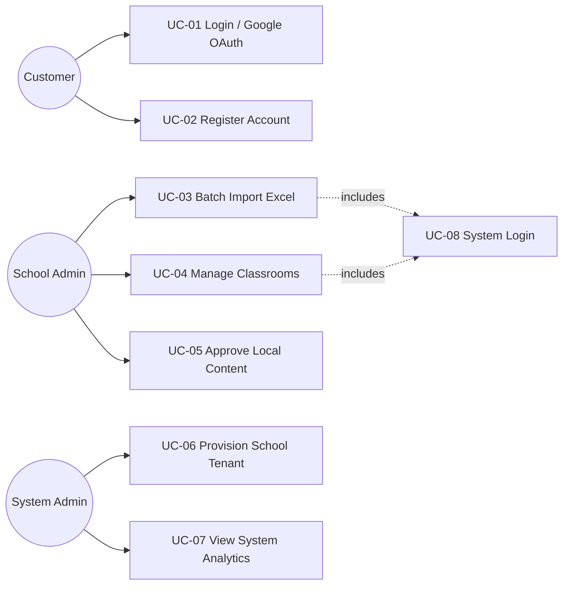
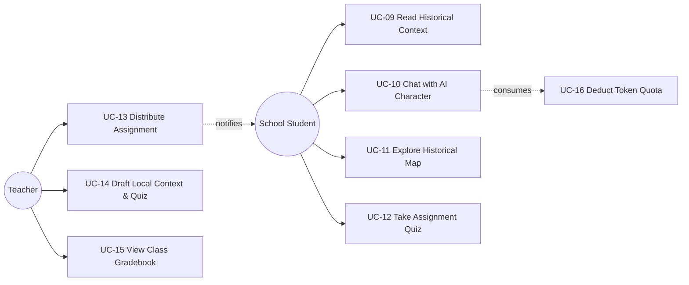
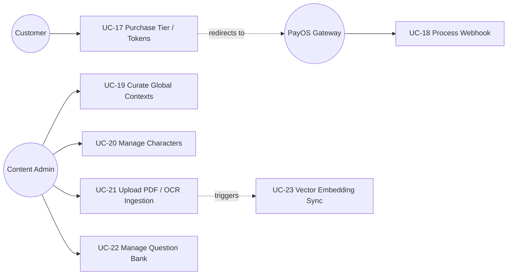
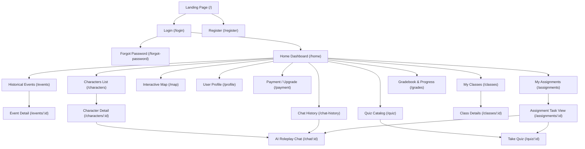
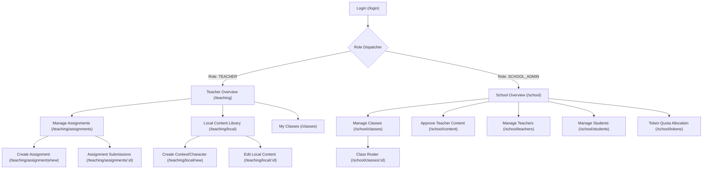
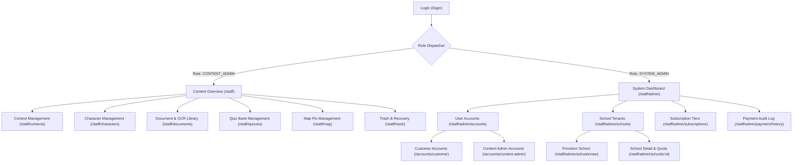
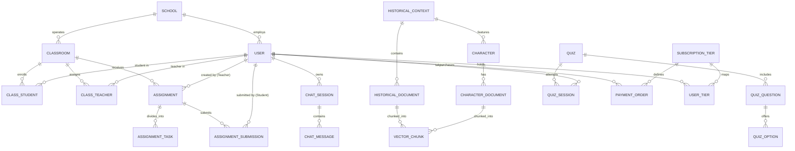

# TRƯỜNG ĐẠI HỌC FPT — FPT UNIVERSITY
## CAPSTONE PROJECT REPORT
### Report 3 – Software Requirement Specification (SRS)
**Hanoi, 2026**

---

### PROJECT INFORMATION
* **Project Title (English):** HistoryTalk: A SaaS Historical Education Platform Powered by Conversational AI and RAG Technology
* **Project Title (Vietnamese):** HistoryTalk: Nền tảng SaaS Giáo dục Lịch sử ứng dụng Trí tuệ Nhân tạo và công nghệ RAG
* **Subject Code:** SWP490 / SEP490 — Capstone Project
* **Team Members:**
  1. Nguyễn Minh Trí (SE192645) – Leader & AI Engineer & Backend Developer
  2. Đỗ Quốc Bảo (SE193803) – Backend Developer & Tester
  3. Nguyễn Công Thành (SE196309) – Frontend Developer & Tester
  4. Võ Đồng Đức Khải (SE196405) – Backend Developer & Tester
  5. Trần Quốc Dinh (SE196495) – Backend Developer & DevOps
* **Document Version:** 1.0

---

## TABLE OF CONTENTS
- [I. Project Report](#i-project-report)
  - [1. Status Report](#1-status-report)
  - [2. Team Involvements](#2-team-involvements)
  - [3. Issues/Suggestions](#3-issuessuggestions)
- [Record of Changes](#record-of-changes)
- [II. Software Requirement Specification](#ii-software-requirement-specification)
  - [1. Overall Description](#1-overall-description)
    - [1.1 Product Overview](#11-product-overview)
    - [1.2 Business Rules Summary](#12-business-rules-summary)
  - [2. User Requirements](#2-user-requirements)
    - [2.1 System Actors](#21-system-actors)
    - [2.2 Use Cases](#22-use-cases)
      - [2.2.1 Use Case Diagrams](#221-use-case-diagrams)
      - [2.2.2 Use Case Descriptions](#222-use-case-descriptions)
  - [3. Functional Requirements](#3-functional-requirements)
    - [3.1 System Functional Overview](#31-system-functional-overview)
      - [3.1.1 Screens Flow](#311-screens-flow)
      - [3.1.2 Screen Descriptions](#312-screen-descriptions)
      - [3.1.3 Screen Authorization (Role Matrix)](#313-screen-authorization-role-matrix)
      - [3.1.4 Non-Screen Functions](#314-non-screen-functions)
      - [3.1.5 Entity Relationship Diagram (ERD)](#315-entity-relationship-diagram-erd)
    - [3.2 Module 1: Authentication & Account Management](#32-module-1-authentication--account-management)
    - [3.3 Module 2: SaaS B2B Classroom Management](#33-module-2-saas-b2b-classroom-management)
    - [3.4 Module 3: Conversational AI & Historical Roleplay (RAG)](#34-module-3-conversational-ai--historical-roleplay-rag)
    - [3.5 Module 4: Spatio-Temporal Historical Map](#35-module-4-spatio-temporal-historical-map)
    - [3.6 Module 5: Quiz & Automated Knowledge Assessment](#36-module-5-quiz--automated-knowledge-assessment)
    - [3.7 Module 6: Token Economy & Payment Integration (PayOS)](#37-module-6-token-economy--payment-integration-payos)
    - [3.8 Module 7: Local Content & School Approval Workflow](#38-module-7-local-content--school-approval-workflow)
    - [3.9 Module 8: Academic Knowledge Curation & Document OCR](#39-module-8-academic-knowledge-curation--document-ocr)
    - [3.10 Module 9: Progress Tracking & Analytics Dashboards](#310-module-9-progress-tracking--analytics-dashboards)
  - [4. Non-Functional Requirements](#4-non-functional-requirements)
    - [4.1 External Interfaces](#41-external-interfaces)
    - [4.2 Quality Attributes](#42-quality-attributes)
  - [5. Requirement Appendix](#5-requirement-appendix)
    - [5.1 Business Rules](#51-business-rules)
    - [5.2 Common Requirements](#52-common-requirements)
    - [5.3 Application Messages List](#53-application-messages-list)
    - [5.4 Other Technical & Operational Requirements](#54-other-technical--operational-requirements)

---

# I. Project Report

## 1. Status Report
* **Current Phase:** Iteration 1 / Review 1 Deliverable Phase.
* **Milestone Progress:**
  - System architecture finalized: Java Spring Boot 3 Core Backend + Python FastAPI AI Microservice + Next.js / React 18 Frontend.
  - Multi-tenant relational database schema and vector embedding store (PostgreSQL + Supabase PgVector + Flyway V1–V37) designed and deployed.
  - Core authentication (JWT + Google OAuth2), SaaS classroom management, AI RAG pipeline with streaming SSE, PayOS VietQR payment flow, and question bank modules successfully drafted and under integration testing.
  - Mobile Application (React Native / Expo) initial framework established for roadmapped cross-platform access.
* **Planned Review Date:** Week 3 / Review 1.

## 2. Team Involvements

| Student ID | Full Name | Role | Core Responsibilities & Contributions |
| :--- | :--- | :--- | :--- |
| **SE192645** | **Nguyễn Minh Trí** | Leader & AI Engineer & Backend Dev | Project management, Agile/Sprint planning, RAG pipeline design, AI streaming chat (SSE), prompt engineering for historical persona, daily token logic. |
| **SE196495** | **Trần Quốc Dinh** | Backend Developer & DevOps | B2B SaaS classroom & user management APIs, progress tracking & analytics engine, CI/CD automated pipeline, server containerization (Docker/Caddy). |
| **SE196405** | **Võ Đồng Đức Khải** | Backend Developer & Tester | Multi-tenant schema design, RBAC & Google OAuth2 integration, Academic Content CRUD APIs, Document OCR pipeline (Tess4J/PDFBox), Unit & Integration testing. |
| **SE196309** | **Nguyễn Công Thành** | Frontend Developer & Tester | User-facing Web application (AI Chat, Interactive Map, Quiz Player), B2B Teacher & School Admin portals, System & Content Admin dashboards, UI/UX testing. |
| **SE193803** | **Đỗ Quốc Bảo** | Backend Developer & Tester | Quiz & question bank engine APIs, PayOS online checkout & webhook reconciliation, interactive map geospatial APIs, test case design and execution. |

## 3. Issues/Suggestions
* **Issue 1 (AI Hallucination & Accuracy):** Generic LLMs frequently invent historical facts, dates, or confuse battle timelines.  
  *Solution:* Built a 2-stage RAG architecture combining Supabase PgVector semantic search with Kaggle Cross-Encoder reranking, anchoring LLM outputs strictly to curated documents.
* **Issue 2 (Multi-Tenant Collision):** Risk of username collision across different schools when importing student rosters.  
  *Solution:* Enforced automated username generation prefixing the school's unique code: `{school_code}_hs_{ma_hs}` and `{school_code}_gv_{ma_gv}`.
* **Issue 3 (Response Latency in AI Roleplay):** Waiting for full LLM answers causes user drop-off.  
  *Solution:* Implemented Server-Sent Events (SSE) for real-time token streaming ($TTFT < 1.5$s).

---

# Record of Changes

| Date | A\*, M, D | In charge | Change Description |
| :--- | :---: | :--- | :--- |
| **2026-03-06** | A | Nguyễn Minh Trí | Initial system architecture, SRS template setup and core use case definition. |
| **2026-05-18** | M | Võ Đồng Đức Khải | Refactored monolith to 3-layer decoupled architecture (Spring Boot Core + FastAPI AI). |
| **2026-05-25** | A | Đỗ Quốc Bảo | Added PayOS VietQR payment flow and Subscription Tier definitions. |
| **2026-06-05** | M | Đỗ Quốc Bảo | Added asynchronous payment fulfillment reconciliation scheduler and webhook verification. |
| **2026-07-23** | A | Võ Đồng Đức Khải | Integrated Tess4J OCR and Apache PDFBox for automated document vectorization. |
| **2026-09-23** | M | Võ Đồng Đức Khải | Updated dual-token security: JWT access token + refresh token rotation. |
| **2026-10-14** | A | Trần Quốc Dinh | Integrated B2B SaaS School Module (2-sheet Excel import, class rosters, teacher assignment). |
| **2026-10-16** | A | Nguyễn Minh Trí | Standardized 27-feature RBAC Role Matrix, Local Content Approval, and Assignment Workflow. |
| **2026-10-19** | M | Nguyễn Minh Trí | Finalized comprehensive SRS Report 3 for Capstone Project Review 1 submission. |

*\*A: Added, M: Modified, D: Deleted*

---

# II. Software Requirement Specification

## 1. Overall Description

### 1.1 Product Overview
**HistoryTalk** is a Software-as-a-Service (SaaS) educational platform engineered to revolutionize Vietnamese history education. The system replaces passive rote learning and memorization of historical facts with immersive, interactive learning experiences.

The platform provides a dual-model service:
1. **B2C (Direct to Consumer):** Dedicated to individual learners, history buffs, and self-studying students with Free and Premium tiers, allowing them to chat with historical personae, interact with chronological battle maps, and practice quizzes.
2. **B2B SaaS (Schools & Educational Institutions):** Dedicated to secondary and high schools. It provides a multi-tenant administration ecosystem where School Admins manage teachers and classes, and Teachers curate localized historical contexts, distribute multi-component assignments (Context Reading $\rightarrow$ Character Roleplay $\rightarrow$ Automated Quiz Assessment), and monitor learning performance.

#### Context Diagram
The context diagram below illustrates the external entities, third-party services, and boundaries of the HistoryTalk platform:

```
                          ┌──────────────────────────┐
                          │   System Administrator   │
                          └────────────┬─────────────┘
                                       │ System config & SaaS School provisioning
                                       ▼
 ┌──────────────┐         ┌──────────────────────────┐         ┌──────────────┐
 │ School Admin │────────▶│                          │◀────────│   Teacher    │
 └──────────────┘ Manage  │                          │ Assign  └──────────────┘
                  classes │                          │ homework &
 ┌──────────────┐ & users │                          │ track   ┌──────────────┐
 │School Student│────────▶│                          │◀────────│   Customer   │
 └──────────────┘ Study & │       HISTORYTALK        │ Chat &  │(B2C Free/Pro)│
                  Quizzes │       SAAS SYSTEM        │ Top-up  └──────────────┘
 ┌──────────────┐         │                          │
 │Content Admin │────────▶│                          │
 └──────────────┘ Curate  │                          │
                  global  └────────────┬─────────────┘
                  content              │
         ┌─────────────────────────────┼─────────────────────────────┐
         │                             │                             │
         ▼                             ▼                             ▼
┌──────────────────┐          ┌──────────────────┐          ┌──────────────────┐
│ PayOS Payment GW │          │ Supabase Storage │          │ LLM Providers /  │
│ - VietQR Checkout│          │  & Cloudflare R2 │          │ Kaggle Reranker  │
│ - Webhook verify │          │ - Audio/Avatars  │          │ - Vector RAG API │
└──────────────────┘          │ - PDFs & Docs    │          │ - SSE LLM Stream │
                              └──────────────────┘          └──────────────────┘
```

### 1.2 Business Rules Summary
The core operations of HistoryTalk are governed by key business constraints:
* **Multi-tenancy Isolation:** School resources (classes, students, local content, assignments) are strictly segregated by `school_id`. No cross-tenant access is permitted.
* **Token Economy:** AI conversations consume tokens based on message complexity and prompt size. Free users receive a refreshed daily token quota upon their first login of the day; paid customers or school quota tiers expand this balance.
* **Academic Integrity in Assignments:** A homework assignment consists of up to 3 components (Reading Context, Chatting with Persona, Taking a Quiz). Quiz submissions are evaluated server-side against protected answer keys.

---

## 2. User Requirements

### 2.1 System Actors

| # | Actor | Type | Description |
| :-: | :--- | :--- | :--- |
| **1** | **Customer (B2C)** | Human | Individual user who signs up freely or upgrades to Premium (Plus/Pro). Interacts with historical personae, explores map events, and practices quizzes. |
| **2** | **School Student** | Human | Student belonging to an enrolled school tenant. Logs in via school-provisioned credentials, studies assigned homework, dialogues with AI, and submits tests. |
| **3** | **Teacher** | Human | Instructor managing classrooms. Manages class rosters, assigns homework, drafts local historical contexts and quizzes, and analyzes student grades. |
| **4** | **School Admin** | Human | School administrator. Performs 2-sheet batch Excel onboarding of teachers and students, sets school token allowances, and approves local teacher content. |
| **5** | **Content Admin** | Human | History content specialist. Curates global historical events, characters, reference documents, and standard quiz banks. |
| **6** | **System Admin** | Human | Super-administrator. Onboards new school contracts, oversees platform health, configures subscription tiers, and audits revenue. |
| **7** | **PayOS Gateway** | External System | Third-party payment gateway processing VietQR transactions and sending asynchronous payment confirmation webhooks. |
| **8** | **AI / LLM Engine** | External System | Python FastAPI microservice + remote LLM & Cross-Encoder hosting RAG vector searches and generating streaming roleplay responses. |

### 2.2 Use Cases

#### 2.2.1 Use Case Diagrams

##### 1. Authentication & School Administration Use Case Diagram


##### 2. Learning, AI Interaction & Assessment Use Case Diagram


##### 3. Payment & Content Administration Use Case Diagram


#### 2.2.2 Use Case Descriptions

| ID | Use Case | Primary Actor | Secondary Actors | Description |
| :---: | :--- | :--- | :--- | :--- |
| **UC-01** | User Login & Authentication | All Users | Google OAuth | Authenticate users via Email/Password or Google OAuth; issue access and refresh JWT tokens. |
| **UC-02** | Customer Self-Registration | Customer | — | Allows individual users to register an account with username, email, and password. |
| **UC-03** | Batch Import School Accounts | School Admin | — | Upload 2-sheet Excel file to auto-create Teacher and Student accounts and populate class rosters. |
| **UC-04** | Manage School Classrooms | School Admin | Teacher | Create, update, or deactivate classrooms; assign primary teacher to classes. |
| **UC-05** | Approve Local Content | School Admin | Teacher | Review and transition teacher-submitted local contexts and quizzes from DRAFT to PUBLISHED. |
| **UC-06** | Provision School Tenant | System Admin | School Admin | Register a school organization, generate School Admin credentials, and configure subscription dates. |
| **UC-07** | View System & Revenue Analytics | System Admin | — | Monitor total active users, token consumption, revenue, and JVM/API performance metrics. |
| **UC-08** | Distribute Homework Assignment | Teacher | School Student | Create multi-task homework containing Contexts, AI Chat tasks, and timed Quizzes with a set deadline. |
| **UC-09** | Draft Local Content | Teacher | — | Author school-specific historical events, characters, and custom quiz tests. |
| **UC-10** | View Class Analytics & Gradebook | Teacher | — | Review student completion rates, average scores, and AI interaction message volume. |
| **UC-11** | Chat with AI Character | Student, Customer | AI Engine | Engage in first-person streaming dialogue with historical figures grounded by RAG documents. |
| **UC-12** | Explore Spatio-Temporal Map | All Users | — | View historical event locations on an interactive Leaflet/MapLibre map filtered by chronological timeline. |
| **UC-13** | Take Quiz / Test | Student, Customer | — | Answer randomized single-choice, multi-choice, or fill-in questions within a time limit; receive instant score. |
| **UC-14** | Purchase Premium Tier / Tokens | Customer | PayOS | Select subscription package, scan VietQR code, and receive real-time balance upgrades. |
| **UC-15** | Curate Academic Knowledge | Content Admin | AI Engine | Manage global contexts, character biographies, reference documents, and trigger vector chunk embeddings. |
| **UC-16** | Document OCR & Ingestion | Content Admin | Tess4J / PDFBox | Upload historical scans or PDFs; extract text via OCR and synchronize chunks to Supabase PgVector. |

---

## 3. Functional Requirements

### 3.1 System Functional Overview

#### 3.1.1 Screens Flow

##### A. Public & Student / Customer Screen Navigation Flow


##### B. Teacher & School Admin Screen Navigation Flow


##### C. Content Admin & System Admin Screen Navigation Flow


#### 3.1.2 Screen Descriptions

| # | Feature | Screen Name | Route Path | Description |
| :-: | :--- | :--- | :--- | :--- |
| **1** | Authentication | Login | `/login` | Email/password login and "Sign in with Google" button; forgot password link. |
| **2** | Authentication | Register | `/register` | B2C self-service registration form with input validation and password confirmation. |
| **3** | Learning | Home Dashboard | `/home` | Central dashboard showing daily streaks, active assignments, and recommended historical figures. |
| **4** | Learning | Historical Events | `/events` | Grid listing published historical eras and events with search and period filters. |
| **5** | Learning | Event Details | `/events/:id` | Full narrative overview, lesson video player, and related historical figures. |
| **6** | Learning | Characters Catalog | `/characters` | Roster of historical personalities with era tags, avatars, and short bios. |
| **7** | AI Roleplay | Character Chat | `/chat/:id` | Real-time SSE chat window simulating dialogue with character, prompt suggestions, and token counter. |
| **8** | AI Roleplay | Chat History | `/chat-history` | Archive of past AI conversation sessions with resumption capability. |
| **9** | Visualization | Historical Map | `/map` | Interactive map with temporal slider displaying battles, monuments, and territorial shifts. |
| **10** | Assessment | Quiz Catalog | `/quiz` | Self-practice quiz list organized by difficulty, era, and topic. |
| **11** | Assessment | Quiz Player | `/quiz/:id` | Timed test interface supporting single/multi-choice questions, answer lock, and result summary. |
| **12** | SaaS Student | My Assignments | `/assignments` | List of homework assigned by teachers with status tags (`NOT_STARTED`, `SUBMITTED`, `OVERDUE`). |
| **13** | SaaS Student | Gradebook | `/grades` | Personal report card showing assignment scores, quiz accuracy, and AI interaction metrics. |
| **14** | Payment | Subscription & Top-up | `/payment` | B2C pricing packages, VietQR modal via PayOS, and transaction receipt status. |
| **15** | SaaS Teacher | Teacher Overview | `/teaching` | Class performance cards, upcoming deadlines, and fast links to assignment creation. |
| **16** | SaaS Teacher | Assignment Manager | `/teaching/assignments` | Table of assigned homework across classes with submission progress bars. |
| **17** | SaaS Teacher | Create Assignment | `/teaching/assignments/new` | Multi-step form to combine reading material, AI chat persona, and quiz into an assignment. |
| **18** | SaaS Teacher | Local Content Library | `/teaching/local` | Interface for teachers to draft school-level historical events and localized test questions. |
| **19** | SaaS School | School Overview | `/school` | School high-level statistics (total teachers, active students, classes, monthly token consumption). |
| **20** | SaaS School | Classroom Manager | `/school/classes` | Class CRUD operations, primary teacher assignment, and student roster viewer. |
| **21** | SaaS School | User Directory | `/school/students`, `/teachers` | Directory of school members with 2-sheet Excel batch import modal. |
| **22** | SaaS School | Content Approval | `/school/content` | Review queue for teacher-created local contexts/quizzes with Publish/Reject controls. |
| **23** | Content Admin | Content Overview | `/staff` | Global content metrics and quick access to context/character/doc editors. |
| **24** | Content Admin | Context Management | `/staff/contexts` | CRUD operations for national historical contexts; status toggling (Draft/Publish/Trash). |
| **25** | Content Admin | Document & OCR Hub | `/staff/documents` | Knowledge base manager; upload scanned PDFs, execute OCR, view vectorized chunks. |
| **26** | Content Admin | Question Bank | `/staff/quizzes` | Comprehensive question repository with difficulty ratings, explanations, and bulk import. |
| **27** | System Admin | System Dashboard | `/staff/admin` | Platform-wide operational health, JVM memory, API latency, and monthly revenue graph. |
| **28** | System Admin | School Provisioning | `/staff/admin/schools` | Tenant management: create new school codes, assign School Admin accounts, set license validity. |

#### 3.1.3 Screen Authorization (Role Matrix)

The system enforces strict Role-Based Access Control (RBAC) across all screens and features:

| # | Screen / Feature Area | System Admin | Content Admin | School Admin | Teacher | School Student | Customer | Permissions Scope |
| :-: | :--- | :---: | :---: | :---: | :---: | :---: | :---: | :--- |
| **1** | Landing & Public Pages | 👁️ | 👁️ | 👁️ | 👁️ | 👁️ | 👁️ | Public access |
| **2** | Login / Register / Password Reset | ✅ | ✅ | ✅ | ✅ | ✅ | ✅ | Public & Authenticated |
| **3** | Home Dashboard (`/home`) | 👁️ | 👁️ | 👁️ | 👁️ | ✅ | ✅ | Personalized feed |
| **4** | Historical Events & Characters (Global) | 👁️ | ✅ | 👁️ | 👁️ | 👁️ | 👁️ | Content Admin edits; others view |
| **5** | AI Character Chat (`/chat/:id`) | 👁️ | 👁️ | 👁️ | 👁️ | ✅ | ✅ | Consumes user/school token quota |
| **6** | Historical Map (`/map`) | 👁️ | 👁️ | 👁️ | 👁️ | 👁️ | 👁️ | Global view; class layer for schools |
| **7** | Quiz Practice (`/quiz`) | 👁️ | 👁️ | 👁️ | 👁️ | ✅ | ✅ | Self-study quizzes |
| **8** | Student Assignments (`/assignments`) | ❌ | ❌ | ❌ | ❌ | ✅ | ❌ | Enrolled students only |
| **9** | Student Gradebook (`/grades`) | ❌ | ❌ | ❌ | ❌ | 👁️ | 👁️ | Own scores & completion stats |
| **10** | Payment & Subscription (`/payment`) | 👁️ | ❌ | ❌ | ❌ | ❌ | ✅ | B2C customers only |
| **11** | Teacher Overview & Classes (`/teaching`) | 👁️ | ❌ | 👁️ | ✅ | ❌ | ❌ | Assigned classes only |
| **12** | Create/Manage Assignments | ❌ | ❌ | ❌ | ✅ | ❌ | ❌ | Assigned classes only |
| **13** | Draft Local Content (`/teaching/local`) | ❌ | ❌ | 👁️ | ✅ | ❌ | ❌ | Scoped to teacher's school |
| **14** | School Admin Dashboard (`/school`) | 👁️ | ❌ | ✅ | ❌ | ❌ | ❌ | School organization scope |
| **15** | Manage School Classes & Rosters | 👁️ | ❌ | ✅ | ❌ | ❌ | ❌ | Full school class management |
| **16** | Batch Import Accounts (Excel) | ❌ | ❌ | ✅ | ❌ | ❌ | ❌ | Bulk school teacher/student import |
| **17** | Approve Local Content | ❌ | ❌ | ✅ | ❌ | ❌ | ❌ | School Admin publishes teacher drafts |
| **18** | Allocate School Token Quotas | 👁️ | ❌ | ✅ | ❌ | ❌ | ❌ | Configure school daily limit |
| **19** | Content Admin Hub (`/staff/**`) | 👁️ | ✅ | ❌ | ❌ | ❌ | ❌ | Global curriculum curation |
| **20** | Document Upload & OCR Ingestion | 👁️ | ✅ | ❌ | ❌ | ❌ | ❌ | Vector database ingestion |
| **21** | Question Bank Management | 👁️ | ✅ | ❌ | ❌ | ❌ | ❌ | Standard question authoring |
| **22** | System Admin Dashboard (`/staff/admin`) | ✅ | ❌ | ❌ | ❌ | ❌ | ❌ | Platform-wide analytics |
| **23** | Provision School Tenants | ✅ | ❌ | ❌ | ❌ | ❌ | ❌ | B2B contract onboarding |
| **24** | Audit Logs & Payment History | ✅ | ❌ | ❌ | ❌ | ❌ | 👁️ (Own) | Super-admin audit; user own history |

*Legend: ✅ Full Control (CRUD / Execute) | 👁️ Read-only / View | ❌ Forbidden (HTTP 403)*

#### 3.1.4 Non-Screen Functions

| # | Feature Area | System Function Name | Execution Mode | Description |
| :-: | :--- | :--- | :--- | :--- |
| **1** | Token Management | `DailyTokenResetScheduler` | Cron Job (`0 0 0 * * ?`) | Resets daily token allowances for Free customers and School student accounts at midnight UTC+7. |
| **2** | Payment Fulfillment | `PaymentReconciliationScheduler` | Cron Job (`*/5 * * * * ?`) | Polls PayOS API for pending orders that missed webhook delivery; updates order status and credits tokens. |
| **3** | RAG Vectorization | `AsyncDocumentChunkerService` | Async Message / Worker | Slices uploaded document text into semantic chunks, generates dense vector embeddings, and stores in PgVector. |
| **4** | Document OCR | `TesseractOcrWorker` | Background Task | Processes scanned images/PDFs using Tess4J (`vie.traineddata`), extracts plaintext, and triggers vectorization. |
| **5** | AI Chat Streaming | `FastApiRoleplaySseStream` | SSE Stream Gateway | Pipes token-by-token LLM output from Ollama/vLLM through FastAPI to client web browser via Server-Sent Events. |
| **6** | Assignment Lifecycle | `AssignmentDueChecker` | Cron Job (`0 * * * * ?`) | Scans active assignments, marks unsubmitted student tasks as `OVERDUE` after the submission deadline expires. |
| **7** | Security Auditing | `JwtBlacklistCleanScheduler` | Cron Job (`0 0 * * * ?`) | Evicts expired JWT access tokens from the Redis/in-memory token revocation blacklist. |

#### 3.1.5 Entity Relationship Diagram (ERD)



##### Entities Description

| # | Entity Name | Primary Key | Foreign Keys | Business Description |
| :-: | :--- | :--- | :--- | :--- |
| **1** | `users` | `id` (UUID) | `school_id` | Core identity entity storing credentials, role (`CUSTOMER`, `STUDENT`, `TEACHER`, etc.), and token quota. |
| **2** | `schools` | `id` (UUID) | — | B2B tenant organization entity holding school code, contract license dates, and token limits. |
| **3** | `classrooms` | `id` (UUID) | `school_id` | Academic class entity (e.g., "10A1", "11B2") belonging to a specific school tenant. |
| **4** | `class_students` | `id` (UUID) | `classroom_id`, `student_id` | Associative table enrolling students into specific classes. |
| **5** | `class_teachers` | `id` (UUID) | `classroom_id`, `teacher_id` | Associative table assigning teachers as instructors for specific classrooms. |
| **6** | `historical_contexts`| `id` (UUID) | `school_id` (nullable) | Global or localized historical event / period summary. |
| **7** | `characters` | `id` (UUID) | `context_id`, `school_id` | Historical figure profile storing biographical data, system persona prompt, and avatar URL. |
| **8** | `documents` | `id` (UUID) | `context_id`, `character_id` | Curated source text or PDF reference used as grounding data for RAG. |
| **9** | `vector_chunks` | `id` (UUID) | `document_id` | Text chunk and its dense 768/1536-dimensional vector embedding stored in Supabase PgVector. |
| **10**| `chat_sessions` | `id` (UUID) | `user_id`, `character_id` | AI conversation session representing dialogue between a user and a historical persona. |
| **11**| `chat_messages` | `id` (UUID) | `session_id` | Message log holding role (`USER`/`ASSISTANT`), content, token count, and suggested follow-ups. |
| **12**| `quizzes` | `id` (UUID) | `context_id`, `school_id` | Assessment test entity defining duration, passing score, and question configuration. |
| **13**| `quiz_questions` | `id` (UUID) | `quiz_id` | Question entity supporting single-choice, multiple-choice, or fill-in-blank types. |
| **14**| `quiz_options` | `id` (UUID) | `question_id` | Answer choices for a question, flagged with `is_correct` boolean. |
| **15**| `quiz_sessions` | `id` (UUID) | `quiz_id`, `user_id` | Record of a student's test attempt, capturing start/end timestamps, submitted answers, and score. |
| **16**| `assignments` | `id` (UUID) | `classroom_id`, `teacher_id`| Multi-task homework assigned to a class, specifying start date, due date, and instructions. |
| **17**| `assignment_tasks`| `id` (UUID) | `assignment_id` | Individual task component (`READ_CONTEXT`, `CHAT_CHARACTER`, or `TAKE_QUIZ`). |
| **18**| `assignment_submissions` | `id` (UUID) | `assignment_id`, `student_id` | Submission state of a student (`NOT_STARTED`, `IN_PROGRESS`, `COMPLETED`, `LATE`). |
| **19**| `payment_orders` | `id` (UUID) | `user_id`, `tier_id` | PayOS transaction record containing order code, amount, status (`PENDING`, `PAID`, `EXPIRED`). |
| **20**| `subscription_tiers`| `id` (UUID) | — | Available B2C subscription plans (`FREE`, `PLUS`, `PRO`) and pricing parameters. |

---

### 3.2 Module 1: Authentication & Account Management

#### 3.2.1 Function: User Login & Google OAuth2
* **Trigger:** User navigates to `/login`, fills in credentials, or clicks "Đăng nhập bằng Google".
* **Description:** Authenticates user identity, validates password against BCrypt hash or verifies Google ID token, generates JWT access and refresh token pair, and redirects to appropriate portal based on role.
* **Screen Layout Mockup:**
```
+-------------------------------------------------------------------------+
|                              HistoryTalk                                |
|                        Chắp cánh tri thức lịch sử                       |
+-------------------------------------------------------------------------+
|                                                                         |
|                         [ ĐĂNG NHẬP HỆ THỐNG ]                          |
|                                                                         |
|      Email hoặc Tên đăng nhập:                                          |
|      [ nguyenvan_a@gmail.com                                      ]     |
|                                                                         |
|      Mật khẩu:                                                          |
|      [ ****************                                           ]     |
|                                                                         |
|      [  ] Ghi nhớ đăng nhập                 Quên mật khẩu?              |
|                                                                         |
|      [                   ĐĂNG NHẬP                           ]          |
|                                                                         |
|      -------------------------- HOẶC -------------------------          |
|                                                                         |
|      [  (G) Tiếp tục với tài khoản Google                    ]          |
|                                                                         |
|      Chưa có tài khoản? [Đăng ký ngay]                                  |
+-------------------------------------------------------------------------+
```
* **Function Details:**
  - *Normal Flow:* User enters valid credentials $\rightarrow$ System generates JWT Access Token (1-day expiry) and Refresh Token (7-day expiry) $\rightarrow$ User is redirected to `/home` (Customer/Student), `/teaching` (Teacher), `/school` (School Admin), or `/staff` (Admin).
  - *Google OAuth Flow:* User selects Google account $\rightarrow$ Google returns OAuth token $\rightarrow$ Backend verifies token with Google servers $\rightarrow$ If email exists, logs in; if email is new, auto-provisions a `CUSTOMER` account with `FREE` tier.
  - *Abnormal Flow:* If account is deactivated (`is_active = false`), system returns `MSG09: Tài khoản đã bị khóa hoặc chưa kích hoạt`. If password incorrect $\rightarrow$ `MSG09: Tên đăng nhập hoặc mật khẩu không chính xác`.

#### 3.2.2 Function: School Admin Batch Excel Import
* **Trigger:** School Admin clicks "Import Danh Sách (Excel)" on `/school/students` or `/school/teachers`.
* **Description:** Parses 2-sheet Excel workbook (`Danh_Sach_Giao_Vien` and `Danh_Sach_Hoc_Sinh_Va_Lop`), validates mandatory columns, creates user records with collision-free prefixed usernames, and maps students to classes.
* **Screen Layout Mockup:**
```
+-------------------------------------------------------------------------+
|                  [ IMPORT TÀI KHOẢN TRƯỜNG HỌC QUA EXCEL ]              |
+-------------------------------------------------------------------------+
|  1. Tải file mẫu chuẩn: [ Tải File Mẫu (Template_Truong_THPT.xlsx) ]    |
|                                                                         |
|  2. Tải lên tệp đã điền:                                                |
|     +-------------------------------------------------------------+     |
|     |  [  📁 Kéo thả file Excel vào đây hoặc Nhấn để Duyệt  ]     |     |
|     |  Tệp đã chọn: Danh_sach_Khoi_10_2026.xlsx (2.4 MB)          |     |
|     +-------------------------------------------------------------+     |
|                                                                         |
|  3. Xem trước & Kiểm tra (Preview):                                     |
|     - Sheet Giáo viên: 12 tài khoản hợp lệ (0 lỗi)                      |
|     - Sheet Học sinh : 450 tài khoản hợp lệ, 2 cảnh báo email trùng     |
|                                                                         |
|  [ Hủy bỏ ]                                  [ Bắt đầu Import ]         |
+-------------------------------------------------------------------------+
```
* **Function Details:**
  - *Data Processing:* System auto-generates usernames using `{school_code}_gv_{code}` for teachers and `{school_code}_hs_{code}` for students. Default initial password generated as `{school_code}@2026` with `must_change_password = true`.
  - *Validation:* Validates email format, unique national ID/student ID, and non-empty class code. If class does not exist, system auto-creates classroom under the current school tenant.

---

### 3.3 Module 2: SaaS B2B Classroom Management

#### 3.3.1 Function: Teacher Homework Assignment Distribution
* **Trigger:** Teacher clicks "Tạo Bài Tập Mới" on `/teaching/assignments`.
* **Description:** Form allowing teacher to title an assignment, choose targeted classes, select required components (Reading Context, Chatting with Persona, Taking a Quiz), set due date, and publish to students.
* **Screen Layout Mockup:**
```
+-------------------------------------------------------------------------+
|                       TẠO BÀI TẬP LỊCH SỬ MỚI                           |
+-------------------------------------------------------------------------+
|  Tiêu đề bài tập:                                                       |
|  [ Tìm hiểu Chiến dịch Điện Biên Phủ 1954                             ] |
|                                                                         |
|  Lớp áp dụng: [v] Lớp 12A1   [v] Lớp 12A2   [ ] Lớp 12A3                |
|  Hạn nộp bài: [ 23:59 ] [ 30/10/2026 ]                                  |
|                                                                         |
|  --- CÁC PHẦN BẮT BUỘC TRONG BÀI TẬP ---                               |
|  [x] 1. Đọc bối cảnh : [ Chiến dịch Điện Biên Phủ (1954)            |v] |
|  [x] 2. Đối thoại AI : [ Đại tướng Võ Nguyên Giáp                  |v] |
|       Yêu cầu: Tối thiểu [ 5 ] tin nhắn đối thoại có ý nghĩa.           |
|  [x] 3. Bài thi kiểm tra: [ Đề kiểm tra tổng kết Điện Biên Phủ      |v] |
|       Thời gian làm bài: 15 phút - Điểm đạt: 7.0/10                     |
|                                                                         |
|  [ Lưu bản nháp ]                              [ Phát hành cho học sinh ]|
+-------------------------------------------------------------------------+
```
* **Function Details:**
  - *Assignment Creation:* Creates record in `assignments` and child rows in `assignment_tasks`.
  - *Student Dispatch:* Auto-generates `assignment_submissions` entries with status `NOT_STARTED` for all students currently enrolled in the targeted classrooms.
  - *Notification:* Sends in-app notification to all students in the assigned classes.

---

### 3.4 Module 3: Conversational AI & Historical Roleplay (RAG)

#### 3.4.1 Function: Streaming First-Person AI Chat with Persona
* **Trigger:** Student or Customer navigates to `/chat/:id` and submits a prompt.
* **Description:** Initiates a conversational turn with a historical character. System checks token balance, queries Vector DB for relevant documents, augments LLM prompt with historical facts, and streams response via SSE.
* **Screen Layout Mockup:**
```
+-------------------------------------------------------------------------+
| [<- Quay lại]    ĐẠI TƯỚNG VÕ NGUYÊN GIÁP               Quota: 1,420 tk |
|                  Chiến dịch Điện Biên Phủ (1954)                        |
+-------------------------------------------------------------------------+
| (AI) Đại tướng:                                                         |
| Chào cháu. Ta là Võ Nguyên Giáp, Tổng tư lệnh Chiến dịch Điện Biên Phủ.  |
| Cháu có điều gì muốn hỏi ta về phương châm 'Đánh chắc, tiến chắc'?      |
|                                                                         |
|                                  (User) Cháu chào Đại tướng. Vì sao     |
|                                  Đại tướng quyết định đổi phương châm   |
|                                  từ 'Đánh nhanh' sang 'Đánh chắc'?      |
|                                                                         |
| (AI) Đại tướng: [Đang gõ...]                                            |
| Quyết định chuyển từ 'đánh nhanh thắng nhanh' sang 'đánh chắc tiến      |
| chắc' là quyết định khó khăn nhất trong cuộc đời chỉ huy của ta. Trận   |
| địa pháo của địch đã kiên cố, quân ta chưa đủ điều kiện chắc thắng...    |
+-------------------------------------------------------------------------+
| Gợi ý: [ Kế hoạch kéo pháo vào Điện Biên? ] [ Vai trò của dân công? ]   |
+-------------------------------------------------------------------------+
| [ Nhập câu hỏi của bạn với nhân vật lịch sử...               ] [ GỬI ]  |
+-------------------------------------------------------------------------+
```
* **Function Details:**
  - *Token Check:* System verifies `user.token_balance >= 10`. If zero, input is disabled with modal prompt to upgrade or wait for midnight reset.
  - *RAG Search:* Question converted to embedding $\rightarrow$ pgvector executes cosine similarity search on `vector_chunks` belonging to current `character_id` and `context_id` $\rightarrow$ Kaggle Cross-Encoder reranks top-5 chunks.
  - *Persona Enforcement:* System prompt mandates authentic Vietnamese historical address forms (*"Ta"*, *"Trẫm"*, *"Tôi"* depending on character status).
  - *Streaming SSE:* Tokens delivered continuously to client; once complete, assistant message is persisted to database and tokens are deducted.

---

### 3.5 Module 4: Spatio-Temporal Historical Map

#### 3.5.1 Function: Interactive Map & Timeline Exploration
* **Trigger:** User opens `/map` from main navigation.
* **Description:** Renders a geographic map displaying historical landmarks, battlefield coordinates, and territorial shifts, synchronized with a draggable temporal timeline slider (e.g., Year 938 to 1975).
* **Screen Layout Mockup:**
```
+-------------------------------------------------------------------------+
|  BẢN ĐỒ LỊCH SỬ VIỆT NAM QUA CÁC THỜI KỲ                [ Lọc: Toàn quốc |v]
+-------------------------------------------------------------------------+
|  +-------------------------------------+  [ THÔNG TIN ĐỊA DANH / TRẬN ] |
|  |             (Map Area)              |  Trận Bạch Đằng (Năm 938)      |
|  |         [Hà Nội]                    |  Lãnh đạo: Ngô Quyền           |
|  |             * (Chi Lăng)            |  Quân xâm lược: Nam Hán        |
|  |     * (Bạch Đằng - 938)             |  ----------------------------- |
|  |                                     |  Ngô Quyền lợi dụng thủy triều |
|  |             * (Điện Biên Phủ)       |  cắm cọc nhọn bọc sắt dưới     |
|  |                                     |  lòng sông, đại phá quân địch. |
|  |         [Huế]                       |                                |
|  |                                     |  [ Đối thoại với Ngô Quyền ]   |
|  +-------------------------------------+  [ Xem Video Trận Đánh (3D) ]  |
+-------------------------------------------------------------------------+
|  [|<] [<<]  Năm: [  938 CN  ] ===o========================== [>>] [>|]  |
|  (938) Bạch Đằng    (1077) Như Nguyệt    (1288) Vạn Kiếp    (1789) Đống Đa
+-------------------------------------------------------------------------+
```
* **Function Details:**
  - *Timeline Filtering:* Adjusting the slider fetches map pins where `event_year <= current_slider_year`.
  - *Pin Interaction:* Clicking a battle marker displays an overview popup with hyperlinks to start an AI dialogue with the commanding general.

---

### 3.6 Module 5: Quiz & Automated Knowledge Assessment

#### 3.6.1 Function: Timed Quiz Player & Server-Side Evaluation
* **Trigger:** User launches a quiz from `/quiz/:id` or clicks "Làm bài kiểm tra" in an assignment.
* **Description:** Presents a series of randomized questions with a countdown timer. Evaluates submitted answers on the server and provides immediate score breakdowns and explanations.
* **Screen Layout Mockup:**
```
+-------------------------------------------------------------------------+
|  BÀI KIỂM TRA: KHÁNG CHIẾN CHỐNG THỰC DÂN PHÁP     Thời gian: [ 12:45 ] |
+-------------------------------------------------------------------------+
|  Câu hỏi 4 / 15:                                 [ Đánh dấu xem lại ]   |
|  Vị tướng nào trực tiếp chỉ huy chiến dịch Điện Biên Phủ năm 1954?      |
|                                                                         |
|  ( ) A. Đại tướng Nguyễn Chí Thanh                                      |
|  (*) B. Đại tướng Võ Nguyên Giáp                                        |
|  ( ) C. Trung tướng Đồng Sỹ Nguyên                                      |
|  ( ) D. Thượng tướng Chu Văn Tấn                                        |
|                                                                         |
|  [ Câu trước ]                                             [ Câu tiếp ] |
|                                                                         |
|  Danh sách câu hỏi: [1] [2] [3] [*4] [5] [6] [7] [8] [9] [10]...        |
|                                                          [ NỘP BÀI ]    |
+-------------------------------------------------------------------------+
```
* **Function Details:**
  - *Anti-Cheat / Timer:* Countdown timer runs client-side and validates against `start_time` on server submission. Submissions received after `duration_minutes + 2 minutes tolerance` are marked late.
  - *Scoring:* Score calculated as $(\text{Correct Answers} / \text{Total Questions}) \times 10.0$.
  - *Persistence:* Results stored in `quiz_sessions` and linked to `assignment_submissions` if undertaken as a classroom homework task.

---

### 3.7 Module 6: Token Economy & Payment Integration (PayOS)

#### 3.7.1 Function: Subscription Top-Up via PayOS VietQR
* **Trigger:** Customer selects a package on `/payment` and clicks "Thanh toán ngay".
* **Description:** Initiates checkout order via PayOS API, displays dynamic VietQR image with embedded transfer content, receives webhook payment confirmation, and credits token quota.
* **Screen Layout Mockup:**
```
+-------------------------------------------------------------------------+
|                     THANH TOÁN GÓI DỊCH VỤ PREMIUM                      |
+-------------------------------------------------------------------------+
|  Gói đã chọn: GÓI PRO 1 THÁNG (Không giới hạn Chat AI RAG)              |
|  Số tiền thanh toán: 99.000 VNĐ                                         |
|                                                                         |
|  +--------------------------------+   Hướng dẫn thanh toán:             |
|  |          [ QR CODE ]           |   1. Mở ứng dụng Ngân hàng (App)    |
|  |                                |   2. Quét mã VietQR bên cạnh.       |
|  |      (VietQR - PayOS)          |   3. Kiểm tra số tiền & nội dung:   |
|  |                                |      Nội dung: HTALK99824           |
|  +--------------------------------+                                     |
|  Đang chờ thanh toán... [ Vòng quay xoay ] (Tự động kích hoạt khi nhận) |
|                                                                         |
|  [ Hủy giao dịch ]                                                      |
+-------------------------------------------------------------------------+
```
* **Function Details:**
  - *Webhook Verification:* PayOS webhook verifies SHA256 checksum signature before processing payload.
  - *Fulfillment Reconciliation:* Background scheduler audits any unmatched orders every 5 minutes to prevent lost payments.
  - *Credit:* Successfully completed orders update user tier to `PRO` or credit specified token bundles.

---

### 3.8 Module 7: Local Content & School Approval Workflow

#### 3.8.1 Function: School Admin Review & Approval Queue
* **Trigger:** School Admin visits `/school/content`.
* **Description:** Displays teacher-submitted localized contexts, local heroes, and school tests; allows School Admin to preview content and either Approve (`PUBLISHED`) or Reject with feedback (`DRAFT`).
* **Function Details:**
  - Content approved by School Admin becomes visible to all teachers and students belonging to that specific `school_id`.
  - Content is inaccessible to other schools or B2C customers.

---

### 3.9 Module 8: Academic Knowledge Curation & Document OCR

#### 3.9.1 Function: Document Upload, Tess4J OCR & Vector Ingestion
* **Trigger:** Content Admin uploads a PDF or scanned image on `/staff/documents`.
* **Description:** Ingests academic source materials. Plaintext is extracted directly via Apache PDFBox, or via Tess4J OCR for scanned images, split into semantic chunks, and embedded into PgVector.
* **Function Details:**
  - Chunk size: 500 tokens with 10% overlap.
  - Dense embedding model: `text-embedding-3-small` / Vietnamese Sentence-BERT.

---

### 3.10 Module 9: Progress Tracking & Analytics Dashboards

#### 3.10.1 Function: Teacher Class Analytics & Gradebook
* **Trigger:** Teacher accesses `/teaching` or clicks a specific class card.
* **Description:** Visualizes class-wide completion rates for assignments, average quiz scores, and AI engagement statistics (messages sent per student).
* **Function Details:**
  - Exportable to Excel format for school administrative reporting.

---

## 4. Non-Functional Requirements

### 4.1 External Interfaces

#### 4.1.1 User Interfaces
* **Responsive Layout:** Web application optimized for 1920x1080 desktop monitors, 1366x768 laptops, and tablet displays (minimum viewport 768px).
* **Design Language:** Modern educational palette styled with Tailwind CSS; dark mode and light mode contrast ratio compliant with WCAG 2.1 AA standards.

#### 4.1.2 Software Interfaces
* **Database Management System:** PostgreSQL 15+ equipped with the `pgvector` extension.
* **Payment Gateway:** PayOS REST API v2 + Webhook listener.
* **Storage Provider:** Cloudflare R2 / Supabase Storage for avatar media, historical audio snippets, and uploaded PDFs.
* **OCR Library:** Tesseract OCR / Tess4J native binary bindings for Vietnamese text extraction (`vie.traineddata`).

#### 4.1.3 Communications Interfaces
* **Protocols:** HTTPS (TLS 1.3) for all external traffic; HTTP/2 enabled.
* **Real-Time Streaming:** Server-Sent Events (SSE) protocol (`text/event-stream`) for AI LLM token delivery.
* **API Architecture:** RESTful APIs exchanging JSON payloads.

---

### 4.2 Quality Attributes

#### 4.2.1 Usability
* **Learnability:** A first-time student can register, access a character, and start chatting within 2 minutes without external instructions.
* **Accessibility:** All form inputs feature explicit visual labels and aria attributes; validation errors are highlighted in red below the offending field.

#### 4.2.2 Reliability & Availability
* **Availability:** System uptime $\ge 99.5\%$ during school operating hours (07:00–22:00 UTC+7).
* **Mean Time Between Failures (MTBF):** $\ge 720$ hours (30 operational days).
* **Mean Time To Repair (MTTR):** $\le 30$ minutes for core API crashes via Docker restart policies and automated CI/CD rollbacks.
* **Defect Rate:** $\le 0.5$ critical bugs per 1,000 lines of code at milestone delivery.

#### 4.2.3 Performance
* **AI Time-To-First-Token (TTFT):** Streaming LLM responses must begin rendering within 1.5 seconds for 95% of queries.
* **REST API Latency:** 95% of standard CRUD requests must respond in $< 300$ms under normal load.
* **Concurrency:** System supports at least 500 concurrent active users and 100 concurrent streaming AI chat sessions without performance degradation.

#### 4.2.4 Security
* **Multi-Tenant Data Isolation:** Multi-tenancy isolation strictly enforced at the database query level via `school_id` filtering.
* **Credential Protection:** Passwords hashed with BCrypt (cost factor 10); JWT tokens signed with HMAC-SHA256.
* **Data Encryption:** 256-bit TLS encryption in transit for all network traffic.
* **Anti-Cheat Measures:** Quiz correct answers are never sent to the client browser prior to submission.

#### 4.2.5 Maintainability
* **Modular Decoupling:** Business logic (Java Spring Boot) and AI pipeline (Python FastAPI) are containerized separately.
* **Database Evolution:** All database schema changes managed strictly through Flyway migration scripts (`V1` through `V37`).

---

## 5. Requirement Appendix

### 5.1 Business Rules

| ID | Business Rule Definition |
| :--- | :--- |
| **BR-01** | Multi-tenant isolation: School Admins, Teachers, and Students can only view and manipulate data belonging to their own `school_id`. |
| **BR-02** | System Admins possess global oversight across all schools but cannot alter student exam submissions. |
| **BR-03** | Free tier B2C accounts receive a daily allowance of 1,000 AI tokens reset at 00:00 UTC+7; unused daily tokens do not accumulate. |
| **BR-04** | Paid Premium tier accounts enjoy unlimited or extended token allowances and priority AI inference queueing. |
| **BR-05** | When a user's token balance drops below 10 tokens, further AI dialogue turns are locked until quota replenishment. |
| **BR-06** | Historical character persona prompts must enforce respectful, historically authentic 1st-person Vietnamese pronouns (*"Ta"*, *"Trẫm"*, *"Tôi"*). |
| **BR-07** | School Admin batch Excel imports must validate that all student usernames are prefixed with the school's unique code: `{school_code}_hs_{code}`. |
| **BR-08** | Teachers can only assign homework to classrooms where they are officially designated as instructors (`ClassTeacher`). |
| **BR-09** | Teacher-authored local historical content (contexts, characters, quizzes) remains in `DRAFT` status until approved by their School Admin. |
| **BR-10** | Quizzes submitted past the defined due date and grace period are stamped with status `LATE_SUBMITTED` and penalized per school policy. |
| **BR-11** | PayOS payment webhook calls require valid HMAC-SHA256 signature verification prior to updating order status. |
| **BR-12** | User passwords must contain a minimum of 8 characters, including at least one uppercase letter, one digit, and one special character. |

### 5.2 Common Requirements
* **Standard Timezone:** All timestamps are processed in UTC and formatted for display in Vietnam Standard Time (UTC+7, `dd/MM/yyyy HH:mm:ss`).
* **Pagination:** All tabular data queries (lists of events, students, transactions) default to 10 or 20 items per page with page index parameters.
* **Soft Deletion:** Primary academic entities implement soft deletion via `status = 'TRASH'` with a 30-day recovery window.

### 5.3 Application Messages List

| # | Message Code | Message Type | Trigger Context | Message Content (Vietnamese / English) |
| :-: | :--- | :--- | :--- | :--- |
| **1** | `MSG01` | In-line Text | Search yielded no matching items | Không tìm thấy kết quả phù hợp. / No search results found. |
| **2** | `MSG02` | Red text under field | Required field left blank | Trường này là bắt buộc. / This field is required. |
| **3** | `MSG03` | Toast (Success) | Entity updated successfully | Cập nhật thông tin thành công. / Updated successfully. |
| **4** | `MSG04` | Toast (Success) | Entity created successfully | Thêm mới thành công. / Created successfully. |
| **5** | `MSG05` | Toast (Success) | Password reset email dispatched | Email đặt lại mật khẩu đã được gửi đến {email}. |
| **6** | `MSG06` | Toast (Success) | Entity moved to Trash | Đã chuyển vào thùng rác thành công. / Moved to trash. |
| **7** | `MSG07` | Toast (Success) | Entity restored from Trash | Khôi phục dữ liệu thành công. / Restored successfully. |
| **8** | `MSG08` | Red text under field | Input exceeds maximum allowable length | Vượt quá độ dài tối đa {max_length} ký tự. / Max length exceeded. |
| **9** | `MSG09` | In-line Alert (Error)| Invalid username or password on sign-in | Tên đăng nhập hoặc mật khẩu không chính xác. / Invalid credentials. |
| **10**| `MSG10` | Modal Alert (Warning)| User has exhausted token balance | Bạn đã hết lượt đối thoại hôm nay. Vui lòng nâng cấp gói hoặc chờ làm mới vào 0h. |
| **11**| `MSG11` | Toast (Error) | Insufficient permissions (HTTP 403) | Bạn không có quyền thực hiện thao tác này. / Access denied. |
| **12**| `MSG12` | Toast (Success) | Excel batch import processed | Import thành công {count} tài khoản. / Imported {count} accounts. |
| **13**| `MSG13` | Toast (Success) | Quiz submitted successfully | Nộp bài thành công! Điểm của bạn: {score}/10. / Submitted successfully. |
| **14**| `MSG14` | Toast (Error) | Server error or AI timeout | Hệ thống đang bận. Vui lòng thử lại sau giây lát. / System busy. |

### 5.4 Other Technical & Operational Requirements
* **OCR Quality Baseline:** Scanned documents processed by Tess4J must achieve a minimum character accuracy of 85% on clear Vietnamese print scans.
* **Vector Dimension Uniformity:** All document chunk embeddings must adhere to a fixed dimension size (e.g. 768 or 1536 float values) matching the configured embedding model.
* **Container Health Checks:** All Docker microservices must implement `/actuator/health` or `/healthz` endpoints responding within 200ms.
