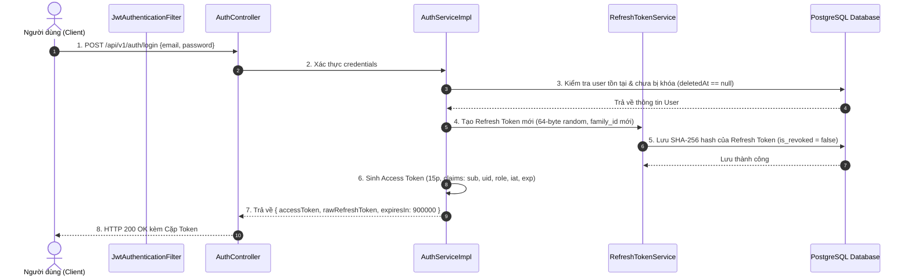
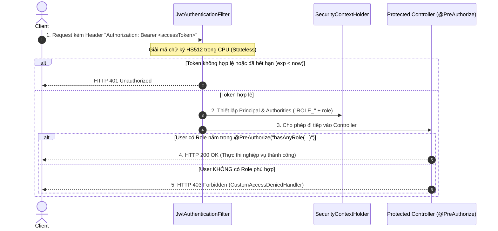
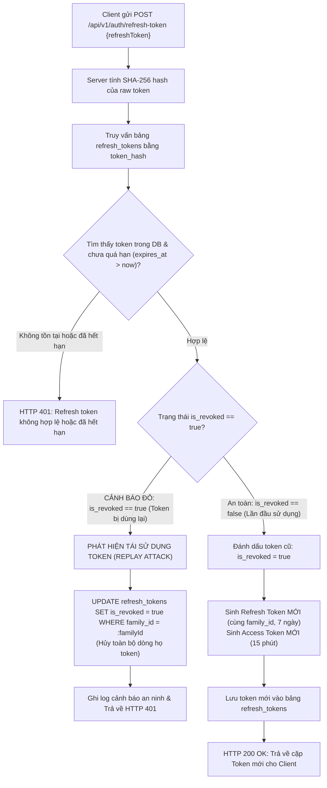

# 🔄 SPRINT 0 — BUSINESS FLOWS (AUTHENTICATION & RBAC)
> **Chủ đề:** Quy trình Xác thực Dual-Token, Xoay vòng Refresh Token Rotation (RTR) & Kiểm tra Phân quyền RBAC  
> **Áp dụng cho:** Sprint 0 (13/10/2026 – 19/10/2026)  

---

## 1. LUỒNG ĐĂNG NHẬP & CẤP PHÁT DUAL-TOKEN

---

## 2. LUỒNG GỌI API NGHIỆP VỤ & KIỂM TRA PHÂN QUYỀN RBAC

---

## 3. LUỒNG XOAY VÒNG TOKEN (RTR) & BÁO ĐỘNG ĐỎ PHÁT HIỆN XÂM PHẠM

