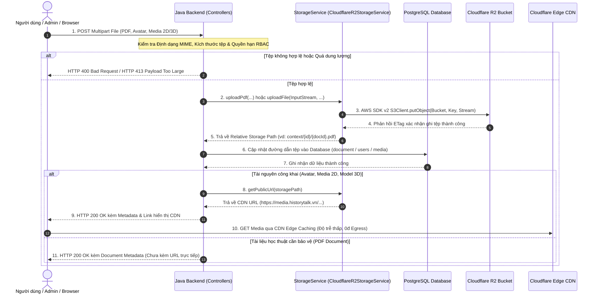
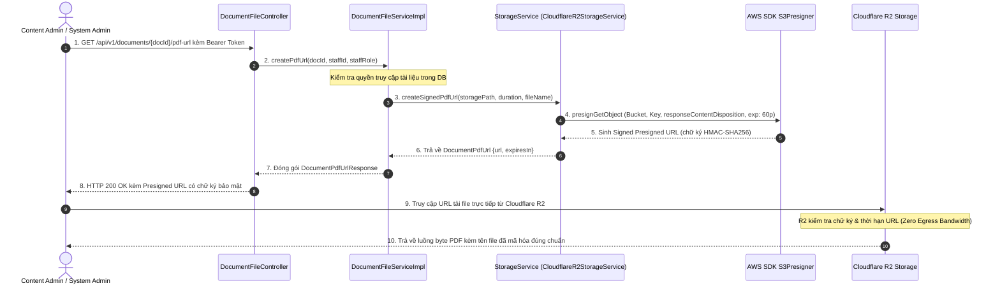
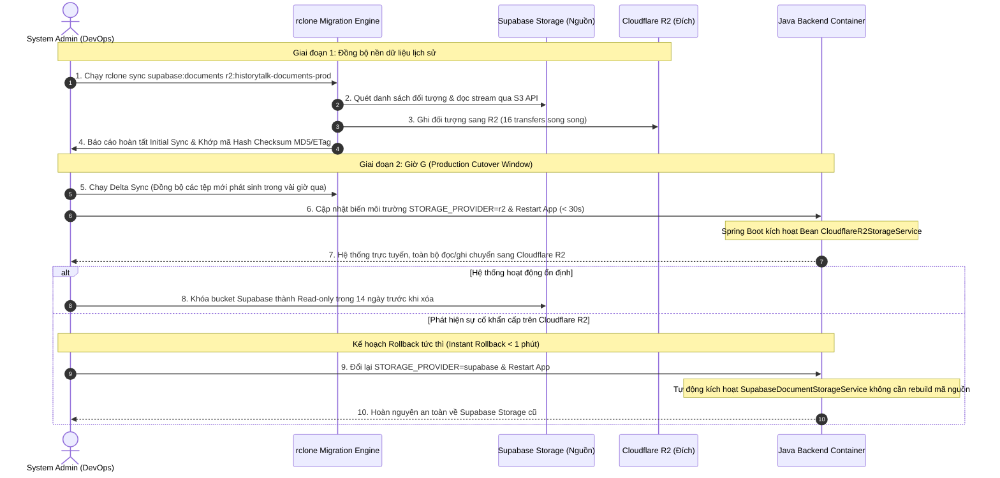
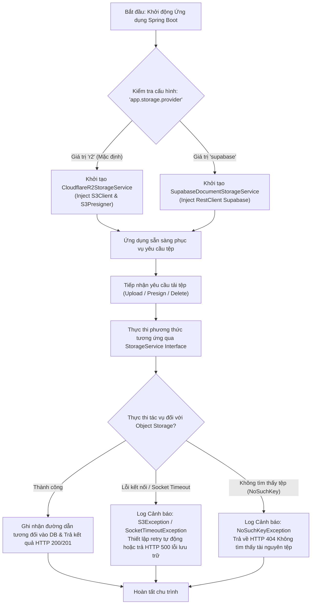

# 🔄 SPRINT 0 — BUSINESS FLOWS (CLOUDFLARE R2 STORAGE)
> **Chủ đề:** Quy trình Tải lên Tệp tin, Cấp phát Presigned S3 URL, Phân phối Edge CDN & Đồng bộ Dữ liệu Không Gián Đoạn  
> **Áp dụng cho:** Sprint 0 (13/10/2026 – 19/10/2026)  

---

## 1. LUỒNG TẢI LÊN & PHÂN PHỐI TỆP TIN (PDF & MEDIA 2D/3D)

---

## 2. LUỒNG SINH PRESIGNED S3 URL XEM / TẢI TÀI LIỆU BẢO MẬT

---

## 3. QUY TRÌNH ĐỒNG BỘ DỮ LIỆU CŨ & CƠ CHẾ DỰ PHÒNG CHUYỂN ĐỔI (CUTOVER & ROLLBACK)

---

## 4. QUY TRÌNH ĐIỀU HƯỚNG NHÀ CUNG CẤP & XỬ LÝ NGOẠI LỆ TỆP TIN

