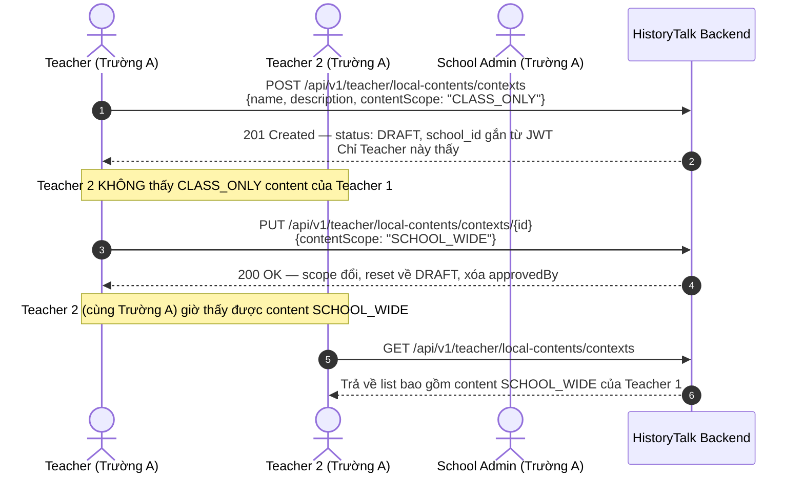
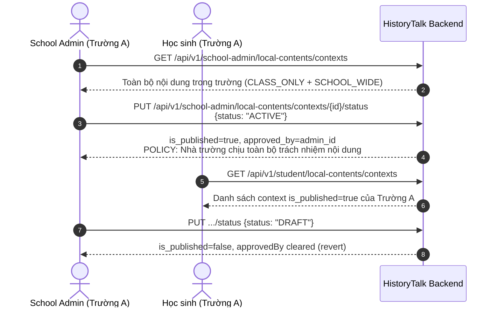
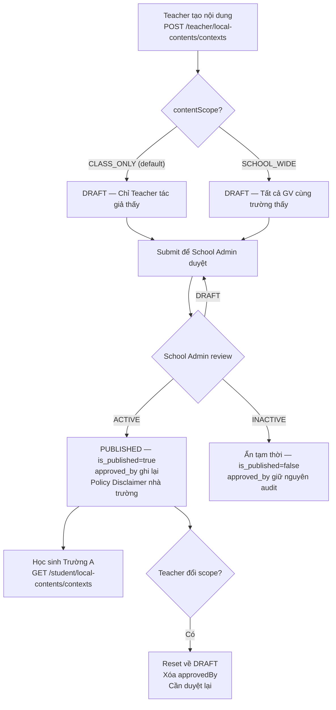
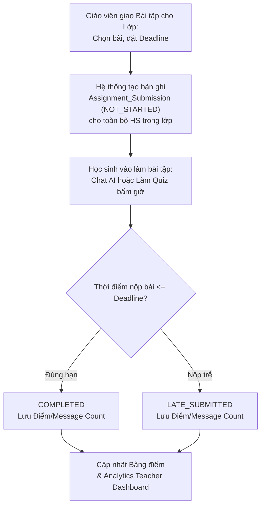

# 🔄 SPRINT 6 — BUSINESS FLOWS & ARCHITECTURE
> **Chủ đề:** Local Content Governance & Disclaimer Policy, Assignment & Deadline Engine, 5 Analytics Dashboards  
> **Áp dụng cho:** Sprint 6 (11/10/2026 – 17/10/2026)  
> **Updated:** ✅ 14/10/2026 — Đã reflect đúng implementation thực tế

---

## 1. LUỒNG QUẢN LÝ & DUYỆT NỘI DUNG LỊCH SỬ ĐỊA PHƯƠNG (LOCAL CONTENT WORKFLOW)

### 1.1 Tạo nội dung — Scope CLASS_ONLY (default)

### 1.2 School Admin duyệt & Student xem

### 1.3 Flowchart tổng quan Scope & Status

---

## 2. LUỒNG GIAO BÀI TẬP, THU BÀI VÀ CẬP NHẬT DASHBOARD GIÁO VIÊN

---

## 3. DB SCHEMA — Local Content Columns (Flyway V32)

| Bảng | Cột mới | Kiểu | Ý nghĩa |
|------|---------|------|---------|
| `historical_schema.historical_context` | `school_id` | `UUID NULL` | NULL=global, NOT NULL=local |
| `historical_schema.historical_context` | `content_scope` | `VARCHAR(20) NULL` | `CLASS_ONLY` \| `SCHOOL_WIDE` |
| `historical_schema.historical_context` | `approved_by` | `UUID NULL` | UID School Admin đã duyệt |
| `historical_schema."character"` | `school_id` | `UUID NULL` | Tương tự |
| `historical_schema."character"` | `content_scope` | `VARCHAR(20) NULL` | Tương tự |
| `historical_schema."character"` | `approved_by` | `UUID NULL` | Tương tự |

---

## 4. ISOLATION RULES

| Truy cập | Kết quả |
|---------|---------|
| Teacher Trường A → content Trường B | ❌ 404 Not Found |
| Teacher Trường A → CLASS_ONLY của GV khác Trường A | ❌ 403 Unauthorized |
| Teacher Trường A → SCHOOL_WIDE của GV khác Trường A | ✅ Read-only |
| School Admin Trường A → content Trường B | ❌ 404 Not Found |
| B2C Customer / CONTENT_ADMIN → bất kỳ local content | ❌ 403 Forbidden |
| Student Trường A → DRAFT content | ❌ Không thấy (chỉ PUBLISHED) |
| Student Trường A → PUBLISHED content Trường B | ❌ 404 (filtered by school_id) |
