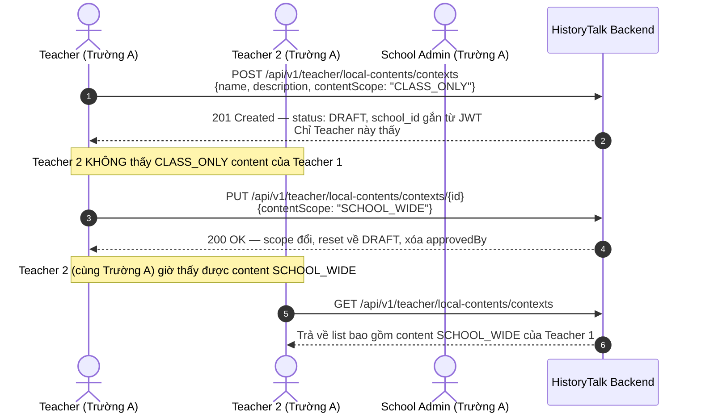
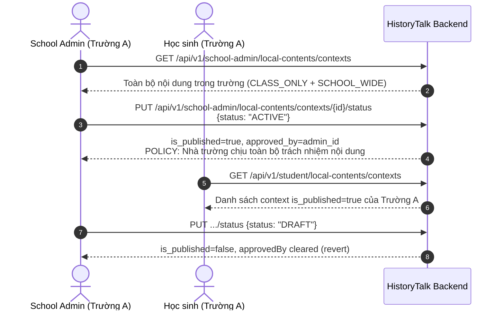
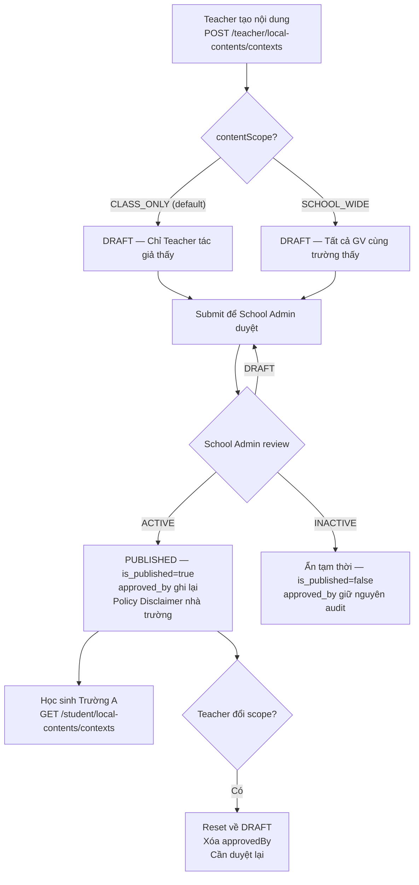
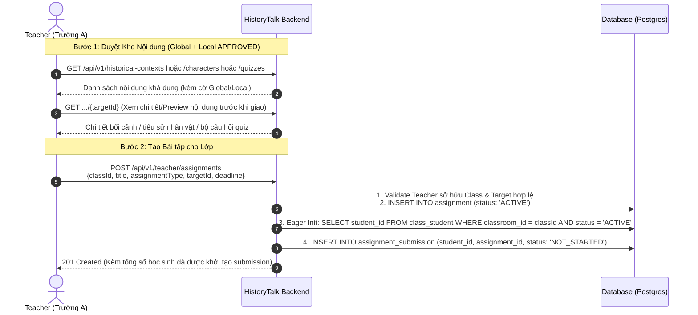
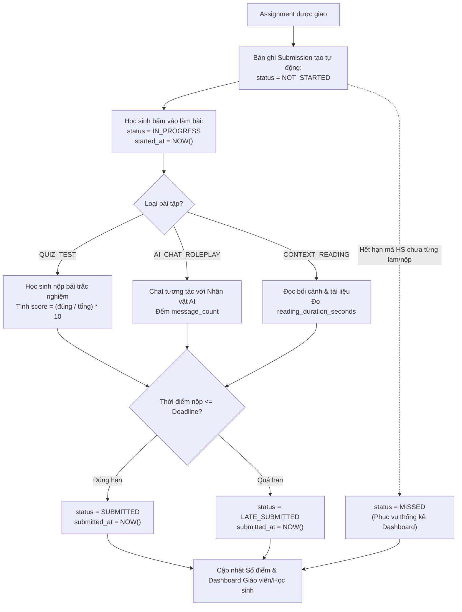
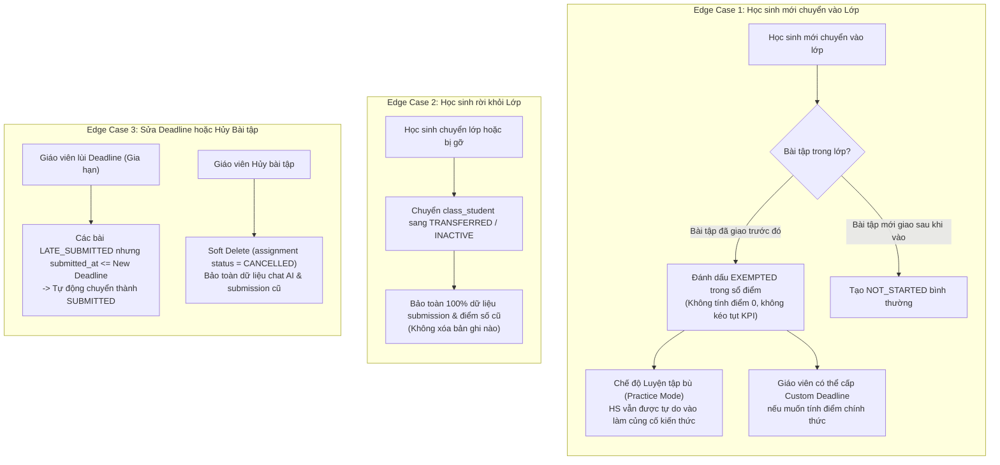

# 🔄 SPRINT 6 — BUSINESS FLOWS & ARCHITECTURE
> **Chủ đề:** Local Content Governance & Disclaimer Policy, Assignment & Deadline Engine, 5 Analytics Dashboards  
> **Áp dụng cho:** Sprint 6 (11/10/2026 – 17/10/2026)  
> **Updated:** ✅ 14/10/2026 — Đã reflect đúng implementation thực tế

---

## 1. LUỒNG QUẢN LÝ & DUYỆT NỘI DUNG LỊCH SỬ ĐỊA PHƯƠNG (LOCAL CONTENT WORKFLOW)

### 1.1 Tạo nội dung — Scope CLASS_ONLY (default)



### 1.2 School Admin duyệt & Student xem



### 1.3 Flowchart tổng quan Scope & Status



---

## 2. LUỒNG GIAO BÀI TẬP, THU BÀI & XỬ LÝ EDGE CASES

### 2.1 Luồng Giáo viên Duyệt Kho nội dung & Giao bài tập (Eager Initialization)



### 2.2 Luồng Học sinh Làm bài & Tự động Chấm điểm (Submission State Machine)



### 2.3 Luồng Xử lý Edge Cases Thực tế



---

## 3. DB SCHEMA

### 3.1 Local Content Columns (Flyway V32)

| Bảng | Cột mới | Kiểu | Ý nghĩa |
|------|---------|------|---------|
| `historical_schema.historical_context` | `school_id` | `UUID NULL` | NULL=global, NOT NULL=local |
| `historical_schema.historical_context` | `content_scope` | `VARCHAR(20) NULL` | `CLASS_ONLY` \| `SCHOOL_WIDE` |
| `historical_schema.historical_context` | `approved_by` | `UUID NULL` | UID School Admin đã duyệt |
| `historical_schema."character"` | `school_id` | `UUID NULL` | Tương tự |
| `historical_schema."character"` | `content_scope` | `VARCHAR(20) NULL` | Tương tự |
| `historical_schema."character"` | `approved_by` | `UUID NULL` | Tương tự |

### 3.2 Assignment & Submission Tables (Sprint 6 Plan)

```sql
-- historical_schema.assignment
CREATE TABLE historical_schema.assignment (
    id              UUID PRIMARY KEY DEFAULT gen_random_uuid(),
    classroom_id    UUID NOT NULL REFERENCES historical_schema.classroom(id),
    teacher_id      UUID NOT NULL REFERENCES historical_schema."user"(uid),
    title           VARCHAR(255) NOT NULL,
    description     TEXT,
    assignment_type VARCHAR(30) NOT NULL, -- 'CONTEXT_READING', 'AI_CHAT_ROLEPLAY', 'QUIZ_TEST'
    target_id       UUID NOT NULL,        -- context_id, character_id, or quiz_id
    deadline        TIMESTAMP WITH TIME ZONE NOT NULL,
    status          VARCHAR(20) NOT NULL DEFAULT 'ACTIVE', -- 'ACTIVE', 'CANCELLED', 'ARCHIVED'
    created_at      TIMESTAMP WITH TIME ZONE DEFAULT NOW(),
    updated_at      TIMESTAMP WITH TIME ZONE DEFAULT NOW()
);

-- historical_schema.assignment_submission
CREATE TABLE historical_schema.assignment_submission (
    id                      UUID PRIMARY KEY DEFAULT gen_random_uuid(),
    assignment_id           UUID NOT NULL REFERENCES historical_schema.assignment(id) ON DELETE CASCADE,
    student_id              UUID NOT NULL REFERENCES historical_schema."user"(uid),
    status                  VARCHAR(20) NOT NULL DEFAULT 'NOT_STARTED', -- 'NOT_STARTED', 'IN_PROGRESS', 'SUBMITTED', 'LATE_SUBMITTED', 'MISSED', 'EXEMPTED'
    score                   NUMERIC(4, 2),        -- điểm bài quiz (thang điểm 10)
    message_count           INT DEFAULT 0,         -- số tin nhắn chat AI
    reading_duration_seconds INT DEFAULT 0,        -- thời gian đọc bối cảnh (giây)
    started_at              TIMESTAMP WITH TIME ZONE,
    submitted_at            TIMESTAMP WITH TIME ZONE,
    created_at              TIMESTAMP WITH TIME ZONE DEFAULT NOW(),
    updated_at              TIMESTAMP WITH TIME ZONE DEFAULT NOW(),
    CONSTRAINT uq_assignment_student UNIQUE (assignment_id, student_id)
);
```

---

## 4. ISOLATION RULES

| Truy cập | Kết quả |
|---------|---------|
| Teacher Trường A → content Trường B | ❌ 404 Not Found |
| Teacher Trường A → CLASS_ONLY của GV khác Trường A | ❌ 403 Unauthorized |
| Teacher Trường A → SCHOOL_WIDE của GV khác Trường A | ✅ Read-only |
| School Admin Trường A → content Trường B | ❌ 404 Not Found |
| B2C Customer / CONTENT_ADMIN → bất kỳ local content | ❌ 403 Forbidden |
| Student Trường A → DRAFT content | ❌ Không thấy (chỉ PUBLISHED) |
| Student Trường A → PUBLISHED content Trường B | ❌ 404 (filtered by school_id) |
