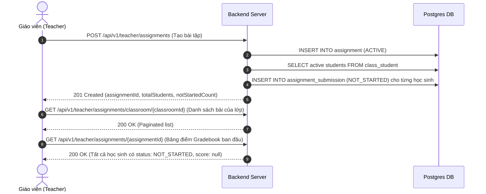
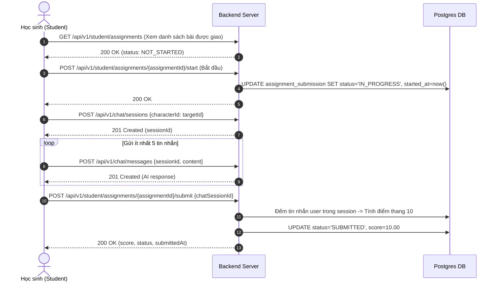
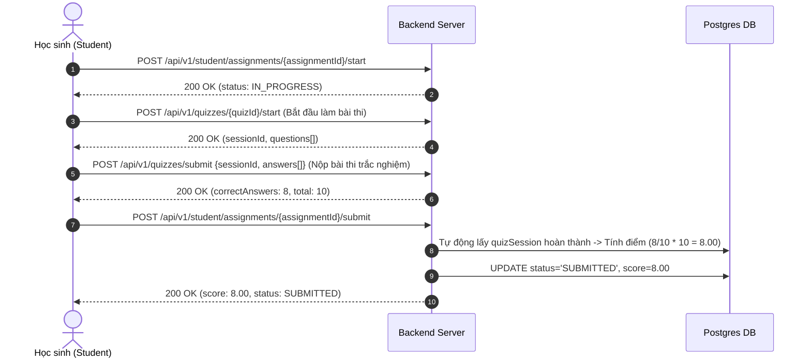
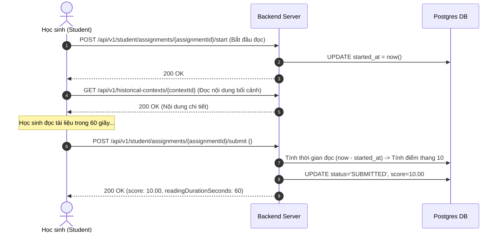
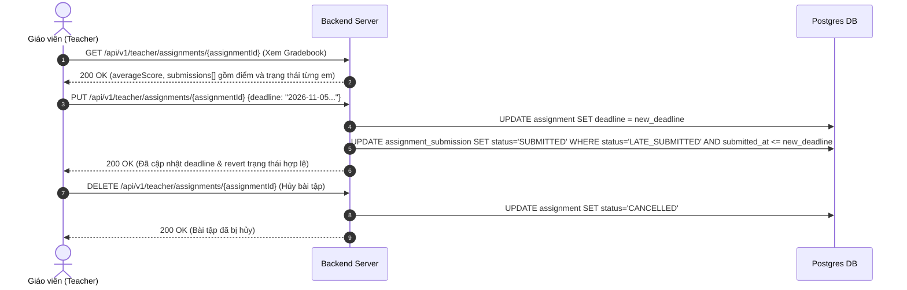

# 🔄 Assignment End-to-End Business & Testing Flows (Sprint 6)

> **Sprint:** Sprint 6 (11/10/2026 – 17/10/2026)  
> **Story IDs:** `US-SP6-04` (Quản lý Bài tập Giáo viên) & `US-SP6-05` (Nộp bài tập & Tự động Chấm điểm Server-side)  
> **Người biên soạn:** 🟢 Võ Đồng Đức Khải (`KhaiVDD`)  
> **Mục đích:** Tài liệu hướng dẫn nghiệp vụ chi tiết kèm chuỗi API thực thi end-to-end cho Developers (Frontend & Backend) tra cứu khi làm tính năng hoặc kiểm thử toàn diện hệ thống.  
> **Base URL (Local):** `http://localhost:8080/Historical-tell`  
> **Swagger UI:** `http://localhost:8080/Historical-tell/api/v1/swagger-ui`

---

## 📌 FLOW 0: CHUẨN BỊ TÀI KHOẢN & DỮ LIỆU ĐẦU VÀO

Trước khi thực hiện chuỗi nghiệp vụ bài tập, Developers cần chuẩn bị Token và các ID dữ liệu liên quan:

### 1. Đăng nhập lấy Token
1. **Lấy Token Giáo viên (Teacher):**
   - **Method:** `POST`
   - **Endpoint:** `/api/v1/auth/login`
   - **Body:** `{ "userName": "<teacher_username>", "password": "<password>" }`
   - 👉 Lưu lại: `{{TEACHER_TOKEN}}`
2. **Lấy Token Học sinh (Student):**
   - **Method:** `POST`
   - **Endpoint:** `/api/v1/auth/login`
   - **Body:** `{ "userName": "<student_username>", "password": "<password>" }`
   - 👉 Lưu lại: `{{STUDENT_TOKEN}}`

### 2. Thu thập ID Lớp học & Nội dung mục tiêu
1. **Lấy Lớp học mà giáo viên đang phụ trách:**
   - **Method:** `GET`
   - **Endpoint:** `/api/v1/classrooms/my-teaching` *(Header: `Bearer {{TEACHER_TOKEN}}`)*
   - 👉 Lưu lại: `classId` (UUID lớp học)
2. **Lấy Nội dung Mục tiêu (`targetId`):**
   - Đọc bối cảnh: `GET /api/v1/historical-contexts?page=0&size=20` $\rightarrow$ lưu `contextId`
   - Chat với nhân vật: `GET /api/v1/characters?page=0&size=20` $\rightarrow$ lưu `characterId`
   - Làm bài trắc nghiệm: `GET /api/v1/quizzes?page=0&size=20` $\rightarrow$ lưu `quizId`

---

## 🚀 FLOW 1: GIÁO VIÊN GIAO BÀI TẬP & KHỞI TẠO NỘP BÀI (US-SP6-04)

### Bản chất Nghiệp vụ (Business Rules)
- Giáo viên chỉ được giao bài cho lớp mình được phân công giảng dạy.
- Hệ thống áp dụng cơ chế **Eager Initialization**: Ngay khi bài tập được tạo (`POST /api/v1/teacher/assignments`), Backend tự động quét toàn bộ học sinh đang có trạng thái `ACTIVE` trong lớp và tạo sẵn bản ghi `assignment_submission` với trạng thái `NOT_STARTED`.
- Không tạo submission cho học sinh đã bị `INACTIVE` hoặc `TRANSFERRED`.

### Chuỗi API Thực thi


1. **Tạo bài tập:**
   - **Method:** `POST`
   - **Endpoint:** `/api/v1/teacher/assignments`
   - **Header:** `Authorization: Bearer {{TEACHER_TOKEN}}`
   - **Body mẫu (Ví dụ bài tập AI Chat Roleplay):**
     ```json
     {
       "classId": "{{CLASS_ID}}",
       "title": "Đối thoại với Trần Hưng Đạo về Trận Bạch Đằng",
       "description": "Hãy hỏi Tướng quân ít nhất 5 câu về kế sách cắm cọc gỗ.",
       "assignmentType": "AI_CHAT_ROLEPLAY",
       "targetId": "{{CHARACTER_ID}}",
       "deadline": "2026-10-30T23:59:59",
       "minRequirement": 5
     }
     ```
   - **Kỳ vọng:** `201 Created`. Lưu lại `assignmentId`.

2. **Xem danh sách bài tập lớp:**
   - **Method:** `GET`
   - **Endpoint:** `/api/v1/teacher/assignments/classroom/{{CLASS_ID}}`
   - **Header:** `Authorization: Bearer {{TEACHER_TOKEN}}`

3. **Xem Gradebook ban đầu:**
   - **Method:** `GET`
   - **Endpoint:** `/api/v1/teacher/assignments/{{ASSIGNMENT_ID}}`
   - **Header:** `Authorization: Bearer {{TEACHER_TOKEN}}`
   - **Kỳ vọng:** `200 OK`. `averageScore: null`, `notStartedCount` bằng đúng sĩ số học sinh active trong lớp.

---

## 💬 FLOW 2: HỌC SINH LÀM BÀI TẬP "AI CHAT ROLEPLAY" (US-SP6-05)

### Bản chất Nghiệp vụ (Business Rules)
1. Học sinh bấm "Bắt đầu": Trạng thái đổi từ `NOT_STARTED` $\rightarrow$ `IN_PROGRESS`, ghi nhận `startedAt`.
2. Học sinh trò chuyện với nhân vật qua bộ API Chat hiện có (`/api/v1/chat/...`).
3. **Cơ chế Chấm điểm Server-side (Thang điểm 10):**
   - Frontend gửi `chatSessionId`.
   - Server đếm số tin nhắn user gửi (`role = 'USER'` hoặc `m.isFromAi = false`).
   - Điểm số = $\min(10.0, \frac{\text{Số tin nhắn}}{\text{minRequirement}} \times 10.0)$.
   - Nếu nộp trước deadline: gán `SUBMITTED`; nếu sau deadline: gán `LATE_SUBMITTED`.

### Chuỗi API Thực thi


1. **Xem bài tập:** `GET /api/v1/student/assignments` (hoặc xem danh mục kịch bản roleplay qua `GET /api/v1/chat/scenarios`).
2. **Bắt đầu làm bài:** `POST /api/v1/student/assignments/{{ASSIGNMENT_ID}}/start`
3. **Tạo phiên chat:** `POST /api/v1/chat/sessions` với `{ "characterId": "{{CHARACTER_ID}}" }` (hoặc kèm `"contextId": "{{CONTEXT_ID}}"` nếu muốn chọn bối cảnh cụ thể) $\rightarrow$ Lưu `chatSessionId`.
4. **Chat với nhân vật:** `POST /api/v1/chat/messages` với `{ "sessionId": "{{CHAT_SESSION_ID}}", "content": "..." }` (gửi 4-5 tin nhắn).
5. **Nộp bài tập:** `POST /api/v1/student/assignments/{{ASSIGNMENT_ID}}/submit` (không cần truyền body, hoặc truyền `{ "chatSessionId": "{{CHAT_SESSION_ID}}" }` nếu muốn chỉ định phiên chat cụ thể).
   - **Kỳ vọng:** `200 OK`, `score: 8.00` (nếu chat 4/5 tin nhắn) hoặc `10.00` (nếu chat >= 5 tin nhắn), `status: "SUBMITTED"`.

---

## 📝 FLOW 3: HỌC SINH LÀM BÀI TẬP "TRẮC NGHIỆM QUIZ" (US-SP6-05)

### Bản chất Nghiệp vụ (Business Rules)
1. Học sinh làm bài thi trắc nghiệm qua Module Quiz (`/api/v1/quizzes/...`).
2. Module Quiz chấm điểm thô (`score` là số câu trả lời đúng) và ghi nhận `endTime`.
3. Khi học sinh nộp bài tập lớp (có thể truyền `quizSessionId` hoặc để trống để Server tự động lấy phiên làm bài hoàn thành điểm cao nhất):
   - Server kiểm tra bài thi phải thuộc về học sinh và đã nộp (`endTime != null`).
   - Server đọc số câu đúng và tổng số câu hỏi của Quiz (hỗ trợ cả câu hỏi gắn từ Question Bank).
   - Điểm số = $\frac{\text{Số câu đúng}}{\text{Tổng số câu hỏi}} \times 10.0$.

### Chuỗi API Thực thi


1. **Bắt đầu làm bài:** `POST /api/v1/student/assignments/{{ASSIGNMENT_ID}}/start`
2. **Bắt đầu thi Quiz:** `POST /api/v1/quizzes/{{QUIZ_ID}}/start` $\rightarrow$ Lưu `quizSessionId`.
3. **Nộp bài thi trắc nghiệm:** `POST /api/v1/quizzes/submit` với `{ "sessionId": "{{QUIZ_SESSION_ID}}", "answers": [...] }`.
4. **Nộp bài tập cho lớp:** `POST /api/v1/student/assignments/{{ASSIGNMENT_ID}}/submit` (không cần truyền body, hoặc truyền `{ "quizSessionId": "{{QUIZ_SESSION_ID}}" }`).
   - **Kỳ vọng:** `200 OK`, `score: 8.00` (nếu đúng 8/10 câu), `status: "SUBMITTED"`.

---

## 📖 FLOW 4: HỌC SINH LÀM BÀI TẬP "ĐỌC BỐI CẢNH LỊCH SỬ" (US-SP6-05)

### Bản chất Nghiệp vụ (Business Rules)
1. Khi học sinh bấm "Bắt đầu đọc", hệ thống lưu mốc thời gian `startedAt = now()`.
2. Học sinh mở nội dung bối cảnh để đọc tài liệu.
3. Khi bấm "Hoàn thành", Server đo thời gian: $\text{readingDuration} = \text{submittedAt} - \text{startedAt}$ (tính bằng giây).
4. Điểm số = $\min(10.0, \frac{\text{readingDuration}}{\text{minRequirement}} \times 10.0)$. (Nếu `minRequirement = 60s`, đọc được 45s $\rightarrow$ 7.50 điểm).

### Chuỗi API Thực thi


1. **Bắt đầu đọc:** `POST /api/v1/student/assignments/{{ASSIGNMENT_ID}}/start`
2. **Lấy nội dung bối cảnh:** `GET /api/v1/historical-contexts/{{CONTEXT_ID}}`
3. **Nộp bài đọc:** `POST /api/v1/student/assignments/{{ASSIGNMENT_ID}}/submit` với body rỗng `{}`.
   - **Kỳ vọng:** `200 OK`, hiển thị `readingDurationSeconds` và `score` thang 10 tương ứng.

---

## 📊 FLOW 5: GIÁO VIÊN KIỂM TRA SỔ ĐIỂM, GIA HẠN & HỦY BÀI TẬP

### Bản chất Nghiệp vụ (Business Rules)
1. **Gradebook Sổ điểm:** Giáo viên theo dõi danh sách từng học sinh, điểm số, thời gian nộp, tỉ lệ nộp và điểm trung bình cả lớp.
2. **Gia hạn Deadline & Auto-Revert:** Nếu giáo viên dời hạn nộp về sau, những học sinh trước đây từng bị đánh dấu `LATE_SUBMITTED` nhưng thời điểm nộp thực tế nằm trước deadline mới sẽ **tự động được revert về `SUBMITTED`**.
3. **Hủy bài tập (Soft Delete):** Đổi trạng thái bài tập sang `CANCELLED`. Toàn bộ dữ liệu bài nộp cũ của học sinh vẫn được bảo toàn nguyên vẹn trong Database (không hard-delete).

### Chuỗi API Thực thi


1. **Xem Gradebook:** `GET /api/v1/teacher/assignments/{{ASSIGNMENT_ID}}`
2. **Gia hạn Deadline:** `PUT /api/v1/teacher/assignments/{{ASSIGNMENT_ID}}` với body:
   ```json
   {
     "title": "Đối thoại với Trần Hưng Đạo (Đã gia hạn)",
     "description": "Thầy gia hạn thêm 2 ngày.",
     "deadline": "2026-11-05T23:59:59"
   }
   ```
3. **Hủy bài tập:** `DELETE /api/v1/teacher/assignments/{{ASSIGNMENT_ID}}`

---

## 🛡️ FLOW 6: TEST CÁC KỊCH BẢN NGOẠI LỆ & BẢO MẬT (ANTI-CHEAT)

Developers cần kiểm tra các kịch bản chặn gian lận và tính toàn vẹn dữ liệu:

| Kịch bản Ngoại lệ | Hành động Test | Kết quả mong đợi |
| :--- | :--- | :--- |
| **Chặn nộp đè** | Học sinh đã có trạng thái `SUBMITTED`, gửi lại request `POST .../submit` lần thứ 2. | `400 Bad Request`: *"Bạn đã nộp bài tập này rồi, không thể nộp lại"* |
| **Chặn nộp bài người khác** | Học sinh A gửi `quizSessionId` thuộc về tài khoản của Học sinh B. | `403 Forbidden`: *"Phiên làm bài Quiz không thuộc quyền sở hữu của bạn"* |
| **Chặn nộp Quiz chưa hoàn thành** | Học sinh vừa gọi `startQuiz` (chưa bấm `submitQuiz` bên quiz), liền gọi submit bài tập lớp. | `400 Bad Request`: *"Phiên làm bài Quiz này chưa hoàn thành nộp bài"* |
| **Chặn nộp sai nhân vật** | Đề bài yêu cầu chat với "Trần Hưng Đạo", nhưng học sinh gửi `chatSessionId` của "Ngô Quyền". | `400 Bad Request`: *"Phiên chat không phải với nhân vật lịch sử được yêu cầu trong bài tập"* |
| **Chặn học sinh ngoài lớp** | Học sinh không có tên trong danh sách lớp gửi request nộp bài. | `404 Not Found`: *"Không tìm thấy thông tin nộp bài của bạn cho bài tập này"* |
| **Chặn giáo viên ngoài lớp** | Giáo viên A gọi Gradebook của bài tập thuộc lớp do Giáo viên B phụ trách. | `403 Forbidden`: *"Bạn không có quyền quản lý lớp học này"* |
| **Chặn nộp bài đã hủy** | Học sinh nộp bài cho bài tập đã bị giáo viên chuyển sang `CANCELLED`. | `400 Bad Request`: *"Bài tập này hiện không còn khả dụng để nộp"* |
