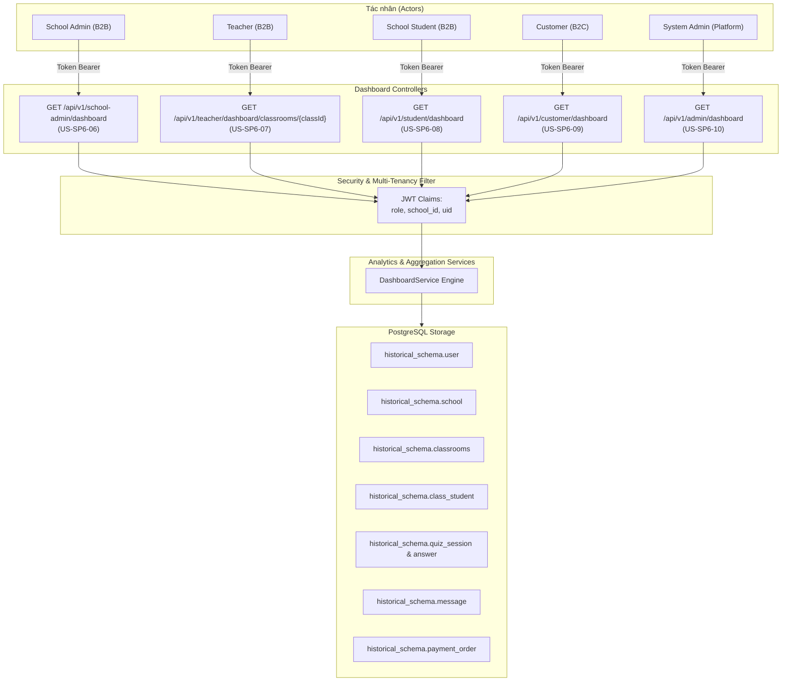
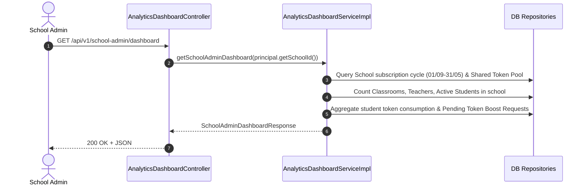
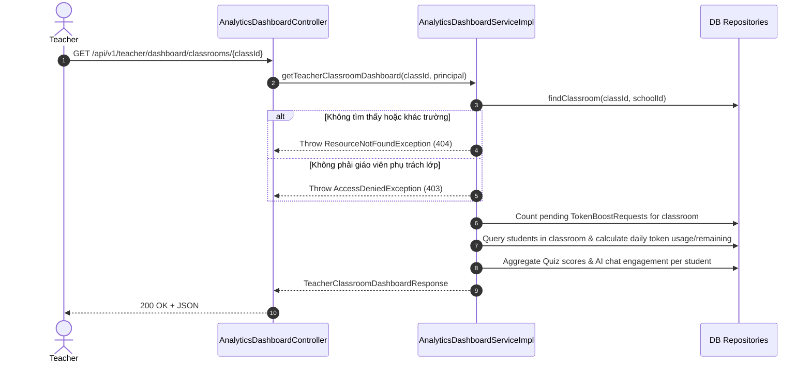

# 📊 SPRINT 6 — BUSINESS FLOW: 5 CHUYÊN HỆ DASHBOARDS & ANALYTICS APIS
> **User Stories:** `US-SP6-06`, `US-SP6-07`, `US-SP6-08`, `US-SP6-09`, `US-SP6-10`  
> **Lập trình viên phụ trách:** Trần Quốc Dinh (`DinhTQ`)  
> **Áp dụng cho:** Sprint 6 (11/10/2026 – 17/10/2026)  
> **Mục tiêu:** Cung cấp 5 bộ API Dashboard chuyên biệt theo từng vai trò (School Admin, Teacher, Student, B2C Customer, System Admin), đảm bảo bảo mật Multi-tenancy isolation và hiệu năng tổng hợp truy vấn.

---

## 1. TỔNG QUAN KIẾN TRÚC & PHÂN QUYỀN 5 DASHBOARDS

---

## 2. LUỒNG NGHIỆP VỤ CHI TIẾT TỪNG DASHBOARD

### 2.1 US-SP6-06: School Admin Dashboard API (`GET /api/v1/school-admin/dashboard`)
- **Actor:** `SCHOOL_ADMIN` (Multi-tenant: `school_id` lấy từ JWT `UserPrincipal`).
- **Nghiệp vụ:**
  1. Kiểm tra quyền `SCHOOL_ADMIN`, trích xuất `school_id`.
  2. Lấy thông tin Chu kỳ Gói Trường học (`01/09` – `31/05`):
     - `packageType`, `recommendedStudents`, `status` (`ACTIVE`/`EXPIRED`), `subscriptionStartDate`, `subscriptionEndDate`, `renewedForNextYear`, `nextPackageType`.
  3. Tổng hợp quy mô trường:
     - Số lớp học: `count(classrooms) WHERE school_id = :schoolId AND deleted_at IS NULL`.
     - Số giáo viên: `count(user) WHERE school_id = :schoolId AND role = 'TEACHER' AND deleted_at IS NULL`.
     - Số học sinh đang hoạt động: `count(user) WHERE school_id = :schoolId AND role = 'SCHOOL_STUDENT' AND deleted_at IS NULL`.
  4. Thống kê Quỹ Token Chung (`Pure Shared Pool`) & Định mức Ngày:
     - Toàn bộ token của trường nằm trong `unallocated_token_quota` và trừ trực tiếp khi học sinh chat AI.
     - Lấy `total_school_token_quota`, `unallocated_token_quota`, `default_daily_student_quota` từ bảng `school`.
     - Tính `allocated_tokens = total_school_token_quota - unallocated_token_quota` và `tokens_used_by_students` từ bảng `message`.
     - Đếm `pending_token_boost_requests`: Số yêu cầu xin thêm hạn mức token trong ngày đang chờ duyệt (`PENDING`) trong toàn trường.
  5. Thống kê Bài tập (Assignment Stats): Tỷ lệ % hoàn thành đúng hạn (`COMPLETED`), nộp trễ (`LATE_SUBMITTED`), chưa làm (`NOT_STARTED`).
- **Sequence Diagram:**

---

### 2.2 US-SP6-07: Teacher Classroom Analytics Dashboard (`GET /api/v1/teacher/dashboard/classrooms/{classId}`)
- **Actor:** `TEACHER`
- **Nghiệp vụ:**
  1. Kiểm tra quyền `TEACHER`, kiểm tra lớp `{classId}` có thuộc trường `school_id` của giáo viên hay không.
  2. **Ownership Check:** Kiểm tra `classroom.teacher_id == teacher.uid`. Nếu giáo viên khác cố tình xem lớp không phụ trách $\rightarrow$ trả về `403 Forbidden`.
  3. Lấy thông tin hạn mức ngày của lớp (`dailyTokenLimit = COALESCE(classroom.dailyTokenQuota, school.defaultDailyStudentQuota, 1000)`), trạng thái lớp (`ACTIVE`/`ARCHIVED`), và số yêu cầu xin thêm token trong ngày đang chờ giáo viên duyệt (`pendingTokenBoostRequests`).
  4. Tổng hợp danh sách học sinh của lớp từ `class_student`:
     - Danh sách học sinh kèm thông tin hạn mức ngày hôm nay: `dailyTokenLimit`, `dailyBonusTokens` (đã được duyệt thêm hôm nay), `dailyTokensUsed` (đã tiêu hôm nay), `currentTokens` (hạn mức còn được tiêu hôm nay).
     - Điểm Quiz trung bình của từng học sinh và số tin nhắn trò chuyện với nhân vật AI (`aiMessagesCount`).
  5. Tỷ lệ hoàn thành bài tập của lớp (On-time vs Late vs Pending).

---

### 2.3 US-SP6-08: Student Personal Dashboard (`GET /api/v1/student/dashboard`)
- **Actor:** `SCHOOL_STUDENT`
- **Nghiệp vụ:**
  1. Xác thực học sinh từ JWT `uid` và `school_id` (tài khoản `DEACTIVATED` do đã ra trường/chuyển trường bị chặn ngay từ tầng Auth/JWT).
  2. Lấy danh sách lớp học sinh theo học qua các năm (`enrolledClassrooms`: bao gồm cả lớp `ACTIVE` năm học hiện tại và lớp `ARCHIVED` các năm học trước).
  3. Tính toán Hạn mức Token AI theo ngày (theo cơ chế 100% Quỹ chung + Hạn mức Chi tiêu Ngày):
     - `dailyTokenLimit`: Hạn mức ngày cơ bản của lớp `ACTIVE` hiện tại (hoặc mặc định của trường `1.000 token/ngày`).
     - `dailyBonusTokens`: Số hạn mức được giáo viên duyệt cộng thêm trong ngày hôm nay.
     - `tokensUsedToday`: Số token đã tiêu thụ trong ngày hôm nay.
     - `currentTokens`: Hạn mức còn được phép tiêu trong ngày hôm nay (`min(dailyTokenLimit + dailyBonusTokens - tokensUsedToday, school.unallocatedTokenQuota)`).
  4. Lấy lịch sử Quiz cá nhân:
     - Tổng số bài Quiz đã tham gia (`totalQuizzesAttempted`), Điểm trung bình % (`averageScorePercentage`), Top 5 bài Quiz hoàn thành gần nhất (`recentQuizzes`).
  5. Danh sách bài tập sắp đến hạn nộp (`Upcoming Deadlines`).

---

### 2.4 US-SP6-09: Customer B2C Personal Dashboard (`GET /api/v1/customer/dashboard`)
- **Actor:** `CUSTOMER` / `USER` (Người dùng học tập tự do cá nhân).
- **Nghiệp vụ:**
  1. Xác thực người dùng B2C từ JWT `uid`.
  2. Lấy thông tin Gói cước (`user_tier` $\rightarrow$ `tier`: Free, Plus, Pro, v.v.), số dư Token, hạn dùng.
  3. Lấy phân tích học tập cá nhân:
     - Tổng số Quiz đã làm, điểm trung bình %, phân bố thời kỳ lịch sử đã học (`eraDistribution`).
     - Danh sách 5 bài Quiz gần nhất.
     - Top nhân vật lịch sử trò chuyện nhiều nhất (`topCharacters`: `name`, `messageCount`, `tokenUsed`).
  4. Lấy lịch sử thanh toán PayOS:
     - 5 đơn hàng mua Token / gói gần nhất (`orderCode`, `amount`, `tierName`, `status: PAID`, `createdAt`).

---

### 2.5 US-SP6-10: System Admin Dashboard & JVM Health (`GET /api/v1/admin/dashboard`)
- **Actor:** `SYSTEM_ADMIN`
- **Nghiệp vụ:**
  1. Kiểm tra quyền `SYSTEM_ADMIN`.
  2. **JVM Health Metrics:**
     - Sử dụng `ManagementFactory.getOperatingSystemMXBean()` & `Runtime.getRuntime()`:
       - `cpuUsagePercentage`: % tải CPU.
       - `usedMemoryMb`, `totalMemoryMb`, `maxMemoryMb`, `freeMemoryMb`.
       - `activeThreadCount`: Số lượng luồng đang chạy trong JVM.
       - `uptimeSeconds`: Thời gian ứng dụng đã online liên tục.
  3. **Lưu lượng Token toàn hệ thống (`tokenSummary`):**
     - `totalTokensB2bAllocated`: Tổng quỹ token đã cấp cho tất cả các Trường học.
     - `totalTokensB2bRemainingInPools`: Tổng token còn lại trong Quỹ chung (`unallocatedTokenQuota`) của các trường.
     - `totalTokensB2bConsumed`: Tổng token khối trường học B2B đã tiêu thụ thực tế.
     - `totalTokensB2cConsumed`: Tổng token khối khách hàng lẻ B2C đã tiêu thụ.
     - `totalTokensSystemConsumed`: Tổng token tiêu thụ toàn hệ thống.
  4. **Top 10 Câu hỏi Quiz có tỷ lệ làm sai cao nhất hệ thống:**
     - Truy vấn bảng câu trả lời Quiz `quiz_answer`: Lọc các câu hỏi có số lần trả lời sai (`is_correct = false`) nhiều nhất, tính tỷ lệ % trả lời sai.
  5. **Tổng quan Nền tảng (`platformOverview`):**
     - `totalSchools`, `activeSchools` (các trường đang trong hạn `01/09` – `31/05`), `expiredSchools` (các trường đã hết hạn gói chưa gia hạn).
     - `totalUsers`, `totalQuizzes`, `totalRevenue` (Tổng doanh thu PayOS lũy kế).

---

## 3. MA TRẬN PHÂN QUYỀN VÀ BẢO MẬT (SECURITY MATRIX)

| API Endpoint | Role được phép | Multi-tenancy & Subscription Guard |
|---|---|---|
| `GET /api/v1/school-admin/dashboard` | `SCHOOL_ADMIN` | Chỉ xem dữ liệu trong `principal.getSchoolId()`; cho phép School Admin xem trạng thái gói ngay cả khi trường `EXPIRED` |
| `GET /api/v1/teacher/dashboard/classrooms/{classId}` | `TEACHER` | Chỉ xem lớp học có `teacher_id = teacher.uid`, cùng `school_id`, và trường đang trong hạn `ACTIVE` (`01/09` – `31/05`) |
| `GET /api/v1/student/dashboard` | `SCHOOL_STUDENT` | Chỉ xem dữ liệu cá nhân của `principal.getUid()`, tài khoản `ACTIVE` và trường đang trong hạn `ACTIVE` (`01/09` – `31/05`) |
| `GET /api/v1/customer/dashboard` | `CUSTOMER` | Chỉ xem dữ liệu cá nhân của `principal.getUid()` |
| `GET /api/v1/admin/dashboard` | `SYSTEM_ADMIN` | Dữ liệu tổng hợp toàn hệ thống |
