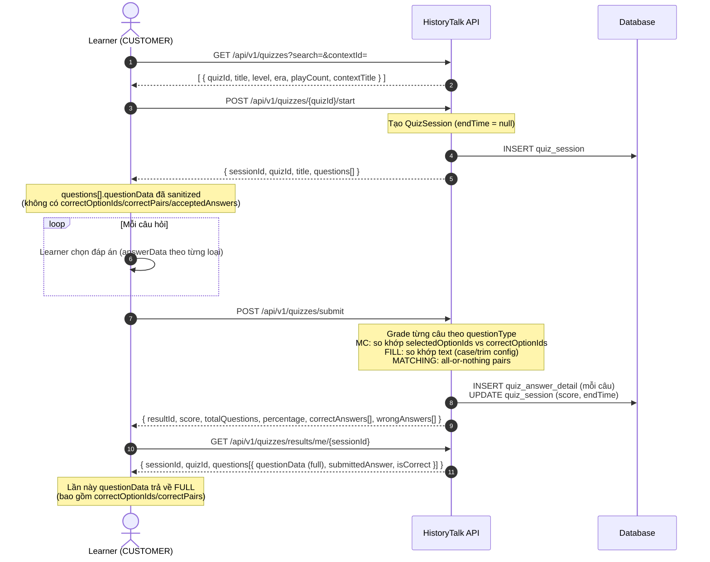
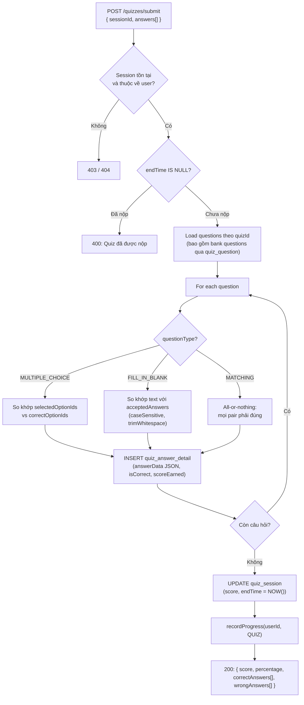
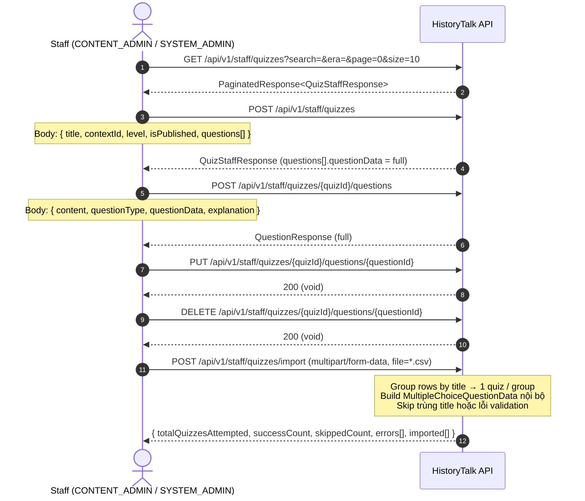
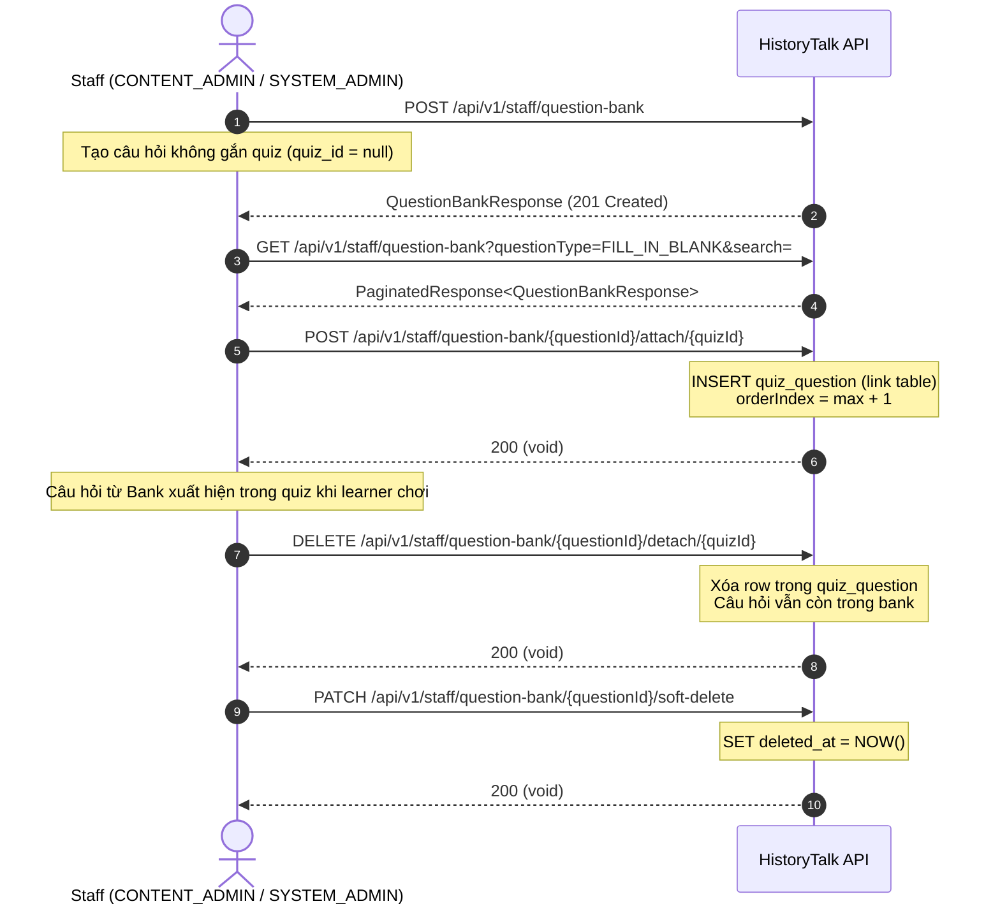
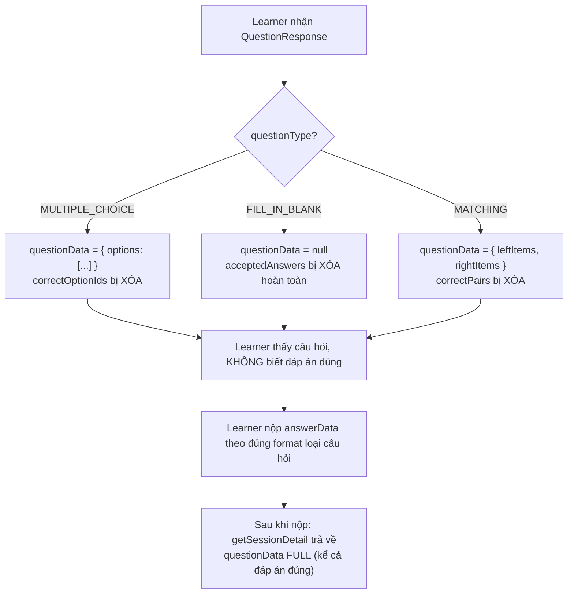

# 🔄 SPRINT 7 — BUSINESS FLOWS
> **Chủ đề:** Quiz Module — Luồng làm bài, Quản lý nội dung, Question Bank  
> **Áp dụng cho:** Sprint 7 (16/10/2026 – 30/10/2026)

---

## 1. LUỒNG LÀM BÀI CỦA LEARNER

---

## 2. QUY TRÌNH XỬ LÝ SUBMIT & CHẤM ĐIỂM

---

## 3. LUỒNG QUẢN LÝ QUIZ CỦA STAFF

---

## 4. LUỒNG QUESTION BANK

---

## 5. QUY TRÌNH RẼ NHÁNH — QUESTION DATA SANITIZATION

