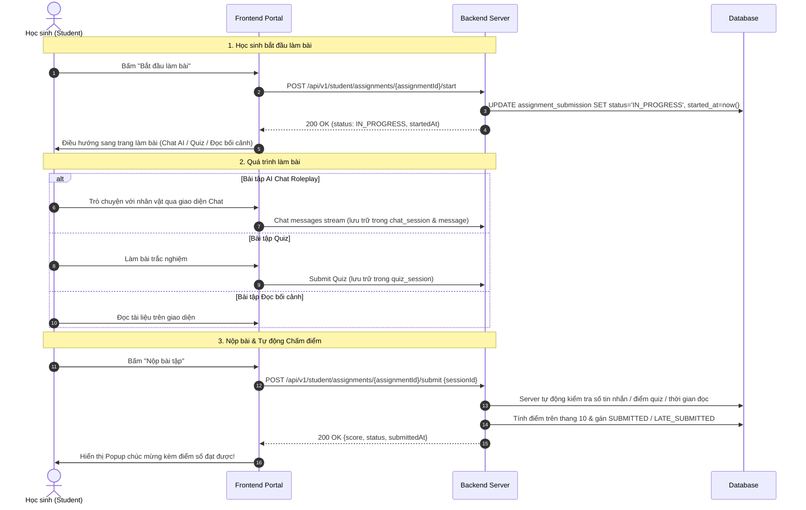

# Assignment Management & Multi-task Submission API Contract (Sprint 6)

> **Sprint:** Sprint 6 (11/10/2026 – 17/10/2026)  
> **Story IDs:** `US-SP6-04` (Quản lý Bài tập Giáo viên) & `US-SP6-05` (Nộp bài tập & Tự động Chấm điểm Server-side)  
> **Người biên soạn:** 🟢 Võ Đồng Đức Khải (`KhaiVDD`)  
> **Dành cho:** Frontend Developers (Teacher Portal & Student Portal)  
> **Base URL (Local):** `http://localhost:8080/Historical-tell`  
> **Swagger UI:** `http://localhost:8080/Historical-tell/api/v1/swagger-ui`  
> **Authentication Header:** `Authorization: Bearer <access_token>`  
> **Content-Type:** `application/json`

---

## 1. Response Wrappers & Common Interfaces

### 1.1 Single Item Response Wrapper (`ApiResponse<T>`)
```typescript
export interface ApiResponse<T> {
  success: boolean;
  message: string;
  data: T;
  timestamp: string;          // ISO 8601
  errorCode?: string | null;
}
```

### 1.2 Paginated List Response Wrapper (`PaginatedApiResponse<T>`)
```typescript
export interface PaginationMeta {
  page: number;               // 0-indexed
  size: number;
  totalElements: number;
  totalPages: number;
  hasNext: boolean;
  hasPrevious: boolean;
}

export interface PaginatedApiResponse<T> {
  success: boolean;
  message: string;
  data: T[];
  pagination: PaginationMeta;
  timestamp: string;
  errorCode?: string | null;
}
```

---

## 2. Enums & TypeScript Models

### 2.1 Enums Nghiệp vụ

```typescript
// Loại bài tập được giao
export type AssignmentType = 
  | "CONTEXT_READING"    // Đọc hiểu bối cảnh lịch sử
  | "AI_CHAT_ROLEPLAY"   // Nhập vai đối thoại với nhân vật lịch sử qua AI
  | "QUIZ_TEST";         // Trắc nghiệm kiểm tra kiến thức

// Trạng thái bài tập của giáo viên
export type AssignmentStatus = 
  | "ACTIVE"             // Đang hoạt động, học sinh được làm bài
  | "CANCELLED"          // Đã hủy bởi giáo viên (soft delete)
  | "ARCHIVED";          // Đã lưu trữ sau khi kết thúc kỳ học

// Trạng thái bài nộp của học sinh
export type SubmissionStatus = 
  | "NOT_STARTED"        // Chưa bắt đầu
  | "IN_PROGRESS"        // Đang làm bài
  | "SUBMITTED"          // Đã nộp đúng hạn
  | "LATE_SUBMITTED"     // Nộp muộn sau deadline
  | "MISSED"             // Bỏ lỡ bài nộp quá hạn
  | "EXEMPTED";          // Được miễn bài tập
```

---

### 2.2 Model Dành cho Giáo viên (Teacher Portal)

#### Model Thẻ Bài tập của Giáo viên (`TeacherAssignmentResponse`)
```typescript
export interface TeacherAssignmentResponse {
  assignmentId: string;       // UUID bài tập
  classroomId: string;        // UUID lớp học
  className: string;          // Tên lớp học (VD: "10A1 Chuyên Sử")
  title: string;              // Tiêu đề bài tập
  description?: string | null;// Dặn dò của giáo viên
  assignmentType: AssignmentType;
  targetId: string;           // UUID bối cảnh / nhân vật / quiz được chọn
  targetTitle?: string | null;// Tên hiển thị (Bối cảnh/Nhân vật/Quiz)
  deadline: string;           // ISO 8601 (VD: "2026-10-25T23:59:59")
  minRequirement: number;     // Số tiêu chuẩn để đạt 10 điểm (số tin nhắn chat AI hoặc số giây đọc)
  status: AssignmentStatus;
  
  // Thống kê nhanh tiến độ lớp học
  totalStudents: number;      // Tổng số học sinh trong lớp (ACTIVE)
  submittedCount: number;     // Số học sinh đã nộp đúng hạn
  lateSubmittedCount: number; // Số học sinh nộp muộn
  inProgressCount: number;    // Số học sinh đang làm
  notStartedCount: number;    // Số học sinh chưa bắt đầu
  createdAt: string;          // ISO 8601
}
```

#### Model Bảng điểm Chi tiết của Lớp (`AssignmentGradebookResponse`)
```typescript
export interface SubmissionItemResponse {
  submissionId: string;       // UUID bản ghi nộp bài
  studentId: string;          // UUID học sinh
  studentCode: string;        // Mã số học sinh (VD: "HS260001")
  fullName: string;           // Họ và tên học sinh
  email: string;              // Email học sinh
  status: SubmissionStatus;   // NOT_STARTED | IN_PROGRESS | SUBMITTED | LATE_SUBMITTED
  score?: number | null;      // Điểm số thang điểm 10 (làm tròn 2 chữ số thập phân, null nếu chưa nộp)
  messageCount: number;       // Số lượt tin nhắn học sinh chat với AI (đối với AI_CHAT_ROLEPLAY)
  readingDurationSeconds: number; // Số giây học sinh đọc tài liệu (đối với CONTEXT_READING)
  startedAt?: string | null;  // Thời điểm bấm bắt đầu làm bài
  submittedAt?: string | null;// Thời điểm nộp bài
}

export interface AssignmentGradebookResponse {
  assignmentId: string;
  classroomId: string;
  className: string;
  title: string;
  assignmentType: AssignmentType;
  targetTitle?: string | null;
  deadline: string;
  minRequirement: number;
  totalStudents: number;
  submittedCount: number;
  lateSubmittedCount: number;
  inProgressCount: number;
  notStartedCount: number;
  averageScore?: number | null;// Điểm trung bình cả lớp (thang điểm 10)
  submissions: SubmissionItemResponse[]; // Danh sách từng học sinh
}
```

---

### 2.3 Model Dành cho Học sinh (Student Portal)

#### Model Bài tập Học sinh Được giao (`StudentAssignmentResponse`)
```typescript
export interface StudentAssignmentResponse {
  assignmentId: string;       // UUID bài tập
  classroomId: string;        // UUID lớp học
  className: string;          // Tên lớp học
  title: string;              // Tiêu đề bài tập
  description?: string | null;// Dặn dò của giáo viên
  assignmentType: AssignmentType;
  targetId: string;           // UUID nội dung cần làm (Bối cảnh / Nhân vật / Quiz)
  targetTitle?: string | null;// Tên nội dung mục tiêu
  deadline: string;           // Hạn chót nộp bài
  minRequirement: number;     // Tiêu chuẩn để đạt tối đa 10 điểm
  
  // Trạng thái bài làm của riêng học sinh
  submissionStatus: SubmissionStatus; // NOT_STARTED, IN_PROGRESS, SUBMITTED, LATE_SUBMITTED
  score?: number | null;      // Điểm đạt được (thang 10, null nếu chưa có)
  messageCount: number;       // Số tin nhắn chat đã thực hiện
  readingDurationSeconds: number; // Thời gian đọc đã ghi nhận (giây)
  startedAt?: string | null;  // Thời điểm bắt đầu
  submittedAt?: string | null;// Thời điểm nộp bài
  isExpired: boolean;         // true nếu hiện tại đã quá hạn deadline
}
```

#### Model Kết quả Nộp bài (`StudentSubmissionResponse`)
```typescript
export interface StudentSubmissionResponse {
  submissionId: string;
  assignmentId: string;
  status: SubmissionStatus;   // SUBMITTED hoặc LATE_SUBMITTED (hoặc IN_PROGRESS khi start)
  score?: number | null;      // Điểm số server chấm trên thang 10
  messageCount: number;
  readingDurationSeconds: number;
  startedAt?: string | null;
  submittedAt?: string | null;
}
```

---

## 3. Endpoints Chi tiết: Giáo viên (`TeacherAssignmentController`)

**Base Path:** `/api/v1/teacher/assignments`  
**Yêu cầu quyền:** `ROLE_TEACHER`

### 3.1 Tạo bài tập mới
Khi tạo bài tập thành công, hệ thống tự động khởi tạo trước bản ghi nộp bài (`NOT_STARTED`) cho toàn bộ học sinh đang `ACTIVE` trong lớp.

- **Method:** `POST`
- **Path:** `/api/v1/teacher/assignments`
- **Request Body (`CreateAssignmentRequest`):**
```json
{
  "classId": "3fa85f64-5717-4562-b3fc-2c963f66afa6",
  "title": "Tìm hiểu Bối cảnh Chiến thắng Bạch Đằng 938",
  "description": "Các em đọc kỹ bối cảnh và chuẩn bị câu hỏi thảo luận trên lớp.",
  "assignmentType": "CONTEXT_READING",
  "targetId": "c83b23e1-7e89-4912-a1b2-998877665544",
  "deadline": "2026-10-25T23:59:59",
  "minRequirement": 120
}
```
*Ghi chú về `minRequirement`:*
- Với `AI_CHAT_ROLEPLAY`: Là số lượt tin nhắn học sinh cần chat để đạt 10 điểm (mặc định = 5).
- Với `CONTEXT_READING`: Là số giây đọc tài liệu để đạt 10 điểm (mặc định = 60).
- Với `QUIZ_TEST`: Để null hoặc 0 (hệ thống tự lấy tổng số câu hỏi của Quiz để quy đổi điểm).

- **Response:** `201 Created` (`ApiResponse<TeacherAssignmentResponse>`)
```json
{
  "success": true,
  "message": "Assignment created successfully",
  "data": {
    "assignmentId": "b1a23c4d-5e6f-7a8b-9c0d-1e2f3a4b5c6d",
    "classroomId": "3fa85f64-5717-4562-b3fc-2c963f66afa6",
    "className": "10A1 Chuyên Sử",
    "title": "Tìm hiểu Bối cảnh Chiến thắng Bạch Đằng 938",
    "description": "Các em đọc kỹ bối cảnh và chuẩn bị câu hỏi thảo luận trên lớp.",
    "assignmentType": "CONTEXT_READING",
    "targetId": "c83b23e1-7e89-4912-a1b2-998877665544",
    "targetTitle": "Chiến thắng Bạch Đằng năm 938",
    "deadline": "2026-10-25T23:59:59",
    "minRequirement": 120,
    "status": "ACTIVE",
    "totalStudents": 40,
    "submittedCount": 0,
    "lateSubmittedCount": 0,
    "inProgressCount": 0,
    "notStartedCount": 40,
    "createdAt": "2026-10-15T19:00:00"
  },
  "timestamp": "2026-10-15T19:00:00.123"
}
```

---

### 3.2 Lấy danh sách bài tập của lớp
- **Method:** `GET`
- **Path:** `/api/v1/teacher/assignments/classroom/{classroomId}`
- **Query Parameters:**
  - `status` (optional): Lọc theo `ACTIVE`, `CANCELLED`, `ARCHIVED`
  - `page` (optional, default `0`): Chỉ số trang (0-indexed)
  - `size` (optional, default `20`): Kích thước trang
  - `sort` (optional, default `createdAt,DESC`)
- **Response:** `200 OK` (`PaginatedApiResponse<TeacherAssignmentResponse>`)
```json
{
  "success": true,
  "message": "Assignments retrieved successfully",
  "data": [
    {
      "assignmentId": "b1a23c4d-5e6f-7a8b-9c0d-1e2f3a4b5c6d",
      "classroomId": "3fa85f64-5717-4562-b3fc-2c963f66afa6",
      "className": "10A1 Chuyên Sử",
      "title": "Tìm hiểu Bối cảnh Chiến thắng Bạch Đằng 938",
      "assignmentType": "CONTEXT_READING",
      "targetId": "c83b23e1-7e89-4912-a1b2-998877665544",
      "targetTitle": "Chiến thắng Bạch Đằng năm 938",
      "deadline": "2026-10-25T23:59:59",
      "minRequirement": 120,
      "status": "ACTIVE",
      "totalStudents": 40,
      "submittedCount": 15,
      "lateSubmittedCount": 2,
      "inProgressCount": 5,
      "notStartedCount": 18,
      "createdAt": "2026-10-15T19:00:00"
    }
  ],
  "pagination": {
    "page": 0,
    "size": 20,
    "totalElements": 1,
    "totalPages": 1,
    "hasNext": false,
    "hasPrevious": false
  },
  "timestamp": "2026-10-15T19:05:00.000"
}
```

---

### 3.3 Xem Gradebook chi tiết của bài tập
- **Method:** `GET`
- **Path:** `/api/v1/teacher/assignments/{assignmentId}`
- **Response:** `200 OK` (`ApiResponse<AssignmentGradebookResponse>`)
```json
{
  "success": true,
  "message": "Gradebook retrieved successfully",
  "data": {
    "assignmentId": "b1a23c4d-5e6f-7a8b-9c0d-1e2f3a4b5c6d",
    "classroomId": "3fa85f64-5717-4562-b3fc-2c963f66afa6",
    "className": "10A1 Chuyên Sử",
    "title": "Tìm hiểu Bối cảnh Chiến thắng Bạch Đằng 938",
    "assignmentType": "CONTEXT_READING",
    "targetTitle": "Chiến thắng Bạch Đằng năm 938",
    "deadline": "2026-10-25T23:59:59",
    "minRequirement": 120,
    "totalStudents": 2,
    "submittedCount": 1,
    "lateSubmittedCount": 1,
    "inProgressCount": 0,
    "notStartedCount": 0,
    "averageScore": 8.75,
    "submissions": [
      {
        "submissionId": "a1b2c3d4-0001-4000-8000-000000000001",
        "studentId": "e1f2a3b4-5c6d-7e8f-9a0b-1c2d3e4f5a6b",
        "studentCode": "HS260001",
        "fullName": "Trần Quốc Dinh",
        "email": "dinh@cva.edu.vn",
        "status": "SUBMITTED",
        "score": 10.0,
        "messageCount": 0,
        "readingDurationSeconds": 145,
        "startedAt": "2026-10-15T19:10:00",
        "submittedAt": "2026-10-15T19:12:25"
      },
      {
        "submissionId": "a1b2c3d4-0002-4000-8000-000000000002",
        "studentId": "e1f2a3b4-5c6d-7e8f-9a0b-1c2d3e4f5a6c",
        "studentCode": "HS260002",
        "fullName": "Lê Thảo Vy",
        "email": "vy@cva.edu.vn",
        "status": "LATE_SUBMITTED",
        "score": 7.5,
        "messageCount": 0,
        "readingDurationSeconds": 90,
        "startedAt": "2026-10-15T19:15:00",
        "submittedAt": "2026-10-15T19:16:30"
      }
    ]
  },
  "timestamp": "2026-10-15T19:10:00.000"
}
```

---

### 3.4 Cập nhật bài tập (Tiêu đề, Dặn dò, Gia hạn Deadline)
**Quy tắc gia hạn Deadline:** Nếu giáo viên dời deadline về sau, những học sinh từng bị đánh dấu `LATE_SUBMITTED` nhưng thời điểm nộp bài thực tế nằm trước deadline mới sẽ **tự động được revert về `SUBMITTED`**!

- **Method:** `PUT`
- **Path:** `/api/v1/teacher/assignments/{assignmentId}`
- **Request Body (`UpdateAssignmentRequest`):**
```json
{
  "title": "Tìm hiểu Bối cảnh Chiến thắng Bạch Đằng 938 (Gia hạn)",
  "description": "Thầy gia hạn thêm 2 ngày để các em nghiên cứu kỹ hơn.",
  "deadline": "2026-10-27T23:59:59"
}
```
- **Response:** `200 OK` (`ApiResponse<TeacherAssignmentResponse>`)

---

### 3.5 Hủy bài tập (Cancel Assignment)
Hệ thống thực hiện soft delete: chuyển trạng thái bài tập sang `CANCELLED`. Học sinh sẽ không còn thấy bài tập này để nộp bài nữa.

- **Method:** `DELETE`
- **Path:** `/api/v1/teacher/assignments/{assignmentId}`
- **Response:** `200 OK` (`ApiResponse<null>`)
```json
{
  "success": true,
  "message": "Assignment cancelled successfully",
  "data": null,
  "timestamp": "2026-10-15T19:15:00.000"
}
```

---

## 4. Endpoints Chi tiết: Học sinh (`StudentAssignmentController`)

**Base Path:** `/api/v1/student/assignments`  
**Yêu cầu quyền:** `ROLE_SCHOOL_STUDENT`

### 4.1 Lấy danh sách bài tập được giao cho học sinh
- **Method:** `GET`
- **Path:** `/api/v1/student/assignments`
- **Query Parameters:**
  - `classroomId` (optional): Lọc theo một lớp học cụ thể (nếu học sinh học nhiều lớp)
  - `status` (optional): Lọc theo trạng thái nộp bài (`NOT_STARTED`, `IN_PROGRESS`, `SUBMITTED`, `LATE_SUBMITTED`)
  - `page` (optional, default `0`)
  - `size` (optional, default `20`)
  - `sort` (optional, default `createdAt,DESC`)
- **Response:** `200 OK` (`PaginatedApiResponse<StudentAssignmentResponse>`)
```json
{
  "success": true,
  "message": "Assignments retrieved successfully",
  "data": [
    {
      "assignmentId": "b1a23c4d-5e6f-7a8b-9c0d-1e2f3a4b5c6d",
      "classroomId": "3fa85f64-5717-4562-b3fc-2c963f66afa6",
      "className": "10A1 Chuyên Sử",
      "title": "Đối thoại nhập vai với Tướng quân Trần Hưng Đạo",
      "description": "Các em hãy hỏi về chiến thuật cắm cọc Bạch Đằng nhé.",
      "assignmentType": "AI_CHAT_ROLEPLAY",
      "targetId": "7c12f4b0-3d89-4a92-b432-11a5b8e90c23",
      "targetTitle": "Trần Hưng Đạo",
      "deadline": "2026-10-25T23:59:59",
      "minRequirement": 5,
      "submissionStatus": "NOT_STARTED",
      "score": null,
      "messageCount": 0,
      "readingDurationSeconds": 0,
      "startedAt": null,
      "submittedAt": null,
      "isExpired": false
    }
  ],
  "pagination": {
    "page": 0,
    "size": 20,
    "totalElements": 1,
    "totalPages": 1,
    "hasNext": false,
    "hasPrevious": false
  },
  "timestamp": "2026-10-15T19:20:00.000"
}
```

---

### 4.2 Xem chi tiết bài tập được giao
- **Method:** `GET`
- **Path:** `/api/v1/student/assignments/{assignmentId}`
- **Response:** `200 OK` (`ApiResponse<StudentAssignmentResponse>`)

---

### 4.3 Bắt đầu làm bài tập
Học sinh gọi endpoint này khi bấm nút "Bắt đầu làm bài" trên giao diện.
- Trạng thái chuyển từ `NOT_STARTED` -> `IN_PROGRESS`.
- Ghi nhận `startedAt` (làm mốc tính thời gian cho bài đọc bối cảnh).

- **Method:** `POST`
- **Path:** `/api/v1/student/assignments/{assignmentId}/start`
- **Request Body:** Không có (Body rỗng)
- **Response:** `200 OK` (`ApiResponse<StudentSubmissionResponse>`)
```json
{
  "success": true,
  "message": "Assignment started successfully",
  "data": {
    "submissionId": "a1b2c3d4-0001-4000-8000-000000000001",
    "assignmentId": "b1a23c4d-5e6f-7a8b-9c0d-1e2f3a4b5c6d",
    "status": "IN_PROGRESS",
    "score": null,
    "messageCount": 0,
    "readingDurationSeconds": 0,
    "startedAt": "2026-10-15T19:22:00",
    "submittedAt": null
  },
  "timestamp": "2026-10-15T19:22:00.100"
}
```

---

### 4.4 Nộp bài tập & Tự động Chấm điểm Server-side

> 🛡️ **Cơ chế Chống Gian lận (Anti-cheat):**  
> Frontend **tuyệt đối KHÔNG gửi điểm số** lên Server.  
> Frontend chỉ gửi ID phiên làm bài (`chatSessionId` hoặc `quizSessionId`), Server sẽ trực tiếp truy vấn Database để tính toán và tự động chấm điểm trên **thang điểm 10**.

- **Method:** `POST`
- **Path:** `/api/v1/student/assignments/{assignmentId}/submit`

#### Trường hợp 1: Nộp bài `AI_CHAT_ROLEPLAY`
Học sinh đã trò chuyện với nhân vật trong phiên chat, FE truyền `chatSessionId`:
```json
{
  "chatSessionId": "d94c34e2-8f90-4823-b2c3-112233445566"
}
```
*Quy tắc Server tính điểm:*
- Đếm số tin nhắn user gửi trong phiên chat (`m.isFromAi = false`).
- So sánh với `minRequirement` (số tin nhắn tiêu chuẩn giáo viên đặt ra).
- Điểm = `min(10.0, (messageCount / minRequirement) * 10.0)`. Nếu chat 4/5 tin nhắn -> 8.00 điểm; nếu chat >= 5 tin nhắn -> 10.00 điểm.

#### Trường hợp 2: Nộp bài `QUIZ_TEST`
Học sinh đã hoàn thành bài thi Quiz qua API Quiz của hệ thống, FE truyền `quizSessionId`:
```json
{
  "quizSessionId": "c83b23e1-7e89-4912-a1b2-998877665544"
}
```
*Quy tắc Server tính điểm:*
- Server kiểm tra `QuizSession` thuộc quyền sở hữu của chính học sinh, đúng bài Quiz được giao và đã kết thúc (`endTime != null`).
- Server lấy số câu đúng và tổng số câu hỏi hoạt động của Quiz.
- Điểm = `(correctAnswers / totalQuestions) * 10.0`. (VD: Đúng 8/10 câu -> 8.00 điểm).

#### Trường hợp 3: Nộp bài `CONTEXT_READING`
Học sinh hoàn thành việc đọc tài liệu bối cảnh, FE gửi body rỗng `{}`:
```json
{}
```
*Quy tắc Server tính điểm:*
- Server đo khoảng thời gian từ `startedAt` (lúc bấm start) đến thời điểm nộp bài `now`: `readingDurationSeconds`.
- So sánh với `minRequirement` (số giây tiêu chuẩn đọc, mặc định = 60s).
- Điểm = `min(10.0, (readingDurationSeconds / minRequirement) * 10.0)`.

- **Response:** `200 OK` (`ApiResponse<StudentSubmissionResponse>`)
```json
{
  "success": true,
  "message": "Assignment submitted successfully",
  "data": {
    "submissionId": "a1b2c3d4-0001-4000-8000-000000000001",
    "assignmentId": "b1a23c4d-5e6f-7a8b-9c0d-1e2f3a4b5c6d",
    "status": "SUBMITTED",
    "score": 8.00,
    "messageCount": 4,
    "readingDurationSeconds": 0,
    "startedAt": "2026-10-15T19:22:00",
    "submittedAt": "2026-10-15T19:25:30"
  },
  "timestamp": "2026-10-15T19:25:30.500"
}
```

---

## 5. Bảng Mã Lỗi (Error Codes & Troubleshooting)

| HTTP Status | Chi tiết lỗi | Nguyên nhân & Hướng dẫn xử lý |
| :--- | :--- | :--- |
| `400 Bad Request` | `Vui lòng cung cấp chatSessionId cho bài tập AI Chat Roleplay` | Học sinh submit bài AI Chat nhưng không truyền `chatSessionId`. |
| `400 Bad Request` | `Phiên chat không phải với nhân vật lịch sử được yêu cầu` | `chatSessionId` trỏ tới cuộc trò chuyện với nhân vật khác, không đúng nhân vật được giao. |
| `400 Bad Request` | `Vui lòng cung cấp quizSessionId cho bài tập trắc nghiệm` | Học sinh submit bài Quiz nhưng không truyền `quizSessionId`. |
| `400 Bad Request` | `Phiên làm bài Quiz này chưa hoàn thành nộp bài` | Học sinh chưa nộp bài Quiz bên module Quiz mà đã bấm submit bài tập. |
| `400 Bad Request` | `Bạn đã nộp bài tập này rồi, không thể nộp lại` | Trạng thái hiện tại đã là `SUBMITTED` hoặc `LATE_SUBMITTED`. Hệ thống ngăn chặn nộp đè để bảo toàn điểm số. |
| `400 Bad Request` | `Bài tập này hiện không còn khả dụng để nộp` | Bài tập đã bị giáo viên hủy (`CANCELLED`) hoặc đã bị xóa. |
| `403 Forbidden` | `Phiên làm bài Quiz không thuộc quyền sở hữu của bạn` | Học sinh truyền ID bài thi của người khác (gian lận). |
| `403 Forbidden` | `Bạn không phụ trách lớp học này` | Giáo viên thao tác trên lớp học mà mình không được phân công giảng dạy. |
| `404 Not Found` | `Không tìm thấy thông tin nộp bài của bạn cho bài tập này` | Học sinh không thuộc danh sách học sinh của lớp được giao bài tập. |
| `404 Not Found` | `Bài tập không tồn tại hoặc đã bị xóa` | Sai `assignmentId`. |

---

## 6. Luồng Tích hợp Frontend Đề xuất (Integration Sequence)



---

## 7. Các API Tích hợp Sẵn có trong Flow (Already Integrated APIs)

> 💡 **Lưu ý dành cho Frontend:**  
> Các API dưới đây **đã được triển khai hoàn chỉnh (already integrated)** trong hệ thống. Frontend chỉ cần gọi kết hợp các API này trong luồng giao bài của Giáo viên và làm bài của Học sinh mà không cần yêu cầu Backend viết thêm.

### 7.1 Dành cho Giáo viên: Lấy Dữ liệu để Tạo Bài tập

Khi mở modal/màn hình **Tạo Bài tập**, giáo viên cần chọn Lớp học và Nội dung mục tiêu:

| API | Method | Endpoint | Mục đích sử dụng | Role yêu cầu |
| :--- | :---: | :--- | :--- | :---: |
| **Lấy danh sách Lớp học phụ trách** | `GET` | `/api/v1/classrooms/my-teaching` | Lấy danh sách lớp giáo viên đang dạy để chọn `classId` | `TEACHER` |
| **Lấy Bối cảnh Lịch sử (Chung)** | `GET` | `/api/v1/historical-contexts?page=0&size=50` | Chọn `targetId` khi `assignmentType = CONTEXT_READING` | Public / All |
| **Lấy Bối cảnh Địa phương (Trường)** | `GET` | `/api/v1/teacher/local-contexts` | Chọn bối cảnh địa phương của trường đã duyệt | `TEACHER` |
| **Lấy Nhân vật Lịch sử (Chung)** | `GET` | `/api/v1/characters?page=0&size=50` | Chọn `targetId` khi `assignmentType = AI_CHAT_ROLEPLAY` | Public / All |
| **Lấy Nhân vật Địa phương (Trường)** | `GET` | `/api/v1/teacher/local-characters` | Chọn nhân vật lịch sử của trường đã duyệt | `TEACHER` |
| **Lấy Bộ đề Quiz Trắc nghiệm** | `GET` | `/api/v1/quizzes?page=0&size=50` | Chọn `targetId` khi `assignmentType = QUIZ_TEST` | Public / All |

---

### 7.2 Dành cho Học sinh: Thực hiện Làm bài theo từng Loại Bài tập

Khi học sinh nhấn **"Bắt đầu làm bài"** (`POST /api/v1/student/assignments/{assignmentId}/start`), Frontend điều hướng học sinh đến màn hình làm bài tương ứng:

#### A. Nhóm Bài tập `AI_CHAT_ROLEPLAY` (Chat nhập vai với AI)
Học sinh cần trò chuyện với nhân vật lịch sử để tích lũy số lượt trao đổi (message count):

1. **Khởi tạo phiên chat với nhân vật:**
   - **Method:** `POST`
   - **Endpoint:** `/api/v1/chat/sessions`
   - **Request Body:**
     ```json
     {
       "characterId": "7c12f4b0-3d89-4a92-b432-11a5b8e90c23"
     }
     ```
   - **Response (`201 Created`):** Nhận về `sessionId` (VD: `d94c34e2-8f90-4823-b2c3-112233445566`). Frontend lưu lại `sessionId` này để dùng cho bước nộp bài.

2. **Gửi tin nhắn trò chuyện (Stream SSE hoặc Standard REST):**
   - **Stream SSE:** `POST /api/v1/chat/messages/stream` (Nhận AI stream phản hồi theo thời gian thực)
   - **Standard REST:** `POST /api/v1/chat/messages`
   - **Request Body:**
     ```json
     {
       "sessionId": "d94c34e2-8f90-4823-b2c3-112233445566",
       "content": "Thưa Tướng quân, xin người cho biết kế sách đánh giặc trên sông Bạch Đằng?"
     }
     ```

3. **Lấy lịch sử tin nhắn của phiên chat:**
   - **Method:** `GET`
   - **Endpoint:** `/api/v1/chat/sessions/{sessionId}/messages`

4. **Nộp bài tập:**
   - **Method:** `POST`
   - **Endpoint:** `/api/v1/student/assignments/{assignmentId}/submit`
   - **Request Body:** `{ "chatSessionId": "d94c34e2-8f90-4823-b2c3-112233445566" }`

---

#### B. Nhóm Bài tập `QUIZ_TEST` (Làm trắc nghiệm)
Học sinh làm và nộp bài trắc nghiệm thông qua bộ API Quiz có sẵn:

1. **Bắt đầu làm bài thi Quiz:**
   - **Method:** `POST`
   - **Endpoint:** `/api/v1/quizzes/{quizId}/start` *(Đã hỗ trợ `ROLE_SCHOOL_STUDENT`)*
   - **Response (`200 OK`):** Trả về `QuizStartResponse` chứa `sessionId` (`quizSessionId`) và danh sách câu hỏi.

2. **Nộp bài thi trắc nghiệm để chấm điểm quiz:**
   - **Method:** `POST`
   - **Endpoint:** `/api/v1/quizzes/submit`
   - **Request Body:**
     ```json
     {
       "sessionId": "c83b23e1-7e89-4912-a1b2-998877665544",
       "answers": [
         { "questionId": "q1-uuid", "selectedAnswer": 0 },
         { "questionId": "q2-uuid", "selectedAnswer": 2 }
       ]
     }
     ```
   - **Response (`200 OK`):** Hệ thống Quiz lưu điểm và kết thúc phiên làm bài (`endTime` được ghi nhận).

3. **Nộp bài tập cho lớp học:**
   - **Method:** `POST`
   - **Endpoint:** `/api/v1/student/assignments/{assignmentId}/submit`
   - **Request Body:** `{ "quizSessionId": "c83b23e1-7e89-4912-a1b2-998877665544" }`

---

#### C. Nhóm Bài tập `CONTEXT_READING` (Đọc bối cảnh lịch sử)
Học sinh đọc tài liệu nghiên cứu lịch sử:

1. **Lấy toàn bộ nội dung bối cảnh để hiển thị đọc:**
   - **Method:** `GET`
   - **Endpoint:** `/api/v1/historical-contexts/{contextId}`
   - **Response (`200 OK`):** Toàn bộ bài viết, các mốc thời gian, bản đồ trận đánh, nhân vật liên quan.

2. **Nộp bài tập:**
   - Sau khi học sinh đọc xong, nhấn nút "Hoàn thành bài đọc".
   - **Method:** `POST`
   - **Endpoint:** `/api/v1/student/assignments/{assignmentId}/submit`
   - **Request Body:** `{}` (Body rỗng). Server sẽ tự động tính độ chênh lệch thời gian giữa lúc bấm `start` và lúc bấm `submit` để tính điểm.

