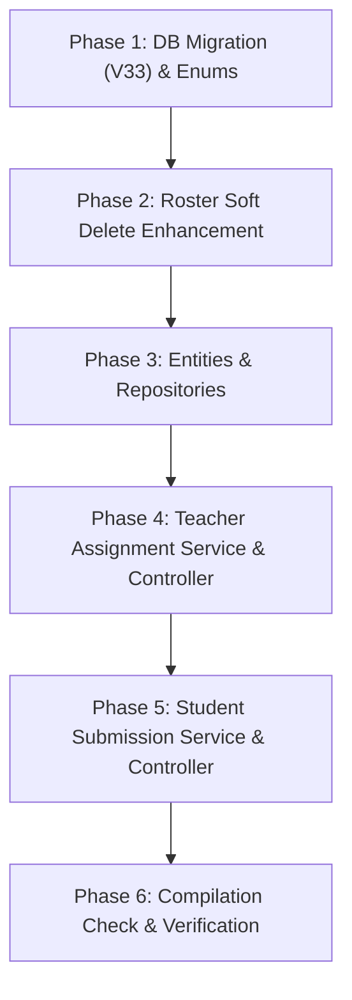

# 📋 IMPLEMENTATION PLAN: ASSIGNMENT CREATION, MULTI-TASK SUBMISSION & GRADING ENGINE (SPRINT 6)
> **Sprint:** Sprint 6 (11/10/2026 – 17/10/2026)  
> **Target User Story File:** `docs/sprints/sprint_6/user_stories/class_association_and_assignment_management.md`  
> **Stories Covered:**  
> - `US-SP6-04`: Giáo viên Giao Bài tập Đa nhiệm cho Lớp kèm Deadline (Assignment Creation & Content Pool Selection)  
> - `US-SP6-05`: Học sinh Nộp bài & Tự động Đánh giá Tiến độ (Assignment Submission & Auto-Grading)  
> - Bugfix/Enhancement: Chuyển đổi Roster Removal & Transfer sang Soft Delete (`INACTIVE` / `TRANSFERRED`) trong `US-SP6-01`  
> **Lập trình viên phụ trách:** 🟢 Võ Đồng Đức Khải (`KhaiVDD`)  
> **Trạng thái:** Sẵn sàng triển khai (Ready for Implementation)  

---

## 🎯 1. TỔNG QUAN MỤC TIÊU & BỐI CẢNH

Kế hoạch này thiết kế và triển khai trọn vẹn phân hệ **Giao Bài tập Đa nhiệm & Quản lý Nộp bài** cho khối Trường học (B2B SaaS), kết nối giữa Giáo viên, Học sinh và Hệ thống Nội dung:

1. **Giao Bài tập Đa nhiệm (Multi-task Assignment Engine):**
   - Hỗ trợ 3 hình thức bài tập: `CONTEXT_READING` (Đọc bối cảnh), `AI_CHAT_ROLEPLAY` (Nhập vai trò chuyện AI với nhân vật), và `QUIZ_TEST` (Làm quiz trắc nghiệm).
   - Tích hợp linh hoạt từ cả Kho Chung (Global Content) lẫn Kho Địa phương (`PUBLISHED` Local Content của trường).
   - Giáo viên có quyền Preview xem trước chi tiết nội dung trước khi bấm giao bài.
2. **Khởi tạo Nộp bài Tức thì (Eager Initialization):**
   - Tự động sinh sẵn bản ghi `assignment_submission` trạng thái `NOT_STARTED` cho toàn bộ học sinh `ACTIVE` trong lớp ngay khi tạo bài tập.
3. **Thu bài & Tự động Đánh giá (Auto-Grading & Submission Lifecycle):**
   - Quản lý vòng đời `SubmissionStatus`: `NOT_STARTED` ➔ `IN_PROGRESS` ➔ `SUBMITTED` / `LATE_SUBMITTED` / `MISSED` / `EXEMPTED`.
   - Tự động chấm điểm % đúng (`score` thang điểm 10) cho Quiz, đếm số tin nhắn (`message_count`) cho Chat AI, và đo thời lượng (`reading_duration_seconds`) cho Đọc bối cảnh.
4. **Xử lý Edge Cases Thực tế:**
   - **Học sinh mới chuyển vào lớp:** Các bài tập cũ trước đó được đánh dấu `EXEMPTED` (Miễn làm, không tính điểm 0 kéo tụt KPI); hỗ trợ chế độ Luyện tập bù (Practice Mode) và Custom Deadline từ Giáo viên.
   - **Học sinh rời lớp:** Bảo toàn 100% dữ liệu submission cũ; chuyển liên kết `class_student` sang `INACTIVE` / `TRANSFERRED` (thay thế triệt để Hard Delete).
   - **Gia hạn Deadline:** Tự động điều chỉnh các bài nộp `LATE_SUBMITTED` hợp lệ thành `SUBMITTED` đúng hạn.
   - **Hủy/Xóa bài tập:** Soft Delete chuyển sang `CANCELLED`, bảo toàn dữ liệu đối thoại AI đã phát sinh.

---

## 🔍 2. SCAN TÀI NGUYÊN TÁI SỬ DỤNG TRONG HỆ THỐNG

| Tài nguyên | Trạng thái hiện tại | Hướng tái sử dụng trong Module Assignment |
| :--- | :---: | :--- |
| **`HistoricalContext` & `LocalContext`** | ✅ Đã có sẵn | Làm target cho `CONTEXT_READING`. Đã có API GET detail công khai và theo trường. |
| **`Character` & `LocalCharacter`** | ✅ Đã có sẵn | Làm target cho `AI_CHAT_ROLEPLAY`. Tích hợp với Chat Session AI hiện có. |
| **`Quiz` & `QuizSession`** | ✅ Đã có sẵn | Làm target cho `QUIZ_TEST`. Đã có bộ câu hỏi và logic chấm trắc nghiệm. |
| **Bảng `classroom` & `class_student`** | ✅ Đã có sẵn (V31) | Lấy danh sách học sinh `ACTIVE` để eager init submission. |
| **`SecurityUtils` & `UserPrincipal`** | ✅ Đã chuẩn hóa | Trích xuất `schoolId`, `teacherId`, `studentId`, `role` từ JWT token. |

---

## 🏗️ 3. THIẾT KẾ DATABASE (FLYWAY MIGRATION V33)

Tạo file migration: `src/main/resources/db/migration/V33__add_assignment_and_submission_tables.sql`

```sql
-- 1. Bảng bài tập do giáo viên giao cho lớp
CREATE TABLE historical_schema.assignment (
    id              UUID PRIMARY KEY DEFAULT gen_random_uuid(),
    classroom_id    UUID NOT NULL REFERENCES historical_schema.classroom(id) ON DELETE CASCADE,
    teacher_id      UUID NOT NULL REFERENCES historical_schema."user"(uid),
    title           VARCHAR(255) NOT NULL,
    description     TEXT,
    assignment_type VARCHAR(30) NOT NULL, -- 'CONTEXT_READING', 'AI_CHAT_ROLEPLAY', 'QUIZ_TEST'
    target_id       UUID NOT NULL,        -- context_id, character_id, hoặc quiz_id
    deadline        TIMESTAMP WITH TIME ZONE NOT NULL,
    status          VARCHAR(20) NOT NULL DEFAULT 'ACTIVE', -- 'ACTIVE', 'CANCELLED', 'ARCHIVED'
    created_at      TIMESTAMP WITH TIME ZONE DEFAULT NOW(),
    updated_at      TIMESTAMP WITH TIME ZONE DEFAULT NOW(),
    deleted_at      TIMESTAMP WITH TIME ZONE
);

CREATE INDEX idx_assignment_classroom ON historical_schema.assignment(classroom_id);
CREATE INDEX idx_assignment_teacher ON historical_schema.assignment(teacher_id);
CREATE INDEX idx_assignment_status ON historical_schema.assignment(status);

-- 2. Bảng nộp bài & tiến độ của từng học sinh
CREATE TABLE historical_schema.assignment_submission (
    id                      UUID PRIMARY KEY DEFAULT gen_random_uuid(),
    assignment_id           UUID NOT NULL REFERENCES historical_schema.assignment(id) ON DELETE CASCADE,
    student_id              UUID NOT NULL REFERENCES historical_schema."user"(uid),
    status                  VARCHAR(20) NOT NULL DEFAULT 'NOT_STARTED', -- 'NOT_STARTED', 'IN_PROGRESS', 'SUBMITTED', 'LATE_SUBMITTED', 'MISSED', 'EXEMPTED'
    score                   NUMERIC(4, 2),        -- Điểm bài Quiz (0.00 - 10.00)
    message_count           INT DEFAULT 0,         -- Số lượt trao đổi chat AI
    reading_duration_seconds INT DEFAULT 0,        -- Thời gian đọc bối cảnh (giây)
    started_at              TIMESTAMP WITH TIME ZONE,
    submitted_at            TIMESTAMP WITH TIME ZONE,
    created_at              TIMESTAMP WITH TIME ZONE DEFAULT NOW(),
    updated_at              TIMESTAMP WITH TIME ZONE DEFAULT NOW(),
    CONSTRAINT uq_assignment_student UNIQUE (assignment_id, student_id)
);

CREATE INDEX idx_submission_assignment ON historical_schema.assignment_submission(assignment_id);
CREATE INDEX idx_submission_student ON historical_schema.assignment_submission(student_id);
CREATE INDEX idx_submission_status ON historical_schema.assignment_submission(status);
```

---

## 🧩 4. CẤU TRÚC CODE & DANH SÁCH FILE CẦN TẠO / CẬP NHẬT

### 4.1 Enums (`com.historytalk.entity.enums`)
* `AssignmentType.java`: `CONTEXT_READING`, `AI_CHAT_ROLEPLAY`, `QUIZ_TEST`.
* `AssignmentStatus.java`: `ACTIVE`, `CANCELLED`, `ARCHIVED`.
* `SubmissionStatus.java`: `NOT_STARTED`, `IN_PROGRESS`, `SUBMITTED`, `LATE_SUBMITTED`, `MISSED`, `EXEMPTED`.

### 4.2 Entities (`com.historytalk.entity.assignment`)
* `Assignment.java`: JPA Entity ánh xạ bảng `historical_schema.assignment`.
* `AssignmentSubmission.java`: JPA Entity ánh xạ bảng `historical_schema.assignment_submission`.

### 4.3 Repositories (`com.historytalk.repository.assignment`)
* `AssignmentRepository.java`:
  - `findByClassroomIdAndStatusAndDeletedAtIsNull(...)`
  - `findByTeacherIdAndDeletedAtIsNull(...)`
  - `findByIdAndDeletedAtIsNull(...)`
* `AssignmentSubmissionRepository.java`:
  - `findByAssignmentIdAndStudentId(...)`
  - `findByAssignmentId(...)`
  - `findByStudentId(...)`
  - `countByAssignmentIdAndStatus(...)`

### 4.4 DTOs (`com.historytalk.dto.assignment`)
* **Teacher side:**
  - `CreateAssignmentRequest.java`: `classId`, `title`, `description`, `assignmentType`, `targetId`, `deadline`.
  - `UpdateAssignmentRequest.java`: `title`, `description`, `deadline`, `status`.
  - `TeacherAssignmentResponse.java`: Thông tin bài tập + thông tin target tóm tắt + số lượng nộp/chưa nộp.
  - `AssignmentGradebookResponse.java`: Chi tiết bài tập kèm toàn bộ danh sách nộp bài của học sinh trong lớp.
* **Student side:**
  - `StudentAssignmentResponse.java`: Thông tin bài tập + trạng thái submission của chính học sinh đó.
  - `StartAssignmentResponse.java`: Xác nhận bắt đầu làm, trả về chi tiết target để làm bài.
  - `SubmitAssignmentRequest.java`: `score` (quiz), `messageCount` (AI chat), `readingDurationSeconds` (context).
  - `SubmissionDetailResponse.java`: Kết quả chấm điểm, thời gian nộp, trạng thái `SUBMITTED`/`LATE_SUBMITTED`.

### 4.5 Services (`com.historytalk.service.assignment`)
* `TeacherAssignmentService.java` & `TeacherAssignmentServiceImpl.java`:
  - `createAssignment(...)`: Validate quyền sở hữu lớp -> Kiểm tra target hợp lệ -> Tạo Assignment -> Eager init submissions cho học sinh `ACTIVE`.
  - `getAssignmentsByClassroom(...)`: Lấy danh sách bài tập của lớp.
  - `getAssignmentDetailAndSubmissions(...)`: Lấy sổ điểm của bài tập.
  - `updateAssignment(...)`: Gia hạn deadline (auto-adjust `LATE_SUBMITTED` -> `SUBMITTED`) hoặc chỉnh sửa thông tin.
  - `cancelAssignment(...)`: Soft delete bài tập (`status = CANCELLED`).
* `StudentAssignmentService.java` & `StudentAssignmentServiceImpl.java`:
  - `getMyAssignments(...)`: Lấy danh sách bài tập của các lớp học sinh đang tham gia.
  - `startAssignment(...)`: Đổi trạng thái từ `NOT_STARTED` sang `IN_PROGRESS`, ghi nhận `started_at`.
  - `submitAssignment(...)`: Chấm điểm, so khớp deadline, ghi nhận `submitted_at`, đổi sang `SUBMITTED` / `LATE_SUBMITTED`.

### 4.6 Controllers (`com.historytalk.controller.assignment`)
* `TeacherAssignmentController.java` (`/api/v1/teacher/assignments`):
  - `POST /api/v1/teacher/assignments`: Giao bài tập mới.
  - `GET /api/v1/teacher/assignments/classroom/{classroomId}`: Xem bài tập theo lớp.
  - `GET /api/v1/teacher/assignments/{assignmentId}`: Chi tiết & sổ điểm bài tập.
  - `PUT /api/v1/teacher/assignments/{assignmentId}`: Cập nhật hạn nộp / thông tin.
  - `DELETE /api/v1/teacher/assignments/{assignmentId}`: Hủy bài tập (Soft Delete).
* `StudentAssignmentController.java` (`/api/v1/student/assignments`):
  - `GET /api/v1/student/assignments`: Xem danh sách bài tập của mình.
  - `POST /api/v1/student/assignments/{assignmentId}/start`: Bắt đầu làm bài.
  - `POST /api/v1/student/assignments/{assignmentId}/submit`: Nộp bài & nhận kết quả.

### 4.7 Enhancement cho Roster Management (`ClassroomStudentServiceImpl.java`)
* Đổi `classStudentRepository.delete(...)` thành `classStudent.setStatus("INACTIVE")`.
* Đổi `transferStudents` từ xóa nguồn thành `enrollment.setStatus("TRANSFERRED")`.
* Xử lý tái kích hoạt `ACTIVE` nếu học sinh trước đó đã từng có bản ghi trong lớp.

---

## 🚦 5. KẾ HOẠCH TRIỂN KHAI THEO TỪNG BƯỚC (PHASE BREAKDOWN)



| Phase | Nội dung công việc | File tác động chính | Tiêu chí hoàn thành |
| :---: | :--- | :--- | :--- |
| **Phase 1** | Tạo Flyway migration V33 & các Enums trạng thái | `V33__add_assignment_and_submission_tables.sql`<br>`AssignmentType.java`, `AssignmentStatus.java`, `SubmissionStatus.java` | DB schema chuẩn, Enums sẵn sàng. |
| **Phase 2** | Nâng cấp Roster Soft Delete (`INACTIVE`/`TRANSFERRED`) | `ClassroomStudentServiceImpl.java` | Không còn gọi `delete()`, bảo toàn lịch sử khi gỡ/chuyển học sinh. |
| **Phase 3** | Tạo JPA Entities & Spring Data JPA Repositories | `Assignment.java`, `AssignmentSubmission.java`<br>`AssignmentRepository.java`, `AssignmentSubmissionRepository.java` | Ánh xạ ORM chuẩn, quan hệ ràng buộc đầy đủ. |
| **Phase 4** | Xây dựng DTO, Service & Controller cho Teacher | `TeacherAssignmentService(Impl)`<br>`TeacherAssignmentController` | Giao bài thành công, eager init submission cho toàn bộ học sinh lớp, gia hạn deadline & hủy bài. |
| **Phase 5** | Xây dựng DTO, Service & Controller cho Student | `StudentAssignmentService(Impl)`<br>`StudentAssignmentController` | Học sinh bắt đầu làm bài (`IN_PROGRESS`), nộp bài, auto-grade đúng hạn/trễ hạn. |
| **Phase 6** | Cấu hình SecurityConfig, Compile Check & Kiểm thử | `SecurityConfig.java`<br>`mvn compile` | Build thành công 100%, endpoint phân quyền đúng role. |

---

## 🧪 6. MA TRẬN TEST CASES & TIÊU CHÍ NGHIỆM THU (AC VALIDATION)

| Mã Test | Kịch bản kiểm thử | Kỳ vọng |
| :--- | :--- | :--- |
| **TC-01** | Teacher tạo bài Quiz cho Lớp 10A (30 học sinh `ACTIVE`) | Trả về 201 Created; bảng `assignment_submission` có đúng 30 bản ghi `NOT_STARTED`. |
| **TC-02** | Teacher giao bài với `target_id` không tồn tại hoặc sai loại | Trả về 400 Bad Request / 404 Not Found kèm thông báo lỗi rõ ràng. |
| **TC-03** | Teacher cố giao bài cho lớp của giáo viên khác | Trả về 403 Forbidden (chặn bảo mật Teacher ownership). |
| **TC-04** | Học sinh bấm vào làm bài tập | Trạng thái chuyển thành `IN_PROGRESS`, `started_at` được gán giờ hiện tại. |
| **TC-05** | Học sinh nộp bài Quiz trước hạn deadline | Trả về điểm số, trạng thái đổi thành `SUBMITTED`, lưu `submitted_at`. |
| **TC-06** | Học sinh nộp bài Quiz sau hạn deadline | Điểm số được lưu, trạng thái đổi thành `LATE_SUBMITTED`. |
| **TC-07** | Teacher lùi deadline bài tập sang tuần sau | Học sinh từng bị `LATE_SUBMITTED` ở TC-06 tự động chuyển thành `SUBMITTED`. |
| **TC-08** | Gỡ học sinh khỏi lớp sau khi đã nộp bài | `class_student.status` chuyển thành `INACTIVE`, bài nộp cũ trong `assignment_submission` vẫn nguyên vẹn. |
