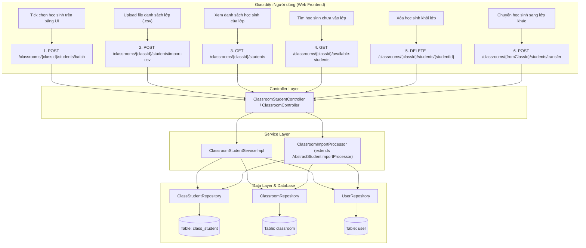

# 📋 IMPLEMENTATION PLAN: CLASS ROSTER ASSOCIATION & STUDENT IMPORT INTEGRATION (SPRINT 6)
> **Sprint:** Sprint 6 (11/10/2026 – 17/10/2026)  
> **Target User Story File:** `docs/sprints/sprint_6/user_stories/class_association_and_assignment_management.md`  
> **Stories Covered:** `US-SP6-01: Gán & Chuyển Học sinh vào Lớp học (Class Roster Association)`  
> **Lập trình viên phụ trách:** 🟢 Võ Đồng Đức Khải (`KhaiVDD`)  
> **Trạng thái:** Sẵn sàng triển khai (Ready for Implementation)  

---

## 🎯 1. TỔNG QUAN MỤC TIÊU & BỐI CẢNH

Kế hoạch này giải quyết trọn vẹn luồng **Quản lý Danh sách Học sinh theo Lớp học (Class Roster Management)**, đáp ứng các tiêu chuẩn:
1. **Thao tác nhanh trên Web UI:** Cho phép Giáo viên/School Admin tick chọn nhiều học sinh từ bảng danh sách để gán vào lớp qua JSON payload (`POST /api/v1/classrooms/{classId}/students/batch`).
2. **Tái sử dụng (Reuse) 100% Import Engine Sprint 5:** Cho phép tải file CSV danh sách lớp (`POST /api/v1/classrooms/{classId}/students/import-csv`) kế thừa từ Template Pattern `AbstractStudentImportProcessor` do KhaiVDD xây dựng ở Sprint 5.
3. **Thẩm định & Quản trị Roster:** Cho phép xem danh sách học sinh trong lớp (`GET /classrooms/{classId}/students`), xem danh sách học sinh trường sẵn sàng để thêm (`GET /classrooms/{classId}/available-students`), gỡ học sinh khỏi lớp (`DELETE`), và chuyển lớp an toàn (`transfer`).
4. **Tự động liên kết khi Import toàn trường (Sprint 5 Upgrade):** Nâng cấp `SchoolWideImportProcessor` để nếu file CSV toàn trường có cột `class_code`, hệ thống tự động gán học sinh vào lớp học tương ứng ngay khi tạo tài khoản.

---

## 🔍 2. SCAN & ĐÁNH GIÁ TÀI NGUYÊN TÁI SỬ DỤNG TỪ SPRINT 5

| Tài nguyên | Trạng thái hiện tại | Hướng tái sử dụng & Tích hợp trong Sprint 6 |
| :--- | :---: | :--- |
| **Bảng DB `class_student`** | ✅ Sẵn sàng (Flyway V31) | Đã có ràng buộc `UNIQUE(classroom_id, student_id)`, cột `joined_at`, `status`. Không cần viết migration mới. |
| **Entity `ClassStudent` & `Classroom`** | ✅ Sẵn sàng | Đã ánh xạ quan hệ `@ManyToOne` với `User` và `Classroom`. |
| **`AbstractStudentImportProcessor`** | ✅ Sẵn sàng (Sprint 5) | Kế thừa để tạo `@Service("CLASSROOM_IMPORT") ClassroomImportProcessor`. Tận dụng toàn bộ logic parse CSV BOM UTF-8, validate regex, định dạng báo lỗi từng dòng `rowNumber`, `field`, `message`. |
| **Template CSV Lớp học** | ✅ Đã có sẵn mẫu | Tái sử dụng file mẫu [`student_import_classroom_template.csv`](file:///c:/Users/KHAI/Documents/Historical-talk/SWD392_FinalProject_HistoryTalk/docs/sprints/sprint_5/user_stories/student_import_classroom_template.csv) và [`student_import_school_template.csv`](file:///c:/Users/KHAI/Documents/Historical-talk/SWD392_FinalProject_HistoryTalk/docs/sprints/sprint_5/user_stories/student_import_school_template.csv). |
| **Multi-tenancy & Security** | ✅ Chuẩn hóa | Tái sử dụng `UserPrincipal` (lấy `schoolId`, `schoolCode`, `role`, `uid` từ JWT context). |

---

## 🏗️ 3. KIẾN TRÚC KỸ THUẬT & QUY CHUẨN



### Quy chuẩn Phân quyền & Bảo mật (RBAC & Tenant Isolation):
* **School Admin (`ROLE_SCHOOL_ADMIN`):** Toàn quyền xem, gán, gỡ, chuyển học sinh cho bất kỳ lớp học nào thuộc `school_id` của mình.
* **Giáo viên (`ROLE_TEACHER`):** Chỉ được quyền thao tác trên các lớp mà mình được phân công phụ trách (`classroom.teacher.uid == principal.uid`).
* **Tenant Isolation:** Ngăn chặn 100% việc thêm học sinh trường A vào lớp của trường B (trả về lỗi `400 Bad Request` hoặc `403 Forbidden`).
* **Role Integrity:** Chỉ cho phép gán người dùng có role `SCHOOL_STUDENT` vào bảng `class_student`.

---

## 📑 4. CHI TIẾT THIẾT KẾ API CONTRACTS

### 4.1 Gán nhanh học sinh vào lớp (Batch JSON)
* **Method & Path:** `POST /api/v1/classrooms/{classId}/students/batch`
* **Quyền:** `SCHOOL_ADMIN`, `TEACHER`
* **Request Body:**
  ```json
  {
    "studentIds": [
      "d290f1ee-6c54-4b01-90e6-d701748f0851",
      "e3a1f2aa-7b65-4c12-a1f7-e812859f1962"
    ]
  }
  ```
* **Cơ chế Idempotent (Chống lỗi crash batch):**
  - Nếu học sinh đã tồn tại trong lớp: Bỏ qua và tăng biến `alreadyEnrolledCount` thay vì rollback toàn bộ transaction.
  - Kiểm tra toàn bộ học sinh phải thuộc cùng `school_id` của lớp học.
* **Response `200 OK`:**
  ```json
  {
    "success": true,
    "message": "Đã thêm 2 học sinh vào lớp học",
    "data": {
      "classroomId": "e4b2d13a-7a54-46c5-a1c2-8495f5602d1a",
      "className": "10A1",
      "totalRequested": 2,
      "successCount": 2,
      "alreadyEnrolledCount": 0,
      "currentStudentCount": 38
    }
  }
  ```

---

### 4.2 Import danh sách học sinh vào lớp bằng CSV (Reuse Sprint 5 Engine)
* **Method & Path:** `POST /api/v1/classrooms/{classId}/students/import-csv`
* **Content-Type:** `multipart/form-data`
* **Quyền:** `SCHOOL_ADMIN`, `TEACHER`
* **Request Params:**
  - `file`: File `.csv` theo định dạng `student_import_classroom_template.csv`.
* **Cơ chế Đồng bộ Thông minh (Smart Roster Sync):**
  - **Học sinh đã có tài khoản trong trường:** (khớp theo `student_code` hoặc `email`): Chỉ việc gán vào `class_student`, **không trừ thêm quota token** và giữ nguyên tài khoản.
  - **Học sinh mới chưa có tài khoản:** Tạo tài khoản học sinh mới, trừ token từ quỹ trường, và gán ngay vào `class_student`.
* **Response `200 OK`:** Trả về `StudentImportResultDto` chuẩn Sprint 5 với chi tiết số lượng thành công, danh sách lỗi từng dòng (nếu có).

---

### 4.3 Xem danh sách học sinh trong lớp (Class Roster Listing)
* **Method & Path:** `GET /api/v1/classrooms/{classId}/students`
* **Quyền:** `SCHOOL_ADMIN`, `TEACHER`
* **Query Params:**
  - `search` (String, optional): Tìm theo họ tên, mã học sinh, username, email.
  - `page` (int, default: 0), `size` (int, default: 10), `sort` (default: `joinedAt,desc`).
* **Response `200 OK`:** `PaginatedApiResponse<ClassroomStudentResponse>`:
  ```json
  {
    "success": true,
    "message": "Danh sách học sinh lớp học",
    "data": [
      {
        "studentId": "d290f1ee-6c54-4b01-90e6-d701748f0851",
        "studentCode": "HS260001",
        "userName": "cva_hs_hs260001",
        "fullName": "Nguyễn Tuyết Ly",
        "email": "cva_hs_hs260001@saas.historytalk.vn",
        "dob": "2009-04-05",
        "gender": "FEMALE",
        "phoneNumber": "0912345678",
        "joinedAt": "2026-10-12T14:30:00",
        "status": "ACTIVE"
      }
    ],
    "pagination": {
      "page": 0,
      "size": 10,
      "totalElements": 38,
      "totalPages": 4,
      "hasNext": true,
      "hasPrevious": false
    }
  }
  ```

---

### 4.4 Tra cứu học sinh sẵn sàng để thêm vào lớp (Available Students Pool)
* **Method & Path:** `GET /api/v1/classrooms/{classId}/available-students`
* **Quyền:** `SCHOOL_ADMIN`, `TEACHER`
* **Query Params:** `search`, `page`, `size`.
* **Mô tả:** Lọc ra các học sinh thuộc trường nhưng **chưa có trong lớp này** để Frontend hiển thị trên Modal chọn học sinh.

---

### 4.5 Xóa / Gỡ học sinh khỏi lớp
* **Method & Path:** `DELETE /api/v1/classrooms/{classId}/students/{studentId}`
* **Quyền:** `SCHOOL_ADMIN`, `TEACHER`
* **Logic:** Xóa liên kết khỏi `class_student`. Giữ nguyên tài khoản học sinh và điểm số lịch sử.
* **Response `200 OK`:** `ApiResponse<Void>` với thông báo "Gỡ học sinh khỏi lớp học thành công".

---

### 4.6 Chuyển học sinh giữa các lớp (Transfer Student)
* **Method & Path:** `POST /api/v1/classrooms/{fromClassId}/students/transfer`
* **Quyền:** `SCHOOL_ADMIN`, `TEACHER`
* **Request Body:**
  ```json
  {
    "targetClassroomId": "f5c3e24b-8b65-4d76-b2d3-9506e6713e2b",
    "studentIds": ["d290f1ee-6c54-4b01-90e6-d701748f0851"]
  }
  ```
* **Logic:** Kiểm tra cả 2 lớp đều thuộc cùng `school_id`. Xóa khỏi lớp cũ và thêm vào lớp mới trong cùng một `@Transactional` an toàn tuyệt đối.

---

## 🗺️ 5. LỘ TRÌNH THỰC HIỆN THEO CÁC PHASE

```
Phase 1: Data Access Layer (ClassStudentRepository)
   └── Bổ sung các queries phân trang, tìm kiếm, kiểm tra và batch delete
         │
         ▼
Phase 2: DTOs & Models
   ├── BatchEnrollStudentRequest.java & BatchEnrollResultResponse.java
   ├── TransferStudentRequest.java
   └── ClassroomStudentResponse.java
         │
         ▼
Phase 3: Service Layer & Reuse Import Engine
   ├── ClassroomStudentService & ClassroomStudentServiceImpl
   └── ClassroomImportProcessor.java (extends AbstractStudentImportProcessor)
         │
         ▼
Phase 4: Controller Layer & API Endpoints
   └── Cập nhật ClassroomController.java (hoặc tạo ClassroomStudentController.java)
         │
         ▼
Phase 5: Upgrade Sprint 5 SchoolWideImportProcessor
   └── Đọc cột class_code trong student_import_school_template.csv để auto-enroll
         │
         ▼
Phase 6: Verification & Testing
   ├── Compile: mvn -q -DskipTests compile
   ├── Unit Test: ClassroomStudentServiceTest.java
   └── Verify API Swagger UI
```

---

## 📂 6. DANH SÁCH FILE CẦN TẠO VÀ CHỈNH SỬA

| STT | File Path | Hành động | Mục đích |
| :--- | :--- | :---: | :--- |
| 1 | `src/main/java/com/historytalk/repository/classroom/ClassStudentRepository.java` | Chỉnh sửa | Bổ sung method phân trang tìm học sinh theo lớp, find by student & class, query available students. |
| 2 | `src/main/java/com/historytalk/dto/classroom/BatchEnrollStudentRequest.java` | Tạo mới | DTO nhận danh sách `studentIds` để gán vào lớp. |
| 3 | `src/main/java/com/historytalk/dto/classroom/BatchEnrollResultResponse.java` | Tạo mới | DTO trả về kết quả batch enroll (số lượng thành công, bỏ qua, tổng số hiện tại). |
| 4 | `src/main/java/com/historytalk/dto/classroom/TransferStudentRequest.java` | Tạo mới | DTO yêu cầu chuyển học sinh sang lớp đích. |
| 5 | `src/main/java/com/historytalk/dto/classroom/ClassroomStudentResponse.java` | Tạo mới | DTO trả về thông tin học sinh trong bảng Roster của lớp. |
| 6 | `src/main/java/com/historytalk/service/classroom/ClassroomStudentService.java` | Tạo mới | Interface nghiệp vụ quản lý thành viên lớp học. |
| 7 | `src/main/java/com/historytalk/service/classroom/ClassroomStudentServiceImpl.java` | Tạo mới | Xử lý logic gán batch, xóa, chuyển lớp, phân trang roster, check tenant/role. |
| 8 | `src/main/java/com/historytalk/service/classroom/ClassroomImportProcessor.java` | Tạo mới | Kế thừa `AbstractStudentImportProcessor` để import file CSV trực tiếp vào lớp. |
| 9 | `src/main/java/com/historytalk/controller/classroom/ClassroomStudentController.java` | Tạo mới | REST Endpoints cho toàn bộ nghiệp vụ Roster & Import học sinh của lớp. |
| 10 | `src/main/java/com/historytalk/service/school/student/SchoolWideImportProcessor.java` | Chỉnh sửa | Đọc thêm cột `class_code` để auto-enroll vào lớp ngay khi import toàn trường. |
| 11 | `src/test/java/com/historytalk/service/classroom/ClassroomStudentServiceImplTest.java` | Tạo mới | Unit test kiểm thử các trường hợp thành công, trùng lặp, khác trường học. |
