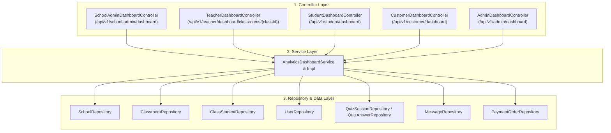

# 📋 IMPLEMENTATION PLAN: 5 CHUYÊN HỆ DASHBOARDS & ANALYTICS APIS (SPRINT 6)
> **Sprint:** Sprint 6 (11/10/2026 – 17/10/2026)  
> **Target User Story File:** `docs/sprints/sprint_6/user_stories/dashboards_and_analytics_apis.md`  
> **Stories Covered:** `US-SP6-06`, `US-SP6-07`, `US-SP6-08`, `US-SP6-09`, `US-SP6-10`  
> **Lập trình viên phụ trách:** 🔵 Trần Quốc Dinh (`DinhTQ`)  
> **Trạng thái:** Sẵn sàng triển khai (Ready for Implementation)

---

## 🎯 1. TỔNG QUAN MỤC TIÊU & BỐI CẢNH

Kế hoạch này triển khai trọn vẹn cụm 5 API Dashboard phục vụ 5 đối tượng người dùng khác nhau trong hệ thống HistoryTalk:
1. **School Admin Dashboard (`US-SP6-06`):** `GET /api/v1/school-admin/dashboard` — Tổng hợp quy mô trường (lớp, giáo viên, học sinh), quỹ Token trường và mức độ tiêu thụ thực tế của học sinh.
2. **Teacher Classroom Analytics Dashboard (`US-SP6-07`):** `GET /api/v1/teacher/dashboard/classrooms/{classId}` — Thống kê sổ điểm Quiz, mức độ tương tác AI (*Engagement Analytics*) và tỷ lệ hoàn thành bài tập của học sinh trong lớp.
3. **Student Personal Dashboard (`US-SP6-08`):** `GET /api/v1/student/dashboard` — Báo cáo học tập cá nhân, hạn mức Token còn lại, điểm Quiz trung bình, và danh sách bài tập sắp đến hạn.
4. **Customer B2C Dashboard (`US-SP6-09`):** `GET /api/v1/customer/dashboard` — Lịch sử luyện Quiz tự do, gói cước hiện tại, phân bố thời kỳ lịch sử và lịch sử giao dịch PayOS.
5. **System Admin & JVM Health Dashboard (`US-SP6-10`):** `GET /api/v1/admin/dashboard` — Giám sát hiệu năng phần cứng/JVM (CPU, RAM, Thread), tổng lưu lượng Token toàn nền tảng, và Top 10 câu hỏi Quiz có tỷ lệ làm sai cao nhất.

---

## 🔍 2. ĐÁNH GIÁ TÀI NGUYÊN HIỆN CÓ TRONG CODEBASE

| Tài nguyên | Trạng thái hiện tại | Hướng tái sử dụng / Mở rộng |
|---|---|---|
| `SystemDashboardController` | Đã có sẵn các endpoint chi tiết cho System Admin | Mở rộng endpoint tổng quan `GET /api/v1/admin/dashboard` để gom tất cả chỉ số vào 1 response duy nhất phục vụ màn hình chính. |
| `UserDashboardResponse` | Đã định nghĩa DTO nhưng chưa có API | Hoàn thiện mapping và tích hợp vào Customer Dashboard (`US-SP6-09`) và Student Dashboard (`US-SP6-08`). |
| `ClassroomRepository` & `ClassStudentRepository` | Đã có sẵn query đa năng | Sử dụng đếm quy mô trường, lấy danh sách học sinh của lớp kèm sĩ số. |
| `QuizSessionRepository` & `QuizAnswerRepository` | Đã có sẵn dữ liệu thi Quiz | Tận dụng query tính điểm trung bình %, số bài thi đã làm, và tỷ lệ trả lời sai từng câu hỏi. |
| `MessageRepository` | Đã có trường `token_cost` và `created_at` | Tận dụng tính tổng token tiêu thụ của học sinh / khách hàng và số tin nhắn trao đổi với AI. |
| `PaymentOrderRepository` | Đã có tracking giao dịch | Tận dụng tính doanh thu tổng và danh sách đơn hàng gần nhất. |

---

## 🏗️ 3. KIẾN TRÚC KỸ THUẬT & CÁC TẦNG LỚP XÂY DỰNG

---

## 📁 4. DANH SÁCH FILE CẦN TẠO MỚI HOẶC BỔ SUNG

### 4.1 DTO Models (`com.historytalk.dto.dashboard`)
- `SchoolAdminDashboardResponse.java`:
  - `totalClassrooms`, `totalTeachers`, `totalStudents`.
  - `totalSchoolTokenQuota`, `unallocatedTokenQuota`, `allocatedTokens`, `tokensUsedByStudents`.
  - `assignmentStats`: `completedRate`, `lateSubmittedRate`, `notStartedRate`.
- `TeacherClassroomDashboardResponse.java`:
  - `classId`, `className`, `classCode`, `studentCount`.
  - `studentAnalytics`: list of `{ studentId, studentCode, fullName, quizzesAttempted, avgScorePercentage, aiMessagesCount }`.
  - `totalAiMessages`, `avgAiMessagesPerStudent`.
  - `assignmentRates`: `onTimeRate`, `lateRate`, `pendingRate`.
- `StudentPersonalDashboardResponse.java`:
  - `studentName`, `studentCode`, `schoolName`, `currentTokens`, `tokensUsedToday`.
  - `totalQuizzesAttempted`, `averageScorePercentage`, `recentQuizzes`.
  - `enrolledClassrooms`: list of `{ classId, className, teacherName }`.
  - `upcomingAssignments`: list of `{ assignmentId, title, type, deadline }`.
- `CustomerPersonalDashboardResponse.java`:
  - `currentTier`, `tokenBalance`, `tierExpiresAt`.
  - `learning`: `totalQuizzesAttempted`, `averageScorePercentage`, `eraDistribution`, `recentQuizzes`.
  - `aiUsage`: `totalMessages`, `topCharacters`.
  - `paymentHistory`: list of `{ orderCode, amount, tierName, status, createdAt }`.
- `SystemAdminComprehensiveDashboardResponse.java`:
  - `jvmHealth`: `cpuUsagePercentage`, `totalMemoryMb`, `usedMemoryMb`, `freeMemoryMb`, `activeThreads`, `uptimeSeconds`.
  - `tokenSummary`: `totalTokensB2bAllocated`, `totalTokensB2cConsumed`, `totalTokensSystemConsumed`.
  - `topWrongQuestions`: list of `{ questionId, content, quizTitle, errorRatePercentage, wrongAttempts }`.
  - `platformOverview`: `totalSchools`, `totalUsers`, `totalRevenue`.

### 4.2 Repository Queries bổ sung
- `MessageRepository`: Truy vấn tổng token tiêu thụ theo `school_id` hoặc theo `user_id`, đếm số lượng tin nhắn AI của học sinh trong lớp.
- `QuizSessionRepository` & `QuizAnswerRepository`: Truy vấn top câu hỏi có tỷ lệ sai nhiều nhất, điểm trung bình của học sinh trong lớp.

### 4.3 Service Layer (`com.historytalk.service.dashboard`)
- `AnalyticsDashboardService.java`:
  - `SchoolAdminDashboardResponse getSchoolAdminDashboard(UUID schoolId);`
  - `TeacherClassroomDashboardResponse getTeacherClassroomDashboard(UUID classId, UserPrincipal principal);`
  - `StudentPersonalDashboardResponse getStudentDashboard(UserPrincipal principal);`
  - `CustomerPersonalDashboardResponse getCustomerDashboard(UserPrincipal principal);`
  - `SystemAdminComprehensiveDashboardResponse getSystemAdminDashboard();`
- `AnalyticsDashboardServiceImpl.java`: Triển khai logic tính toán an toàn, tối ưu query tránh N+1.

### 4.4 Controller Layer (`com.historytalk.controller.dashboard`)
- Tạo các endpoints tương ứng theo đúng đường dẫn yêu cầu trong User Stories:
  - `GET /api/v1/school-admin/dashboard`
  - `GET /api/v1/teacher/dashboard/classrooms/{classId}`
  - `GET /api/v1/student/dashboard`
  - `GET /api/v1/customer/dashboard`
  - `GET /api/v1/admin/dashboard`

---

## 🧪 5. KẾ HOẠCH TEST & KIỂM THỬ

1. **Unit Tests:**
   - `AnalyticsDashboardServiceImplTest`:
     - Test School Admin Dashboard tính toán quy mô và token chính xác.
     - Test Teacher Classroom Dashboard ném `AccessDeniedException` khi giáo viên khác xem lớp.
     - Test Student Dashboard lấy đúng số dư token và bài Quiz gần nhất.
     - Test Customer Dashboard lấy đúng gói cước và lịch sử thanh toán.
     - Test System Admin Dashboard lấy đúng thông số JVM và top câu hỏi sai.
2. **Integration Tests (MockMvc):**
   - `AnalyticsDashboardControllerTest`:
     - Kiểm tra phân quyền HTTP 403 Forbidden nếu gọi sai role.
     - Kiểm tra HTTP 200 OK và cấu trúc JSON trả về cho từng endpoint.
