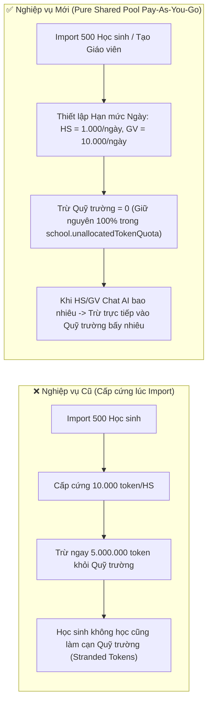
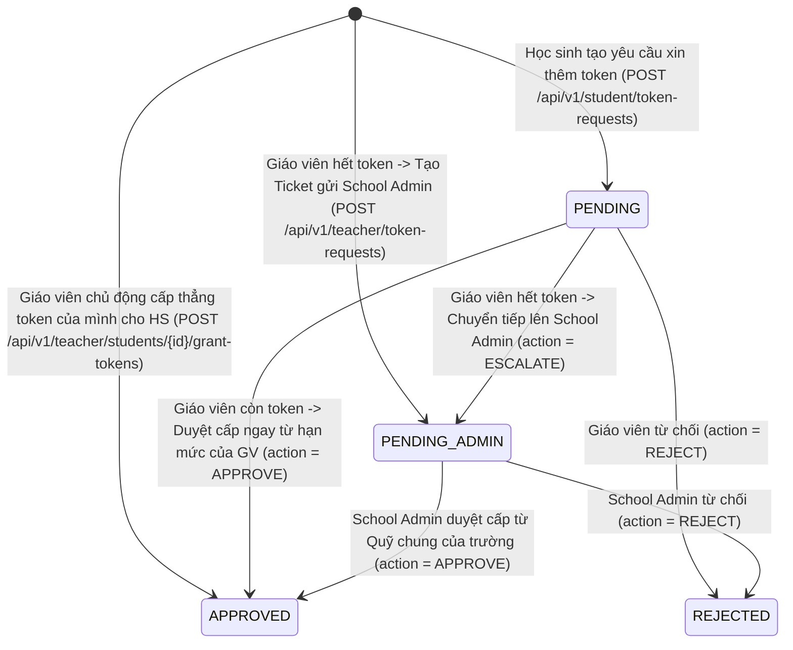
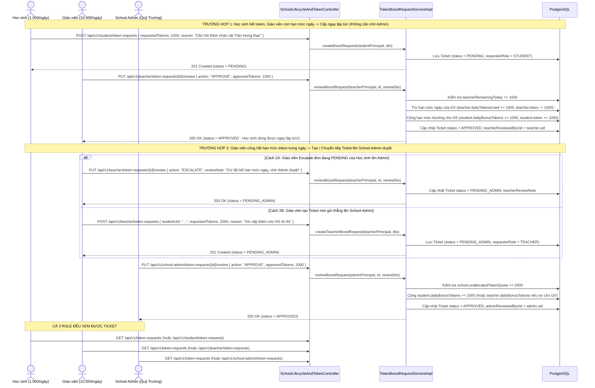
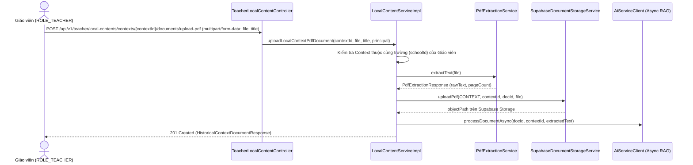

# 🔄 BUSINESS FLOW: SCHOOL SUBSCRIPTION, PAY-AS-YOU-GO TOKEN POOL, TEACHER DIRECT TOKEN TRANSFER & TICKET WORKFLOW
> **Sprint:** Sprint 7 (16/10/2026 – 30/10/2026)  
> **Phân hệ:** Quản trị Gói B2B Trường học (01/09 – 31/05), Quỹ Token Chung Pay-As-You-Go, Luồng Giáo viên Cấp Token & Ticket Admin, Upload PDF Local Content & Vòng đời Học sinh  
> **Stories Covered:** `US-SP7-14`, `US-SP7-15`, `US-SP7-16`, `US-SP7-17`, `US-SP7-18`, `US-SP7-19`, `US-SP7-20`  
> **Tác giả:** 🔵 Trần Quốc Dinh (`DinhTQ`)  

---

## 1. TỔNG QUAN KIẾN TRÚC NGHIỆP VỤ

Hệ thống chuyển đổi từ mô hình *"Cấp cứng một lượng token cố định vào từng tài khoản ngay lúc Import học sinh"* sang mô hình **"100% Quỹ Token Chung Pay-As-You-Go + Hạn mức Ngày phân tầng (Học sinh `1.000/ngày`, Giáo viên `10.000/ngày`) + Giáo viên Cấp trực tiếp Token của mình cho Học sinh + Tạo Ticket lên School Admin khi Giáo viên hết Token"**.

### 6 Nguyên tắc Vàng (Core Business Invariants)
1. **Chu kỳ gói trường học (`01/09` – `31/05`):**
   * Gói B2B trường học hoạt động từ **đầu tháng 9 (`01/09`)** đến **cuối tháng 5 (`31/05`)**, gia hạn trong **tháng 5 (`01/05` – `31/05`)** và bảo lưu tối đa **20% token dư** sang năm mới.
2. **Phân tách cơ chế Khóa (Two-Level Locking):**
   * **Hết hạn gói (`EXPIRED`):** Khóa toàn bộ nền tảng của trường (`403 SCHOOL_SUBSCRIPTION_EXPIRED`).
   * **Còn hạn gói nhưng Hết Token (`Out of Tokens`):** Chỉ khóa tính năng Chat AI (`403 AI_QUOTA_EXCEEDED`), toàn bộ tính năng Quiz, Tài liệu, Assignment, Dashboard vẫn mở 100%.
3. **Import Học sinh & Tạo Giáo viên Không Trừ Cứng Quỹ Trường (Pure Shared Pool Pay-As-You-Go):**
   * Lúc Import học sinh hoặc tạo tài khoản Giáo viên, **không trừ bất kỳ token nào từ `school.unallocatedTokenQuota`** (`totalTokensDeducted = 0`).
   * Toàn bộ token của trường nằm cố định tại `school.unallocatedTokenQuota`. Ai xài bao nhiêu khi Chat AI thì mới trừ bấy nhiêu vào tổng token của trường.
4. **Hạn mức Ngày của Giáo viên Lớn hơn Học sinh (`10.000` vs `1.000`):**
   * **Học sinh (`ROLE_SCHOOL_STUDENT`):** Hạn mức mặc định **`1.000 token/ngày`** (`classroom.dailyTokenQuota` hoặc `school.defaultDailyStudentQuota`).
   * **Giáo viên (`ROLE_TEACHER`):** Hạn mức mặc định **`10.000 token/ngày`** (`school.defaultDailyTeacherQuota`) để vừa chat AI phục vụ giảng dạy vừa có quỹ hạn mức ngày để cấp thêm trực tiếp cho học sinh trong lớp.
5. **Luồng Giáo viên Tự Cấp Token cho Học sinh & Escalate Ticket lên School Admin khi Hết Token:**
   * **Khi Học sinh hết token trong ngày & Giáo viên còn hạn mức ngày:** Giáo viên duyệt đơn của học sinh (`APPROVE`) hoặc chủ động bấm cấp token (`grant-tokens`) $\rightarrow$ **Trích trực tiếp từ hạn mức ngày của Giáo viên chuyển sang Học sinh ngay lập tức (`APPROVED`)**, không cần chờ School Admin duyệt.
   * **Khi Giáo viên hết hạn mức ngày:** Giáo viên bấm **Chuyển tiếp (`ESCALATE`)** đơn của học sinh hoặc **Tạo Ticket mới (`POST /api/v1/teacher/token-requests`)** gửi lên **School Admin (`PENDING_ADMIN`)** để School Admin duyệt cấp thêm từ Quỹ chung của trường.
   * **Cả 3 Role (`SCHOOL_STUDENT`, `TEACHER`, `SCHOOL_ADMIN`)** đều xem được danh sách và trạng thái Ticket.
6. **Giáo viên Upload Tài liệu PDF Local Content:**
   * Giáo viên có thể upload trực tiếp file PDF vào Local Context hoặc Local Character để tự động trích xuất văn bản, lưu trữ file PDF và đồng bộ sang AI RAG.

---

## 2. LUỒNG IMPORT HỌC SINH & KHẤU TRỪ PAY-AS-YOU-GO KHI CHAT AI (US-SP7-15 & US-SP7-16)

### 2.1. Sơ đồ So sánh Nghiệp vụ Import Học sinh (Trước và Sau khi Cập nhật)

### 2.2. Công thức Tính Hạn mức Khả dụng trong Ngày (Student & Teacher)

* **Đối với Học sinh (`ROLE_SCHOOL_STUDENT`):**
  $$\text{dailyBaseLimit}_{\text{student}} = \text{COALESCE}(\text{classroom.dailyTokenQuota}, \text{school.defaultDailyStudentQuota}, 1000)$$
  $$\text{effectiveDailyLimit}_{\text{student}} = \text{dailyBaseLimit}_{\text{student}} + \text{student.dailyBonusTokens}$$
  $$\text{availableToday}_{\text{student}} = \min(\max(0, \text{effectiveDailyLimit}_{\text{student}} - \text{student.dailyTokensUsed}), \text{school.unallocatedTokenQuota})$$

* **Đối với Giáo viên (`ROLE_TEACHER`):**
  $$\text{dailyBaseLimit}_{\text{teacher}} = \text{COALESCE}(\text{school.defaultDailyTeacherQuota}, 10000)$$
  $$\text{effectiveDailyLimit}_{\text{teacher}} = \text{dailyBaseLimit}_{\text{teacher}} + \text{teacher.dailyBonusTokens}$$
  $$\text{availableToday}_{\text{teacher}} = \min(\max(0, \text{effectiveDailyLimit}_{\text{teacher}} - \text{teacher.dailyTokensUsed}), \text{school.unallocatedTokenQuota})$$

---

## 3. LUỒNG GIÁO VIÊN CẤP TOKEN TRỰC TIẾP CHO HỌC SINH & TẠO TICKET LÊN SCHOOL ADMIN KHI GIÁO VIÊN HẾT TOKEN (US-SP7-17)

### 3.1. State Diagram: Vòng đời của Ticket Cấp Token (`TokenBoostRequestStatus`)

### 3.2. Sequence Diagram: Toàn bộ Luồng Học sinh — Giáo viên — School Admin

---

## 4. LUỒNG GIÁO VIÊN UPLOAD TÀI LIỆU PDF LOCAL CONTENT (US-SP7-19)

