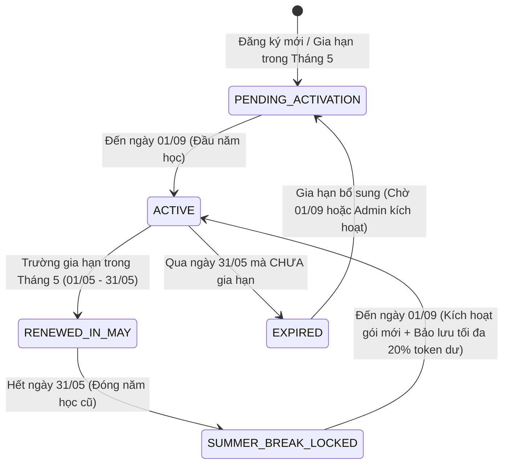
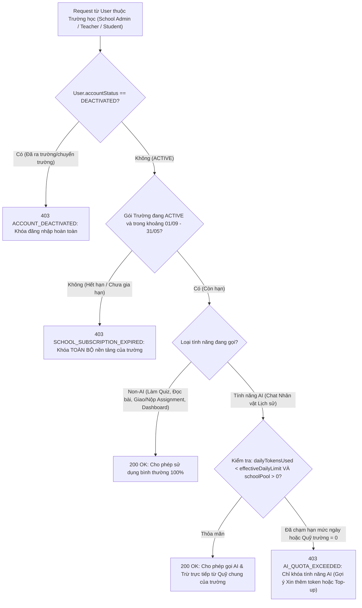
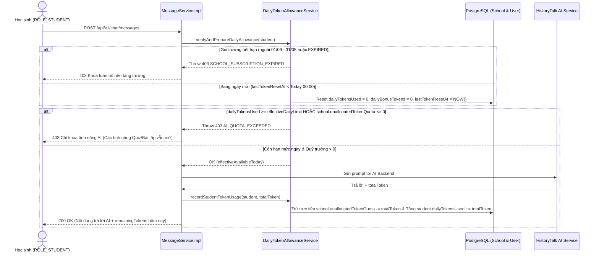
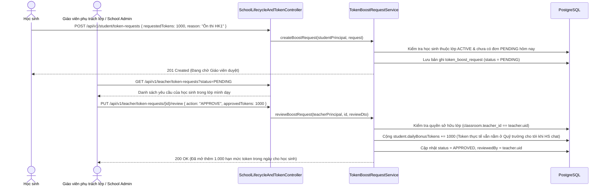
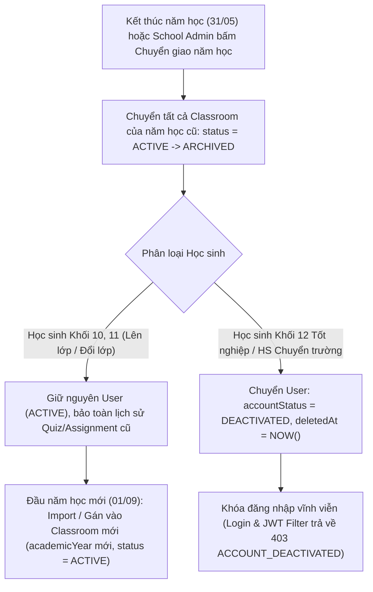

# 🔄 BUSINESS FLOW: SCHOOL SUBSCRIPTION, DAILY TOKEN POOL & ACADEMIC YEAR LIFECYCLE
> **Sprint:** Sprint 7 (18/10/2026 – 30/10/2026)  
> **Phân hệ:** Quản trị Gói B2B Trường học (01/09 – 31/05), Quỹ Token Chung theo Ngày (Daily Allowance) & Vòng đời Học sinh  
> **Stories Covered:** `US-SP7-14`, `US-SP7-15`, `US-SP7-16`, `US-SP7-17`, `US-SP7-18`  
> **Tác giả:** 🔵 Trần Quốc Dinh (`DinhTQ`)  

---

## 1. TỔNG QUAN KIẾN TRÚC NGHIỆP VỤ

Hệ thống chuyển đổi từ mô hình *"Cấp phát tĩnh 1 lần vô thời hạn"* sang mô hình **"Hợp đồng Năm học 9 tháng (01/09 – 31/05) + Quỹ Token Chung (Shared Pool) + Hạn mức Ngày (Daily Allowance) + Quản lý Vòng đời Học sinh (Academic Rollover & Account Deactivation)"**.

### 5 Nguyên tắc Vàng (Core Business Invariants)
1. **Chu kỳ gói trường học (`01/09` – `31/05`):**
   * Gói B2B trường học chỉ hoạt động từ **đầu tháng 9 (`01/09`)** đến **cuối tháng 5 (`31/05`)**.
   * Trường phải **gia hạn trong tháng 5 (`01/05` – `31/05`)**, và gói mới chỉ bắt đầu có hiệu lực sử dụng từ **`01/09`** đầu năm học tiếp theo.
2. **Phân tách cơ chế Khóa (Two-Level Locking):**
   * **Hết hạn gói (`EXPIRED` / Chưa gia hạn):** **Khóa toàn bộ nền tảng của trường** (chặn mọi tính năng của Giáo viên, Học sinh, School Admin, chỉ mở trang thông tin gia hạn).
   * **Còn hạn gói nhưng Hết Token (`Out of Tokens`):** **Chỉ khóa tính năng AI** (Chat nhân vật lịch sử), toàn bộ các tính năng khác (làm Quiz, đọc tài liệu, giao/nộp bài tập, xem Dashboard) vẫn hoạt động bình thường.
3. **100% Quỹ chung + Hạn mức Chi tiêu theo Ngày (Pure Shared Pool + Daily Spending Limit):**
   * Toàn bộ token của trường nằm cố định tại Quỹ chung (`school.unallocatedTokenQuota`). **Không chia trước token vào tài khoản học sinh đầu ngày và không cần thu hồi cuối ngày.**
   * Mỗi học sinh có bộ đếm lượng đã dùng trong ngày (`dailyTokensUsed`) và hạn mức được tiêu tối đa trong ngày (`dailyTokenLimit`, mặc định `1.000 token/ngày`). Học sinh chat câu nào thì hệ thống trừ trực tiếp vào `school.unallocatedTokenQuota` và tăng `dailyTokensUsed` câu đó $\rightarrow$ **Triệt tiêu 100% "token chết" (stranded tokens)** và **chống xài lố cả năm**.
4. **Luồng Xin & Duyệt thêm Hạn mức trong ngày (Daily Boost):**
   * Học sinh chạm trần hạn mức ngày có thể bấm **"Xin thêm token"** $\rightarrow$ Giáo viên dạy lớp đó (hoặc School Admin) duyệt tăng thêm hạn mức trong ngày (`dailyBonusTokens`), học sinh dùng tới đâu mới trừ từ Quỹ trường tới đó.
5. **Vòng đời qua các năm học (Academic Year Lifecycle):**
   * **Lên lớp / Đổi lớp:** Kết thúc năm học, lớp cũ chuyển sang `ARCHIVED`. Đầu năm học mới, học sinh được xếp vào lớp mới (`academicYear` mới) trên cùng tài khoản cũ.
   * **Ra trường / Chuyển trường:** Tài khoản học sinh bị chuyển sang **`DEACTIVATED` (Vô hiệu hóa — khóa đăng nhập hoàn toàn)**.

---

## 2. SƠ ĐỒ VÒNG ĐỜI GÓI TRƯỜNG HỌC & CƠ CHẾ KHÓA (US-SP7-14)

### 2.1. State Diagram: Trạng thái Gói Trường học theo Năm học

### 2.2. Flowchart: Kiểm tra Quyền Truy cập Nền tảng vs Quyền Gọi AI

---

## 3. LUỒNG 100% QUỸ CHUNG & HẠN MỨC CHI TIÊU THEO NGÀY (US-SP7-15 & US-SP7-16)

### 3.1. Cơ chế Direct Pool Deduction & Bộ đếm Hạn mức Ngày (Không chia trước, Không cần thu hồi)
Thay vì chia token vào tài khoản học sinh đầu ngày rồi cuối ngày phải thu hồi, hệ thống áp dụng mô hình **100% Quỹ chung (Pure Shared Pool) kết hợp Bộ đếm Hạn mức Ngày (`dailyTokensUsed`)**:

1. **Khi học sinh gửi tin nhắn AI đầu tiên trong ngày mới $D$ (`lastTokenResetAt < D.atStartOfDay()`):**
   * Hệ thống chỉ đặt lại bộ đếm trong ngày của học sinh: `user.dailyTokensUsed = 0`, `user.dailyBonusTokens = 0`, `user.lastTokenResetAt = LocalDateTime.now()`.
   * **Không rút trước bất kỳ token nào từ `school.unallocatedTokenQuota`**.
2. **Kiểm tra điều kiện trước khi gọi AI:**
   * Xác định hạn mức tối đa học sinh được phép tiêu hôm nay:
     $$\text{effectiveDailyLimit} = \text{COALESCE}(\text{classroom.dailyTokenQuota}, \text{school.defaultDailyStudentQuota}, 1000) + \text{user.dailyBonusTokens}$$
   * Số lượng còn được phép tiêu hôm nay:
     $$\text{availableToday} = \min(\max(0, \text{effectiveDailyLimit} - \text{user.dailyTokensUsed}), \text{school.unallocatedTokenQuota})$$
   * Nếu $\text{availableToday} \le 0$: Chặn cuộc gọi AI với mã `403 AI_QUOTA_EXCEEDED` (các tính năng Quiz/Tài liệu/Bài tập vẫn mở bình thường).
3. **Sau khi AI phản hồi (`tokensUsed`):**
   * Trừ trực tiếp `tokensUsed` vào Quỹ chung của trường: `school.unallocatedTokenQuota -= tokensUsed`.
   * Tăng bộ đếm đã dùng trong ngày của học sinh: `user.dailyTokensUsed += tokensUsed`.

### 3.2. Sequence Diagram: Học sinh Chat AI Trừ Trực tiếp vào Quỹ Chung

---

## 4. LUỒNG XIN & DUYỆT THÊM HẠN MỨC TOKEN TRONG NGÀY (US-SP7-17)

---

## 5. LUỒNG VÒNG ĐỜI QUA CÁC NĂM HỌC: LÊN LỚP, ĐỔI LỚP, RA TRƯỜNG / CHUYỂN TRƯỜNG (US-SP7-18)

### 5.1. Flowchart: Xử lý Cuối Năm học (31/05) & Đầu Năm học mới (01/09)

### 5.2. Quy tắc Ràng buộc Lớp học theo Năm học (`ClassStudent` Constraints)
1. **Một học sinh có nhiều lớp qua các năm, nhưng chỉ 1 lớp `ACTIVE` tại một thời điểm:**
   * Năm học `2025`: Học sinh `HS001` thuộc lớp `10A1` (`academicYear = 2025`, `status = ARCHIVED`).
   * Năm học `2026`: Học sinh `HS001` thuộc lớp `11A2` (`academicYear = 2026`, `status = ACTIVE`).
   * Khi kiểm tra điều kiện *"Học sinh đã có lớp chưa"* lúc gán lớp hoặc import: Hệ thống chỉ kiểm tra các lớp có `classroom.status == 'ACTIVE'`, cho phép học sinh đã có lớp `ARCHIVED` của năm trước được vào lớp `ACTIVE` của năm mới bình thường.
2. **Khi Học sinh Ra trường hoặc Chuyển trường (`DEACTIVATED`):**
   * Toàn bộ token chưa dùng vốn đã nằm sẵn trong `school.unallocatedTokenQuota` nên không bao giờ bị thất thoát.
   * Đánh dấu `user.accountStatus = DEACTIVATED` (và gán `deletedAt = LocalDateTime.now()`).
   * Tại `AuthServiceImpl.login()` và `JwtAuthenticationFilter`: Nếu phát hiện `user.accountStatus == DEACTIVATED` hoặc `user.deletedAt != null`, từ chối ngay lập tức với lỗi `403 Forbidden ("Tài khoản học sinh đã ngừng hoạt động do đã tốt nghiệp hoặc chuyển trường")`.
