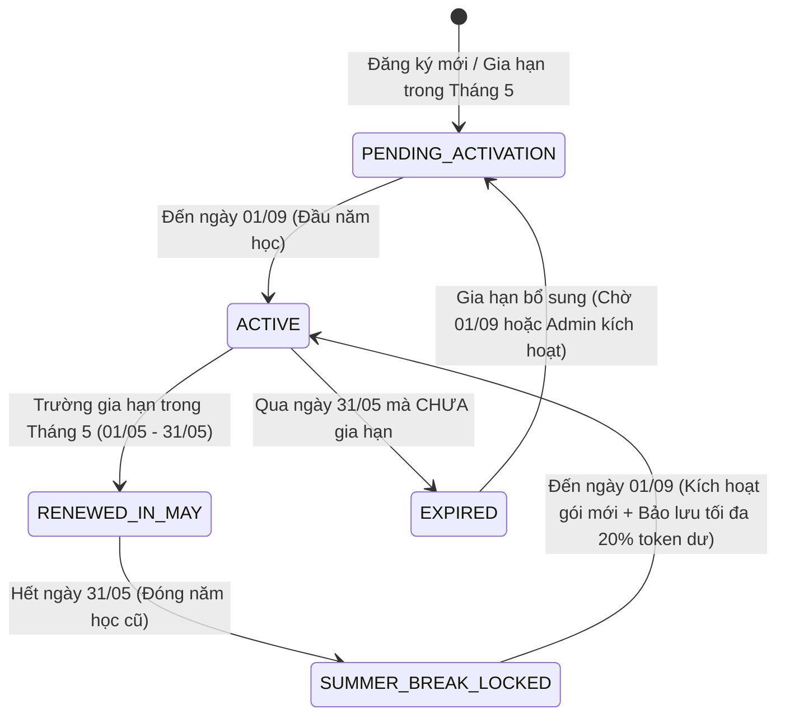
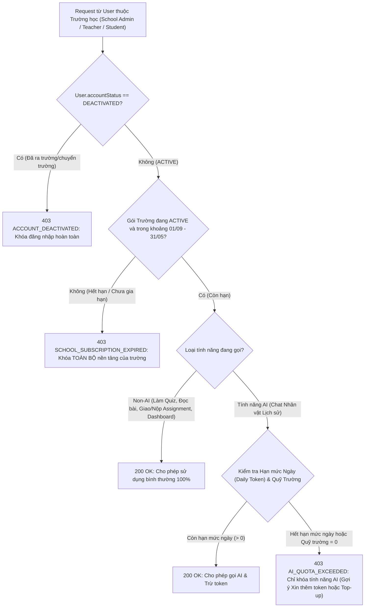
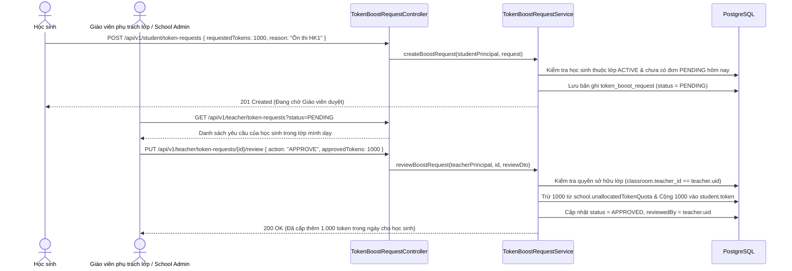
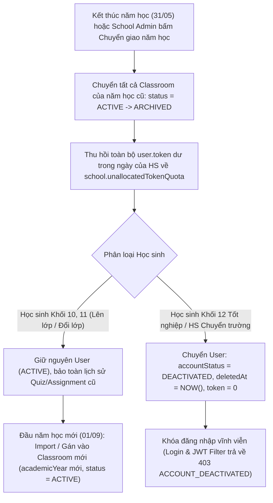

# 🔄 BUSINESS FLOW: SCHOOL SUBSCRIPTION, DAILY TOKEN POOL & ACADEMIC YEAR LIFECYCLE
> **Sprint:** Sprint 7 (18/10/2026 – 30/10/2026)  
> **Phân hệ:** Quản trị Gói B2B Trường học (01/09 – 31/05), Quỹ Token Chung theo Ngày (Daily Allowance) & Vòng đời Học sinh  
> **Stories Covered:** `US-SP7-14`, `US-SP7-15`, `US-SP7-16`, `US-SP7-17`, `US-SP7-18`  
> **Tác giả:** 🔵 Trần Quốc Dinh (`DinhTQ`)  

---

## 1. TỔNG QUAN KIẾN TRÚC NGHIỆP VỤ

Hệ thống chuyển đổi từ mô hình *"Cấp phát tĩnh 1 lần vô thời hạn"* sang mô hình **"Hợp đồng Năm học 9 tháng (01/09 – 31/05) + Quỹ Token Chung (Shared Pool) + Hạn mức Ngày (Daily Allowance) + Quản lý Vòng đời Học sinh (Academic Rollover & Account Deactivation)"**.

### 5 Nguyên tắc Vàng (Core Business Invariants)
1. **Chu kỳ gói trường học (`01/09` – `31/05`):**
   * Gói B2B trường học chỉ hoạt động từ **đầu tháng 9 (`01/09`)** đến **cuối tháng 5 (`31/05`)**.
   * Trường phải **gia hạn trong tháng 5 (`01/05` – `31/05`)**, và gói mới chỉ bắt đầu có hiệu lực sử dụng từ **`01/09`** đầu năm học tiếp theo.
2. **Phân tách cơ chế Khóa (Two-Level Locking):**
   * **Hết hạn gói (`EXPIRED` / Chưa gia hạn):** **Khóa toàn bộ nền tảng của trường** (chặn mọi tính năng của Giáo viên, Học sinh, School Admin, chỉ mở trang thông tin gia hạn).
   * **Còn hạn gói nhưng Hết Token (`Out of Tokens`):** **Chỉ khóa tính năng AI** (Chat nhân vật lịch sử), toàn bộ các tính năng khác (làm Quiz, đọc tài liệu, giao/nộp bài tập, xem Dashboard) vẫn hoạt động bình thường.
3. **Quỹ chung + Hạn mức theo Ngày (Shared Pool + Daily Limit):**
   * Toàn bộ token nằm tại Quỹ chung của trường (`school.unallocatedTokenQuota`).
   * Mỗi ngày học sinh chỉ được rút tối đa định mức ngày (`dailyTokenLimit`, mặc định `1.000 token/ngày`). Cuối ngày nếu học sinh dùng không hết, phần dư tự động thu hồi về Quỹ chung khi sang ngày mới $\rightarrow$ **Triệt tiêu 100% "token chết" (stranded tokens)** và **chống xài lố cả năm**.
4. **Luồng Xin & Duyệt thêm Token trong ngày (Daily Boost):**
   * Học sinh chạm trần hạn mức ngày có thể bấm **"Xin thêm token"** $\rightarrow$ Giáo viên dạy lớp đó (hoặc School Admin) duyệt cấp thêm ngay trong ngày trích từ Quỹ trường.
5. **Vòng đời qua các năm học (Academic Year Lifecycle):**
   * **Lên lớp / Đổi lớp:** Kết thúc năm học, lớp cũ chuyển sang `ARCHIVED`. Đầu năm học mới, học sinh được xếp vào lớp mới (`academicYear` mới) trên cùng tài khoản cũ.
   * **Ra trường / Chuyển trường:** Tài khoản học sinh bị chuyển sang **`DEACTIVATED` (Vô hiệu hóa — khóa đăng nhập hoàn toàn)** và thu hồi toàn bộ hạn mức dư về Quỹ trường.

---

## 2. SƠ ĐỒ VÒNG ĐỜI GÓI TRƯỜNG HỌC & CƠ CHẾ KHÓA (US-SP7-14)

### 2.1. State Diagram: Trạng thái Gói Trường học theo Năm học



### 2.2. Flowchart: Kiểm tra Quyền Truy cập Nền tảng vs Quyền Gọi AI



---

## 3. LUỒNG QUỸ CHUNG & HẠN MỨC TOKEN THEO NGÀY (US-SP7-15 & US-SP7-16)

### 3.1. Cơ chế Lazy Daily Token Reset & Refund (Không cần chạy Cronjob nặng)
Thay vì cấp phát cứng cho toàn bộ học sinh (kể cả những em không đăng nhập trong ngày gây giam token), hệ thống sử dụng thuật toán **Lazy Daily Allowance kết hợp Refund**:

1. **Khi học sinh gửi tin nhắn AI đầu tiên trong ngày $D$ (`lastTokenResetAt < D.atStartOfDay()`):**
   * **Bước 1 (Thu hồi dư ngày cũ):** Nếu `user.token > 0` (còn dư từ ngày hôm trước), cộng trả `user.token` về lại `school.unallocatedTokenQuota` và đặt `user.token = 0`.
   * **Bước 2 (Xác định hạn mức ngày $D$):**
     $$\text{limit} = \text{ COALESCE}(\text{classroom.dailyTokenQuota}, \text{school.defaultDailyStudentQuota}, 1000)$$
   * **Bước 3 (Rút hạn mức ngày từ Quỹ chung):**
     $$\text{allocated} = \min(\text{limit}, \text{school.unallocatedTokenQuota})$$
     * Nếu $\text{allocated} == 0$: Báo lỗi `403 AI_QUOTA_EXCEEDED` (Trường đã hết sạch Quỹ token chung, cần Top-up).
     * Nếu $\text{allocated} > 0$: Trừ `allocated` khỏi `school.unallocatedTokenQuota`, gán `user.token = allocated`, cập nhật `user.lastTokenResetAt = LocalDateTime.now()`.
2. **Trong cùng ngày $D$ (`lastTokenResetAt >= D.atStartOfDay()`):**
   * Khấu trừ trực tiếp vào `user.token` theo lượng token thực tế của cuộc hội thoại AI.
   * Nếu `user.token <= 0`: Chặn cuộc gọi AI tiếp theo và hiển thị nút **"Xin thêm Token hôm nay"**.

### 3.2. Sequence Diagram: Học sinh Chat AI với Hạn mức Ngày

```mermaid
sequenceDiagram
    actor Student as Học sinh (ROLE_STUDENT)
    participant ChatCtrl as ChatController
    participantGuard as DailyTokenAllowanceService
    participant DB as PostgreSQL (School & User)
    participant AI as HistoryTalk AI Service

    Student->>ChatCtrl: POST /api/v1/chat/messages
    ChatCtrl->>participantGuard: verifyAndPrepareDailyAllowance(studentUid)
    participantGuard->>DB: SELECT user, school FOR UPDATE
    alt Gói trường hết hạn (ngoài 01/09 - 31/05 hoặc EXPIRED)
        participantGuard-->>ChatCtrl: Throw 403 SCHOOL_SUBSCRIPTION_EXPIRED
        ChatCtrl-->>Student: 403 Khóa toàn bộ nền tảng trường
    else Còn hạn gói & Sang ngày mới (lastTokenResetAt < Today 00:00)
        participantGuard->>DB: Hoàn trả user.token dư (ngày cũ) -> school.unallocatedTokenQuota
        participantGuard->>DB: Rút min(dailyLimit, unallocatedTokenQuota) -> user.token
        participantGuard->>DB: Cập nhật lastTokenResetAt = NOW()
    end

    alt user.token <= 0 (Hết hạn mức ngày hoặc Quỹ trường = 0)
        participantGuard-->>ChatCtrl: Throw 403 AI_QUOTA_EXCEEDED
        ChatCtrl-->>Student: 403 Chỉ khóa tính năng AI (Các tính năng Quiz/Bài tập vẫn mở)
    else user.token > 0
        participantGuard-->>ChatCtrl: OK (Available Daily Tokens)
        ChatCtrl->>AI: Gửi prompt tới AI Backend
        AI-->>ChatCtrl: Trả lời + tokensUsed
        ChatCtrl->>DB: Trừ user.token = max(0, user.token - tokensUsed)
        ChatCtrl-->>Student: 200 OK (Nội dung trả lời AI)
    end
```

---

## 4. LUỒNG XIN & DUYỆT THÊM TOKEN TRONG NGÀY (US-SP7-17)



---

## 5. LUỒNG VÒNG ĐỜI QUA CÁC NĂM HỌC: LÊN LỚP, ĐỔI LỚP, RA TRƯỜNG / CHUYỂN TRƯỜNG (US-SP7-18)

### 5.1. Flowchart: Xử lý Cuối Năm học (31/05) & Đầu Năm học mới (01/09)



### 5.2. Quy tắc Ràng buộc Lớp học theo Năm học (`ClassStudent` Constraints)
1. **Một học sinh có nhiều lớp qua các năm, nhưng chỉ 1 lớp `ACTIVE` tại một thời điểm:**
   * Năm học `2025`: Học sinh `HS001` thuộc lớp `10A1` (`academicYear = 2025`, `status = ARCHIVED`).
   * Năm học `2026`: Học sinh `HS001` thuộc lớp `11A2` (`academicYear = 2026`, `status = ACTIVE`).
   * Khi kiểm tra điều kiện *"Học sinh đã có lớp chưa"* lúc gán lớp hoặc import: Hệ thống chỉ kiểm tra các lớp có `classroom.status == 'ACTIVE'`, cho phép học sinh đã có lớp `ARCHIVED` của năm trước được vào lớp `ACTIVE` của năm mới bình thường.
2. **Khi Học sinh Ra trường hoặc Chuyển trường (`DEACTIVATED`):**
   * Thu hồi ngay `user.token` còn lại trong ngày trả về `school.unallocatedTokenQuota`.
   * Đánh dấu `user.accountStatus = DEACTIVATED` (và gán `deletedAt = LocalDateTime.now()`).
   * Tại `AuthServiceImpl.login()` và `JwtAuthenticationFilter`: Nếu phát hiện `user.accountStatus == DEACTIVATED` hoặc `user.deletedAt != null`, từ chối ngay lập tức với lỗi `403 Forbidden ("Tài khoản học sinh đã ngừng hoạt động do đã tốt nghiệp hoặc chuyển trường")`.
