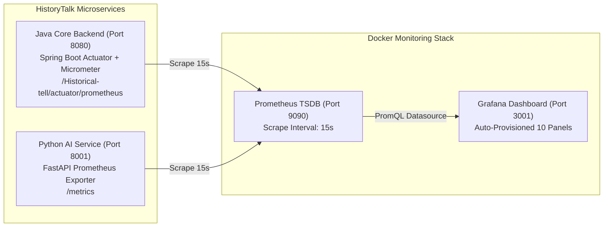

# 📋 IMPLEMENTATION PLAN: FULL-SYSTEM OBSERVABILITY WITH PROMETHEUS & GRAFANA (SPRINT 7)
> **Sprint:** Sprint 7 (16/10/2026 – 30/10/2026)  
> **Target Module:** Infrastructure & Observability (`monitoring/`, `history-talk-backend-Java`, `history-talk-backend-AI`)  
> **Lập trình viên phụ trách:** 🔵 Trần Quốc Dinh (`DinhTQ`)  
> **Trạng thái:** Đã hoàn thành triển khai & kiểm thử (Implemented & Verified)  

---

## 🎯 1. BỐI CẢNH & CÁC VẤN ĐỀ CẦN GIẢI QUYẾT

Lần cấu hình Prometheus & Grafana trước đó được thực hiện tại commit `145dfd3` (Sprint đầu). Qua quá trình phát triển từ Sprint 3 đến Sprint 7, hệ thống phát sinh 5 điểm đứt gãy/thiếu hụt cần khắc phục để đảm bảo **giám sát toàn bộ hệ thống (Full-System Observability)**:

1. **Issue 1 (Mất cấu hình Actuator/Prometheus trong `application.properties`):**
   * **Nguyên nhân:** Khi giải quyết merge conflict tích hợp OAuth2 (commit `9beba4af`), 11 dòng cấu hình `management.endpoints.web.exposure.include=health,prometheus` đã bị ghi đè mất. Mặc định Spring Boot đóng `/actuator/prometheus` (trả về 404).
   * **Giải pháp:** Khôi phục và bổ sung đầy đủ cấu hình Actuator, Prometheus Histogram Buckets (phục vụ đo `histogram_quantile(0.95, ...)`), và dải IP nội bộ Docker trong `application.properties` và `application.properties.example`.

2. **Issue 2 (Lệch Servlet Path `/Historical-tell` và Chặn IP Docker Bridge trong `SecurityConfig.java`):**
   * **Nguyên nhân:** `spring.mvc.servlet.path=/Historical-tell` khiến đường dẫn thực tế có thể đi qua `/Historical-tell/actuator/prometheus`, đồng thời Prometheus chạy trong Docker container mang IP thuộc dải `172.16.0.0/12` – `172.18.0.0/16` bị chặn bởi whitelist mặc định (`127.0.0.1`).
   * **Giải pháp:** Mở rộng `securityMatcher` trong `SecurityConfig.java` hỗ trợ cả `/actuator/**` và `/Historical-tell/actuator/**`, đồng thời bổ sung dải mạng nội bộ Docker (`172.16.0.0/12`, `10.0.0.0/8`, `192.168.0.0/16`) vào `monitoring.allowed-ips`.

3. **Issue 3 (Lệch đường dẫn Volume trong `monitoring/docker-compose.monitoring.yml`):**
   * **Nguyên nhân:** File `docker-compose.monitoring.yml` được di chuyển từ thư mục gốc vào thư mục `monitoring/`, nhưng đường dẫn mount volume vẫn để `./monitoring/prometheus/...` thay vì `./prometheus/...`.
   * **Giải pháp:** Chuẩn hóa đường dẫn volume tương đối `./prometheus/prometheus.yml`, `./grafana/provisioning`, và `./grafana/dashboards` để lệnh `docker compose -f docker-compose.monitoring.yml up -d` chạy trực tiếp từ thư mục `monitoring/`.

4. **Issue 4 (Luồng Chat Streaming SSE & RAG Document Processing chưa ghi nhận vào `AiMetricsService`):**
   * **Nguyên nhân:** Các tính năng phát triển sau (`streamChat` trong `MessageServiceImpl` / `AiServiceClient` và `processDocumentAsync` / `deleteDocumentAsync`) chưa gọi `aiMetricsService.recordRequest()` và `aiMetricsService.recordTokens()`.
   * **Giải pháp:**
     * Ghi nhận `aiMetricsService.recordRequest("chat_stream", "success" | "failure")` và `recordTokens(...)` ngay khi luồng SSE Streaming hoàn tất hoặc gặp lỗi.
     * Ghi nhận `aiMetricsService.recordRequest("process_document", ...)` và `delete_document` khi đồng bộ tài liệu PDF/OCR sang Vector DB.

5. **Issue 5 (Python AI Service chưa mở `/metrics` và Grafana Dashboard thiếu biểu đồ tài nguyên hệ thống):**
   * **Nguyên nhân:** Job `historytalk-ai-backend` trong `prometheus.yml` đang bị comment; Dashboard Grafana mới chỉ có 4 panel cơ bản.
   * **Giải pháp:**
     * Bổ sung middleware thu thập Prometheus metrics (`ai_http_requests_total`, `ai_http_request_duration_seconds`, `ai_up`) và mở endpoint `GET /metrics` trên Python AI Service (`history-talk-backend-AI`).
     * Kích hoạt job `historytalk-ai-backend` trong `monitoring/prometheus/prometheus.yml`.
     * Nâng cấp toàn diện Grafana Dashboard (`historytalk-java-backend.json`) lên **10 Panels** bao phủ cả Java Backend, Database HikariCP Pool, JVM/CPU, AI Token Consumption và Python AI Service.

---

## 🏗️ 2. KIẾN TRÚC GIÁM SÁT TOÀN HỆ THỐNG (END-TO-END ARCHITECTURE)



---

## 📊 3. DANH SÁCH 10 PANELS TRÊN GRAFANA DASHBOARD

| STT | Tên Biểu đồ (Panel Title) | PromQL Query chính | Ý nghĩa Giám sát |
| :-: | :--- | :--- | :--- |
| 1 | **Java Backend - HTTP Request Rate (RPS)** | `sum(rate(http_server_requests_seconds_count{application="history-talk-backend"}[5m]))` | Lưu lượng truy cập toàn hệ thống theo giây |
| 2 | **Java Backend - HTTP P95 Latency** | `histogram_quantile(0.95, sum(rate(http_server_requests_seconds_bucket{application="history-talk-backend"}[5m])) by (le))` | Kiểm chứng cam kết NFR độ trễ API $< 300\text{ms}$ |
| 3 | **HTTP Error Rate (4xx & 5xx)** | `sum(rate(http_server_requests_seconds_count{application="history-talk-backend", status=~"4..\|5.."}[5m])) by (status, uri)` | Phát hiện tức thời các API bị lỗi 4xx/5xx |
| 4 | **System & Process CPU Usage** | `system_cpu_usage{application="history-talk-backend"}`, `process_cpu_usage{application="history-talk-backend"}` | Theo dõi tải CPU của máy chủ và tiến trình Java |
| 5 | **JVM Memory Used (Heap vs Non-Heap)** | `sum(jvm_memory_used_bytes{application="history-talk-backend"}) by (area)` | Giám sát bộ nhớ RAM JVM và phát hiện Memory Leak |
| 6 | **Database Connection Pool (HikariCP)** | `hikaricp_connections_active`, `hikaricp_connections_idle`, `hikaricp_connections_pending` | Giám sát nghẽn kết nối tới PostgreSQL / Supabase |
| 7 | **AI Operations Rate (Chat, Stream, Title, RAG Doc)** | `sum(increase(historytalk_ai_requests_total[5m])) by (operation, status)` | Số lượt gọi AI phân theo loại tác vụ và trạng thái |
| 8 | **AI LLM Token Consumption (5m)** | `sum(increase(historytalk_ai_tokens_total[5m])) by (model, type)` | Lượng Prompt / Completion / Total Token tiêu thụ |
| 9 | **Python AI Service - Request Rate by Endpoint** | `sum(rate(ai_http_requests_total[5m])) by (path, status)` | Lưu lượng xử lý trực tiếp tại FastAPI AI Service |
| 10 | **Python AI Service - P95 Processing Latency** | `histogram_quantile(0.95, sum(rate(ai_http_request_duration_seconds_bucket[5m])) by (le, path))` | Thời gian phản hồi của mô hình LLM & RAG Vector Search |

---

## 🛠️ 4. CHI TIẾT CÁC FILE THAY ĐỔI

1. **Java Backend (`history-talk-backend-Java`):**
   * `src/main/resources/application.properties` & `application.properties.example`: Khôi phục cấu hình Actuator, bật `percentile-histogram` cho `http.server.requests` và cấu hình `monitoring.allowed-ips`.
   * `src/main/java/com/historytalk/config/SecurityConfig.java`: Mở rộng `actuatorFilterChain` hỗ trợ cả `/actuator/**` và `/Historical-tell/actuator/**`, bổ sung dải IP Docker vào whitelist mặc định.
   * `src/main/java/com/historytalk/service/chat/AiServiceClient.java`: Ghi nhận metrics cho `streamChat`, `processDocumentAsync`, `deleteDocumentAsync`, và thêm helper `recordStreamTokens(int promptTokens, int completionTokens)`.
   * `src/main/java/com/historytalk/service/chat/MessageServiceImpl.java`: Gọi `aiServiceClient.recordStreamTokens(...)` khi nhận xong metadata token từ luồng SSE streaming.

2. **Python AI Backend (`history-talk-backend-AI`):**
   * `src/history_talk_ai/common/metrics.py`: Middleware thu thập số lượng request và histogram thời gian xử lý trên từng endpoint của FastAPI, xuất định dạng chuẩn Prometheus tại `GET /metrics`.
   * `src/history_talk_ai/main.py`: Gắn `PrometheusMetricsMiddleware` và route `/metrics`.

3. **Monitoring Infrastructure (`monitoring/`):**
   * `monitoring/docker-compose.monitoring.yml`: Sửa đường dẫn volume mount tương đối chuẩn xác.
   * `monitoring/prometheus/prometheus.yml`: Mở scrape job `historytalk-ai-backend` (port `8001`).
   * `monitoring/grafana/dashboards/historytalk-java-backend.json`: Cập nhật Dashboard 10 panels giám sát toàn hệ thống.

---

## ✅ 5. HƯỚNG DẪN CHẠY & KIỂM TRA (VERIFICATION)

```bash
# 1. Khởi chạy Prometheus & Grafana từ thư mục monitoring
cd Source-code/SWD392_FinalProject_HistoryTalk/monitoring
docker compose -f docker-compose.monitoring.yml up -d

# 2. Kiểm tra endpoint Prometheus của Java Backend
curl http://localhost:8080/Historical-tell/actuator/prometheus

# 3. Kiểm tra endpoint Prometheus của Python AI Service
curl http://localhost:8001/metrics

# 4. Truy cập giao diện
# - Prometheus Targets: http://localhost:9090/targets
# - Grafana Dashboard:  http://localhost:3001 (admin / admin)
```
