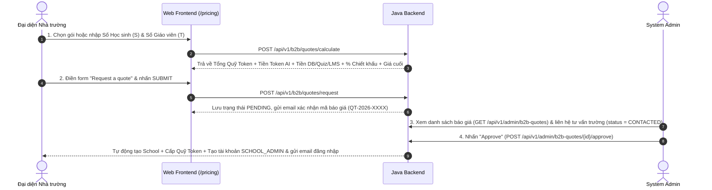

# 🏫 BẢNG GIÁ SUBSCRIPTION (B2C & B2B), CÔNG THỨC CUSTOMIZE B2B PLAN & LUỒNG ĐĂNG KÝ BÁO GIÁ (`REQUEST A QUOTE`)

> **Dự án:** HistoryTalk | **Sprint:** Sprint 9 | **Tham chiếu giao diện:** Humy.ai  
> **Thông số chuẩn đã chốt toàn hệ thống:**  
> - **Đơn giá 1 Token (Cả B2C & B2B):** **`0,15 đ / token`**  
> - **Phí DB, Lưu lịch sử, Mở khoá Quiz & Exam Mode (Cả Plus, Pro B2C & Học sinh B2B):** **`7.000 đ`**  
> - **Học sinh B2B (`STUDENT`):** `5.000 tokens/ngày` $\times$ `4 ngày/tuần` = `20.000 tokens/tuần` $\xrightarrow{\times 35\text{ tuần}}$ **`700.000 tokens / năm học`**  
> - **Giáo viên B2B (`TEACHER`):** `5.000 tokens/ngày` $\times$ `6 ngày/tuần` = `30.000 tokens/tuần` $\xrightarrow{\times 35\text{ tuần}}$ **`1.050.000 tokens / năm học`**

---

## 1. Cơ sở Định giá & Công thức Tính toán (Từ Gốc lên Ngọn)

### 1.1. Định mức Sử dụng Token & Chi phí trên 1 Học sinh và 1 Giáo viên B2B (1 Năm học = 35 tuần)

| Đối tượng | Hạn mức / Ngày | Số ngày dùng / Tuần | Token / Tuần | Tổng Token / Năm học (35 tuần) | **(1) Tiền Token AI (`× 0,15 đ`)** | **(2) Phí DB, Lưu trữ S3, Vector, Quiz, LMS** | **Tổng Chi phí Gốc / Năm (`1 + 2`)** |
| :--- | :---: | :---: | :---: | :---: | ---: | :--- | ---: |
| **1 Học sinh (`STUDENT`)** | **`5.000 tokens`** | `4 ngày / tuần` | `20.000 tokens` | **`700.000 tokens / năm`** | **`105.000 đ`** | **`7.000 đ`** *(DB, lịch sử chat, Quiz, Exam Mode, BXH)* | **`112.000 đ / HS / năm`** |
| **1 Giáo viên (`TEACHER`)** | **`5.000 tokens`** | `6 ngày / tuần` | `30.000 tokens` | **`1.050.000 tokens / năm`** | **`157.500 đ`** | **`42.500 đ`** *(LMS, tạo đề Quiz, tải PDF/Video S3 & Vector)* | **`200.000 đ / GV / năm`** |

---

### 1.2. Công thức Tính giá B2B Tổng quát (Áp dụng cho cả Gói Cố định & Gói Customize B2B)

Khi nhà trường có **$S$ Học sinh** và **$T$ Giáo viên**:

1. **Bước 1 — Tính Tổng Quỹ Token Chung của Trường (`Total Token Pool`):**
   $$\text{Tổng Quỹ Token} = (S \times 700.000) + (T \times 1.050.000)$$
2. **Bước 2 — Tính Tổng Tiền Token AI (`× 0,15 đ/token`):**
   $$\text{Tiền Token AI} = \text{Tổng Quỹ Token} \times 0,15\text{ đ} = (S \times 105.000\text{ đ}) + (T \times 157.500\text{ đ})$$
3. **Bước 3 — Cộng Tiền Database, Lưu trữ (S3 PDF/Video, Vector DB), Quiz & LMS:**
   $$\text{Tiền DB, Lưu trữ, Quiz, LMS} = (S \times 7.000\text{ đ}) + (T \times 42.500\text{ đ})$$
4. **Bước 4 — Tính Tổng Giá Chưa Chiết Khấu (`Subtotal`):**
   $$\text{Giá Chưa Chiết Khấu} = \text{Tiền Token AI} + \text{Tiền DB/Quiz/LMS} = (S \times 112.000\text{ đ}) + (T \times 200.000\text{ đ})$$
5. **Bước 5 — Áp dụng Bậc thang Chiết khấu theo Quy mô Học sinh & Tính Giá Cuối Cùng (`Final Price`):**
   * Dưới 600 Học sinh ($S < 600$): **`0%`**
   * Từ 600 đến 1.199 Học sinh ($600 \le S < 1.200$ — chuẩn gói `Small`): **`10%`**
   * Từ 1.200 đến 1.799 Học sinh ($1.200 \le S < 1.800$ — chuẩn gói `Medium`): **`20%`**
   * Từ 1.800 Học sinh trở lên ($S \ge 1.800$ — chuẩn gói `Large`): **`30%`**
   $$\text{Giá Cuối Cùng} = \text{Giá Chưa Chiết Khấu} \times \left(100\% - \% \text{ Chiết khấu}\right)$$

---

## 2. Chi tiết Toàn bộ các Gói Subscription (B2C & B2B)

### 2.1. Bảng giá & Bóc tách Chi phí các Gói B2C (Khách hàng Cá nhân - 1 tháng = 30 ngày)

| Thuộc tính | **Free (Khám Phá)** | **Plus (Nâng Cao)** | **Pro (Chuyên Sâu)** |
| :--- | :---: | :---: | :---: |
| **Hạn mức Token mỗi ngày** | **`1.500 tokens / ngày`** *(~4–5 lượt chat)* | **`5.000 tokens / ngày`** *(~15 lượt chat)* | **`10.000 tokens / ngày`** *(~30 lượt chat)* |
| **Tổng Token / Tháng (30 ngày)** | `45.000 tokens / tháng` | **`150.000 tokens / tháng`** | **`300.000 tokens / tháng`** |
| **(1) Tiền Token AI (`= Tổng Token × 0,15 đ`)** | `0 đ` *(Tài trợ trải nghiệm)* | **`22.500 đ`** *(150.000 × 0,15 đ)* | **`45.000 đ`** *(300.000 × 0,15 đ)* |
| **(2) Phí DB, Lưu lịch sử, Quiz & Exam Mode** | `0 đ` | **`7.000 đ / tháng`** | **`7.000 đ / tháng`** |
| **GIÁ GÓI THEO THÁNG (`1 + 2`)** | **`0 đ`** | **`29.500 đ / tháng`** | **`52.000 đ / tháng`** |
| **Giá Gốc 12 Tháng (Chưa giảm)** | `0 đ` | `354.000 đ` *(29.500 × 12)* | `624.000 đ` *(52.000 × 12)* |
| **GIÁ GÓI THEO NĂM (Giảm 15%)** | **`0 đ`** | **`300.900 đ / năm`** | **`530.400 đ / năm`** |
| **Chế độ Vấn đáp (`Exam Mode`)** | **Giới hạn 2 tin nhắn mỗi session** | **Không giới hạn** | **Không giới hạn** |
| **Làm bài Quiz & Xem giải thích** | Cơ bản | **Không giới hạn** | **Không giới hạn** |

---

### 2.2. Bảng giá các Gói B2B Trường học & Tổ chức (Năm học 9 tháng: 01/09 – 31/05)

| Hạng mục | 🏫 **Gói Trường Nhỏ / THCS** (`ENTERPRISE_SMALL`) | 🏛️ **Gói Tiêu Chuẩn (Phổ biến)** (`ENTERPRISE_MEDIUM`) | 🎓 **Gói Trường Lớn / Đô thị** (`ENTERPRISE_LARGE`) | ⚙️ **Gói Tuỳ Chỉnh (`CUSTOM`)** *(Ví dụ: 800 HS, 20 GV)* |
| :--- | :---: | :---: | :---: | :---: |
| **Số lượng Học sinh tối đa ($S$)** | **600 Học sinh** *(~15 lớp)* | **1.400 Học sinh** *(~35 lớp)* | **2.000 Học sinh** *(~50 lớp)* | **800 Học sinh** *(Tuỳ chỉnh)* |
| **Số lượng Giáo viên tối đa ($T$)** | **15 Giáo viên** | **35 Giáo viên** | **50 Giáo viên** | **20 Giáo viên** *(Tuỳ chỉnh)* |
| **Hạn mức Token / Ngày** | `HS: 5.000` \| `GV: 5.000` | `HS: 5.000` \| `GV: 5.000` | `HS: 5.000` \| `GV: 5.000` | `HS: 5.000` \| `GV: 5.000` |
| **Tần suất sử dụng / Tuần** | `HS: 4 ngày` \| `GV: 6 ngày` | `HS: 4 ngày` \| `GV: 6 ngày` | `HS: 4 ngày` \| `GV: 6 ngày` | `HS: 4 ngày` \| `GV: 6 ngày` |
| **Token của Học sinh ($S \times 700.000$)** | `420.000.000 tokens` | `980.000.000 tokens` | `1.400.000.000 tokens` | `560.000.000 tokens` |
| **Token của Giáo viên ($T \times 1.050.000$)** | `15.750.000 tokens` | `36.750.000 tokens` | `52.500.000 tokens` | `21.000.000 tokens` |
| **TỔNG QUỸ TOKEN TRƯỜNG** | **`435.750.000 tokens`** | **`1.016.750.000 tokens`** | **`1.452.500.000 tokens`** | **`581.000.000 tokens`** |
| **(1) Tiền Token AI (`= Quỹ Token × 0,15 đ`)** | `65.362.500 đ` | `152.512.500 đ` | `217.875.000 đ` | `87.150.000 đ` |
| **(2) Tiền DB, Lưu trữ, Quiz, LMS** *(7.000 đ/HS + 42.500 đ/GV)* | `4.837.500 đ` | `11.287.500 đ` | `16.125.000 đ` | `6.450.000 đ` |
| **TỔNG CHƯA CHIẾT KHẤU (`1 + 2`)** | **`70.200.000 đ`** | **`163.800.000 đ`** | **`234.000.000 đ`** | **`93.600.000 đ`** |
| **Mức Chiết khấu Giáo dục** | **Giảm 10%** (`-7.020.000 đ`) | **Giảm 20%** (`-32.760.000 đ`) | **Giảm 30%** (`-70.200.000 đ`) | **Giảm 10%** (`-9.360.000 đ`) |
| **GIÁ TRỌN GÓI NĂM HỌC (`FINAL`)** | **`63.180.000 đ / năm học`** | **`131.040.000 đ / năm học`** | **`163.800.000 đ / năm học`** | **`84.240.000 đ / năm học`** |
| **Chi phí bình quân / 1 HS / tháng (9 tháng)** | *~11.700 đ / HS / tháng* | *~10.400 đ / HS / tháng* | *~9.100 đ / HS / tháng* | *~11.700 đ / HS / tháng* |

---

### 2.3. Ma trận Tính năng (Feature Matrix) giữa B2C và B2B

| Nhóm tính năng | `Free` (B2C) | `Plus` / `Pro` (B2C) | `Schools & Organizations` (B2B) |
| :--- | :---: | :---: | :---: |
| **Thư viện Nhân vật & Sự kiện Quốc gia** | Cơ bản | Toàn bộ thư viện | Toàn bộ thư viện + Nhân vật riêng của Trường |
| **Chat nhập vai Lịch sử có trích dẫn (RAG)** | ✅ (1.500/ngày) | ✅ (Plus: 5.000/ngày \| Pro: 10.000/ngày) | ✅ (5.000/ngày cho cả Học sinh & Giáo viên) |
| **Chế độ Thi Vấn Đáp (`Exam Mode`)** | **Giới hạn 2 tin nhắn mỗi session** | ✅ **Không giới hạn** | ✅ **Không giới hạn** + Lưu điểm vào sổ điểm lớp |
| **Kho nội dung "Lịch sử Địa phương" riêng** | ❌ | ❌ | ✅ **Độc quyền B2B** (Tải PDF, Video, Nhân vật địa phương) |
| **Quản lý Khối lớp (`Grade`) & Lớp học (`Classroom`)** | ❌ | ❌ | ✅ Quản lý theo Khối 10, 11, 12 và từng Lớp |
| **Import Học sinh & Giáo viên hàng loạt (CSV/Excel)** | ❌ | ❌ | ✅ Tự động tạo tài khoản & phân lớp |
| **Cổng Quản trị Trường học (`SCHOOL_ADMIN`)** | ❌ | ❌ | ✅ Theo dõi Quỹ Token, cấp lại mật khẩu, báo cáo |
| **Hỗ trợ Triển khai, Tập huấn & Xuất hoá đơn** | ❌ | ❌ | ✅ Có chuyên viên hỗ trợ riêng & Hợp đồng nhà trường |

---

## 3. Luồng Nghiệp vụ Đăng ký & Báo giá B2B (`Request a Quote` - Tham khảo Humy.ai)

### 3.1. Thiết kế Giao diện (UI/UX)

1. **Trang Bảng giá (`/pricing`):**
   - Hiển thị các gói B2C (`Free`, `Plus`, `Pro`) và cột **`Schools & Organizations`** kèm bảng 3 gói B2B cố định (`Small`, `Medium`, `Large`).
   - Tích hợp bộ công cụ **Customize B2B Plan**: Đại diện trường nhập **Số lượng Học sinh ($S$)** và **Số lượng Giáo viên ($T$)** $\rightarrow$ Hệ thống tự động hiển thị ngay **Tổng Quỹ Token, Tiền Token AI (`× 0,15 đ`), Tiền DB/Quiz/LMS, % Chiết khấu và Giá cuối cùng**.
   - Nút CTA chính: **`Nhận báo giá & Đăng ký (Request a quote) ->`**.
2. **Drawer / Split-Screen Modal `Request a quote` (Chia 2 cột giống Humy.ai):**
   - **Cột trái (Form nhập liệu):** Tóm tắt gói & bảng tính giá tạm tính + các trường thông tin người liên hệ và trường học + nút **`SUBMIT`**.
   - **Cột phải (Social Proof):** Thông điệp đồng hành cùng các trường phổ thông Việt Nam, trích dẫn đánh giá từ giáo viên Lịch sử và cam kết hỗ trợ triển khai.

---

### 3.2. Các trường dữ liệu trong Form `Request a Quote`

| Nhóm | Tên trường trên UI | Field API DTO | Bắt buộc | Mô tả / Ví dụ |
| :--- | :--- | :--- | :---: | :--- |
| **1. Người liên hệ** | **Họ (`Last Name`) & Tên (`First Name`)** | `lastName`, `firstName` | ✅ | Họ tên người đại diện nhà trường đăng ký |
| | **Email công vụ (`Your Email`)** | `contactEmail` | ✅ | Nhận báo giá & dùng để cấp tài khoản `SCHOOL_ADMIN` khi duyệt |
| | **Số điện thoại (`Phone Number`)** | `contactPhone` | ✅ | Số điện thoại để bộ phận triển khai liên hệ xác nhận |
| | **Chức vụ (`Job Title`)** | `jobTitle` | ✅ | VD: `Hiệu trưởng`, `Tổ trưởng bộ môn Lịch sử`, `Cán bộ CNTT` |
| **2. Nhà trường** | **Tên Trường / Tổ chức (`School Name`)** | `schoolName` | ✅ | VD: `Trường THPT Chuyên Lê Hồng Phong` |
| | **Địa chỉ trường (`School Address`)** | `schoolAddress` | ❌ | Địa chỉ tỉnh/thành phố của trường |
| **3. Quy mô & Gói** | **Loại gói đăng ký** | `selectedPackage` | ✅ | `ENTERPRISE_SMALL`, `ENTERPRISE_MEDIUM`, `ENTERPRISE_LARGE`, hoặc `ENTERPRISE_CUSTOM` |
| | **Tổng số Học sinh (`Number of Students`)** | `numberOfStudents` | ✅ | Tổng số học sinh của trường (VD: `800`) |
| | **Tổng số Giáo viên (`Total Number of Teachers`)** | `numberOfTeachers` | ✅ | Tổng số giáo viên sử dụng hệ thống (VD: `20`) |
| **4. Ghi chú** | **Lời nhắn (`Message`) & Mã ưu đãi (`Promo Code`)** | `message`, `promoCode` | ❌ | Yêu cầu thêm của trường và mã giảm giá giáo dục (nếu có) |

---

### 3.3. Quy trình Xử lý từ lúc Gửi Form đến khi Khởi tạo Trường học (4 Bước)

